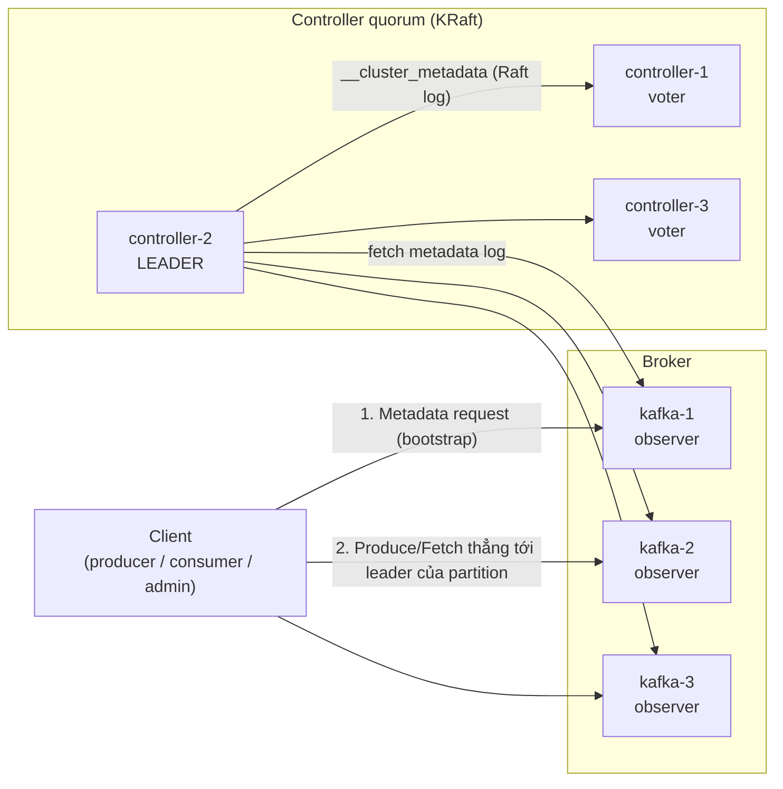
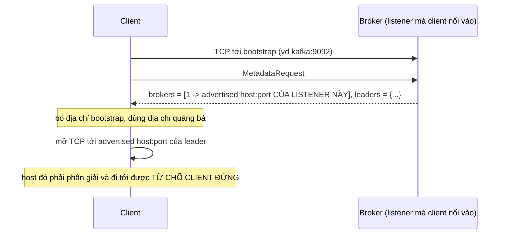

# Bài 01 — Kafka chạy bằng Docker và kết nối: từ `docker compose up` tới client nói chuyện đúng broker

> **Dùng cho:** **Katalon** (họ C — mọi câu "đặt Kafka ở giữa", bài đếm sự kiện [06](06-dem-su-kien-1m-10m-de-va-kien-truc.md)) ·
> **NAB** (event-driven, saga, [nab-prep/04](../../nab-prep/04-kafka-event-driven-saga.md)); ai từng deploy Kafka
> trên Docker/Kubernetes đều sẽ bị hỏi `advertised.listeners`.
>
> **Thời lượng:** đọc 40 phút · lab 20 phút · drill 10 phút
>
> **Lab:** [`docker/kafka-1node.yml`](lab/docker/kafka-1node.yml) · [`docker/cluster.yml`](lab/docker/cluster.yml) ·
> [`scripts/k01-chay-va-ket-noi.sh`](lab/scripts/k01-chay-va-ket-noi.sh) · [`ConnectCheck.java`](lab/src/main/java/com/prep/cs/kafka/ConnectCheck.java) ·
> output thật: [`results/k01-chay-va-ket-noi.txt`](lab/results/k01-chay-va-ket-noi.txt),
> [`results/k01b-min-isr-elr.txt`](lab/results/k01b-min-isr-elr.txt)
>
> **Học tiếp:** [bài 02](02-kafka-ben-trong-broker.md), mở ổ đĩa của broker xem bên trong.

```bash
cd on-bai/chuyen-sau/lab
scripts/k01-chay-va-ket-noi.sh        # ~2 phút: tự bật một node, chạy CLI, thử 4 cách kết nối, rồi tự xoá
scripts/k01b-min-isr-elr.sh           # ~1 phút: cái bẫy min.insync.replicas của Kafka 4.x
```

Máy lab: Kafka **4.1.2** (image chính thức `apache/kafka`), Docker Compose v2, Java 21. Mọi output trong bài là
output thật của lần chạy ghi trong `results/`; chạy lại thì thời gian, id, IP sẽ khác, nhưng hình dạng giống hệt.

---

## 0. Trọng tâm phỏng vấn

| # | Interviewer dò | Câu trả lời của senior |
|:-:|---|---|
| 1 | "Client nối vào Kafka thế nào?" | `bootstrap.servers` chỉ để lấy **metadata** lần đầu. Sau đó client nối **thẳng** tới broker đang làm leader của từng partition, bằng địa chỉ broker **tự quảng bá** (`advertised.listeners`) |
| 2 | "Chạy trong Docker thì sao?" | Mỗi "góc nhìn mạng" một listener: `INTERNAL` cho container cùng network, `EXTERNAL` cho máy host. Quảng bá sai là bootstrap được nhưng gửi/đọc treo |
| 3 | "ZooKeeper đâu?" | Kafka 4.x **không còn ZooKeeper**. Metadata là một log Raft (`__cluster_metadata`) do 3 hoặc 5 controller giữ (KRaft); broker là *observer* đọc log đó |
| 4 | "Production bạn cấu hình gì?" | Controller tách khỏi broker, RF 3, `min.insync.replicas` 2 (**đặt ở controller** trên 4.x, §8), heap nhỏ, nhường RAM cho page cache, ổ riêng, `ulimit -n` cao |
| 5 | "Broker vừa start sao client chưa vào được?" | Broker chỉ mở cổng client sau khi đăng ký với controller và **bắt kịp metadata** (`STARTING → RECOVERY → RUNNING`); trước đó nó bị *fenced* |

**Năm câu nói được nguyên văn:**

1. *"Bootstrap chỉ là cửa vào. Địa chỉ client thật sự dùng là địa chỉ broker quảng bá trong metadata, nên
   `advertised.listeners` phải là địa chỉ mà **phía client** phân giải và đi tới được."*
2. *"Tôi tách listener theo mạng: `INTERNAL://kafka-1:9092` cho service trong cluster, `EXTERNAL://<dns ngoài>:19092`
   cho client bên ngoài. Broker trả về địa chỉ của **đúng listener** mà client đã nối vào."*
3. *"Kafka 4 dùng KRaft: controller quorum giữ metadata log, broker là observer. Mất một controller thì quorum
   bầu lại trong vài giây; mất quorum thì không tạo topic được, nhưng produce/consume vào partition có sẵn
   vẫn chạy."* (bài 03 có số đo.)
4. *"Lỗi kinh điển: `Connection to node 1 (localhost/127.0.0.1:9092) could not be established` từ trong container:
   bootstrap được, nhưng broker quảng bá `localhost`."*
5. *"Trên Kafka 4.x có ELR, `min.insync.replicas` đặt ở broker có thể **không có tác dụng**: controller ghi giá trị
   của nó thành mặc định cấp cụm. Tôi luôn `kafka-configs --describe --all` để xem giá trị thật và nguồn của nó."*

---

## 1. Mô hình trong 5 phút: ai nói chuyện với ai



- **Controller** giữ *metadata* của cả cụm: topic nào, partition nào, replica ở đâu, ai là leader, ISR, config.
  Metadata đó là **một log** (`__cluster_metadata`), nhân bản giữa các controller bằng Raft. Controller leader ghi;
  ghi xong được đa số (2/3) xác nhận mới tính là đã commit.
- **Broker** giữ *dữ liệu* (partition). Broker đọc metadata log như một *observer* (đọc nhưng không bỏ phiếu), nên
  mọi broker đều biết leader của mọi partition và trả lời được câu hỏi metadata của client.
- **Client** không bao giờ nói chuyện với controller. Client hỏi một broker bất kỳ để lấy metadata, rồi tự mở kết
  nối tới **từng broker leader** mà nó cần. Đây là lý do mục §6 (advertised listeners) quan trọng.

Combined mode (`process.roles=broker,controller` trên cùng một process) dùng cho dev và cụm rất nhỏ. Production tách
riêng: controller nhỏ, ít RAM, ổn định; broker to, nhiều đĩa. Bài này dựng cả hai.

---

## 2. Bước 1 — Một node bằng Docker Compose, đọc từng dòng

📄 [`docker/kafka-1node.yml`](lab/docker/kafka-1node.yml)

```yaml
services:
  kafka:
    image: apache/kafka:4.1.2
    container_name: kafka
    hostname: kafka
    ports:
      - "9092:9092"                       # chi mo listener EXTERNAL ra may host
    environment:
      KAFKA_NODE_ID: 1
      KAFKA_PROCESS_ROLES: broker,controller
      KAFKA_CONTROLLER_QUORUM_VOTERS: 1@kafka:9093
      KAFKA_LISTENERS: INTERNAL://:29092,EXTERNAL://:9092,CONTROLLER://:9093
      KAFKA_ADVERTISED_LISTENERS: INTERNAL://kafka:29092,EXTERNAL://localhost:9092
      KAFKA_LISTENER_SECURITY_PROTOCOL_MAP: INTERNAL:PLAINTEXT,EXTERNAL:PLAINTEXT,CONTROLLER:PLAINTEXT
      KAFKA_INTER_BROKER_LISTENER_NAME: INTERNAL
      KAFKA_CONTROLLER_LISTENER_NAMES: CONTROLLER
      KAFKA_LOG_DIRS: /var/lib/kafka/data
      KAFKA_NUM_PARTITIONS: 3
      KAFKA_OFFSETS_TOPIC_REPLICATION_FACTOR: 1
      KAFKA_TRANSACTION_STATE_LOG_REPLICATION_FACTOR: 1
      KAFKA_TRANSACTION_STATE_LOG_MIN_ISR: 1
      KAFKA_GROUP_INITIAL_REBALANCE_DELAY_MS: 0
      KAFKA_HEAP_OPTS: -Xms512m -Xmx512m
      CLUSTER_ID: MkU3OEVBNTcwNTJENDM2Qg
    volumes:
      - kafka-data:/var/lib/kafka/data
    healthcheck:
      test: ["CMD-SHELL", "/opt/kafka/bin/kafka-broker-api-versions.sh --bootstrap-server localhost:9092 > /dev/null 2>&1"]
```

Từng dòng, theo thứ tự interviewer hay hỏi:

| Dòng | Nghĩa | Sai thì sao |
|---|---|---|
| `KAFKA_NODE_ID: 1` | Id của node trong cụm, **duy nhất** cho cả broker lẫn controller | Trùng id: node thứ hai không đăng ký được |
| `KAFKA_PROCESS_ROLES: broker,controller` | Một process làm cả hai vai (combined mode) | — |
| `KAFKA_CONTROLLER_QUORUM_VOTERS: 1@kafka:9093` | Danh sách cử tri Raft: `id@host:cổng-controller`. Một node thì quorum là chính nó | Sai host: node không bầu được leader, đứng mãi ở "Attempting to elect" |
| `KAFKA_LISTENERS` | Cổng **mở ra** (bind). Ba listener, tên tự đặt: `INTERNAL` 29092, `EXTERNAL` 9092, `CONTROLLER` 9093 | — |
| `KAFKA_ADVERTISED_LISTENERS` | Địa chỉ broker **trả cho client** trong metadata, **theo từng listener**. Không có `CONTROLLER` (client không nói chuyện với controller) | §6: bốn cách nối, hai cách hỏng |
| `LISTENER_SECURITY_PROTOCOL_MAP` | Mỗi tên listener dùng giao thức gì (`PLAINTEXT`, `SSL`, `SASL_SSL`…) | Thiếu một tên: broker không start |
| `INTER_BROKER_LISTENER_NAME` | Broker nói chuyện với nhau (replication) qua listener nào | Chọn `EXTERNAL` = các broker gọi nhau qua `localhost` của chính mình: hỏng |
| `CLUSTER_ID` | Id cụm (base64 của 16 byte, sinh bằng `kafka-storage.sh random-uuid`). Lần start đầu, image **format** thư mục dữ liệu với id này | Đổi id trên volume cũ: broker từ chối start vì `meta.properties` khác |
| `*_REPLICATION_FACTOR: 1` | Topic nội bộ (`__consumer_offsets`, `__transaction_state`) chỉ một bản vì chỉ có một node | Để mặc định 3 trên cụm 1 node: consumer group không chạy được |
| `KAFKA_HEAP_OPTS` | Heap JVM. Kafka dùng **page cache của OS** cho dữ liệu, heap không cần lớn (bài 02) | Heap to "cho chắc" = bớt RAM cho page cache: đọc chậm hơn |
| `healthcheck` | Gọi API thật của broker; `docker compose up --wait` chờ tới khi qua | Healthcheck bằng `nc -z 9092` sẽ "khoẻ" trước khi broker thật sự phục vụ (§4) |

Chạy:

```text
=== 1. docker compose up: mot node vua la broker vua la controller
 Container kafka Waiting
 Container kafka Healthy
san sang sau 8.6 giay
NAME      STATUS                   PORTS
kafka     Up 8 seconds (healthy)   0.0.0.0:9092->9092/tcp
```

---

## 3. Bước 2 — Image biến biến môi trường thành `server.properties`

```text
=== 2. Image doi bien moi truong KAFKA_* thanh server.properties
advertised.listeners=INTERNAL://kafka:29092,EXTERNAL://localhost:9092
controller.listener.names=CONTROLLER
controller.quorum.voters=1@kafka:9093
group.initial.rebalance.delay.ms=0
inter.broker.listener.name=INTERNAL
listener.security.protocol.map=INTERNAL:PLAINTEXT,EXTERNAL:PLAINTEXT,CONTROLLER:PLAINTEXT
listeners=INTERNAL://:29092,EXTERNAL://:9092,CONTROLLER://:9093
log.dirs=/var/lib/kafka/data
node.id=1
num.partitions=3
offsets.topic.replication.factor=1
process.roles=broker,controller
...
```

Ba điều rút ra từ file này, không đọc tài liệu thì không biết:

1. **Quy tắc đổi tên:** bỏ `KAFKA_`, chữ thường, `_` thành `.` (`KAFKA_LOG_DIRS` → `log.dirs`). Muốn có dấu `_` thật
   trong tên key thì viết `__`, dấu `-` thì `___`.
2. **Có biến môi trường thì file mặc định của image bị bỏ hẳn.** File sinh ra chỉ có đúng những gì ta khai báo.
   Image có sẵn một `server.properties` mặc định (single node `localhost`), nhưng nó **không được trộn vào**. Quên
   một key bắt buộc là broker không start, chứ không "lấy mặc định".
3. **`KAFKA_HEAP_OPTS` không nằm trong file:** nó là biến môi trường của script khởi động JVM, không phải config
   broker.

---

## 4. Bước 3 — Đọc vòng đời khởi động trong log

```text
[07:44:59,962] INFO [RaftManager id=1] Completed transition to Leader(epoch=1 ...)
[07:45:00,070] INFO Awaiting socket connections on 0.0.0.0:9093.
[07:45:00,330] INFO [BrokerLifecycleManager id=1] Incarnation TmeW33sx... of broker 1 in cluster MkU3OEVB... is now STARTING.
[07:45:00,398] INFO [BrokerLifecycleManager id=1] Successfully registered broker 1 with broker epoch 9
[07:45:00,587] INFO [BrokerLifecycleManager id=1] The broker has caught up. Transitioning from STARTING to RECOVERY.
[07:45:00,630] INFO [BrokerLifecycleManager id=1] The broker has been unfenced. Transitioning from RECOVERY to RUNNING.
[07:45:00,634] INFO Awaiting socket connections on 0.0.0.0:29092.
[07:45:00,636] INFO Awaiting socket connections on 0.0.0.0:9092.
[07:45:00,653] INFO [KafkaRaftServer nodeId=1] Kafka Server started
```

Đọc từng dòng:

1. **Controller trước:** Raft bầu leader cho epoch 1 (một cử tri thì tự thắng), rồi mở cổng **9093** cho controller.
2. **Broker đăng ký** với controller và nhận **broker epoch** (9). Epoch này tăng mỗi lần broker đăng ký lại; controller
   dùng nó để phân biệt "cùng broker 1 nhưng là lần chạy cũ" với lần chạy mới — một dạng fencing token.
3. **Bắt kịp metadata** (`STARTING → RECOVERY`): broker đọc metadata log tới gần đầu log. Chưa bắt kịp thì không
   biết mình là leader của partition nào.
4. **Unfenced** (`RECOVERY → RUNNING`): controller cho phép broker nhận làm leader. Broker *fenced* thì không được
   làm leader, không vào ISR.
5. **Chỉ lúc này** cổng client 29092 và 9092 mới mở. Cổng 9092 của Docker map sẵn từ đầu, nên trong khoảng trước đó
   client chỉ nhận `Connection refused` hoặc treo. Đó là lý do healthcheck phải gọi API thật.

> **Dấu hiệu khi broker không lên nổi:** log dừng ở `STARTING` (không nối được controller: sai
> `controller.quorum.voters`, sai cổng, khác `CLUSTER_ID`), hoặc dừng ở `RECOVERY` (bị fenced: thường do đồng hồ
> heartbeat — broker không gửi được heartbeat tới controller trong `broker.session.timeout.ms` = 9 giây).

---

## 5. Bước 4 — CLI: topic, key → partition, offset, lag

```bash
K="docker exec kafka /opt/kafka/bin"
$K/kafka-topics.sh --bootstrap-server localhost:9092 --create --topic orders --partitions 3 --replication-factor 1
printf 'alice:order-1\nbob:order-2\nalice:order-3\ncarol:order-4\nbob:order-5\nalice:order-6\n' | \
  docker exec -i kafka /opt/kafka/bin/kafka-console-producer.sh --bootstrap-server localhost:9092 --topic orders \
  --property parse.key=true --property key.separator=:
$K/kafka-console-consumer.sh --bootstrap-server localhost:9092 --topic orders --from-beginning --group demo \
  --property print.key=true --property print.partition=true --property print.offset=true --timeout-ms 5000
$K/kafka-consumer-groups.sh --bootstrap-server localhost:9092 --describe --group demo
```

```text
Topic: orders  TopicId: iYwRwvUlR6mU2j0qUh57XQ  PartitionCount: 3  ReplicationFactor: 1  Configs: min.insync.replicas=1
    Topic: orders  Partition: 0  Leader: 1  Replicas: 1  Isr: 1  Elr:   LastKnownElr:
    ...
Partition:0  Offset:0  alice  order-1
Partition:0  Offset:1  bob    order-2
Partition:0  Offset:2  alice  order-3
Partition:0  Offset:3  bob    order-5
Partition:0  Offset:4  alice  order-6
Partition:2  Offset:0  carol  order-4

GROUP  TOPIC   PARTITION  CURRENT-OFFSET  LOG-END-OFFSET  LAG
demo   orders  0          5               5               0
demo   orders  1          0               0               0
demo   orders  2          1               1               0
```

Bốn điều phải nói được từ output này:

- **Key quyết định partition:** `partition = toPositive(murmur2(keyBytes)) % số partition`. `alice` và `bob` cùng
  rơi vào p0, `carol` vào p2, **p1 rỗng**. Ít key thì lệch tải là chuyện thường; với Kafka "đều" chỉ là kỳ vọng
  thống kê khi có nhiều key. Bài [05](05-kafka-scale-va-van-hanh.md) đo việc đổi số partition làm 75% key đổi chỗ.
- **Thứ tự chỉ có trong một partition:** `alice` có order-1 → order-3 → order-6 đúng thứ tự vì cùng p0. Giữa p0 và
  p2 không có thứ tự nào.
- **Offset là vị trí trong partition**, đếm riêng từng partition, bắt đầu từ 0, không bao giờ dùng lại (bài 02 cho
  thấy ngay cả khi log đã bị xoá hết, offset tiếp tục từ số cũ).
- **`CURRENT-OFFSET` là offset kế tiếp phải đọc**, không phải offset đã đọc cuối cùng. `LAG = LOG-END-OFFSET −
  CURRENT-OFFSET`. Đây là metric số một để giám sát consumer. Cột `Elr` là *Eligible Leader Replicas* của Kafka 4.x
  (bài 03).

> Dòng `ERROR ... TimeoutException` cuối output của console consumer là **bình thường**: `--timeout-ms 5000` làm
> nó tự thoát khi 5 giây không có message.

---

## 6. Bước 5 — Kết nối: bootstrap chỉ là cửa vào

Đây là phần một nửa số người từng chạy Kafka trên Docker gặp lỗi mà không hiểu vì sao. Cơ chế:



Broker biết client đến qua listener nào (qua cổng nhận kết nối), và trả về địa chỉ quảng bá **của cùng listener đó**.
Lab thử bốn cách nối vào cùng một broker:

```text
--- A. tu may host -> localhost:9092 (listener EXTERNAL)
__consumer_offsets
orders
--- B. tu container cung network -> kafka:29092 (listener INTERNAL)
__consumer_offsets
orders
--- C. tu container cung network -> kafka:9092 (EXTERNAL, quang ba localhost:9092)
WARN [AdminClient clientId=adminclient-1] Connection to node 1 (localhost/127.0.0.1:9092) could not be established. Node may not be available.
WARN [AdminClient clientId=adminclient-1] Connection to node 1 (localhost/127.0.0.1:9092) could not be established. Node may not be available.
Error while executing topic command : Timed out waiting for a node assignment. Call: listTopics
--- D. tu may host -> 172.18.0.2:29092 (INTERNAL, quang ba kafka:29092)
WARN [AdminClient clientId=adminclient-1] Error connecting to node kafka:29092 (id: 1 rack: null isFenced: false)
java.net.UnknownHostException: kafka: Name does not resolve
Error while executing topic command : Timed out waiting for a node assignment. Call: listTopics
```

| Ca | Client ở đâu | Nối vào | Broker trả về | Kết quả |
|---|---|---|---|---|
| A | máy host | `localhost:9092` (EXTERNAL) | `localhost:9092` | ✅ host tới được `localhost:9092` (Docker map cổng) |
| B | container cùng network | `kafka:29092` (INTERNAL) | `kafka:29092` | ✅ DNS của Docker phân giải `kafka` |
| C | container cùng network | `kafka:9092` (EXTERNAL) | `localhost:9092` | ❌ bootstrap **được**, rồi client nối `localhost` của **chính container nó** |
| D | máy host | IP container `:29092` (INTERNAL) | `kafka:29092` | ❌ bootstrap **được**, rồi host không phân giải được tên `kafka` |

**Điều làm người ta mất cả buổi:** ở C và D, bước bootstrap **thành công**. Lỗi chỉ hiện ở bước sau, dưới dạng
WARN và timeout 60 giây (`Timed out waiting for a node assignment`), không phải lỗi rõ ràng lúc kết nối. Thấy
`Connection to node N (<địa chỉ lạ>)` thì đọc ngay địa chỉ trong ngoặc: đó là địa chỉ broker quảng bá.

**Quy tắc thiết kế listener:**

1. Mỗi **góc nhìn mạng** một listener: trong network container (`INTERNAL://kafka-1:9092`), từ máy host hoặc
   ngoài cụm (`EXTERNAL://<địa chỉ ngoài>:<cổng riêng mỗi broker>`).
2. Địa chỉ quảng bá phải **đi tới được từ phía client**, không phải từ phía broker.
3. Cụm nhiều broker: mỗi broker **một cổng ngoài riêng** (lab dùng 19092, 29092, 39092), vì client phải nối tới
   từng broker, không phải tới "Kafka" chung chung. Đặt một load balancer chung phía trước là sai: LB đưa client
   tới broker ngẫu nhiên, không phải leader.
4. Trên **Kubernetes**: StatefulSet + headless service cho DNS riêng từng pod (`kafka-0.kafka-headless...`) làm
   listener trong cụm. Từ ngoài cụm: mỗi broker một Service LoadBalancer hoặc NodePort riêng, broker quảng bá
   đúng địa chỉ đó. Operator như Strimzi tự sinh phần này. Interviewer hỏi "vì sao không dùng một Service chung"
   chính là hỏi quy tắc 3.

---

## 7. Bước 6 — Client Java nối vào: in ra đúng thứ broker quảng bá

📄 [`ConnectCheck.java`](lab/src/main/java/com/prep/cs/kafka/ConnectCheck.java)

```java
Map<String, Object> conf = Map.of(
        AdminClientConfig.BOOTSTRAP_SERVERS_CONFIG, bootstrap,
        AdminClientConfig.REQUEST_TIMEOUT_MS_CONFIG, 5_000,
        AdminClientConfig.DEFAULT_API_TIMEOUT_MS_CONFIG, 10_000);       // mac dinh 60 giay: qua lau de thay loi
try (Admin admin = Admin.create(conf)) {
    DescribeClusterResult c = admin.describeCluster();
    String clusterId = c.clusterId().get(10, TimeUnit.SECONDS);
    Node controller = c.controller().get(10, TimeUnit.SECONDS);
    System.out.printf("cluster id     = %s%n", clusterId);
    // Client chi thay broker, khong thay controller KRaft: truong nay la mot broker ngau nhien.
    System.out.printf("'controller'   = broker %d%n", controller.id());
    for (Node n : c.nodes().get(10, TimeUnit.SECONDS)) {
        System.out.printf("broker %d       -> %s:%d  rack=%s%n", n.id(), n.host(), n.port(), n.rack());
    }
    System.out.printf("topics         = %s%n", admin.listTopics().names().get(10, TimeUnit.SECONDS));
}
```

```text
bootstrap      = localhost:9092
cluster id     = MkU3OEVBNTcwNTJENDM2Qg
'controller'   = broker 1 (client khong noi thang voi controller KRaft)
broker 1       -> localhost:9092  rack=null
topics         = [orders]
```

Hai chi tiết đáng nói:

- **`describeCluster().controller()` trên KRaft trả về một broker ngẫu nhiên**, không phải controller thật. Client
  không có đường nối tới controller; mọi request quản trị (tạo topic, đổi config) đi tới broker rồi được broker
  *chuyển tiếp* (forward) sang controller leader. Bài 03 thấy cái giá của việc chuyển tiếp này khi controller chết.
- **Đặt timeout ngắn khi thử kết nối.** Mặc định `default.api.timeout.ms` là 60 giây; với listener sai, bạn chờ một
  phút mới thấy lỗi.

---

## 8. Bước 7 — Cụm giống production: 3 controller + 3 broker, và cái bẫy `min.insync.replicas`

📄 [`docker/cluster.yml`](lab/docker/cluster.yml) — dùng YAML anchor (`x-controller`, `x-broker`) để không lặp lại 30
dòng config cho mỗi node:

```yaml
x-controller: &controller
  image: apache/kafka:4.1.2
  environment: &controller-env
    KAFKA_PROCESS_ROLES: controller
    KAFKA_LISTENERS: CONTROLLER://:9093
    KAFKA_CONTROLLER_LISTENER_NAMES: CONTROLLER
    KAFKA_LISTENER_SECURITY_PROTOCOL_MAP: CONTROLLER:PLAINTEXT
    KAFKA_CONTROLLER_QUORUM_VOTERS: 101@controller-1:9093,102@controller-2:9093,103@controller-3:9093
    KAFKA_MIN_INSYNC_REPLICAS: 2          # xem cai bay o duoi
    KAFKA_HEAP_OPTS: -Xms256m -Xmx256m    # controller nho
    CLUSTER_ID: YRE8Da5PREOivilI17ORRg

x-broker: &broker
  image: apache/kafka:4.1.2
  environment: &broker-env
    KAFKA_PROCESS_ROLES: broker
    KAFKA_CONTROLLER_QUORUM_VOTERS: 101@controller-1:9093,102@controller-2:9093,103@controller-3:9093
    KAFKA_LISTENER_SECURITY_PROTOCOL_MAP: INTERNAL:PLAINTEXT,EXTERNAL:PLAINTEXT,CONTROLLER:PLAINTEXT
    KAFKA_INTER_BROKER_LISTENER_NAME: INTERNAL
    KAFKA_DEFAULT_REPLICATION_FACTOR: 3
    KAFKA_MIN_INSYNC_REPLICAS: 2
    KAFKA_NUM_PARTITIONS: 6
    KAFKA_REPLICA_LAG_TIME_MAX_MS: 10000  # lab: 10 giay (mac dinh 30) de thi nghiem bai 03 nhanh hon
    ...

services:
  controller-1: { <<: *controller, environment: { <<: *controller-env, KAFKA_NODE_ID: 101 } ... }
  kafka-1:
    <<: *broker
    ports: [ "19092:19092" ]
    environment:
      <<: *broker-env
      KAFKA_NODE_ID: 1
      KAFKA_LISTENERS: INTERNAL://:9092,EXTERNAL://:19092
      KAFKA_ADVERTISED_LISTENERS: INTERNAL://kafka-1:9092,EXTERNAL://localhost:19092
```

```bash
docker compose -f docker/cluster.yml up -d --wait       # ~27 giay
docker exec kafka-1 /opt/kafka/bin/kafka-metadata-quorum.sh --bootstrap-server localhost:9092 describe --replication
```

```text
NodeId  DirectoryId             LogEndOffset  Lag  Status
102     AAAAAAAAAAAAAAAAAAAAAA  7774          0    Leader
101     AAAAAAAAAAAAAAAAAAAAAA  7773          1    Follower
103     AAAAAAAAAAAAAAAAAAAAAA  7773          1    Follower
3       xS_U3v5zVOBAQenxfOyHcA  7773          1    Observer
2       00MlxlwmOyqHK8rFWsROfA  7773          1    Observer
1       p5MlUI5PzTnc7lSiVvw2aw  7774          0    Observer
```

(output đầy đủ: [`results/k01c-quorum.txt`](lab/results/k01c-quorum.txt), chụp sau khi cụm đã chạy hết các bài
nên metadata log đã dài 7.774 bản ghi và `LeaderEpoch` là 12 vì bài 03 đã giết controller vài lần.)

Đúng mô hình §1: 3 controller là **voter** (một leader, hai follower), 3 broker là **observer**, tất cả bám sát đầu
metadata log (lệch 0–1 bản ghi).

### Cái bẫy: đặt `min.insync.replicas=2` ở broker mà cụm vẫn chạy với 1

Lần dựng cụm đầu, tôi chỉ đặt `KAFKA_MIN_INSYNC_REPLICAS: 2` ở **broker**. Kiểm tra lại:

📄 [`scripts/k01b-min-isr-elr.sh`](lab/scripts/k01b-min-isr-elr.sh) — dựng cụm 1 controller + 1 broker, đặt giá trị ở
broker, rồi đặt thêm ở controller:

```text
=== 1. Chi broker dat KAFKA_MIN_INSYNC_REPLICAS=2, controller de mac dinh
min.insync.replicas=1 sensitive=false synonyms={DYNAMIC_DEFAULT_BROKER_CONFIG:min.insync.replicas=1, STATIC_BROKER_CONFIG:min.insync.replicas=2, DEFAULT_CONFIG:min.insync.replicas=1}
Feature: eligible.leader.replicas.version  SupportedMinVersion: 0  SupportedMaxVersion: 1  FinalizedVersionLevel: 1

=== 2. Dat them KAFKA_MIN_INSYNC_REPLICAS=2 cho controller
min.insync.replicas=2 sensitive=false synonyms={DYNAMIC_DEFAULT_BROKER_CONFIG:min.insync.replicas=2, STATIC_BROKER_CONFIG:min.insync.replicas=2, DEFAULT_CONFIG:min.insync.replicas=1}
```

Đọc dòng `synonyms`: giá trị hiệu lực lấy theo thứ tự ưu tiên **dynamic theo broker > dynamic mặc định cấp cụm >
static trong file > mặc định**. Kafka 4.x bật **ELR** (*eligible leader replicas*, KIP-966) sẵn
(`eligible.leader.replicas.version` = 1). Khi bật ELR, controller cần `min.insync.replicas` để quyết định ai được
lên làm leader, nên lúc format cụm nó ghi giá trị **của chính nó** (mặc định 1) vào metadata thành
`DYNAMIC_DEFAULT_BROKER_CONFIG`. Giá trị này đè lên số 2 trong file của broker.

Hệ quả nếu không kiểm: cụm chạy `acks=all` với `min.insync.replicas = 1`. Khi chỉ còn leader trong ISR, ghi vẫn
được xác nhận, tức là đánh mất đúng thứ bạn nghĩ đã cấu hình. Cách sửa: đặt ở controller (như lab), hoặc đặt
động sau khi cụm chạy:

```bash
kafka-configs.sh --bootstrap-server kafka-1:9092 --alter --entity-type brokers --entity-default \
  --add-config min.insync.replicas=2
```

> **Bài học chung:** đừng tin file config. `kafka-configs --describe --all` cho biết **giá trị hiệu lực và nó đến
> từ đâu**. Câu này đáng nói trong phỏng vấn hơn mọi bảng config học thuộc.

---

## 9. Đưa lên production: những gì khác với lab

| Chủ đề | Lab | Production |
|---|---|---|
| Vai trò | 3 controller + 3 broker trên một máy | Controller trên 3 (hoặc 5) máy/AZ riêng; broker trải đều các AZ, `broker.rack` = AZ để replica nằm khác AZ |
| RAM | heap 512 MB | Heap 4–6 GB là đủ cho broker; phần còn lại để **page cache** giữ phần đuôi log nóng (bài 02) |
| Đĩa | Docker volume | Ổ riêng (NVMe/EBS gp3), **không** NFS; nhiều đĩa thì `log.dirs` liệt kê nhiều thư mục |
| File | — | Mỗi segment là 3–4 file đang mở: `ulimit -n` ≥ 100.000; `vm.max_map_count` cao (index được mmap) |
| Bảo mật | `PLAINTEXT` | `SASL_SSL` cho listener ngoài; mTLS hoặc SASL/SCRAM giữa broker; ACL theo topic |
| Mạng | Docker DNS | DNS ổn định cho từng broker; `advertised.listeners` theo §6 |
| Quan sát | log | JMX: `UnderReplicatedPartitions`, `UnderMinIsrPartitionCount`, `OfflinePartitionsCount`, request latency, consumer lag |
| Nâng cấp | xoá đi dựng lại | Rolling restart từng broker (controlled shutdown, bài 03), rồi mới nâng `metadata.version` |

---

## 10. Vẽ trên bảng trắng

```text
         ┌───────────── KRaft quorum (3 controller, mỗi AZ một) ─────────────┐
         │  controller-1 (voter)   controller-2 (LEADER)   controller-3 (voter)│
         │            __cluster_metadata: Raft, commit khi 2/3 ghi             │
         └──────────────────────────────┬─────────────────────────────────────┘
                                        │ broker fetch metadata (observer)
        ┌──────────────┬────────────────┴───┬───────────────────┐
     kafka-1 (AZ a)  kafka-2 (AZ b)     kafka-3 (AZ c)      ... thêm broker = thêm dung lượng
     INTERNAL kafka-1:9092 (trong cụm)  EXTERNAL broker-1.ext:19092 (ngoài cụm), MỖI broker một địa chỉ ngoài
        ▲                                     ▲
        │ 2. produce/fetch thẳng tới leader   │
     ┌──┴─────────────────────────────────────┴──┐
     │ client: 1. bootstrap → metadata → địa chỉ │
     └───────────────────────────────────────────┘
```

Lời nói kèm khi vẽ: *"Client hỏi metadata ở bất kỳ broker nào, rồi tự nối tới leader. Vì vậy mỗi broker phải có
một địa chỉ riêng mà client đi tới được. Controller tách riêng, ba cái ở ba AZ, chỉ giữ metadata."*

---

## 11. Drill (10 phút): viết compose cho một node mà app trong container **và** app trên laptop đều nối được

Tiêu chí chấm:

- [ ] Hai listener cho hai góc nhìn, cộng listener controller; tên listener có trong `security.protocol.map`.
- [ ] `advertised.listeners` có **đúng hai** mục (không quảng bá `CONTROLLER`).
- [ ] App trong container dùng `kafka:<cổng INTERNAL>`, laptop dùng `localhost:<cổng EXTERNAL>`; chỉ cổng
      EXTERNAL được map ra host.
- [ ] `inter.broker.listener.name` = INTERNAL.
- [ ] RF của topic nội bộ = 1 (một node).
- [ ] Healthcheck gọi API thật.
- [ ] Giải thích được ca C ở §6 nếu interviewer cố tình cho app trong container nối vào cổng EXTERNAL.

---

## 12. Follow-up hay gặp

<details>
<summary><b>Q1. Client có cần liệt kê hết broker trong <code>bootstrap.servers</code> không?</b></summary>

Không cần hết, nhưng nên **từ 2–3 broker**: bootstrap chỉ dùng để lấy metadata lần đầu (và khi client mất hết kết
nối). Một broker duy nhất mà đúng lúc đó nó chết thì client không khởi động được. Sau khi có metadata, client biết
mọi broker từ `advertised.listeners`.
</details>

<details>
<summary><b>Q2. Vì sao không đặt Kafka sau một load balancer như service HTTP?</b></summary>

Vì giao thức Kafka **có trạng thái theo partition**: produce phải tới đúng leader, fetch phải tới đúng leader (hoặc
follower gần nhất nếu bật rack-aware fetching). LB chọn broker ngẫu nhiên thì request tới sai broker, nhận
`NOT_LEADER_OR_FOLLOWER`. LB chỉ dùng được cho **bootstrap**, và broker vẫn phải quảng bá địa chỉ riêng từng cái.
</details>

<details>
<summary><b>Q3. KRaft khác ZooKeeper ở điểm nào đáng nói?</b></summary>

1. Metadata là **một log** ghi tuần tự, broker đọc tiếp phần mới (delta), không phải ZooKeeper đẩy watch rồi
   controller đẩy `UpdateMetadata` tới từng broker. Failover controller nhanh hơn vì controller follower đã có sẵn
   toàn bộ metadata trong bộ nhớ.
2. Một hệ thống thay vì hai: không còn vận hành, bảo mật, nâng cấp ZooKeeper riêng.
3. Giới hạn số partition cao hơn nhiều, vì không còn nạp lại toàn bộ metadata từ ZooKeeper khi đổi controller.

Kafka 4.0 bỏ hẳn ZooKeeper; cụm ZooKeeper cũ phải migrate sang KRaft ở bản 3.x trước khi lên 4.x.
</details>

<details>
<summary><b>Q4. 3 controller hay 5?</b></summary>

Raft cần đa số: 3 chịu được 1 cái chết, 5 chịu được 2. 5 controller ghi chậm hơn một chút (phải chờ 3 ack). Phần lớn
cụm dùng 3, mỗi AZ một cái; 5 khi muốn vẫn sống lúc mất một AZ **và** một máy khác đang bảo trì.
</details>

<details>
<summary><b>Q5. Docker for Mac: container nối ra Kafka trên máy host thế nào?</b></summary>

Dùng `host.docker.internal` (Docker Desktop) làm địa chỉ quảng bá cho một listener riêng, ví dụ
`DOCKER://host.docker.internal:9094`. Nguyên tắc vẫn là §6: địa chỉ phải đi tới được **từ phía client**.
</details>

---

## 13. Checklist

- [ ] Giải thích được bốn ca A–D mà không nhìn bảng.
- [ ] Nói được thứ tự khởi động: Raft leader → đăng ký broker (broker epoch) → bắt kịp metadata → unfenced → mở
      cổng client.
- [ ] Biết `CURRENT-OFFSET` là offset **kế tiếp** và `LAG` tính thế nào.
- [ ] Biết `describeCluster().controller()` trên KRaft không phải controller thật.
- [ ] Biết cách xem giá trị config hiệu lực và nguồn của nó; kể được cái bẫy `min.insync.replicas` + ELR.
- [ ] Vẽ được hình §10 trong 2 phút.
