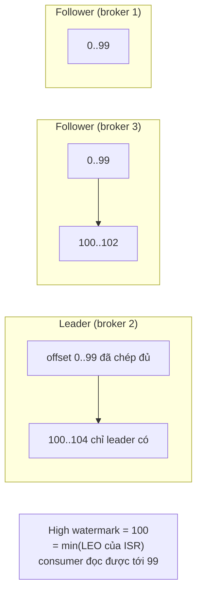

# Bài 03 — Replication và sự cố: ISR, high watermark, `acks`, `min.insync.replicas`; tái hiện mất dữ liệu đã xác nhận

> **Dùng cho:** **NAB** (thanh toán: "ghi vào Kafka rồi thì có mất không?") · **Katalon** (họ C: at-least-once, độ
> bền ghi; bài đếm sự kiện chọn `acks=all` vì số ở đây). Đây là bài interviewer đào sâu nhiều nhất sau khi bạn nói
> "dùng Kafka".
>
> **Thời lượng:** đọc 45 phút · lab 15 phút · drill 15 phút
>
> **Lab:** [`scripts/k03-replication-va-su-co.sh`](lab/scripts/k03-replication-va-su-co.sh) ·
> [`SteadyProducer.java`](lab/src/main/java/com/prep/cs/kafka/SteadyProducer.java) ·
> [`AckLossCheck.java`](lab/src/main/java/com/prep/cs/kafka/AckLossCheck.java) ·
> [`QuorumProbe.java`](lab/src/main/java/com/prep/cs/kafka/QuorumProbe.java) · output thật:
> [`results/k03-replication-va-su-co.txt`](lab/results/k03-replication-va-su-co.txt)
>
> **Cần trước:** [bài 02](02-kafka-ben-trong-broker.md) (leader epoch, log). **Học tiếp:** [bài 04](04-kafka-producer-consumer-tu-code.md).

```bash
cd on-bai/chuyen-sau/lab
docker compose -f docker/cluster.yml up -d --wait
scripts/k03-replication-va-su-co.sh      # ~8 phút: tắt broker, kill leader, pause follower, tắt controller
```

---

## 0. Trọng tâm phỏng vấn

| # | Interviewer dò | Câu trả lời của senior |
|:-:|---|---|
| 1 | `acks=1` có an toàn không? | **Không.** Leader xác nhận ngay khi ghi vào log của nó. Leader chết trước khi follower chép = mất. Lab mất **1.566 message đã xác nhận** |
| 2 | `acks=all` nghĩa là gì chính xác? | Xác nhận khi **mọi replica trong ISR** đã có batch (high watermark vượt qua nó). Kết hợp `min.insync.replicas=2`: ISR nhỏ hơn 2 thì **từ chối ghi** thay vì xác nhận với một bản |
| 3 | Mất một broker thì sao? Mất hai? | RF 3, min ISR 2: mất 1 vẫn ghi và đọc bình thường; mất 2 thì **không ghi được** (`NOT_ENOUGH_REPLICAS`) nhưng vẫn **không mất** dữ liệu đã xác nhận |
| 4 | Failover mất bao lâu? | Tắt êm (controlled shutdown): leader chuyển trước khi tắt, gần như 0 giây. `kill -9`: chờ controller *fence* broker sau `broker.session.timeout.ms` (9 giây): lab đo **8 giây** không xác nhận được gì |
| 5 | Producer báo lỗi timeout thì message có được ghi không? | **Không biết.** Lab có 1 message producer báo lỗi nhưng thực tế nằm trong log. Vì thế phía đọc phải idempotent |
| 6 | Controller (KRaft) chết thì sao? | Mất 1/3: bầu lại vài giây, nhưng broker mất ~10 giây mới chuyển tiếp request quản trị sang controller mới. Mất quorum: không tạo topic, không đổi metadata; **produce/consume vào partition có sẵn vẫn chạy** |

---

## 1. Lý thuyết: LEO, high watermark, ISR



- **Follower kéo (pull):** follower gửi `Fetch` tới leader như một consumer. Offset trong request Fetch cho leader
  biết follower đã có tới đâu. Không có cơ chế leader "đẩy".
- **LEO** (*log end offset*) của mỗi replica là offset kế tiếp nó sẽ ghi. Leader theo dõi LEO của từng follower qua các
  request Fetch.
- **High watermark (HW)** = LEO nhỏ nhất trong ISR. Record dưới HW là **đã commit**: mọi replica trong ISR đều có.
  **Consumer chỉ đọc được tới HW** (phần chỉ leader có thì chưa ai đọc được).
- **ISR** (*in-sync replicas*) là leader + các follower **bắt kịp** trong `replica.lag.time.max.ms` (mặc định 30 giây,
  lab đặt 10 giây). Follower chậm hơn thì leader đề nghị controller loại ra khỏi ISR (`AlterPartition` → controller
  ghi `PartitionChangeRecord` vào metadata log). Bắt kịp lại thì được thêm vào.
- **`acks`**:

| `acks` | Producer nhận xác nhận khi… | Mất dữ liệu đã xác nhận khi… |
|---|---|---|
| `0` | Gửi xong, không chờ gì | Bất kỳ lỗi nào |
| `1` | Leader ghi vào log **của nó** (page cache) | Leader chết trước khi follower kịp chép (lab: bước 7) |
| `all` (`-1`) | HW vượt qua batch: **mọi** replica trong ISR đã có | Mọi replica trong ISR chết **cùng lúc** trước khi xuống đĩa |

- **`min.insync.replicas`** (đặt ở topic hoặc cấp cụm; trên Kafka 4.x đặt cả ở **controller**, xem [bài 01 §8](01-kafka-chay-docker-va-ket-noi.md#8-bước-7--cụm-giống-production-3-controller--3-broker-và-cái-bẫy-mininsyncreplicas)):
  với `acks=all`, nếu ISR **ít hơn** con số này thì leader **từ chối** ghi (`NOT_ENOUGH_REPLICAS`). Thiếu nó, `acks=all`
  khi ISR chỉ còn leader thì chẳng khác `acks=1`.
- **Leader epoch** (bài 02): mỗi lần đổi leader, epoch tăng. Replica quay lại hỏi leader mới "epoch cuối của tôi kết
  thúc ở offset nào" rồi **cắt bỏ** phần thừa. Đây là cơ chế làm phần dữ liệu "chỉ leader cũ có" biến mất (bước 7).
- **ELR** (*eligible leader replicas*, Kafka 4.x): khi ISR co xuống dưới `min.insync.replicas`, các replica bị loại
  được đưa vào ELR thay vì mất hẳn quyền làm leader. Chúng chắc chắn có đủ dữ liệu tới HW nên được bầu làm leader an
  toàn, giảm nhu cầu bầu "unclean" (cho replica thiếu dữ liệu làm leader, `unclean.leader.election.enable`, mặc định
  tắt).

---

## 2. Real case: tắt broker dưới tải thật, từng bước

Công cụ đo: `SteadyProducer` gửi đều **100 message/giây** (`acks=all`, idempotent, `delivery.timeout.ms=20000`),
mỗi giây in một dòng: gửi bao nhiêu, broker xác nhận bao nhiêu, lỗi gì, độ trễ lớn nhất, leader hiện tại. Cuối cùng
ghi mọi id **đã được xác nhận** ra file để `AckLossCheck` đọc lại cả topic và đếm: cái gì đã xác nhận mà biến mất.

📄 [`SteadyProducer.java`](lab/src/main/java/com/prep/cs/kafka/SteadyProducer.java) (phần lõi)

```java
p.put(ProducerConfig.ACKS_CONFIG, acks);
// Idempotence doi hoi acks=all. Voi acks=1/0 phai tat ro rang, neu khong client bao loi cau hinh.
p.put(ProducerConfig.ENABLE_IDEMPOTENCE_CONFIG, acks.equals("all"));
p.put(ProducerConfig.REQUEST_TIMEOUT_MS_CONFIG, 5_000);    // cho mot request toi da 5 giay
p.put(ProducerConfig.DELIVERY_TIMEOUT_MS_CONFIG, 20_000);  // tong thoi gian ke ca retry, roi bao loi
...
producer.send(new ProducerRecord<>(topic, "id-" + id, Long.toString(id)), (md, e) -> {
    if (e == null) {
        acked.add(id);                                     // chi nhung id nay moi duoc tinh la "da xac nhan"
        ok.incrementAndGet();
    } else {
        errors.computeIfAbsent(e.getClass().getSimpleName(), k -> new AtomicLong()).incrementAndGet();
    }
});
```

📄 [`AckLossCheck.java`](lab/src/main/java/com/prep/cs/kafka/AckLossCheck.java) (phần lõi): đọc **từ đầu mọi partition**,
không dùng group, so với file id đã xác nhận:

```java
c.assign(tps);
c.seekToBeginning(tps);
Map<TopicPartition, Long> end = c.endOffsets(tps);
while (tps.stream().anyMatch(tp -> c.position(tp) < end.get(tp))) {
    for (ConsumerRecord<String, String> r : c.poll(Duration.ofMillis(500))) {
        seen.merge(Long.parseLong(r.value()), 1, Integer::sum);
    }
}
Set<Long> lost = new HashSet<>(acked);
lost.removeAll(seen.keySet());                             // da xac nhan ma khong con trong log
```

### Bước 1 — Tắt một follower: không ai nhận ra

```text
07:51:24  describe: Leader=2 Replicas=2,3,1 Isr=2,3,1
07:51:45  docker stop kafka-1   (follower thu nhat, tat em)
07:51:51  describe: Leader=2 Replicas=2,3,1 Isr=2,3
07:51:46 t=13s gui= 100 xac-nhan= 101 loi=[] tre-max=210ms leader=2
07:51:47 t=14s gui= 100 xac-nhan= 100 loi=[] tre-max=36ms leader=2
```

ISR co từ `2,3,1` xuống `2,3`. Còn 2 ≥ `min.insync.replicas` nên ghi tiếp bình thường; độ trễ nhích lên 210 ms trong
một giây rồi về lại. `docker stop` gửi SIGTERM: broker **tắt êm** (controlled shutdown), tự báo controller rời ISR,
nên ISR co ngay, không phải chờ hết `replica.lag.time.max.ms`.

### Bước 2 — Tắt follower thứ hai: ISR còn mỗi leader, cụm từ chối ghi

```text
07:52:00  docker stop kafka-3   (follower thu hai -> ISR chi con leader, duoi min.insync.replicas = 2)
07:52:03  describe: Leader=2 Replicas=2,3,1 Isr=2 Elr=3
07:52:01 t=28s gui= 100 xac-nhan=   0 loi=[] tre-max=0ms leader=2
...
07:52:20 t=47s gui= 100 xac-nhan=   0 loi=[TimeoutException+824] tre-max=0ms leader=2
07:52:28 t=55s gui= 100 xac-nhan=   0 loi=[TimeoutException+819] tre-max=0ms leader=2
07:52:15  docker start kafka-1 kafka-3
07:52:31  ISR du 3 lai
07:52:32 t=59s gui= 100 xac-nhan=1585 loi=[] tre-max=15139ms leader=2
```

Đọc kỹ ba điều:

1. **`Isr=2 Elr=3`**: ISR chỉ còn leader; replica 3 vừa bị loại được đưa vào **ELR** vì nó có đủ dữ liệu tới HW.
2. **31 giây không xác nhận nổi một message** (07:52:01 → 07:52:31). Leader trả `NOT_ENOUGH_REPLICAS` (log producer có
   38 lần), producer **tự retry** (lỗi này retriable) cho tới khi hết `delivery.timeout.ms` = 20 giây thì báo
   `TimeoutException` cho ứng dụng: **1.643 message thất bại**. Ứng dụng *biết* chúng thất bại; đây là đánh đổi đúng:
   từ chối ghi chứ không xác nhận với một bản sao.
3. Khi ISR đủ lại, phần đang retry được xác nhận dồn một lúc (1.585 trong một giây, độ trễ tới 15 giây). Một client
   HTTP phía trước sẽ thấy request treo 15 giây: phải đặt timeout và backpressure (bài 06–09).

### Bước 3 — Tắt êm leader: gần như không ai thấy

```text
07:52:52  docker stop kafka-2   (LEADER, tat em: controlled shutdown, bao controller chuyen leader truoc khi tat)
07:52:56  describe: Leader=3 Replicas=2,3,1 Isr=3,1
07:52:52 t=79s gui= 100 xac-nhan=  91 loi=[] tre-max=21ms leader=2
07:52:53 t=80s gui= 100 xac-nhan= 104 loi=[] tre-max=746ms leader=3
07:52:54 t=81s gui= 100 xac-nhan= 104 loi=[] tre-max=81ms leader=3
```

**Controlled shutdown**: broker xin controller chuyển leadership của mọi partition nó đang làm leader sang replica khác
trong ISR **trước khi** đóng cổng. Producer nhận `NOT_LEADER_OR_FOLLOWER`, làm mới metadata, gửi sang leader mới. Chi
phí: một giây có độ trễ 746 ms. Rolling restart để nâng cấp hay đổi config dựa hoàn toàn vào cơ chế này.

### Bước 4 — `kill -9` leader: 8 giây trắng

```text
07:53:43  docker kill kafka-3   (LEADER, SIGKILL: khong kip bao ai)
07:53:44 t=131s gui= 100 xac-nhan=  46 loi=[] tre-max=66ms leader=3
07:53:45 t=132s gui= 100 xac-nhan=   0 loi=[] tre-max=0ms leader=3
...
07:53:52 t=139s gui= 100 xac-nhan=   0 loi=[] tre-max=0ms leader=3
07:53:53 t=140s gui= 100 xac-nhan= 950 loi=[] tre-max=9433ms leader=2
07:53:53  describe: Leader=2 Replicas=2,3,1 Isr=1,2
```

Không ai báo controller rằng broker 3 đã chết. Controller chỉ biết khi broker 3 **ngừng heartbeat** quá
`broker.session.timeout.ms` (9 giây): lúc đó nó *fence* broker 3, loại khỏi ISR, bầu leader mới trong ISR còn lại.
Producer thấy **8 giây không xác nhận** rồi một đợt dồn 950 message, độ trễ lớn nhất 9,4 giây.

> **Con số để nói trong phỏng vấn:** failover khi máy chết đột ngột ≈ `broker.session.timeout.ms` + vài trăm ms.
> Giảm nó thì failover nhanh hơn, nhưng GC pause hay mạng chập chờn sẽ làm broker khoẻ bị fence oan.

Broker bị kill khởi động lại thì **phục hồi log**, vì Kafka không fsync từng message (bài 02):

```text
[LogLoader partition=pay-0] Recovering unflushed segment 0. 0 recovered for pay-0.
[LogLoader partition=pay-0] Producer state recovery took 7ms for snapshot load and 0ms for segment recovery from offset 11402
```

### Bước 5 — Kiểm toàn bộ: `acks=all` không mất gì, nhưng có một message "không biết"

```text
TONG: gui=15129 xac-nhan=13486 loi={TimeoutException=1643}
topic pay: 13486 id da xac nhan, 13487 id co trong log
MAT (da xac nhan ma khong con trong log): 0
trung (mot id xuat hien >1 lan): 0; co trong log nhung producer khong nhan xac nhan: 1
```

- **0 mất** qua cả bốn sự cố.
- **1 message producer báo lỗi `TimeoutException` nhưng thực tế đã nằm trong log.** Nó được ghi và commit, nhưng phản
  hồi tới producer quá hạn. Đây là bài toán *unknown outcome* của mọi hệ phân tán: timeout **không** có nghĩa là thất
  bại. Ứng dụng gửi lại thì có hai bản. Cách chặn: idempotence ở tầng ứng dụng (key nghiệp vụ + phía đọc khử trùng),
  đúng như bài đếm sự kiện làm với `(clientId, epoch, seq)`.
- **0 trùng** dù producer retry hàng nghìn lần ở bước 2 và 4: **idempotent producer** (bài 02 bước 7) làm broker bỏ
  batch retry trùng.

### Bước 6 — Chuẩn bị tái hiện mất dữ liệu với `acks=1`

Kịch bản cần đúng ba điều kiện cùng lúc: (1) follower **dừng chép** nhưng **chưa bị loại khỏi ISR**; (2) leader vẫn xác
nhận (`acks=1`); (3) leader chết trước khi follower bắt kịp. Lab tạo điều kiện (1) bằng `docker pause` (đóng băng tiến
trình follower: không fetch, không heartbeat) trong 3 giây, ngắn hơn `replica.lag.time.max.ms` = 10 giây và
`broker.session.timeout.ms` = 9 giây, nên controller và leader đều chưa kịp loại follower.

```bash
kafka-topics.sh --create --topic pay1 --replica-assignment 1:2:3      # ép broker 1 làm leader
# producer 500 msg/s, acks=1
docker pause kafka-2 kafka-3   # t0: follower đứng hình
sleep 3
docker kill kafka-1            # t0+3s: leader chết, mang theo 3 giây dữ liệu chỉ nó có
sleep 1
docker unpause kafka-2 kafka-3
```

### Bước 7 — `acks=1`: mất 1.566 message đã xác nhận

```text
07:54:48  docker pause kafka-2 kafka-3   (follower dung fetch; trong ISR toi khi qua replica.lag.time.max.ms = 10s)
07:54:48 t= 4s gui= 500 xac-nhan= 509 loi=[] tre-max=83ms leader=1      <- follower đã đứng, leader VẪN xác nhận
07:54:49 t= 5s gui= 500 xac-nhan= 507 loi=[] tre-max=93ms leader=1
07:54:50 t= 6s gui= 500 xac-nhan= 502 loi=[] tre-max=33ms leader=1
07:54:51  docker kill kafka-1   (leader chet)
07:54:51 t= 7s gui= 500 xac-nhan= 449 loi=[] tre-max=26ms leader=1
07:54:52  docker unpause kafka-2 kafka-3
07:55:05  describe: Leader=2 Replicas=1,2,3 Isr=2,3
07:55:02 t=18s gui= 500 xac-nhan=5540 loi=[] tre-max=10698ms leader=2
TONG: gui=17467 xac-nhan=17467 loi={}
--- kafka-1 quay lai: cat phan log ma leader moi khong co
[ReplicaFetcher replicaId=1, leaderId=2] Truncating partition pay1-0 with TruncationState(offset=1884, completed=true)
  due to leader epoch and offset EpochEndOffset(errorCode=0, partition=0, leaderEpoch=0, endOffset=1884)
[UnifiedLog partition=pay1-0] Truncating to offset 1884
topic pay1: 17467 id da xac nhan, 15901 id co trong log
MAT (da xac nhan ma khong con trong log): 1566  vi du [1884, 1885, 1886, 1887, 1888] .. 3449
```

Chuỗi sự kiện, đúng như log:

1. 07:54:48–07:54:51: follower đứng hình, leader 1 vẫn ghi và **xác nhận** ~1.500 message (`acks=1` không chờ ai).
   Các message đó chỉ nằm trên broker 1. HW **không tăng** (follower không fetch), nên chưa consumer nào đọc được chúng.
2. 07:54:51: broker 1 chết. Follower 2, 3 vẫn trong ISR (chưa quá 10 giây).
3. ~07:55:00: controller fence broker 1 (hết 9 giây không heartbeat), bầu broker 2 làm leader **epoch 1**. Log của
   broker 2 dừng ở offset 1884.
4. Producer gửi tiếp vào leader mới, từ offset 1884. Ứng dụng **không nhận một lỗi nào** (`loi={}`).
5. Broker 1 quay lại, hỏi leader 2 "epoch 0 kết thúc ở đâu?" → 1884 → **cắt log của nó về 1884**. Phần 1884–3449 chỉ
   broker 1 từng có, giờ biến mất ở mọi nơi.

**Kết quả: 1.566 message producer đã nhận "OK" không tồn tại ở đâu cả, và không ai nhận được lỗi.** Đây là câu trả lời
cho "acks=1 có đủ cho thanh toán không".

### Bước 8 — Đối chứng: cùng kịch bản, `acks=all`

```text
07:55:56  docker pause kafka-2 kafka-3
07:55:56 t= 4s gui= 500 xac-nhan= 185 loi=[] tre-max=129ms leader=1
07:55:57 t= 5s gui= 500 xac-nhan=   0 loi=[] tre-max=0ms leader=1      <- dừng xác nhận NGAY khi follower đứng
...
07:55:59  docker kill kafka-1   (leader chet)
07:56:08 t=16s gui= 500 xac-nhan=6264 loi=[] tre-max=11884ms leader=2
TONG: gui=14568 xac-nhan=14568 loi={}
MAT (da xac nhan ma khong con trong log): 0
```

Với `acks=all`, leader chờ HW vượt qua batch, mà HW không tăng khi follower đứng hình. Nên ngay giây follower bị pause,
**không còn gì được xác nhận**: không có gì "đã xác nhận" để mất. Các batch đang chờ được producer retry sang leader
mới (cùng producer id và sequence, nên không trùng), xác nhận dồn 6.264 cái khi leader mới lên. Cái giá: 11 giây độ trễ
thay vì mất dữ liệu.

### Bước 9 — Khi controller chết: data plane vẫn chạy, control plane đứng

```text
07:56:46  quorum: LeaderId:=103 LeaderEpoch:=1
07:56:50  docker stop controller-3   (leader cua quorum)
07:57:11  quorum: LeaderId:=101 LeaderEpoch:=2
describeTopics               OK   leader=2                   563 ms
describeConfigs              OK   min.insync.replicas=2       26 ms
listPartitionReassignments   LOI  TimeoutException          8053 ms
describeMetadataQuorum       OK   leader=101                  14 ms
createTopics                 LOI  TimeoutException          8027 ms
```

Quorum đã có leader mới (101, epoch 2), vậy sao `createTopics` vẫn timeout? Log của broker trả lời:

```text
[07:57:04,552] INFO [NodeToControllerChannelManager id=2 name=forwarding] Disconnecting from node 103 due to socket connection setup timeout. The timeout value is 10313 ms.
[07:57:04,555] INFO [broker-2-to-controller-forwarding-channel-manager]: Recorded new KRaft controller, from now on will use node controller-1:9093
[07:57:10,826] INFO [broker-1-to-controller-forwarding-channel-manager]: Recorded new KRaft controller, from now on will use node controller-1:9093
[07:57:34,357] INFO [broker-3-to-controller-forwarding-channel-manager]: Recorded new KRaft controller, from now on will use node controller-1:9093
```

Request quản trị (`createTopics`, `listPartitionReassignments`) đi tới **broker**, broker **chuyển tiếp** sang controller
qua một kênh riêng (*forwarding channel*). Kênh đó vẫn trỏ vào controller cũ cho tới khi **kết nối tới nó timeout**
(~10 giây, `socket.connection.setup.timeout.ms`) mới chuyển sang leader mới. Mỗi broker chuyển ở một thời điểm khác
nhau (broker 3 tận 07:57:34). Trong khoảng đó, request quản trị đi qua broker "chưa biết" thì treo. Produce và fetch
**không** đi qua controller nên không bị ảnh hưởng.

Tắt thêm một controller (còn 1/3, mất quorum):

```text
07:57:37  docker stop controller-1   (con 1/3 controller: MAT QUORUM)
describeTopics               OK   leader=2                   804 ms    <- broker trả lời từ metadata cache
describeConfigs              OK   min.insync.replicas=2       38 ms
listPartitionReassignments   LOI  TimeoutException          8040 ms    <- phải hỏi controller
describeMetadataQuorum       LOI  TimeoutException          8008 ms
createTopics                 LOI  TimeoutException          8020 ms    <- phải ghi metadata log: cần đa số
07:58:12  producer acks=1 (khong idempotent, khong can producer id) ghi vao topic co san:
TONG: gui=500 xac-nhan=500 loi={}
07:58:23  producer acks=all (idempotent: phai xin producer id) ghi vao topic co san:
TONG: gui=800 xac-nhan=800 loi={}
```

- **Đọc metadata** (`describeTopics`, `describeConfigs`): broker trả lời từ bản sao metadata của nó: vẫn chạy.
- **Ghi metadata** (tạo topic, đổi ISR, reassign): cần controller leader và đa số để commit vào metadata log: đứng.
- **Produce/consume vào partition có sẵn**: chạy (cả `acks=all`), vì leader và ISR hiện tại vẫn nguyên.
- **Rủi ro ẩn:** trong lúc mất quorum, nếu thêm một broker chết thì **không ai bầu leader mới** cho partition của nó;
  ISR cũng không co được nên `acks=all` vào partition có follower chết sẽ treo.
- **Producer idempotent mới khởi động** cần một *producer id*. Broker cấp từ một dải 1.000 id đã xin trước từ
  controller (`PRODUCER_IDS_RECORD`, bài 02). Lần chạy trong `results/` broker nhận yêu cầu còn dải nên producer chạy.
  Một lần chạy thử trước đó (không lưu trong `results/`) gặp broker **hết dải**: producer mới treo ở bước khởi tạo, log
  broker ghi `[RPC ProducerId Manager 1]: Timed out when requesting AllocateProducerIds from the controller.` Nghĩa là
  khi mất quorum, **ứng dụng đang chạy vẫn ghi được, ứng dụng vừa khởi động lại có thể không**.

Bật lại hai controller: quorum về với leader 102, epoch 5, mọi API chạy lại (`createTopics OK 72 ms`).

---

## 3. Bảng tổng kết: cấu hình × sự cố

RF = 3. "Ghi" là producer nhận xác nhận. "Mất" là dữ liệu đã xác nhận biến mất.

| Sự cố | `acks=1` | `acks=all`, min ISR 1 | `acks=all`, min ISR 2 |
|---|---|---|---|
| 1 follower chết | ghi được, không mất | ghi được, không mất | ghi được, không mất |
| 2 follower chết | ghi được, **rủi ro mất** nếu leader chết tiếp | ghi được (ISR = 1), **rủi ro mất** | **không ghi được**, không mất |
| Leader `kill -9` | **mất** phần follower chưa chép (lab: 1.566) | không mất phần đã xác nhận | không mất |
| Follower đứng hình + leader chết | **mất** | không mất (đã chờ ISR) | không mất |
| Mất quorum controller | ghi được vào partition có sẵn | như trái | như trái; nhưng không tạo topic, không failover |

**Cấu hình cho dữ liệu tiền / đếm chính xác:** RF 3, `min.insync.replicas=2` (kiểm bằng `kafka-configs --describe`),
`acks=all`, `enable.idempotence=true` (mặc định từ 3.0), `unclean.leader.election.enable=false` (mặc định), replica ở 3
AZ (`broker.rack`), cảnh báo trên `UnderMinIsrPartitionCount > 0` và `OfflinePartitionsCount > 0`.

---

## 4. Vẽ trên bảng trắng

```text
producer ──acks=all──► leader (LEO 105)            consumer đọc tới HW
                        │  ▲ Fetch(offset=103)       ▲
                        │  │                         │
                follower A (LEO 103)   follower B (LEO 100)      HW = min(LEO trong ISR) = 100
                        ISR = {leader, A, B}   min.insync.replicas = 2
  - B chậm quá replica.lag.time.max.ms → bị loại khỏi ISR → HW = min(105, 103) = 103
  - ISR < 2 → leader trả NOT_ENOUGH_REPLICAS (từ chối ghi, không xác nhận một bản)
  - leader chết: controller (sau 9 s nếu kill -9) bầu leader mới trong ISR (hoặc ELR); epoch + 1
  - replica cũ quay lại: cắt log về offset kết thúc epoch cũ bên leader mới
```

---

## 5. Drill (15 phút): chọn cấu hình cho topic `payments` và giải thích từng con số

Tiêu chí chấm:

- [ ] RF 3 (chịu 1 máy chết mà vẫn ghi), không phải RF 2 (một máy bảo trì là hết dư địa).
- [ ] `min.insync.replicas=2`, nói được vì sao không phải 3 (= RF thì một follower chết là dừng ghi).
- [ ] `acks=all` + idempotence; nói được mất gì nếu `acks=1` (kể số của bước 7).
- [ ] `unclean.leader.election.enable=false`; nói được ELR làm gì.
- [ ] `delivery.timeout.ms` hữu hạn + ứng dụng xử lý `TimeoutException` như *không biết kết quả* (không phải thất bại).
- [ ] Phía đọc idempotent theo khoá nghiệp vụ.
- [ ] Replica 3 AZ; cảnh báo URP, UnderMinIsr, Offline; failover ~9 giây khi máy chết đột ngột.

---

## 6. Follow-up hay gặp

<details>
<summary><b>Q1. Vì sao không đặt <code>min.insync.replicas=3</code> cho chắc?</b></summary>

Vì khi đó mọi lần **một** follower chậm hay đang khởi động lại (rolling restart!) là cụm từ chối ghi. Với RF 3, min ISR
2 cho phép đúng một replica vắng mặt. Muốn chịu 2 replica vắng mà vẫn ghi an toàn thì RF 5, min ISR 3: tốn 5/3 dung
lượng và băng thông.
</details>

<details>
<summary><b>Q2. Unclean leader election là gì, bật khi nào?</b></summary>

Cho phép một replica **ngoài ISR** (thiếu dữ liệu) lên làm leader khi mọi replica trong ISR đã chết, để partition có
leader trở lại. Cái giá là mất phần dữ liệu nó thiếu, và các replica khác cắt log theo nó. Chỉ bật cho dữ liệu chấp nhận
mất (metric, log). Kafka 4.x với ELR giảm số ca phải chọn giữa "mất dữ liệu" và "partition offline".
</details>

<details>
<summary><b>Q3. Consumer có đọc được dữ liệu chưa commit (trên HW) không?</b></summary>

Không. Leader chỉ trả cho consumer tới HW. Đó là lý do ở bước 7, ~1.500 message chỉ leader cũ có **chưa từng được
consumer nào đọc**: không có "đọc rồi mới mất". Với transaction thì consumer `read_committed` còn chỉ đọc tới LSO, thấp
hơn hoặc bằng HW (bài 04).
</details>

<details>
<summary><b>Q4. Producer nhận <code>TimeoutException</code>: gửi lại hay bỏ?</b></summary>

Không biết message đã được ghi hay chưa (bước 5 có 1 message như vậy). Gửi lại thì có thể trùng; bỏ thì có thể mất.
Đúng: gửi lại **cùng khoá nghiệp vụ**, và để phía đọc khử trùng theo khoá đó. Idempotent producer chỉ chống trùng
**trong một phiên producer** (cùng producer id, cùng sequence); ứng dụng tạo record mới để gửi lại thì sequence mới,
broker không biết là trùng.
</details>

<details>
<summary><b>Q5. Follower ở AZ khác: consumer có đọc từ follower gần mình được không?</b></summary>

Được, từ KIP-392 (Kafka 2.4): `replica.selector.class=RackAwareReplicaSelector` ở broker + `client.rack` ở consumer.
Giảm phí mạng liên AZ (thường là khoản tiền lớn của Kafka trên cloud). Follower chỉ phục vụ tới HW nên độ trễ đọc tăng
một chút.
</details>

---

## 7. Checklist

- [ ] Định nghĩa được LEO, HW, ISR, ELR; biết consumer đọc tới HW.
- [ ] Giải thích được bảng `acks` và vai trò của `min.insync.replicas`.
- [ ] Kể được bước 7 (mất 1.566 message với `acks=1`) theo đúng thứ tự sự kiện, kèm cơ chế cắt log theo leader epoch.
- [ ] Phân biệt được controlled shutdown (gần 0 giây) và `kill -9` (~`broker.session.timeout.ms`).
- [ ] Biết `TimeoutException` là *không biết kết quả*, và hệ quả với ứng dụng.
- [ ] Biết mất quorum ảnh hưởng gì và không ảnh hưởng gì; biết vì sao request quản trị treo thêm ~10 giây sau failover.
