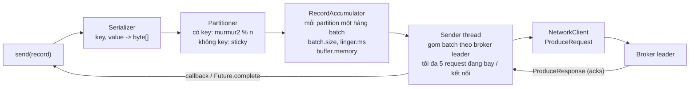

# Bài 04 — Producer và consumer từ code: batch, nén, idempotence, rebalance ba kiểu, commit, transaction

> **Dùng cho:** **Katalon** và **NAB**, vòng technical Java: "producer gửi một message đi qua những gì", "consumer
> group chia lại partition thế nào", "commit offset lúc nào", "exactly-once của Kafka nghĩa là gì". Bài này trả lời
> bằng code chạy trên cụm 3 broker và số đo của chính client.
>
> **Thời lượng:** đọc 50 phút · lab 15 phút · drill 20 phút
>
> **Lab:** [`scripts/k04-producer-consumer.sh`](lab/scripts/k04-producer-consumer.sh) · Java:
> [`ProducerTuning`](lab/src/main/java/com/prep/cs/kafka/ProducerTuning.java),
> [`GroupRebalanceDemo`](lab/src/main/java/com/prep/cs/kafka/GroupRebalanceDemo.java),
> [`CommitSemantics`](lab/src/main/java/com/prep/cs/kafka/CommitSemantics.java),
> [`TxnDemo`](lab/src/main/java/com/prep/cs/kafka/TxnDemo.java),
> [`RobustConsumerLoop`](lab/src/main/java/com/prep/cs/kafka/RobustConsumerLoop.java) · output thật:
> [`results/k04-producer-consumer.txt`](lab/results/k04-producer-consumer.txt)
>
> **Cần trước:** [bài 02](02-kafka-ben-trong-broker.md), [bài 03](03-kafka-replication-va-su-co.md). **Học tiếp:** [bài 05](05-kafka-scale-va-van-hanh.md).

```bash
cd on-bai/chuyen-sau/lab
docker compose -f docker/cluster.yml up -d --wait
scripts/k04-producer-consumer.sh        # ~5 phút
```

---

## 0. Trọng tâm phỏng vấn

| # | Câu hỏi | Trả lời của senior |
|:-:|---|---|
| 1 | `send()` làm gì? | **Không gửi gì cả.** Nó serialize, chọn partition, bỏ record vào một batch trong `RecordAccumulator` rồi trả về `Future`. Một luồng `Sender` riêng gom batch theo broker và gửi |
| 2 | Tăng thông lượng producer? | Batch to hơn (`batch.size`, `linger.ms`), nén (`lz4`/`zstd`). Lab: từ ~69k lên ~424k record/giây với `acks=all`, không thêm máy |
| 3 | Kafka 4.x đổi mặc định gì? | `linger.ms` mặc định **5** (trước là 0); idempotence + `acks=all` là mặc định từ 3.0; consumer có protocol mới `group.protocol=consumer` (KIP-848) |
| 4 | Rebalance làm gián đoạn gì? | Eager: **mọi** consumer trả **mọi** partition rồi nhận lại. Cooperative: chỉ partition phải đổi chủ, mất thêm một vòng. KIP-848: broker tự tính, không có rào chắn chung |
| 5 | Commit trước hay xử lý trước? | Xử lý rồi commit = at-least-once (lab: 50 trùng). Commit rồi xử lý = at-most-once (lab: 49 mất). Auto-commit = at-least-once với lượng trùng tới **cả một chu kỳ** (lab: 351 trùng) |
| 6 | Exactly-once của Kafka là gì? | Transaction + `read_committed`: ghi nhiều partition và commit offset **nguyên tử**, *chỉ trong phạm vi Kafka*. Ghi ra DB thì vẫn cần sink idempotent (bài 08) |

---

## 1. Bên trong producer



- **`send()` gần như không bao giờ chạm mạng.** Nó chỉ chặn khi: chưa có metadata của topic, hoặc `buffer.memory`
  (32 MB mặc định) đầy. Cả hai chặn tối đa `max.block.ms` (60 giây mặc định) rồi ném exception **ngay trong `send()`**,
  không qua callback. Code xử lý lỗi chỉ trong callback là thiếu một nửa.
- **Một batch được gửi khi:** đầy `batch.size`, **hoặc** đã chờ đủ `linger.ms`, hoặc có người gọi `flush()`.
- **Partitioner:** record có key: `toPositive(murmur2(key)) % số partition`. Không key: *sticky* (KIP-480/KIP-794):
  dồn vào một partition tới khi batch đầy rồi mới đổi, để batch to; bản 3.3+ còn tránh partition đang chậm.
- **Idempotence:** producer xin một `producerId`; mỗi batch mang `(producerId, epoch, sequence)` theo từng partition;
  broker nhớ 5 batch gần nhất mỗi producer (bài 02 bước 7). Vì vậy retry không sinh trùng **và** giữ thứ tự dù có
  tới 5 request đang bay.
- **`delivery.timeout.ms`** (120 giây mặc định) là hạn chót cho cả hành trình của một record: chờ trong accumulator +
  mọi lần retry. Hết hạn: callback nhận `TimeoutException` (bài 03 bước 2).

Mặc định **thật** của client đang dùng (đừng tin tài liệu cũ):

```text
kafka-clients 4.1.2
producer  acks                                     = all
producer  enable.idempotence                       = true
producer  max.in.flight.requests.per.connection    = 5
producer  retries                                  = 2147483647
producer  linger.ms                                = 5
producer  batch.size                               = 16384
producer  buffer.memory                            = 33554432
producer  max.block.ms                             = 60000
producer  request.timeout.ms                       = 30000
producer  delivery.timeout.ms                      = 120000
producer  compression.type                         = none
consumer  group.protocol                           = classic
consumer  partition.assignment.strategy            = [RangeAssignor, CooperativeStickyAssignor]
consumer  enable.auto.commit                       = true
consumer  auto.commit.interval.ms                  = 5000
consumer  auto.offset.reset                        = latest
consumer  isolation.level                          = read_uncommitted
consumer  max.poll.records                         = 500
consumer  max.poll.interval.ms                     = 300000
consumer  session.timeout.ms                       = 45000
consumer  heartbeat.interval.ms                    = 3000
```

(in bằng [`ClientDefaults`](lab/src/main/java/com/prep/cs/kafka/ClientDefaults.java), đọc thẳng `ConfigDef` của thư viện.)

---

## 2. Bước 1 — Cùng 300.000 event, sáu cấu hình: đọc metric của chính producer

📄 [`ProducerTuning.java`](lab/src/main/java/com/prep/cs/kafka/ProducerTuning.java)

```java
List<Cfg> cfgs = List.of(
        new Cfg("A mac dinh < 4.0", "all", 0, 16_384, "none"),   // linger.ms mac dinh = 0 truoc Kafka 4.0
        new Cfg("B mac dinh 4.x", "all", 5, 16_384, "none"),     // KIP-1030: linger.ms mac dinh = 5
        new Cfg("C batch 64K", "all", 5, 65_536, "none"),
        new Cfg("D 256K + lz4", "all", 20, 262_144, "lz4"),
        new Cfg("E 256K + zstd", "all", 20, 262_144, "zstd"),
        new Cfg("F nhu D, acks=1", "1", 20, 262_144, "lz4"));
...
for (int i = 0; i < n; i++) {
    // key null -> sticky partitioner: dien day mot batch cho mot partition roi moi doi partition
    producer.send(new ProducerRecord<>(topic, null, payloads[i % payloads.length]));
}
producer.flush();
Map<String, Double> m = metrics(producer.metrics());   // nhom "producer-metrics", cung ten voi JMX
// batch-size-avg, records-per-request-avg, compression-rate-avg, record-queue-time-avg, request-latency-avg
```

Payload là JSON event giống bài đếm (~94 byte). Mỗi cấu hình chạy 3 lần (sau một lần khởi động JIT), in lần ở giữa:

```text
cau hinh                 rec/s     MB/s   batch(B)   rec/req      nen  queue ms    req ms
A mac dinh < 4.0         69103      6.6      16323     308.0     1.00    1660.6      61.4   (3 lan: 47798 / 69103 / 73826)
B mac dinh 4.x           82846      7.9      16332     311.2     1.00    1691.0      51.8   (3 lan: 76021 / 82846 / 129642)
C batch 64K             316376     30.0      65302    1214.6     1.00     143.5      46.3   (3 lan: 280153 / 316376 / 344887)
D 256K + lz4            273923     26.0     110367    4477.6     0.40     212.0     182.6   (3 lan: 120662 / 273923 / 381254)
E 256K + zstd           424413     40.3      39944    6250.0     0.07      17.1      26.7   (3 lan: 126528 / 424413 / 428469)
F nhu D, acks=1         708124     67.2     210836    5882.4     0.39       8.6       7.8   (3 lan: 640004 / 708124 / 914358)
```

> **Đọc số cho đúng:** máy lab 4 vCPU chạy cùng lúc 6 JVM Kafka, Postgres và chính producer. Giữa ba lần chạy chênh
> nhau tới 3 lần (D: 120k–381k). Hãy đọc **xu hướng và metric bên trong**, đừng đọc con số tuyệt đối như năng lực của
> Kafka.

Đọc từng cột như đọc ruột producer:

- **`queue ms` (thời gian record nằm chờ trong accumulator)** của A, B là **1,6–1,7 giây**. Producer gửi nhanh hơn
  Sender kịp đẩy đi, batch 16 KB đầy liền (`batch(B)` = 16.323), record xếp hàng trong `buffer.memory`. Nút thắt là
  **số request**: mỗi request chỉ mang ~310 record (`rec/req`).
- **C (batch 64 KB):** mỗi request mang ~1.215 record, thông lượng **×4,6** so với A, hàng đợi còn 0,14 giây. Không đổi
  gì ngoài một con số cấu hình.
- **D (lz4):** `nen` = 0,40, tức batch trên dây chỉ còn 40%. JSON lặp nhiều nên nén tốt. Thông lượng không hơn C trên
  máy này vì CPU (đang dùng chung với broker) thành nút thắt.
- **E (zstd):** nén còn **7%** (`0.07`), byte trên dây và trên đĩa giảm 14 lần, thông lượng cao nhất. Trên cloud,
  byte qua mạng giữa các AZ là tiền: zstd thường là lựa chọn mặc định hợp lý cho topic lớn.
- **F (`acks=1`):** ×2,6 so với D, độ trễ mỗi request 7,8 ms thay vì 182,6 ms, vì không chờ follower. Bài 03 đã cho
  thấy cái giá: **1.566 message đã xác nhận bị mất**.

**Câu trả lời mẫu:** *"Tôi tăng `batch.size` lên 64–256 KB, `linger.ms` 10–20 ms, nén zstd, rồi đo
`record-queue-time-avg` và `records-per-request-avg`. Hai metric đó cho biết producer đang nghẹt ở hàng đợi hay ở
mạng. `acks` tôi giữ `all`; muốn nhanh hơn thì thêm partition và producer, không hạ độ bền."*

---

## 3. Bên trong consumer group

- **Poll loop:** `poll()` trả các record đã được *fetcher* kéo về (`fetch.min.bytes`, `fetch.max.wait.ms`,
  `max.partition.fetch.bytes`), tối đa `max.poll.records`. Không gọi `poll()` lâu hơn `max.poll.interval.ms` (5 phút)
  thì consumer tự rời group: partition bị chia cho người khác trong khi mình vẫn đang xử lý (nguồn gốc của "zombie").
- **Group coordinator:** broker làm leader của partition `abs(group.hashCode()) % 50` trong `__consumer_offsets`
  (bài 02 bước 9).
- **Classic protocol:** thành viên gửi `JoinGroup`; coordinator chọn một thành viên làm *leader* của group; **client
  leader** tính phân chia (assignor chạy ở client) rồi gửi `SyncGroup`. Ai cũng phải tham gia mỗi lần chia lại: một
  thành viên chậm làm cả group chờ.
- **Consumer protocol (KIP-848, mặc định ở broker 4.x, client phải bật `group.protocol=consumer`):** **broker** tính
  phân chia; thành viên chỉ gửi heartbeat (`ConsumerGroupHeartbeat`), nhận phần của mình, trả lại phần phải trả,
  không có rào chắn chung. Timeout và nhịp heartbeat chuyển sang broker (`group.consumer.session.timeout.ms`,
  `group.consumer.heartbeat.interval.ms` = 5 giây).

## 4. Bước 2 — Rebalance ba kiểu, cùng một kịch bản

📄 [`GroupRebalanceDemo.java`](lab/src/main/java/com/prep/cs/kafka/GroupRebalanceDemo.java): topic 6 partition;
c1 vào → 6 giây sau c2 vào → 8 giây sau c3 vào → 8 giây sau c2 rời nhóm. Mỗi thành viên ghi lại từng lần **trả** và
**nhận** partition qua `ConsumerRebalanceListener`; cuối cùng in mỗi partition "không có chủ" bao lâu, và có quay về
**đúng chủ cũ** không (dừng vô ích).

```java
switch (mode) {
    case "eager" -> {
        p.put(ConsumerConfig.GROUP_PROTOCOL_CONFIG, "classic");
        p.put(ConsumerConfig.PARTITION_ASSIGNMENT_STRATEGY_CONFIG, RangeAssignor.class.getName());
    }
    case "cooperative" -> {
        p.put(ConsumerConfig.GROUP_PROTOCOL_CONFIG, "classic");
        p.put(ConsumerConfig.PARTITION_ASSIGNMENT_STRATEGY_CONFIG, CooperativeStickyAssignor.class.getName());
    }
    // KIP-848: KHONG duoc dat partition.assignment.strategy, session/heartbeat timeout o client.
    case "consumer" -> p.put(ConsumerConfig.GROUP_PROTOCOL_CONFIG, "consumer");
}
```

**Eager (classic + RangeAssignor):**

```text
+ 6.714s -- c2 tham gia
+ 7.320s c1 tra lai [0,1,2,3,4,5] -> con []          <- trả HẾT, kể cả phần sẽ được giữ lại
+ 7.341s c2 nhan [3,4,5] -> giu [3, 4, 5]
+ 7.342s c1 nhan [0,1,2] -> giu [0, 1, 2]
+14.730s -- c3 tham gia
+16.356s c2 tra lai [3,4,5] -> con []
+16.357s c1 tra lai [0,1,2] -> con []
...
  p0: c1 -> c1, khong co chu 23 ms  (ve DUNG chu cu: dung vo ich)
  p1: c1 -> c1, khong co chu 23 ms  (ve DUNG chu cu: dung vo ich)
  p2: c1 -> c1, khong co chu 23 ms  (ve DUNG chu cu: dung vo ich)
  ...
  p2: c2 -> c1, khong co chu 2537 ms
```

**Cooperative (classic + CooperativeStickyAssignor):**

```text
+ 6.811s -- c2 tham gia
+ 7.502s c1 tra lai [3,4,5] -> con [0, 1, 2]           <- chỉ trả phần phải chuyển
+10.511s c2 nhan [3,4,5] -> giu [3, 4, 5]              <- nhận ở VÒNG THỨ HAI, 3 giây sau
+14.844s -- c3 tham gia
+16.540s c2 tra lai [5] -> con [3, 4]
+16.544s c1 tra lai [2] -> con [0, 1]
+19.558s c3 nhan [2,5] -> giu [2, 5]
  p3: c1 -> c2, khong co chu 3009 ms
```

**Consumer protocol (KIP-848):**

```text
+ 6.717s -- c2 tham gia
+11.869s c1 tra lai [3,4,5] -> con [0, 1, 2]
+14.737s -- c3 tham gia
+14.840s c3 nhan [5] -> giu [5]
+17.006s c2 nhan [3,4] -> giu [3, 4]
+17.163s c1 tra lai [2] -> con [0, 1]
+19.977s c3 nhan [2] -> giu [2, 5]
[ERROR] CommitRequestManager - OffsetCommit failed for member ... with stale member epoch error. Last epoch sent: 3
  p3: c1 -> c2, khong co chu 5138 ms
```

| | Partition dừng vô ích (về đúng chủ cũ) | Partition đổi chủ: không có chủ bao lâu | Ai tính phân chia |
|---|---|---|---|
| Eager | **15 lượt** trong 4 lần chia | 22–31 ms (nhanh vì consumer rỗi; thực tế = thời gian commit + dọn state của **mọi** consumer) | client leader |
| Cooperative | 0 | ~2,6–3 giây (hai vòng, cách nhau bởi heartbeat 3 giây) | client leader |
| Consumer (KIP-848) | 0 | ~2,3–5,1 giây (theo nhịp heartbeat 5 giây của broker) | **broker** |

Ba điều phải nói được:

1. **Eager không chậm ở lab nhưng đắt ở production:** consumer rỗi trả và nhận lại trong 23 ms. Consumer thật có
   state (cache, Kafka Streams state store, batch đang dở) phải commit, dọn, rồi nạp lại **cho mọi partition**, mỗi lần
   có một thành viên vào hay ra. Deploy rolling 20 pod = 40 lần cả group dừng.
2. **Cooperative đổi "mọi người dừng" lấy "partition di chuyển chậm hơn":** chỉ partition phải chuyển bị gián đoạn,
   nhưng nó mất hai vòng rebalance (trả ở vòng 1, nhận ở vòng 2).
3. **KIP-848 bỏ rào chắn chung:** broker tính, mỗi thành viên tự hội tụ theo nhịp heartbeat; một thành viên chậm không
   chặn ai. Dòng `StaleMemberEpochException` là auto-commit trúng lúc epoch của thành viên vừa đổi; client tự thử lại
   với epoch mới. Thấy lỗi này trong log production là bình thường, không phải mất offset.

> **Static membership** (`group.instance.id`) là một mẹo khác cho deploy: consumer khởi động lại trong
> `session.timeout.ms` với cùng instance id thì nhận lại đúng partition, **không** kích hoạt rebalance.

---

## 5. Bước 3 — Commit trước hay xử lý trước: `kill -9` thật giữa một batch

📄 [`CommitSemantics.java`](lab/src/main/java/com/prep/cs/kafka/CommitSemantics.java): topic 1.000 record; tiến trình
con đọc theo lô 100, "xử lý" mỗi record bằng cách ghi id ra file (2 ms/record). Tiến trình cha **`kill -9`** con sau khi
nó xử lý ~350 record, rồi cho tiến trình con thứ hai đọc tiếp từ offset đã commit. Đếm: id nào xử lý hai lần, id nào
không bao giờ được xử lý.

```java
while (true) {
    ConsumerRecords<String, String> batch = c.poll(Duration.ofMillis(200));
    if (mode.equals("at-most-once") && !batch.isEmpty()) c.commitSync();  // commit TRUOC
    for (ConsumerRecord<String, String> r : batch) {
        Files.writeString(processed, r.value() + "\n", StandardOpenOption.APPEND); // "xu ly"
        sleepQuietly(2);
    }
    if (mode.equals("at-least-once") && !batch.isEmpty()) c.commitSync(); // commit SAU
    ...
}
```

```text
[at-least-once] kill -9 tien trinh 1 sau khi no xu ly 350 record
[at-least-once] xu ly tong 1050 lan cho 1000 record: TRUNG 50, MAT 0
[at-most-once] kill -9 tien trinh 1 sau khi no xu ly 351 record
[at-most-once] xu ly tong 951 lan cho 1000 record: TRUNG 0, MAT 49
[auto] kill -9 tien trinh 1 sau khi no xu ly 751 record
[auto] xu ly tong 1351 lan cho 1000 record: TRUNG 351, MAT 0
```

- **At-least-once:** chết sau khi xử lý 50 record của lô thứ tư nhưng **trước** khi commit lô đó. Tiến trình hai đọc lại
  cả lô từ offset 300: **50 trùng, 0 mất**. Đây là mặc định đúng cho hầu hết hệ thống, **với điều kiện** việc xử lý
  idempotent.
- **At-most-once:** commit lô thứ tư (tới offset 400) rồi mới xử lý; chết sau 51 record. Tiến trình hai bắt đầu từ 400:
  **49 record không bao giờ được xử lý**, không ai biết.
- **Auto-commit (`auto.commit.interval.ms` = 1 giây trong lab):** commit diễn ra **bên trong `poll()`**, cho các record
  trả về ở lần `poll()` *trước*. Lần commit tự động cuối trước khi chết rơi vào offset 400; 351 record xử lý sau đó bị
  làm lại. Auto-commit là at-least-once **với lượng trùng tới cả một chu kỳ commit** (mặc định 5 giây dữ liệu). Nếu
  ứng dụng chuyển record sang thread khác xử lý rồi `poll()` tiếp, auto-commit còn có thể commit thứ **chưa xử lý xong**:
  thành at-most-once mà không ai để ý.

Mẫu vòng consumer đúng (biên dịch và chạy trong lab: [`RobustConsumerLoop`](lab/src/main/java/com/prep/cs/kafka/RobustConsumerLoop.java);
chạy 8 giây trên topic `perf`: xử lý 61.400 record, tổng offset đã commit của 6 partition đúng bằng 61.400):

```java
consumer.subscribe(List.of(topic), new ConsumerRebalanceListener() {
    @Override public void onPartitionsRevoked(Collection<TopicPartition> parts) { commitPending(); }
    @Override public void onPartitionsAssigned(Collection<TopicPartition> parts) { }
});
try {
    while (true) {
        for (ConsumerRecord<String, String> r : consumer.poll(Duration.ofMillis(500))) {
            handle(r);                                                  // phai idempotent: at-least-once
            pending.put(new TopicPartition(r.topic(), r.partition()),
                    new OffsetAndMetadata(r.offset() + 1));            // commit offset KE TIEP
        }
        commitPending();                                                // commitSync(pending)
    }
} catch (WakeupException e) {
    // luong khac goi consumer.wakeup() de tat em
} finally {
    try { commitPending(); } finally { consumer.close(); }              // roi group ngay
}
```

---

## 6. Bước 4 — Transaction: abort, LSO, zombie, và marker nằm trong log

Kafka transaction cho phép một producer ghi vào **nhiều partition** (và commit offset của consumer) **cùng thắng hoặc
cùng thua**. Cơ chế:

1. `initTransactions()`: producer tìm **transaction coordinator** (leader của partition
   `hash(transactional.id) % 50` trong `__transaction_state`), nhận `producerId` và **tăng epoch**. Producer cũ cùng
   `transactional.id` từ đây là zombie.
2. Mỗi partition ghi lần đầu trong transaction được đăng ký với coordinator.
3. `commitTransaction()`/`abortTransaction()`: coordinator ghi `PrepareCommit` vào `__transaction_state`, rồi ghi
   **marker** COMMIT/ABORT vào **mọi partition** đã tham gia (hai pha), rồi `CompleteCommit`.
4. Consumer `isolation.level=read_committed` chỉ đọc tới **LSO** (*last stable offset*): offset của transaction còn mở
   sớm nhất; record của transaction đã abort bị lọc bỏ.

📄 [`TxnDemo.java`](lab/src/main/java/com/prep/cs/kafka/TxnDemo.java)

```java
tx.initTransactions();
tx.beginTransaction();
for (String v : List.of("a1", "a2", "a3")) tx.send(new ProducerRecord<>(topic, v));
tx.flush();            // dua ca ba xuong broker; khong flush thi abort bo luon record con nam trong buffer
tx.abortTransaction();
tx.beginTransaction();
for (String v : List.of("c1", "c2", "c3")) tx.send(new ProducerRecord<>(topic, v));
tx.commitTransaction();
```

```text
--- 1. Transaction abort roi transaction commit
read_uncommitted: [0:a1, 1:a2, 2:a3, 4:c1, 5:c2, 6:c3]
read_committed  : [4:c1, 5:c2, 6:c3]

--- 2. Transaction dang mo chan read_committed (LSO)
dang mo transaction:
  read_uncommitted: [0:a1, 1:a2, 2:a3, 4:c1, 5:c2, 6:c3, 8:pending, 9:plain-after]
  read_committed  : [4:c1, 5:c2, 6:c3]   <- khong thay ca 'plain-after'
  end offset (HW) = 10, LSO = 8
sau commit:
  read_committed  : [4:c1, 5:c2, 6:c3, 8:pending, 9:plain-after]

--- 3. Zombie fencing: hai producer cung transactional.id
zombie: dang trong transaction, da ghi zombie-1 (chua commit)
fresh : initTransactions() xong -> epoch moi, transaction cua zombie bi abort
zombie: bi chan -> InvalidProducerEpochException: Producer attempted to produce with an old epoch.
read_committed  : [4:c1, 5:c2, 6:c3, 8:pending, 9:plain-after, 13:fresh-1]
```

Và trong file `.log` (bài 02 cách đọc):

```text
| offset: 0 ... payload: a1
| offset: 1 ... payload: a2
| offset: 2 ... payload: a3
baseOffset: 3 ... producerId: 6006 producerEpoch: 1 ... isTransactional: true isControl: true
| offset: 3 ... endTxnMarker: ABORT coordinatorEpoch: 0
| offset: 4 ... payload: c1
| offset: 5 ... payload: c2
| offset: 6 ... payload: c3
baseOffset: 7 ... producerId: 6006 producerEpoch: 2 ... isTransactional: true isControl: true
| offset: 7 ... endTxnMarker: COMMIT coordinatorEpoch: 0
...
TransactionalId  Coordinator  ProducerId  TransactionState
demo-tx-1        2            6006        CompleteCommit
```

Năm điều rút ra:

1. **Abort không xoá gì.** a1–a3 vẫn nằm ở offset 0–2; `read_uncommitted` vẫn thấy. Chỉ `read_committed` lọc chúng ra
   nhờ marker ABORT.
2. **Marker chiếm offset** (3 và 7): offset của consumer `read_committed` có lỗ. Đừng giả định offset liên tục, đừng
   tính "số message = end − start".
3. **LSO chặn cả record không thuộc transaction:** `plain-after` được ghi bằng producer thường, *sau* `pending`, nhưng
   `read_committed` không thấy nó tới khi transaction mở trước nó kết thúc (HW = 10, LSO = 8). Một producer treo giữa
   transaction làm **mọi consumer `read_committed` của partition đứng** tới `transaction.timeout.ms`. Đó là sự cố
   "hanging transaction" có thật; hãy đặt `transaction.timeout.ms` ngắn và giám sát LSO lag.
4. **`producerEpoch` tăng sau mỗi transaction** (1 → 2 trên cùng producerId 6006): Kafka 4.x bật `transaction.version=2`
   (KIP-890) để broker tự chặn ghi muộn từ transaction cũ. Cũng vì thế zombie nhận `InvalidProducerEpochException`;
   tài liệu cũ nói `ProducerFencedException`. Cả hai cùng nghĩa: producer này đã bị thay, **phải đóng**, không retry.
5. **Exactly-once chỉ trong Kafka:** mẫu đọc-xử lý-ghi chuẩn là:

```java
producer.beginTransaction();
for (ConsumerRecord<K, V> r : records) producer.send(transform(r));
producer.sendOffsetsToTransaction(nextOffsets(records), consumer.groupMetadata()); // offset vao CUNG transaction
producer.commitTransaction();
```

Output topic và offset của consumer được commit nguyên tử. Nhưng nếu "xử lý" là ghi Postgres hay gọi HTTP thì
transaction Kafka không bao được: phải lưu offset **trong DB, cùng transaction với dữ liệu** (bài 08 làm đúng việc
này), hoặc làm sink idempotent.

---

## 7. Vẽ trên bảng trắng

```text
PRODUCER                                            CONSUMER (group)
send() → serialize → partition → accumulator        poll() ← fetcher (fetch.min.bytes, max.wait)
   batch theo partition (batch.size, linger.ms)        │  max.poll.records / vòng; quá max.poll.interval → bị loại
   Sender: gom theo broker, ≤5 request bay            xử lý (idempotent) → commitSync(offset + 1)
   (producerId, epoch, seq) → broker chống trùng      rebalance: eager (trả hết) | cooperative (2 vòng)
   acks=all + delivery.timeout.ms                               | KIP-848 (broker tính, không rào chắn)
TRANSACTION: initTransactions (epoch++) → ghi → sendOffsetsToTransaction → commit (marker 2 pha) ; read_committed ≤ LSO
```

---

## 8. Drill (20 phút): viết consumer at-least-once đúng, tắt êm được

Viết tay (không IDE) vòng consumer của §5. Tiêu chí chấm:

- [ ] `enable.auto.commit=false`, commit **sau** khi xử lý, commit `offset + 1`.
- [ ] Commit theo **từng partition** mình đang giữ (map), không `commitSync()` trống khi chưa xử lý gì.
- [ ] `onPartitionsRevoked` commit phần đang dở; nói được vì sao (giảm trùng khi rebalance).
- [ ] Tắt êm bằng `consumer.wakeup()` từ luồng khác, bắt `WakeupException`, `finally` commit + `close()`.
- [ ] Nói được `KafkaConsumer` **không thread-safe** (trừ `wakeup()`), nên xử lý song song phải tự quản offset theo
      partition.
- [ ] `max.poll.records` × thời gian xử lý một record < `max.poll.interval.ms`, có biên an toàn.
- [ ] Nói được xử lý idempotent bằng gì (khoá nghiệp vụ + unique constraint, hoặc offset trong DB).

---

## 9. Follow-up hay gặp

<details>
<summary><b>Q1. Muốn giữ thứ tự tuyệt đối theo key mà vẫn retry, cần cấu hình gì?</b></summary>

Idempotence bật (mặc định) là đủ, kể cả `max.in.flight.requests.per.connection` = 5: broker dùng sequence để từ chối
batch tới sai thứ tự, producer gửi lại đúng thứ tự. Tắt idempotence mà để in-flight > 1 thì retry có thể đảo thứ tự.
Thứ tự chỉ có **trong một partition**: cùng key → cùng partition, và đừng đổi số partition (bài 05).
</details>

<details>
<summary><b>Q2. Xử lý một record mất 2 giây, mỗi lần poll 500 record: chuyện gì xảy ra?</b></summary>

500 × 2 giây = 1.000 giây > `max.poll.interval.ms` (300 giây). Consumer bị đuổi khỏi group giữa chừng, partition chuyển
cho người khác, commit sau đó báo `CommitFailedException`, cả group rebalance liên tục. Sửa: giảm `max.poll.records`, hoặc
xử lý theo lô nhanh hơn (gom DB write), hoặc tách xử lý ra pool riêng và `pause()` partition khi pool đầy.
</details>

<details>
<summary><b>Q3. Exactly-once của Kafka có chống được việc gửi email hai lần không?</b></summary>

Không. Transaction chỉ bao phần ghi vào Kafka và offset. Gửi email là tác dụng phụ bên ngoài: consumer xử lý rồi chết
trước khi commit thì sẽ gửi lại. Cần idempotency key ở phía gửi email (ghi "đã gửi" vào DB cùng transaction với dữ liệu,
kiểm trước khi gửi) hoặc outbox ([gd1 bài 09](../gd1-nen-tang/09-outbox-notification.md)).
</details>

<details>
<summary><b>Q4. Nên chọn cooperative-sticky hay KIP-848?</b></summary>

Broker 4.x hỗ trợ KIP-848 (GA từ 4.0): client chỉ cần `group.protocol=consumer`. Lợi: không rào chắn chung, broker
tính phân chia, cấu hình timeout tập trung ở broker. Còn dùng classic khi client cũ, hoặc cần assignor tự viết chạy ở
client. Đổi giữa hai protocol trên cùng group được hỗ trợ khi group rỗng hoặc qua cơ chế chuyển đổi của broker; thử
trên môi trường thật trước.
</details>

<details>
<summary><b>Q5. <code>linger.ms</code> tăng độ trễ, sao vẫn nên tăng?</b></summary>

Vì dưới tải, batch đầy trước khi hết linger, nên linger gần như không thêm độ trễ; còn khi thưa thì thêm tối đa đúng
`linger.ms`. Đổi lại số request giảm mạnh, broker đỡ CPU, nén tốt hơn. Bảng §2: A và B (linger 0 và 5) có `queue ms`
1,6 giây vì *quá nhiều request nhỏ*, chứ không phải vì linger.
</details>

---

## 10. Checklist

- [ ] Vẽ được đường đi của một record qua producer; nói được `send()` chặn khi nào.
- [ ] Đọc được bảng §2: vì sao C nhanh hơn A gấp 4,6 lần; nén zstd được bao nhiêu; `acks=1` nhanh vì đâu và mất gì.
- [ ] Phân biệt eager, cooperative, KIP-848 bằng output thật.
- [ ] Nói được ba kết quả commit (50 trùng, 49 mất, 351 trùng) và vì sao.
- [ ] Giải thích LSO, marker chiếm offset, zombie fencing; biết exactly-once dừng ở biên Kafka.
- [ ] Viết được vòng consumer §5 trong 10 phút.
