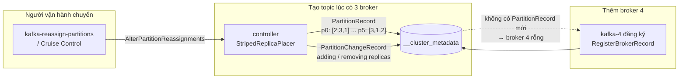
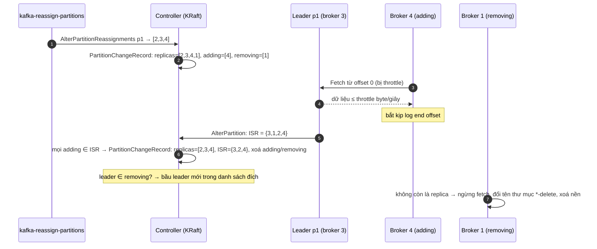

# Bài 05 — Scale và vận hành Kafka: thêm broker, rút broker, đổi số partition, tính cỡ cụm cho 1M–10M request/s

> **Dùng cho:** **Katalon**, bài đếm sự kiện 1M–10M request/s, với câu hỏi "Kafka của anh cần bao nhiêu broker, bao
> nhiêu partition?". Và **NAB**, vòng vận hành: "thêm broker xong thì sao", "rút broker thế nào cho an toàn", "tăng
> partition có vấn đề gì". Mọi con số trong bài lấy từ cụm 3 controller + 3–4 broker chạy thật.
>
> **Thời lượng:** đọc 45 phút · lab 10 phút · drill 15 phút
>
> **Lab:** [`scripts/k05-scale.sh`](lab/scripts/k05-scale.sh), [`scripts/k05b-thu-nho-cum.sh`](lab/scripts/k05b-thu-nho-cum.sh) ·
> Java: [`PartitionMapping`](lab/src/main/java/com/prep/cs/kafka/PartitionMapping.java),
> [`ScaleConsumers`](lab/src/main/java/com/prep/cs/kafka/ScaleConsumers.java),
> [`Decommission`](lab/src/main/java/com/prep/cs/kafka/Decommission.java) · output thật:
> [`results/k05-scale.txt`](lab/results/k05-scale.txt), [`results/k05b-thu-nho-cum.txt`](lab/results/k05b-thu-nho-cum.txt)
>
> **Cần trước:** [bài 01](01-kafka-chay-docker-va-ket-noi.md) (compose, listener), [bài 03](03-kafka-replication-va-su-co.md)
> (ISR, partition thiếu bản sao). **Học tiếp:** [bài 06](06-dem-su-kien-1m-10m-de-va-kien-truc.md), đề bài đếm sự kiện.

```bash
cd on-bai/chuyen-sau/lab
docker compose -f docker/cluster.yml up -d --wait
scripts/k05-scale.sh          # thêm broker 4, chuyển partition, đổi số partition, scale consumer (~4 phút)
scripts/k05b-thu-nho-cum.sh   # rút broker 4: cách sai rồi cách đúng (~2 phút)
```

---

## 0. Trọng tâm phỏng vấn

| # | Câu hỏi | Trả lời của senior |
|:-:|---|---|
| 1 | Thêm broker thì dữ liệu có tự chia lại không? | **Không.** Broker mới vào cụm với 0 replica (lab: kafka-4, 0 MB). Chỉ partition tạo *sau đó* mới được đặt lên nó. Muốn chia lại phải tự chuyển bằng `kafka-reassign-partitions` hoặc Cruise Control |
| 2 | Chuyển partition có làm chậm traffic thật? | Có. Chép replica ăn mạng và đĩa của leader, nên phải đặt **throttle**. Thời gian ≈ số byte phải đi qua broker bận nhất ÷ throttle. Lab: broker 2 phải gửi 61,6 MB ở 5 MB/s, đo được 12,8 giây |
| 3 | Rút một broker ra khỏi cụm? | Chuyển hết replica ra → gỡ throttle → tắt → `kafka-cluster.sh unregister`. Tắt thẳng thì lab có **28 partition thiếu bản sao**, kéo dài tới khi broker quay lại |
| 4 | Tăng số partition được không? | Được, nhưng **không giảm được**, và key đổi partition: 6→7 làm 85,7% key đổi chỗ, gấp đôi làm 50%. Thứ tự theo key vỡ trong lúc chuyển |
| 5 | Chọn bao nhiêu partition? | Đủ cho song song phía đọc (số consumer làm việc tối đa = số partition; lab: 8 consumer trên 6 partition thì 2 consumer ngồi không), cộng phần dư cho tăng trưởng vì tăng về sau rất đắt. Và đừng quá nhiều: ở bài đếm, mỗi partition thêm vào làm block ở ingest nhỏ đi |
| 6 | Cụm cho 10M request/s? | Tính theo **byte**, không theo message. 10M × ~16 byte (bản ghi 32 byte, nén lz4) = 160 MB/s vào, × RF 3 = 480 MB/s ghi đĩa toàn cụm. 6 broker là dư thông lượng; số broker do dung lượng lưu và miền lỗi quyết định |

---

## 1. Cái gì scale được trong Kafka, và cái gì KHÔNG tự xảy ra

Ba đơn vị cần phân biệt:

- **Partition**, đơn vị song song: một partition có một leader ghi tuần tự và được tối đa một consumer trong group đọc.
- **Replica**, đơn vị đặt chỗ: mỗi partition có RF bản sao trên RF broker khác nhau.
- **Leader**, đơn vị phục vụ: producer và consumer chỉ nói chuyện với leader (trừ khi bật đọc từ follower, §11).

Danh sách replica của mỗi partition được controller quyết định **một lần, lúc tạo partition**, rồi ghi vào log metadata
(`PartitionRecord` trong `__cluster_metadata`, bài 02 bước 10). Sau đó không ai tự sửa nó.



| Kafka **tự** làm | Kafka **không** tự làm |
|---|---|
| Bầu leader mới khi broker chết (controller, bài 03) | Đặt replica cũ lên broker mới thêm vào |
| Trả leader về replica ưu tiên: `auto.leader.rebalance.enable=true`, kiểm tra mỗi `leader.imbalance.check.interval.seconds=300`, ra tay khi lệch quá 10% (giá trị đọc từ broker lab bằng `kafka-configs --describe --all`) | Rút replica khỏi broker trước khi tắt |
| Chia lại partition cho consumer trong group (bài 04) | Tăng số partition (lệnh tay), và **không bao giờ** giảm |
| Xoá segment hết hạn (bài 02 bước 11) | Cân lại dung lượng đĩa giữa các broker |

Cột phải là việc của người vận hành, hoặc của công cụ bên ngoài như Cruise Control. Strimzi trên Kubernetes gọi Cruise
Control khi thêm hay bớt broker (§11.4).

---

## 2. Bước 1 — Topic `grow`: 6 partition, RF 3, trên 3 broker

```bash
kafka-topics.sh --create --topic grow --partitions 6 --replication-factor 3
kafka-producer-perf-test.sh --topic grow --num-records 1200000 --record-size 100 --throughput -1 \
  --producer-props bootstrap.servers=kafka-1:9092 acks=all linger.ms=20 batch.size=262144
```

```text
1200000 records sent, 209607.0 records/sec (19.99 MB/sec), 47.92 ms avg latency, 899.00 ms max latency, ...
  p0 Leader: 2 Replicas: 2,3,1 Isr: 2,3,1
  p1 Leader: 3 Replicas: 3,1,2 Isr: 3,1,2
  p2 Leader: 1 Replicas: 1,2,3 Isr: 1,2,3
  p3 Leader: 1 Replicas: 1,2,3 Isr: 1,2,3
  p4 Leader: 2 Replicas: 2,3,1 Isr: 2,3,1
  p5 Leader: 3 Replicas: 3,1,2 Isr: 3,1,2
  broker 1:  6 replica,   132.0 MB
  broker 2:  6 replica,   132.0 MB
  broker 3:  6 replica,   132.0 MB
```

Ba điều đọc được:

1. **RF 3 trên 3 broker nghĩa là mỗi broker giữ mọi partition.** Lúc này thêm partition không làm broker nào nhẹ đi.
   Muốn nhẹ đi thì phải thêm broker.
2. **132 MB cho 120 MB payload**, tức 110 byte/record: 100 byte value cộng ~10 byte vỏ của record v2 (length,
   attributes, timestampDelta, offsetDelta, keyLength = −1, valueLength, số header, đều là varint). 61 byte header
   batch chia cho ~2.000 record mỗi batch thì không đáng kể (bài 02 bước 2).
3. **Các partition không bằng nhau.** Bảng kế hoạch ở §7 cho thấy p3 chỉ 16,6 MB, p5 tới 25,8 MB. Record không key đi
   theo *sticky partitioner*, cộng thêm *adaptive partitioning* (mặc định bật): producer dồn nhiều hơn cho partition
   có leader trả lời nhanh. Cân dung lượng theo "số replica" là chưa đủ, phải theo **byte**.

---

## 3. Bước 2 — Thêm broker 4: vào cụm nhưng rỗng

Broker thứ tư nằm sẵn trong [`docker/cluster.yml`](lab/docker/cluster.yml) dưới một profile, nên không tự chạy:

```yaml
  kafka-4:
    <<: *broker                     # cùng image, cùng CLUSTER_ID, cùng controller.quorum.voters
    profiles: [ scale ]             # chỉ bật khi gọi --profile scale
    container_name: kafka-4
    hostname: kafka-4
    ports: [ "49092:49092" ]
    environment:
      <<: *broker-env
      KAFKA_NODE_ID: 4              # id mới, chưa từng dùng trong cụm
      KAFKA_LISTENERS: INTERNAL://:9092,EXTERNAL://:49092
      KAFKA_ADVERTISED_LISTENERS: INTERNAL://kafka-4:9092,EXTERNAL://localhost:49092
    volumes: [ "b4:/var/lib/kafka/data" ]
```

```bash
docker compose -f docker/cluster.yml --profile scale up -d --wait kafka-4
```

```text
kafka-1:9092 (id: 1
kafka-2:9092 (id: 2
kafka-3:9092 (id: 3
kafka-4:9092 (id: 4
--- broker 4 da vao cum, nhung topic cu KHONG tu chuyen sang:
  p0 Leader: 2 Replicas: 2,3,1 Isr: 2,3,1
  ...
  broker 4:  0 replica,     0.0 MB
```

Bên trong, broker mới vào cụm theo các bước sau (chi tiết vòng đời ở bài 01 §4):

1. Entrypoint của image format thư mục dữ liệu bằng `CLUSTER_ID` (bỏ qua nếu đã format). Sai cluster id thì broker bị
   từ chối ngay.
2. Broker làm *observer* của quorum KRaft: kéo `__cluster_metadata` về và áp dần vào bộ nhớ.
3. Broker gửi `BrokerRegistrationRequest` (node id, incarnation id mới cho mỗi lần khởi động, listener, rack, log dir).
   Controller ghi `RegisterBrokerRecord` ở trạng thái **fenced**.
4. Khi đã đọc kịp metadata, broker xin bỏ fence qua heartbeat. Controller ghi bản ghi đổi trạng thái, broker chuyển
   sang `RUNNING`.

Từ đây broker 4 được chọn khi tạo partition **mới** và được làm leader cho partition **mới**. Nhưng không có
`PartitionRecord` nào của topic cũ thay đổi, nên nó vẫn giữ 0 byte. Một cụm vừa thêm broker để "chia tải" mà không
chuyển partition thì tải không đổi.

---

## 4. Bước 3 — Lập kế hoạch chuyển

`--generate` chỉ **đề xuất**, chưa đụng vào gì:

```bash
echo '{"topics":[{"topic":"grow"}],"version":1}' > /tmp/move.json
kafka-reassign-partitions.sh --bootstrap-server kafka-1:9092 --generate \
  --topics-to-move-json-file /tmp/move.json --broker-list 1,2,3,4
```

Kết quả là một file JSON, cũng là định dạng `--execute` nhận vào:

```json
{"version":1,"partitions":[
  {"topic":"grow","partition":0,"replicas":[1,2,3],"log_dirs":["any","any","any"]},
  {"topic":"grow","partition":1,"replicas":[2,3,4],"log_dirs":["any","any","any"]},
  ...
]}
```

```text
  p0 -> replicas [1, 2, 3]      (trước: [2, 3, 1])  cùng tập broker, chỉ đổi thứ tự → không chép byte nào
  p1 -> replicas [2, 3, 4]      (trước: [3, 1, 2])  thêm 4, bỏ 1
  p2 -> replicas [3, 4, 1]      (trước: [1, 2, 3])  thêm 4, bỏ 2
  p3 -> replicas [4, 1, 2]      (trước: [1, 2, 3])  thêm 4, bỏ 3
  p4 -> replicas [2, 4, 3]      (trước: [2, 3, 1])  thêm 4, bỏ 1
  p5 -> replicas [4, 3, 1]      (trước: [3, 1, 2])  thêm 4, bỏ 2
```

Đọc kỹ kế hoạch trước khi chạy:

- **18 replica / 4 broker = 4,5**, nên chia 4/4/5/5 là đều nhất có thể. Có 5 replica phải chép sang broker 4.
- **Replica đứng đầu danh sách là *preferred leader*.** p0 không phải chép gì, nhưng leader ưu tiên đổi từ 2 sang 1.
  Kế hoạch chuyển dữ liệu cũng là kế hoạch chia leader.
- **`--generate` khá thô:** nó xếp vòng tròn, không biết partition nào nặng, không cố giảm số byte phải chép. Ở
  production, hoặc tự viết kế hoạch (như `Decommission.java` ở §7), hoặc dùng Cruise Control. Cruise Control tối ưu theo
  dung lượng, CPU và mạng thật của từng broker.

---

## 5. Bước 4 — Thực hiện có throttle, theo dõi, rồi gỡ throttle

```bash
kafka-reassign-partitions.sh --bootstrap-server kafka-1:9092 --execute \
  --reassignment-json-file /tmp/plan.json --throttle 10000000          # 10 MB/s
```

```text
Current partition replica assignment
Save this to use as the --reassignment-json-file option during rollback
Warning: You must run --verify periodically, until the reassignment completes, to ensure the throttle is removed.
The inter-broker throttle limit was set to 10000000 B/s
--- trong luc chuyen: throttle dat thanh dynamic config tren broker
    follower.replication.throttled.rate=10000000 ... synonyms={DYNAMIC_BROKER_CONFIG:follower.replication.throttled.rate=10000000}
    leader.replication.throttled.rate=10000000 ... synonyms={DYNAMIC_BROKER_CONFIG:leader.replication.throttled.rate=10000000}
  dang chuyen p1 Leader: 3 Replicas: 2,3,4,1 Isr: 3,1,2 Adding Replicas: 4 Removing ...
  dang chuyen p2 Leader: 1 Replicas: 3,4,1,2 Isr: 1,2,3 Adding Replicas: 4 Removing ...
08:11:48  chuyen xong sau 27 giay
  p1 Leader: 3 Replicas: 2,3,4 Isr: 3,2,4
  ...
  broker 1:  4 replica,    87.2 MB
  broker 2:  4 replica,    81.9 MB
  broker 3:  5 replica,   115.4 MB
  broker 4:  5 replica,   111.4 MB
```

**Lưu output "Current partition replica assignment".** Đó là kế hoạch quay lui nếu việc chuyển gây sự cố: chạy
`--execute` với file đó là trả mọi thứ về như cũ.

### 5.1 Controller chuyển một partition thế nào

Trong lúc chuyển, p1 có **4** replica (`2,3,4,1`): danh sách đích, cộng replica sắp bị bỏ. RF tạm thời tăng lên 4.



Tên gọi: **RS** (replica set) = đích ∪ cũ; **AR** (adding replicas) = đích − cũ; **RR** (removing replicas) = cũ − đích.
Việc chuyển chỉ xong khi **mọi AR vào ISR**. Một replica mới không bao giờ bắt kịp (đĩa đầy, throttle quá thấp so với
tốc độ ghi mới) sẽ làm việc chuyển treo mãi; `--verify` sẽ báo "still in progress".

### 5.2 Throttle là bốn config, và chỉ chạm replica chưa đồng bộ

`--throttle` không có gì bí ẩn, chỉ là 4 config động:

| Config | Đặt ở | Nghĩa |
|---|---|---|
| `leader.replication.throttled.rate` | broker | Byte/giây tối đa broker **gửi đi** cho các replica bị throttle |
| `follower.replication.throttled.rate` | broker | Byte/giây tối đa broker **kéo về** cho các replica bị throttle |
| `leader.replication.throttled.replicas` | topic | Danh sách `partition:broker` bị giới hạn ở phía leader (mọi replica hiện tại của partition đang chuyển) |
| `follower.replication.throttled.replicas` | topic | Danh sách `partition:broker` bị giới hạn ở phía follower (các replica đang thêm) |

Trong code broker, leader chỉ giới hạn một follower khi follower đó **không nằm trong ISR**, partition nằm trong danh
sách throttle, và quota đã vượt. Phía follower kiểm tra y như vậy. Replica đã đồng bộ của traffic thường không bị đụng
tới, nên throttle an toàn cho production.

**Hậu quả của việc quên gỡ throttle.** `--verify` gỡ 4 config khi thấy việc chuyển đã xong; không chạy `--verify` thì
chúng nằm đó mãi. Vài tuần sau một broker khởi động lại, replica của nó rơi khỏi ISR, và việc đuổi kịp của các topic
"đã từng chuyển" bị bóp ở 10 MB/s. Thời gian thiếu bản sao kéo dài từ vài giây thành vài giờ mà không ai hiểu vì sao.
Script lab chạy `--verify` trong vòng lặp. Sau khi xong, `kafka-configs --describe` cho thấy không còn config nào.

### 5.3 "27 giây" đo được gì

Broker 4 phải nhận 111,4 MB, throttle phía follower 10 MB/s, nên tối thiểu là 11 giây. Con số 27 giây còn gồm vòng
`--verify`: mỗi lần gọi khởi động một JVM mất 2–3 giây, rồi ngủ 2 giây. Muốn đo chính xác phải hỏi bằng Admin API
trong cùng một tiến trình. §7 làm đúng việc đó và ra con số khớp lý thuyết tới từng giây.

---

## 6. Bước 5 — Bầu lại leader ưu tiên

Sau khi chuyển, p1 có danh sách `[2,3,4]` nhưng leader vẫn là 3. Controller chỉ đổi leader khi bắt buộc, tức khi
leader cũ nằm trong RR. Chạy bầu leader ưu tiên để leader về replica đứng đầu:

```bash
kafka-leader-election.sh --bootstrap-server kafka-1:9092 --election-type preferred --all-topic-partitions
```

```text
Successfully completed leader election (PREFERRED) for partitions grow-3, grow-2, grow-1, grow-0, grow-5
  broker 1: lam leader 1 partition
  broker 2: lam leader 2 partition
  broker 3: lam leader 1 partition
  broker 4: lam leader 2 partition
```

Không chạy thì `auto.leader.rebalance.enable` cũng làm việc này trong vòng 5 phút. Chạy tay là để không phải chờ, và
để chọn thời điểm. Bầu leader làm producer và consumer phải đổi kết nối (một lần `NOT_LEADER_OR_FOLLOWER`, làm mới
metadata, gửi lại). Mất cỡ vài chục ms, không mất dữ liệu nhờ idempotence.

---

## 7. Bước 6 — Rút broker: cách sai rồi cách đúng

Thu nhỏ cụm (scale-in) mới là phần dễ gây sự cố. Script [`k05b-thu-nho-cum.sh`](lab/scripts/k05b-thu-nho-cum.sh) làm
cả hai cách trên cùng broker 4, lúc đó đang giữ replica của `grow` và của 5 topic `work-*` tạo ở bước 8.

### 7.1 Sai: tắt thẳng broker còn giữ replica

```text
=== 1. SAI: tat thang broker 4 khi no con giu replica
 Container kafka-4 Stopped
partition thieu ban sao (URP): 28
  grow             5 partition thieu ban sao
  work-1-38049     4 partition thieu ban sao
  work-2-51640     5 partition thieu ban sao
  work-3-64385     4 partition thieu ban sao
  work-6-76525     5 partition thieu ban sao
  work-8-87178     5 partition thieu ban sao
  p1 Leader: 2 Replicas: 2,3,4 Isr: 2,3
  p3 Leader: 2 Replicas: 4,1,2 Isr: 2,1
```

Danh sách replica vẫn ghi broker 4, nhưng ISR chỉ còn 2. Với `min.insync.replicas=2`, cụm vẫn ghi được. Có điều mọi
partition này giờ **chỉ chịu được thêm 0 sự cố**: hỏng thêm một broker là producer `acks=all` nhận
`NotEnoughReplicasException` (bài 03 bước 4). Và trạng thái này không tự hết: Kafka không tự chép replica sang broker
khác. Strimzi chặn hẳn việc giảm số broker khi broker còn giữ partition, vì đúng lý do này.

### 7.2 Bật lại: broker tự đuổi kịp

```text
=== 2. Bat lai broker 4: no tu doc tiep tu cho da dung, tu vao lai ISR
 Container kafka-4 Healthy
URP ve 0 sau 24 giay (tinh ca thoi gian khoi dong JVM cua broker)
```

Broker khởi động lại giữ nguyên dữ liệu trên volume. Nó cắt log theo leader epoch (bài 03), fetch phần còn thiếu, và
vào lại ISR. Đây là lý do khởi động lại broker là thao tác thường ngày, còn **mất hẳn** một broker (hỏng đĩa) mới cần
chép lại toàn bộ.

### 7.3 Đúng: chuyển hết replica ra, có throttle, rồi gỡ throttle

Thay vì `--generate` rồi sửa tay, [`Decommission.java`](lab/src/main/java/com/prep/cs/kafka/Decommission.java) gọi
thẳng Admin API, đúng những gì `kafka-reassign-partitions.sh --execute --throttle` rồi `--verify` làm bên trong.

**(1) Tìm mọi partition có replica trên broker cần rút, kể cả topic nội bộ, rồi lập kế hoạch:**

```java
Set<String> names = admin.listTopics(new ListTopicsOptions().listInternal(true)).names().get();
Map<String, TopicDescription> topics = new TreeMap<>(admin.describeTopics(names).allTopicNames().get());
...
for (TopicPartitionInfo p : td.partitions()) {
    List<Integer> from = p.replicas().stream().map(Node::id).toList();
    if (!from.contains(victim)) continue;
    int pick = keep.stream().filter(b -> !from.contains(b))                  // broker chua giu partition nay
            .min(Comparator.comparingInt((Integer b) -> load.getOrDefault(b, 0)).thenComparing(b -> b))
            .orElseThrow(() -> new IllegalStateException("khong con broker nao de giu du ban sao"));
    List<Integer> to = new ArrayList<>(from);
    to.set(to.indexOf(victim), pick);       // thay TAI CHO: neu victim dung dau, pick thanh leader uu tien
    load.merge(pick, 1, Integer::sum);
    ...
}
```

**(2) Đặt throttle: 2 config topic chỉ ra replica nào bị giới hạn, 2 config broker chỉ ra bao nhiêu byte/giây:**

```java
for (Move m : moves) {
    for (int r : m.from())                  // leader co the la bat ky replica hien tai nao
        leaderSide.computeIfAbsent(m.tp().topic(), k -> new ArrayList<>()).add(m.tp().partition() + ":" + r);
    followerSide.computeIfAbsent(m.tp().topic(), k -> new ArrayList<>()).add(m.tp().partition() + ":" + m.adding());
}
throttle.put(new ConfigResource(ConfigResource.Type.TOPIC, t), List.of(
        set("leader.replication.throttled.replicas", String.join(",", leaderSide.get(t))),
        set("follower.replication.throttled.replicas", String.join(",", followerSide.get(t)))));
throttle.put(new ConfigResource(ConfigResource.Type.BROKER, Integer.toString(b)), List.of(
        set("leader.replication.throttled.rate", Long.toString(rate)),
        set("follower.replication.throttled.rate", Long.toString(rate))));
admin.incrementalAlterConfigs(throttle).all().get();
```

**(3) Ra lệnh, rồi mỗi giây đo kích thước các bản sao mới bằng `DescribeLogDirs`:**

```java
admin.alterPartitionReassignments(request).all().get();
while (true) {
    Thread.sleep(1_000);
    int inFlight = admin.listPartitionReassignments(ours).reassignments().get().size();
    Map<Integer, Map<TopicPartition, Long>> now = sizes(admin, keep);         // giong kafka-log-dirs.sh
    long copied = moves.stream()
            .mapToLong(m -> now.getOrDefault(m.adding(), Map.of()).getOrDefault(m.tp(), 0L)).sum();
    ...
    if (inFlight == 0) break;
}
```

**(4) Gỡ throttle. Đây là bước hay bị quên:**

```java
throttle.forEach((res, ops) -> clear.put(res, ops.stream()
        .map(op -> new AlterConfigOp(new ConfigEntry(op.configEntry().name(), null), AlterConfigOp.OpType.DELETE))
        .toList()));
admin.incrementalAlterConfigs(clear).all().get();
```

Output thật, throttle 5 MB/s:

```text
ke hoach: 28 partition co replica tren broker 4, can chep 111.8 MB
  grow-1             [2, 3, 4] -> [2, 3, 1]  leader 2    21.1 MB
  grow-2             [3, 4, 1] -> [3, 2, 1]  leader 3    24.3 MB
  grow-3             [4, 1, 2] -> [3, 1, 2]  leader 2    16.6 MB
  grow-4             [2, 4, 3] -> [2, 1, 3]  leader 2    23.7 MB
  grow-5             [4, 3, 1] -> [2, 3, 1]  leader 1    25.8 MB
  work-1-38049-0     [3, 4, 1] -> [3, 2, 1]  leader 3     0.0 MB
  ... (23 partition work-* nho)
byte phai di qua tung broker (throttle tinh theo broker):
  broker 1: gui di (lam leader)   25.8 MB, nhan ve   44.9 MB
  broker 2: gui di (lam leader)   61.6 MB, nhan ve   50.2 MB
  broker 3: gui di (lam leader)   24.4 MB, nhan ve   16.7 MB
dat throttle 5 MB/s tren broker [1, 2, 3, 4]; vi du topic grow:
  leader.replication.throttled.replicas   = 1:2,1:3,1:4,2:3,2:4,2:1,3:4,3:1,3:2,4:2,4:4,4:3,5:4,5:3,5:1
  follower.replication.throttled.replicas = 1:1,2:2,3:3,4:1,5:2
    1.3 s: con  6 partition dang chuyen, da chep   16.3 MB  ( 12.8 MB/s)
    2.4 s: con  5 partition dang chuyen, da chep   25.6 MB  (  8.0 MB/s)
    3.5 s: con  5 partition dang chuyen, da chep   41.0 MB  ( 15.0 MB/s)
    4.5 s: con  4 partition dang chuyen, da chep   54.7 MB  ( 13.1 MB/s)
    5.5 s: con  4 partition dang chuyen, da chep   64.2 MB  (  9.3 MB/s)
    6.5 s: con  4 partition dang chuyen, da chep   76.6 MB  ( 12.2 MB/s)
    7.5 s: con  4 partition dang chuyen, da chep   87.9 MB  ( 11.1 MB/s)
    8.6 s: con  4 partition dang chuyen, da chep   96.1 MB  (  8.1 MB/s)
    9.6 s: con  4 partition dang chuyen, da chep  102.1 MB  (  5.8 MB/s)
   10.6 s: con  3 partition dang chuyen, da chep  107.6 MB  (  5.4 MB/s)
   11.6 s: con  2 partition dang chuyen, da chep  107.9 MB  (  0.3 MB/s)
   12.8 s: con  0 partition dang chuyen, da chep  111.8 MB  (  3.5 MB/s)
chuyen xong 28 partition, 111.8 MB trong 12.8 s
da go throttle tren 6 topic va 4 broker
broker 4 con 0 replica: tat may an toan
```

**Tính trước được thời gian, và lab khớp:**

- Throttle tính **theo broker**, không theo partition hay theo cả cụm. Broker 2 là leader của grow-1, grow-3 và grow-4,
  nên phải gửi 61,6 MB qua cửa 5 MB/s: 61,6 / 5 = **12,3 giây**. Đo được **12,8 giây**.
- Đầu quá trình, ba leader gửi song song nên tổng tốc độ lên 12–15 MB/s. Không lên được 15 vì broker 2 cũng là bên
  nhận duy nhất của grow-2 và grow-5 (50,2 MB qua cửa vào 5 MB/s). Từ giây thứ 9, chỉ còn broker 2 gửi, nên tốc độ tụt
  về ~5 MB/s.
- Công thức để báo trước cho đội vận hành: **thời gian ≈ max theo broker (byte gửi đi, byte nhận về) ÷ throttle**.
  Không phải tổng byte ÷ (số broker × throttle). Rút một broker giữ 4 TB ở throttle 100 MB/s, rải đều cho 5 broker
  còn lại, thì mỗi broker nhận ~0,8 TB, tức khoảng **2,3 giờ**. Phải lên lịch từ trước.
- Chọn throttle: thấp hơn phần mạng và đĩa còn trống lúc cao điểm, và **cao hơn tốc độ ghi mới vào các partition
  đang chuyển**. Nếu không, replica mới không bao giờ đuổi kịp.

### 7.4 Tắt, gỡ đăng ký, kiểm tra

```text
--- throttle con sot tren broker nao khong:
  broker 1: 0
  broker 2: 0
  broker 3: 0
  broker 4: 0
=== 4. Tat broker 4 va go dang ky khoi metadata
 Container kafka-4 Stopped
URP sau khi tat: 0
Broker 4 is no longer registered.
kafka-1:9092 (id: 1
kafka-2:9092 (id: 2
kafka-3:9092 (id: 3
```

`kafka-cluster.sh unregister --id 4` xoá bản đăng ký khỏi metadata. Không gỡ thì controller vẫn nhớ một broker 4 ở
trạng thái fenced. Nó không nhận partition mới, nhưng làm rối mọi công cụ đếm broker.

### 7.5 Chia lại leader

```text
  so partition doi leader: 9
  broker 1: leader cua 69 partition
  broker 2: leader cua 69 partition
  broker 3: leader cua 72 partition
```

Thứ tự đúng, cũng là thứ tự Strimzi bắt buộc:

```text
SCALE-OUT  thêm broker → chuyển partition sang (throttle) → --verify / gỡ throttle → bầu leader ưu tiên
SCALE-IN   chuyển partition ra (throttle) → gỡ throttle → kiểm tra 0 replica → tắt → unregister → bầu leader
```

---

## 8. Bước 7 — Tăng số partition: key đổi chỗ

`kafka-topics --alter --partitions 12` chạy ngay, không chép dữ liệu cũ. Cái giá nằm ở producer.
[`PartitionMapping.java`](lab/src/main/java/com/prep/cs/kafka/PartitionMapping.java) dùng đúng hàm của producer:

```java
static int partitionFor(String key, int partitions) {
    byte[] bytes = key.getBytes(StandardCharsets.UTF_8);
    return Utils.toPositive(Utils.murmur2(bytes)) % partitions; // giong BuiltInPartitioner.partitionForKey
}
```

```text
100000 key dang 'account-<n>'
 6 ->  7 partition:  85.7% key doi partition; tai sau: min 14106, max 14441
 6 ->  8 partition:  75.1% key doi partition; tai sau: min 12402, max 12656
 6 -> 12 partition:  50.0% key doi partition; tai sau: min 8202, max 8488
12 -> 24 partition:  50.1% key doi partition; tai sau: min 4053, max 4281
vi du: account-42 o partition 2 (6 partition), 4 (8 partition)
```

**Tính được trước:** một key giữ nguyên chỗ khi `h mod n = h mod m = a`. Điều này tương đương `h ≡ a (mod lcm(n, m))`
với `a < min(n, m)`. Vậy tỷ lệ giữ nguyên là **min(n, m) / lcm(n, m)**:

| n → m | Giữ nguyên | Đổi chỗ (lý thuyết) | Lab |
|---|---|---|---|
| 6 → 7 | 6 / 42 = 14,3% | 85,7% | 85,7% |
| 6 → 8 | 6 / 24 = 25% | 75% | 75,1% |
| 6 → 12 | 6 / 12 = 50% | 50% | 50,0% |
| 12 → 24 | 12 / 24 = 50% | 50% | 50,1% |

Muốn tăng mà ít key đổi chỗ nhất thì **nhân đôi**. Vẫn mất một nửa, vì Kafka dùng phép chia lấy dư chứ không dùng
consistent hashing.

**Cái gì vỡ khi key đổi partition:**

1. **Thứ tự theo key.** Record cũ của `account-42` còn nằm chưa đọc ở p2, record mới vào p4. Consumer của p4 có thể xử lý
   record mới trước record cũ: "rút tiền" trước "nạp tiền".
2. **State cục bộ theo partition.** Kafka Streams state store, cache theo partition, và aggregator ở bài 08: state
   chống trùng của client nằm ở partition cũ. Request retry của cùng client đi vào partition mới, nơi chưa biết client
   này, nên có thể bị đếm hai lần.
3. **Topic compacted:** giá trị cũ của key còn ở partition cũ, giá trị mới ở partition mới. Người đọc thấy hai giá trị
   "mới nhất".

**Ba cách làm an toàn:**

| Cách | Làm gì | Khi nào |
|---|---|---|
| Chọn dư từ đầu | Tính số partition cho 2–3 năm tăng trưởng (§10) | Luôn luôn: rẻ nhất |
| Dừng, xả, tăng | Dừng producer → chờ consumer lag về 0 → tăng partition → chạy lại | Chịu được vài phút dừng ghi. Bài đếm ở bài 08 làm cách này vì state chống trùng nằm theo partition |
| Topic mới | Tạo topic N' partition → producer chuyển sang → consumer đọc **hết** topic cũ rồi mới đọc topic mới | Không được dừng; tốn công làm hai consumer |

---

## 9. Bước 8 — Song song phía đọc tối đa bằng số partition

[`ScaleConsumers.java`](lab/src/main/java/com/prep/cs/kafka/ScaleConsumers.java): topic 6 partition, mỗi record tốn
1 ms xử lý (giả lập gọi DB). Chờ group chia xong rồi mới ghi, nên không tính thời gian rebalance:

```text
6 partition, 6000 record moi lan, xu ly 1 ms/record
1 consumer:  7.40 s,   811 record/s   {c1=[0, 1, 2, 3, 4, 5]=6000}
2 consumer:  3.67 s,  1637 record/s   {c1=[0, 1, 2]=2994, c2=[3, 4, 5]=3006}
3 consumer:  2.39 s,  2511 record/s   {c1=[0, 1]=2026, c2=[3, 4]=2018, c3=[2, 5]=1956}
6 consumer:  1.23 s,  4890 record/s   {c1=[2]=968, c2=[3]=997, c3=[4]=1021, c4=[1]=1003, c5=[0]=1023, c6=[5]=988}
8 consumer:  1.29 s,  4664 record/s   {c1=[3]=997, c2=[5]=988, c3=[4]=1021, c4=[2]=968, c5=[]=0, c6=[0]=1023, c7=[]=0, c8=[1]=1003}
```

- Một consumer làm 811 record/s: `Thread.sleep(1)` thật ra ngủ ~1,2 ms. Từ 1 tới 6 consumer, thông lượng tăng gần
  tuyến tính: 4.890 ≈ 6 × 815.
- **8 consumer không nhanh hơn 6:** c5 và c7 nhận `[]`, ngồi chờ làm dự phòng. Một partition chỉ được giao cho một
  consumer trong group, vì đó là cách Kafka giữ thứ tự trong partition.

**Khi cần nhanh hơn số partition cho phép**, theo thứ tự nên thử:

1. **Giảm chi phí mỗi record.** 1 ms/record thường là một lần gọi DB. Gom 200 record thành một `INSERT ... VALUES`
   nhiều dòng hay một `COPY` thì chi phí mỗi record rơi xuống vài chục µs. Thường được ×10–×50, không cần thêm partition.
   Aggregator ở bài 08 xử lý ~5 triệu request/giây trên **một** luồng chính nhờ cách này.
2. **Xử lý song song trong một consumer**, theo key: hàng đợi riêng cho từng key, commit offset thấp nhất chưa xong của
   mỗi partition. Confluent Parallel Consumer làm sẵn việc này.
3. **Tăng partition**, với cái giá ở §8.
4. **Share group** (KIP-932, "queue cho Kafka"): nhiều consumer hơn partition, ack từng record, đổi lại mất thứ tự. Cụm
   lab có tính năng này nhưng đang tắt (`kafka-features describe`: `share.version` FinalizedVersionLevel 0).

---

## 10. Tính cỡ cụm cho bài đếm sự kiện: 1M và 10M request/s

**Nguyên tắc: tính byte, đừng tính message.** Kafka mệt vì byte (mạng, đĩa) và vì số request. Số record/giây chỉ là
chuyện phụ.

### 10.1 Byte vào Kafka: định dạng quyết định tất cả

Số đo từ [`IngestBench`](lab/src/main/java/com/prep/cs/counting/bench/IngestBench.java)
([`results/e-ingest-bench.txt`](lab/results/e-ingest-bench.txt)): body JSON trung bình **835 byte**, 20 item. Bản
ghi gọn sau khi phân loại (bài 07) là **32 byte**. Trên đĩa, sau lz4, **15,1–17,2 byte/request** cho một bản sao.

| | 1M request/s | 10M request/s |
|---|---|---|
| **Ngây thơ**: mỗi request một message JSON 835 B | 835 MB/s vào · 2,5 GB/s ghi đĩa (RF 3) | 8,35 GB/s vào · **25 GB/s** ghi đĩa |
| **Ngây thơ hơn**: mỗi *item* một message | 20M message/s | 200M message/s |
| **Thiết kế bài 06–08**: bản ghi 32 B, gom block, lz4 | ~16 MB/s vào · 48 MB/s ghi đĩa | ~160 MB/s vào · **480 MB/s** ghi đĩa |

Phân loại item ngay ở ingest rồi chỉ gửi 4 con đếm thì dữ liệu nhỏ đi 50 lần. Đây là quyết định kiến trúc lớn nhất
của bài, quan trọng hơn mọi tinh chỉnh Kafka.

### 10.2 Từ byte ra số broker

Với 10M request/s, RF 3, một consumer group, 6 broker chia đều leader:

| Mỗi broker | Công thức | Giá trị |
|---|---|---|
| Producer ghi vào (làm leader) | 160 / 6 | 27 MB/s |
| Nhận replication (làm follower) | 2 × 27 | 53 MB/s |
| **Ghi đĩa** | 27 + 53 | **80 MB/s** |
| Gửi đi | replication 53 + consumer 27 | 80 MB/s |
| Lưu 24 giờ | 160 MB/s × 86.400 × 3 / 6 | **6,9 TB** |

80 MB/s ghi tuần tự là việc nhẹ với NVMe và card mạng 10–25 Gbps. Số broker ở đây do **dung lượng** và **miền lỗi**
quyết định, không do thông lượng:

- **Lưu bao lâu?** Tối thiểu bằng cửa sổ chống trùng (15 phút ở bài 08) cộng thời gian aggregator có thể ngừng mà vẫn
  đọc lại được, ví dụ 24 giờ. 24 giờ ở 10M là 41,5 TB toàn cụm. Muốn giữ 7 ngày thì dùng **tiered storage** (KIP-405,
  sẵn sàng production từ Kafka 3.9): segment đã đóng đẩy lên S3, đĩa local chỉ giữ vài giờ.
- **Miền lỗi:** 3 AZ × 2 broker, `broker.rack` = AZ, nên mỗi partition có một bản sao ở mỗi AZ. Mất một AZ thì còn 2
  bản sao, vẫn ≥ `min.insync.replicas`. 4 broker còn lại mỗi broker làm leader cho 40 MB/s và ghi đĩa ~80 MB/s
  (2 bản sao × 160 / 4), vẫn ổn. Lúc AZ quay lại mới nặng: 2 broker phải chép bù cả quãng thời gian vắng mặt, nên
  cần throttle như §7.
- **1M request/s** thì 3 broker là thừa sức (16 MB/s vào). Phần tốn kém nằm ở tầng HTTP: ~100 µs CPU/request đo ở bài
  07, tức khoảng 100 core cho 1M và 1.000 core cho 10M. **Kafka không phải nút thắt của bài này.**

### 10.3 Số partition: ở bài này, nhiều hơn không phải tốt hơn

Công thức chung: `partitions ≥ max(T / p, T / c)`, với T là thông lượng mục tiêu, p và c là thông lượng **một**
partition đo được phía producer và phía consumer. Sau đó nhân thêm phần dư vì tăng về sau rất đắt.

Áp vào bài đếm, với số đo của lab:

- **Phía đọc:** một luồng aggregator làm ~5M request/giây, kể cả commit Postgres
  ([`results/e-aggregator-bench.txt`](lab/results/e-aggregator-bench.txt)). 10M cần ≥ 2 luồng. Với 12 partition, mỗi
  luồng chỉ dùng ~1/6 sức, nên sau một sự cố aggregator đọc bù nhanh gấp ~5 lần tốc độ ghi mới.
- **Phía ghi:** mỗi ingest node giữ **một block mở cho mỗi partition** và gửi khi đầy 2.000 bản ghi **hoặc** mỗi 5 ms
  (bài 07). Ở tải thật, timer luôn tới trước: trong IngestBench (12 partition, một node ~80–100k request/s), block trung
  bình chỉ có 35–52 request. Vì vậy:

```text
record Kafka/giây ≈ số ingest node × số partition × (1000 / flushMs)
  10M req/s, 100 node, 48 partition, 5 ms:  100 × 48 × 200 = 960.000 record/s, block ~10 request (~340 B)
  10M req/s, 100 node, 12 partition, 5 ms:  100 × 12 × 200 = 240.000 record/s, block ~42 request (~1,3 KB)
```

Nhiều partition hơn thì chia nhỏ block: nhiều record và batch nhỏ hơn, nhiều request hơn cho broker. Bài 09 đo trên
cùng một node: 48 partition so với 12 thì thông lượng giảm ~25% và rác mỗi request gấp đôi. Với bài này, **12–16
partition** cho 10M request/s là đủ, phía đọc còn dư ~6 lần (12 × 5M = 60M/giây). Bài 09 bàn thêm cách giảm fan-out:
định tuyến theo `clientId` ở load balancer, flush thích nghi.

---

## 11. Từ Docker Compose lên production

### 11.1 Lab khác production ở đâu

| Hạng mục | Lab (`cluster.yml`) | Production |
|---|---|---|
| Controller | 3, heap 256 MB, chung máy | 3 (hoặc 5) máy nhỏ **riêng**, không chung với broker |
| Broker heap | 512 MB | ~6 GB. Phần RAM còn lại để **page cache**: consumer đọc từ cache, không chạm đĩa |
| Dữ liệu | named volume | Đĩa riêng (NVMe/SSD, XFS, `noatime`); nhiều đĩa thì liệt kê trong `log.dirs` (JBOD) |
| Listener | PLAINTEXT, `localhost:19092` | `SASL_SSL` hoặc mTLS; listener trong và ngoài tách nhau; ACL (StandardAuthorizer) |
| Truy cập từ ngoài | port map từng broker | **Mỗi broker một địa chỉ ngoài** (LB/NodePort riêng). Không dùng một LB chia vòng tròn tới các broker (bài 01 §6) |
| Rack | không | `broker.rack` = AZ; consumer đặt `client.rack` + broker đặt `replica.selector.class=org.apache.kafka.common.replica.RackAwareReplicaSelector` để đọc từ follower cùng AZ (KIP-392), đỡ phí mạng liên AZ |
| `replica.lag.time.max.ms` | 10 s (cho lab nhanh) | 30 s (mặc định) |
| Retention check | 5 s | 5 phút (mặc định) |

### 11.2 Hệ điều hành và JVM

```bash
# /etc/sysctl.d/90-kafka.conf
vm.swappiness = 1                 # swap heap/page cache là chết latency
vm.max_map_count = 262144         # moi segment mmap .index + .timeindex: nhieu partition x nhieu segment
net.core.somaxconn = 4096
# /etc/security/limits.d/kafka.conf: moi segment la vai file mo, moi client la mot socket
kafka  -  nofile  200000
```

```bash
KAFKA_HEAP_OPTS="-Xms6g -Xmx6g"   # G1 mac dinh tren JDK 17/21; dung de heap to "cho chac": RAM thua de cho page cache
```

### 11.3 Khởi động lại cuốn chiếu và nâng cấp

```bash
for b in 1 2 3 4 5 6; do
  wait_until "UnderReplicatedPartitions == 0 && UnderMinIsrPartitionCount == 0"   # cum phai khoe moi lam
  systemctl stop kafka@$b            # SIGTERM -> controlled shutdown: dua leader di truoc (bai 03: 746 ms)
  # ... thay binary / doi config ...
  systemctl start kafka@$b
  wait_until "broker $b RUNNING && UnderReplicatedPartitions == 0"   # da duoi kip roi moi sang broker sau
done
kafka-leader-election.sh --election-type preferred --all-topic-partitions
```

- **Không bao giờ dừng hai broker cùng lúc** khi RF 3, `min.insync.replicas` 2: partition có hai bản sao nằm trên hai
  broker đó sẽ ngừng nhận ghi.
- **Nâng cấp phiên bản:** thay binary cuốn chiếu từng node (controller và broker, mỗi lần một node), chạy ổn vài
  ngày, rồi mới nâng feature: `kafka-features.sh --bootstrap-server ... upgrade --release-version 4.1-IV1` (cờ `--metadata` cũ đã
  deprecated). Chưa nâng feature thì vẫn quay lui binary được. Nâng rồi thì thường không quay lui được nữa.
- **Thêm, bớt controller:** cụm lab dùng `controller.quorum.voters` tĩnh, nên `kafka-features describe` báo
  `kraft.version` = 0. Muốn thêm, bớt controller khi cụm đang chạy (KIP-853), cụm mới nên format bằng
  `kafka-storage.sh format --standalone` hoặc `--initial-controllers`, rồi dùng
  `kafka-metadata-quorum.sh add-controller` / `remove-controller`. Controller không gánh traffic dữ liệu, nên **không
  bao giờ thêm controller để tăng thông lượng**. 3 controller chịu 1 hỏng, 5 controller chịu 2 hỏng.

### 11.4 Kubernetes với Strimzi

Trên Kubernetes, đừng tự viết StatefulSet cho Kafka. Operator như Strimzi làm hộ những việc ở §5–§7 và §11.3: thứ tự
khởi động lại, chờ hết URP, chặn giảm broker khi còn partition. Khung tham khảo, chế độ KRaft với node pool (đối chiếu
`apiVersion` với operator đang cài: bản cũ phục vụ `v1beta2`, bản mới có `v1`):

```yaml
apiVersion: kafka.strimzi.io/v1beta2
kind: KafkaNodePool
metadata: { name: controllers, labels: { strimzi.io/cluster: events } }
spec:
  replicas: 3
  roles: [ controller ]
  storage: { type: jbod, volumes: [ { id: 0, type: persistent-claim, size: 20Gi, kraftMetadata: shared } ] }
---
apiVersion: kafka.strimzi.io/v1beta2
kind: KafkaNodePool
metadata: { name: brokers, labels: { strimzi.io/cluster: events } }
spec:
  replicas: 6                       # scale = sua so nay; giam se bi chan neu broker con giu partition
  roles: [ broker ]
  storage: { type: jbod, volumes: [ { id: 0, type: persistent-claim, size: 8Ti, deleteClaim: false } ] }
  resources: { requests: { cpu: "8", memory: 32Gi }, limits: { memory: 32Gi } }
  jvmOptions: { "-Xms": 6g, "-Xmx": 6g }
---
apiVersion: kafka.strimzi.io/v1beta2
kind: Kafka
metadata:
  name: events
  annotations: { strimzi.io/node-pools: enabled, strimzi.io/kraft: enabled }   # ban cu can; ban moi mac dinh
spec:
  kafka:
    listeners:
      - { name: internal, port: 9092, type: internal, tls: true }
      - { name: external, port: 9094, type: loadbalancer, tls: true }   # moi broker mot LB + mot LB bootstrap
    rack: { topologyKey: topology.kubernetes.io/zone }                   # broker.rack = AZ
    config:
      default.replication.factor: 3
      min.insync.replicas: 2
      offsets.topic.replication.factor: 3
      transaction.state.log.replication.factor: 3
      transaction.state.log.min.isr: 2
      replica.selector.class: org.apache.kafka.common.replica.RackAwareReplicaSelector
  cruiseControl:
    autoRebalance:                  # them broker: tu chuyen partition sang; bot broker: tu chuyen ra TRUOC khi xoa pod
      - { mode: add-brokers, template: { name: rebalance-template } }
      - { mode: remove-brokers, template: { name: rebalance-template } }
  entityOperator: { topicOperator: {}, userOperator: {} }
```

`rebalance-template` là một `KafkaRebalance` có annotation `strimzi.io/rebalance-template: "true"`. Không bật
`autoRebalance` thì vẫn đúng hai bước như lab: tạo `KafkaRebalance` mode `add-brokers` sau khi tăng `replicas`, hoặc
mode `remove-brokers` trước khi giảm.

### 11.5 Giám sát: những metric phải có cảnh báo

| Metric (JMX) | Bình thường | Nghĩa khi lệch |
|---|---|---|
| `kafka.server:type=ReplicaManager,name=UnderReplicatedPartitions` | 0 | Broker chết, đĩa chậm, mạng nghẽn (§7.1) |
| `kafka.server:type=ReplicaManager,name=UnderMinIsrPartitionCount` | 0 | Producer `acks=all` **đang bị từ chối** |
| `kafka.controller:type=KafkaController,name=OfflinePartitionsCount` | 0 | Partition không có leader: mất sẵn sàng |
| `kafka.controller:type=KafkaController,name=ActiveControllerCount` | tổng cả cụm = 1 | 0 là mất quorum (bài 03 bước 8) |
| `kafka.server:type=KafkaRequestHandlerPool,name=RequestHandlerAvgIdlePercent` | > 0,3 | Luồng I/O của broker bận: cần thêm broker hoặc `num.io.threads` |
| `kafka.network:type=SocketServer,name=NetworkProcessorAvgIdlePercent` | > 0,3 | Luồng mạng bận: quá nhiều request nhỏ (batch kém) |
| `kafka.network:type=RequestMetrics,name=TotalTimeMs,request=Produce` p99 | ổn định | Tách tiếp `LocalTimeMs` (đĩa), `RemoteTimeMs` (chờ follower, `acks=all`) |
| `kafka.server:type=ReplicaManager,name=IsrShrinksPerSec` | ~0 | ISR co giãn liên tục: follower chập chờn |
| Consumer lag (`records-lag-max`, hoặc `kafka-consumer-groups --describe`) | phẳng | Tăng đều là consumer không theo kịp: bài đếm sẽ trễ số |

---

## 12. Vẽ trên bảng trắng

```text
SCALE-OUT: + broker  ──(0 replica!)──>  reassign (throttle: rate x2 broker, replicas x2 topic)
                                        RS = đích ∪ cũ → AR fetch → AR ∈ ISR → replicas = đích → RR xoá log
                                        --verify / gỡ throttle  →  preferred leader election
SCALE-IN : reassign RA (throttle) → gỡ throttle → 0 replica? → tắt → unregister → preferred election
           thời gian ≈ max_broker(byte gửi, byte nhận) / throttle      (lab: 61,6 MB / 5 MB/s ≈ 12,8 s)
PARTITION: chỉ tăng; key giữ chỗ = min(n,m)/lcm(n,m) (6→7: 14%; ×2: 50%); consumer tối đa = số partition
SIZING   : byte! 10M req × 16 B = 160 MB/s × RF3 = 480 MB/s đĩa; 6 broker 3 AZ; 24h = 41,5 TB; 12–16 partition
```

---

## 13. Drill (15 phút)

1. Viết tay (không IDE) hàm lập kế hoạch rút broker của §7.3: vào là danh sách partition → replica, broker cần rút,
   broker còn lại; ra là danh sách replica mới, cân theo số replica. Nói được trường hợp nào phải ném lỗi (RF > số
   broker còn lại).
2. Một cụm 6 broker, mỗi broker 3 TB, rút broker 6 ở throttle 75 MB/s, dữ liệu rải đều sang 5 broker kia. Mất bao
   lâu? (Mỗi broker nhận 0,6 TB ÷ 75 MB/s ≈ 2,2 giờ, nếu leader các partition cũng rải đều.) Tốc độ ghi mới vào topic
   là 100 MB/s toàn cụm: throttle 75 MB/s có đủ không?
3. Topic 10 partition, tăng lên 15. Bao nhiêu phần trăm key đổi chỗ? (10/30 = 33% giữ nguyên, 67% đổi.) Đề xuất số
   khác ít đổi hơn.

---

## 14. Follow-up hay gặp

<details>
<summary><b>Q1. Vì sao Kafka không tự chia lại partition khi thêm broker, như Cassandra?</b></summary>

Chép một partition tốn tài nguyên thật (lab: 111 MB mất 12,8 giây ở 5 MB/s; production là TB và giờ). Kafka để người
vận hành chọn **lúc nào** chuyển và **nhanh tới đâu** (throttle), vì chuyển nhầm giờ cao điểm là tự gây sự cố. Cassandra
dùng consistent hashing với vnode nên node mới tự nhận một phần dải token. Kafka gắn partition cố định vào danh sách
broker. Muốn tự động thì dùng Cruise Control hoặc operator như Strimzi `autoRebalance`, nơi bạn vẫn đặt luật và giới hạn.
</details>

<details>
<summary><b>Q2. Có thể giảm số partition không?</b></summary>

Không. Cách duy nhất là tạo topic mới ít partition hơn rồi chuyển producer và consumer sang (cách 3 ở §8). Vì vậy
"chọn dư từ đầu" quan trọng, nhưng đừng dư quá: mỗi partition tốn file handle, mmap, bộ nhớ ở producer (một batch mở
mỗi partition) và ở consumer, và thời gian bầu lại leader khi broker chết. Ở bài đếm, nó còn chia nhỏ block (§10.3).
</details>

<details>
<summary><b>Q3. Một partition bị "nóng" (một key quá nhiều traffic): xử lý thế nào?</b></summary>

Đo trước: bytes-in theo partition (`kafka-log-dirs` theo thời gian, hoặc tốc độ tăng log end offset), và lag theo
partition. Rồi tuỳ ngữ nghĩa:

- Không cần thứ tự toàn cục theo key: thêm "muối" vào key (`key + "#" + (seq % k)`) để rải ra k partition, rồi gộp lại
  ở phía đọc.
- Cần đếm hay tổng: **gộp trước ở producer**. Ở bài đếm, ingest đã gộp 20 item thành 4 con đếm, nên một client khổng lồ
  cũng chỉ là vài nghìn bản ghi 32 byte mỗi giây.
- Một tenant quá lớn thì tách sang topic riêng.

Không giải bằng cách tăng partition: key nóng vẫn rơi vào **một** partition.
</details>

<details>
<summary><b>Q4. Throttle đặt bao nhiêu là đúng?</b></summary>

Kẹp giữa hai cận. Cận trên: phần mạng và đĩa còn trống của broker lúc cao điểm (đo `BytesInPerSec`, `BytesOutPerSec`,
độ bận đĩa), để traffic thật không chậm. Cận dưới: **tốc độ ghi mới vào các partition đang chuyển**. Nếu throttle thấp
hơn, replica mới không bao giờ bắt kịp log end offset, không vào được ISR, và việc chuyển treo mãi. Đổi throttle giữa
chừng được: chạy lại `--execute --additional --throttle <mới>` hoặc sửa config `*.throttled.rate`.
</details>

<details>
<summary><b>Q5. Thêm broker xong, làm sao để topic MỚI dùng broker mới mà không phải chuyển topic cũ?</b></summary>

Không cần làm gì: controller đặt replica của partition mới lên mọi broker *unfenced*, rải theo rack, nên topic mới tự
dùng broker mới. Nhưng tải cũ vẫn dồn ở broker cũ, và các broker cũ đầy dần với tốc độ cũ. "Thêm broker để chữa đĩa
đầy" mà không chuyển partition thì không chữa được gì.
</details>

---

## 15. Checklist

- [ ] Giải thích được vì sao broker mới có 0 replica, bằng `PartitionRecord` trong metadata log.
- [ ] Đọc được kế hoạch reassign: replica nào phải chép, preferred leader đổi ra sao.
- [ ] Vẽ được RS / AR / RR và lúc nào việc chuyển "xong"; nói được bốn config throttle, và vì sao phải gỡ.
- [ ] Tính trước được thời gian chuyển theo broker bận nhất (lab: 61,6 MB / 5 MB/s ≈ 12,8 s).
- [ ] Nói đúng thứ tự scale-out và scale-in; hậu quả của việc tắt thẳng broker (28 URP).
- [ ] Tính được tỷ lệ key đổi chỗ khi tăng partition; nêu ba thứ bị vỡ và ba cách làm an toàn.
- [ ] Giải thích 8 consumer trên 6 partition, và bốn cách vượt giới hạn đó.
- [ ] Tính cỡ cụm cho 1M và 10M request/s bằng byte; giải thích vì sao bài đếm chỉ cần 12–16 partition.
- [ ] Liệt kê được các metric phải cảnh báo và quy trình khởi động lại cuốn chiếu.
