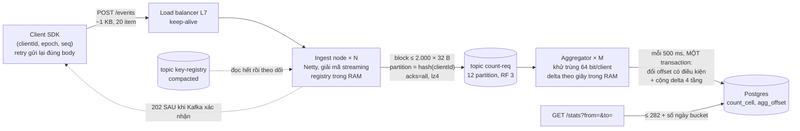

# Bài 06 — Đếm sự kiện 1M–10M request/s: đề bài, con số, và kiến trúc

> **Dùng cho:** **Katalon**, bài phỏng vấn thật "fake key": đếm `true`, `false`, `fake key` trong 24 giờ qua hay khoảng
> bất kỳ. Câu follow-up khó nhất: *"bây giờ là 1 triệu, rồi 10 triệu request mỗi giây thì sao?"*. Bài này dựng con
> số và kiến trúc. Ba bài sau viết **từng dòng code** của nó và chạy trên Kafka + Postgres thật.
>
> **Thời lượng:** đọc 45 phút · drill 20 phút (vẽ lại và tính lại không nhìn bài)
>
> **Code:** [`lab/src/main/java/com/prep/cs/counting/`](lab/src/main/java/com/prep/cs/counting/) · thử ngay bằng
> curl: [`scripts/e-curl-demo.sh`](lab/scripts/e-curl-demo.sh) ([output](lab/results/e-curl-demo.txt))
>
> **Cần trước:** [bài 02](02-kafka-ben-trong-broker.md) (compaction), [bài 04](04-kafka-producer-consumer-tu-code.md)
> (commit offset), [bài 05](05-kafka-scale-va-van-hanh.md) (tính cỡ cụm). Đề gốc và lời giải ở 10k/phút:
> [Katalon 04](../../katalon-prep/katalon-system-design/04-event-counting-10k.md); nấc 10M–100M/**phút**:
> [Katalon 07](../../katalon-prep/katalon-system-design/07-event-counting-10m-100m.md).
>
> **Học tiếp:** [bài 07](07-dem-su-kien-code-ingest.md) (code ingest) → [bài 08](08-dem-su-kien-code-aggregator.md)
> (code aggregator) → [bài 09](09-dem-su-kien-chay-that-va-scale.md) (chạy thật, sự cố, scale).

---

## 0. Trọng tâm phỏng vấn

| # | Câu hỏi | Trả lời của senior |
|:-:|---|---|
| 1 | Nghe "10 triệu request/giây" thì làm gì đầu tiên? | Đổi ra **byte** và **CPU**. 10M × ~1 KB = 10 GB/s ≈ 80 Gbit/s vào. 10M × ~80–100 µs CPU = 800–1.000 core. Mọi quyết định sau đó là để giảm hai con số này |
| 2 | Lưu từng item rồi đếm lúc hỏi? | 20 item/request là **200 triệu dòng/giây**. Không database nào ghi nổi, và hỏi "24 giờ qua" là quét 17 nghìn tỷ dòng. Phải đếm sẵn và đọc bucket |
| 3 | Mỗi request cộng vào một counter (`UPDATE`, `INCR`)? | Một dòng nóng. Lab đo **~500 giao dịch/giây** trên một dòng Postgres ([bài 10](10-ledger-tinh-so-du-tu-code.md)). 10M/s gấp 20.000 lần |
| 4 | Vậy đếm ở đâu? | **Phân loại ngay ở ingest** (20 item → 4 con số), gửi bản ghi **32 byte** qua Kafka, aggregator cộng trong RAM theo giây, rồi mỗi 500 ms commit **delta + offset Kafka trong một transaction** Postgres |
| 5 | Client retry có bị đếm hai lần? | Không. Khoá `(clientId, epoch, seq)` cộng **cửa sổ 64 bit cho mỗi client** ở aggregator. State tỷ lệ với số client, không với số request. Một tập `batch_id` 15 phút ở 10M/s là 9 tỷ id |
| 6 | Aggregator chết giữa chừng? | Offset nằm trong Postgres, cùng transaction với số đếm. Chết trước commit thì đọc lại từ offset cũ; sau commit thì không đọc lại. Aggregator "xác sống" bị chặn bằng `UPDATE ... WHERE next_offset = expected` |
| 7 | Hỏi khoảng bất kỳ có đắt không? | Không. Phân rã `[from, to)` thành bucket giây/phút/giờ/ngày, tối đa **282 + số ngày** bucket, **không phụ thuộc số event**. Lab: 3 ngày dữ liệu, 300 khoảng ngẫu nhiên, đọc tối đa 142 dòng |

---

## 1. Đề bài, và cái gì đổi khi tải nhân 6.000–60.000 lần

**Đề gốc (Katalon, vòng Principal):** mỗi request mang một danh sách key-value, value là `true`/`false`, key có thể là
key không hợp lệ ("fake key"). Bất kỳ lúc nào cũng phải trả lời được: bao nhiêu `true`, `false`, `fake key`, trong 24
giờ qua **hoặc khoảng thời gian bất kỳ**. Đề gốc là 10.000 request/**phút**.

Bài này đẩy lên **1M và 10M request/giây**, gấp 6.000 và 60.000 lần đề gốc. Đó là quy mô của một nền tảng test chạy
hàng trăm nghìn agent CI cùng lúc, hoặc một hệ thống telemetry. Ở quy mô này, ba thứ đổi bản chất:

1. **Mỗi µs CPU trên một request là một core.** 1 µs × 1M request/s = 1 core; ở 10M là 10 core. Code "bình thường"
   (parse cây JSON, `HashMap<String,…>`, exception cho key sai) thành tiền thật ([bài 07](07-dem-su-kien-code-ingest.md)
   đo từng thứ).
2. **Không có chỗ cho một dòng nóng nào.** Mọi thiết kế "cộng vào một chỗ" đều chết, kể cả Redis. Phải **gộp trước**
   rồi mới ghi.
3. **Exactly-once không có sẵn ở tầng nào.** HTTP retry, Kafka at-least-once, consumer chết giữa chừng. Phải ghép
   từ các mảnh at-least-once thành "đếm đúng một lần về hiệu quả", và **chứng minh bằng test có sự cố**
   ([bài 09](09-dem-su-kien-chay-that-va-scale.md)).

### 1.1 Luật phân loại: chốt trước khi code

Interviewer không nói, nên phải hỏi rồi chốt bằng lời. Bài này chốt như sau (khớp
[Katalon 04 §6.6](../../katalon-prep/katalon-system-design/04-event-counting-10k.md#66-phân-loại-fake-key)):

| Item | Kết quả |
|---|---|
| `key` có trong registry, `value` là `true` | **TRUE** |
| `key` có trong registry, `value` là `false` | **FALSE** |
| `key` **không** có trong registry, value gì cũng được | **FAKE_KEY**: xét key trước, value sau |
| `key` hợp lệ nhưng `value` là `"yes"`, `null`, `1`, object... | **MALFORMED**, không gộp vào FALSE |
| Thiếu `key`, `key` không phải chuỗi, item không phải object | **MALFORMED** |
| Cả request hỏng (JSON vỡ, thiếu `clientId`/`seq`, quá 1.000 item) | HTTP **400**, không đếm gì |

Tỷ lệ thành công = TRUE / (TRUE + FALSE). FAKE_KEY và MALFORMED đếm riêng, không nằm trong mẫu số. Và **không bao giờ
lưu tỷ lệ**: lưu các con đếm, chia lúc đọc, vì tỷ lệ không cộng được qua các bucket.

### 1.2 Sáu câu phải hỏi ở quy mô này

| # | Hỏi | Vì sao đổi thiết kế |
|---|---|---|
| 1 | Mỗi request bao nhiêu item, body bao lớn? | Đơn vị tải. Lab giả định 20 item, body ~835 byte |
| 2 | Client có `clientId` và số thứ tự `seq` không? Retry có gửi lại **đúng** body không? | Có thì khử trùng theo client rất rẻ (§4.2). Không có thì phải sinh id cho mỗi request và state khử trùng nổ |
| 3 | Bao nhiêu client hoạt động cùng lúc? | State khử trùng tỷ lệ với số client: 100k agent hay 100M thiết bị là hai thiết kế khác nhau |
| 4 | Client chịu được bao nhiêu ms để nhận 202? | Quyết định có chờ Kafka xác nhận không (§4.1) và flush bao lâu một lần |
| 5 | Số đếm để làm dashboard hay để tính tiền? | Dashboard: đúng sau vài giây là đủ. Tính tiền: cần đối soát với raw ([Katalon 07 §5.4](../../katalon-prep/katalon-system-design/07-event-counting-10m-100m.md#54-exactly-once-về-hiệu-quả-từ-các-mảnh-at-least-once)) |
| 6 | Có cần tách theo từng key hay tenant không? | Có thì bảng đếm có thêm chiều, cardinality đổi bài toán (Katalon 04 §6.7). Bài này đếm 4 con số toàn cục |

---

## 2. Con số trước, kiến trúc sau

Mọi số "đo" dưới đây lấy từ lab chạy trên **một máy 4 vCPU dùng chung** với 6 JVM Kafka và Postgres. Trên máy thật
các số sẽ tốt hơn. Dùng chúng để thấy **bậc độ lớn** và **cái gì chiếm phần lớn**.

| | **1M request/s** | **10M request/s** | Nguồn |
|---|---:|---:|---|
| Item/s (20 item/request) | 20M | 200M | giả định đề |
| Băng thông HTTP vào (~1 KB/request kể cả header) | ~1 GB/s ≈ 8 Gbit/s | ~10 GB/s ≈ **80 Gbit/s** | body 835 B đo ở [`IngestBench`](lab/results/e-ingest-bench.txt) |
| CPU ingest (~80 µs/request: HTTP + giải mã + Kafka) | ~80 core | ~800 core | [`e-http-bench`](lab/results/e-http-bench.txt), Netty, 1.024 kết nối |
| … ở 60% CPU, node 16 vCPU | ~9 node | **~85 node** | |
| Riêng giải mã + phân loại 20 item | 10 core | 100 core | JMH `decodeStreaming` 10,1 µs ([bài 07](07-dem-su-kien-code-ingest.md)) |
| Byte vào Kafka (32 B/request, lz4 còn ~14–16 B) | ~16 MB/s | ~160 MB/s | [`e-ingest-bench`](lab/results/e-ingest-bench.txt) |
| Ghi đĩa Kafka (RF 3) | ~48 MB/s | ~480 MB/s | [bài 05 §10](05-kafka-scale-va-van-hanh.md#10-tính-cỡ-cụm-cho-bài-đếm-sự-kiện-1m-và-10m-requests) |
| Luồng aggregator (~5M request/s/luồng) | 1 (dùng 2 cho dự phòng) | 2 (dùng 12: dư để đọc bù sau sự cố) | [`e-aggregator-bench`](lab/results/e-aggregator-bench.txt) |
| Transaction Postgres | ~24/s | ~24/s | 12 partition × 2 commit/s, **không đổi theo tải** |
| Dòng Postgres thêm mỗi ngày | 87.865 | 87.865 | 86.400 giây + 1.440 phút + 24 giờ + 1 ngày |
| State khử trùng (~60 B/client) | 6 MB cho 100k client | 60 MB cho 1M client | [bài 08](08-dem-su-kien-code-aggregator.md) |
| Registry key hợp lệ, mỗi ingest node | 33,6 MB (1M key) | 268 MB (10M key) | [`KeyRegistryTest`](lab/results/test-output.txt) |

Đọc bảng theo cột "cái gì chiếm phần lớn":

- **Tầng HTTP là phần đắt nhất**: 800 core và 80 Gbit/s ở 10M. Kafka chỉ 6 broker; Postgres chỉ ~24 transaction/giây.
  Ở quy mô này, tối ưu một µs ở ingest đáng giá hơn mọi tinh chỉnh database.
- **Postgres không lớn lên theo tải.** Nó chỉ nhận số đã gộp: số transaction tỷ lệ với *số partition × tần suất
  commit*, không với số request. Đây là luận điểm của cả bài.
- **Câu hỏi đáng giá nhất cho interviewer là #2 và #1 ở §1.2.** Nếu SDK gộp được 10 kết quả test vào một request, mọi
  con số ở cột 10M chia 10.

---

## 3. Bậc thang lời giải: vì sao từng cách trực giác chết

| # | Cách | Chết ở đâu, với số liệu |
|:-:|---|---|
| 1 | `INSERT` mỗi item một dòng, `COUNT(*) WHERE ts BETWEEN` khi hỏi | 200M dòng/s ở 10M. Postgres một node ghi cỡ 10⁴–10⁵ dòng/s. Đọc "24 giờ" là quét 17 nghìn tỷ dòng |
| 2 | Mỗi request `UPDATE counter SET t = t + ?` | Một dòng, mọi transaction xếp hàng trên khoá dòng. Lab: **~500 giao dịch/s** với 16 luồng trên một dòng (bài 10). Và một counter tổng không trả lời được khoảng bất kỳ (Katalon 04 §1) |
| 3 | Counter theo bucket thời gian trong Redis (`HINCRBY sec:<t>`) | Trả lời được khoảng thời gian, nhưng **mọi request cùng giây đập vào cùng một key**: key nóng nằm trên một shard, một luồng. Không durable cùng offset Kafka nên không chống được đếm trùng khi replay |
| 4 | Mỗi request một message JSON vào Kafka, stream processor khử trùng theo `batch_id` (thiết kế ở [Katalon 07](../../katalon-prep/katalon-system-design/07-event-counting-10m-100m.md) cho 10M/**phút**) | Ở 10M/**giây**: 8,35 GB/s vào Kafka (25 GB/s ghi đĩa). Tập `batch_id` trong cửa sổ 15 phút là **9 tỷ id** × 16 B = 144 GB state |
| 5 | **Bài này:** phân loại ở ingest → bản ghi 32 B → block theo partition → khử trùng theo client → delta theo giây → commit delta + offset mỗi 500 ms | 160 MB/s vào Kafka; state khử trùng tỷ lệ số client; Postgres ~24 transaction/s |

Cách 5 không phải "thêm máy cho cách 4". Nó đổi **ba quyết định**:

1. **Phân loại sớm.** Ingest biết luật phân loại và giữ registry trong RAM, nên 20 item × ~40 byte biến thành 4 con số.
   Dữ liệu nhỏ đi 26 lần trước khi nén, ~50 lần sau nén.
2. **Danh tính theo client, không theo request.** `(clientId, epoch, seq)` tăng dần cho phép nhớ "đã thấy seq nào" bằng
   **64 bit cho mỗi client** thay vì một id cho mỗi request. Đây chính là cách idempotent producer của Kafka chống trùng
   (bài 02 bước 7), và cửa sổ chống phát lại của IPsec.
3. **Gộp hai lần trước khi chạm database.** Lần 1 ở ingest (item → con đếm của request). Lần 2 ở aggregator (request →
   delta theo giây, ~10⁶ request thành vài dòng mỗi 500 ms).

---

## 4. Kiến trúc



Đi theo một request (code ở bài 07–08, chạy thật ở [`e-curl-demo`](lab/results/e-curl-demo.txt)):

```text
POST {"clientId":1792404783,"epoch":1,"seq":0,"ts":1792404783046,"items":[
      {"key":"feature_1","value":true},{"key":"feature_2","value":false},
      {"key":"hack_me","value":true},{"key":"feature_3","value":"yes"}]}
 1. Ingest: parser streaming đọc từng token; key băm 128 bit, tra registry → TRUE 1, FALSE 1, FAKE_KEY 1, MALFORMED 1
 2. Ghi 32 byte: clientId | epoch | seq | ts (giây) | 1 | 1 | 1 | 1 vào block của partition hash(clientId) % 12
 3. Block gửi khi đầy 2.000 bản ghi hoặc sau 5 ms; Kafka xác nhận (acks=all) → HTTP 202 cho MỌI request trong block
 4. Aggregator: cửa sổ của client → NEW → cộng (1,1,1,1) vào ô giây 1792404783
 5. Mỗi 500 ms: BEGIN; UPDATE agg_offset ... WHERE next_offset = <cũ>; upsert ô giây, phút, giờ, ngày; COMMIT
 6. GET /stats?from=10:12:58Z&to=10:13:08Z → {"trueCount":3,"falseCount":3,"fakeKey":3,"malformed":3,...,"bucketsRead":1}
```

### 4.1 Hợp đồng của mỗi tầng

| Tầng | Cam kết | Vì sao |
|---|---|---|
| Client SDK | Gán `(clientId, epoch, seq)`; **retry gửi lại đúng body**; khởi động lại thì `epoch` mới, `seq` từ 0 | Mọi khử trùng phía sau dựa vào điều này |
| Ingest | **202 chỉ khi block đã được Kafka xác nhận** (`acks=all`). 400 cho request hỏng. 503 khi Kafka lỗi | 202 nghĩa là "đã bền", không phải "đã vào RAM". Ingest chết thì client không nhận 202 và tự retry |
| Kafka | Request của một client luôn vào **cùng partition** (`hash(clientId)`) | Bản gốc và bản retry gặp nhau ở cùng một aggregator, nên khử trùng chỉ cần state cục bộ |
| Aggregator | Khử trùng theo client; offset và số đếm **cùng một transaction** | Chết ở bất kỳ đâu cũng không mất và không đếm trùng |
| Postgres | Ô `(tầng, bucket)` → 4 con đếm; ô phút **luôn bằng** tổng 60 ô giây của nó | Ghi cả 4 tầng trong cùng transaction, nên đọc khoảng bất kỳ ở tầng nào cũng khớp |

### 4.2 Đếm đúng một lần, ghép từ các mảnh at-least-once

| Sự cố | Điều gì xảy ra | Vì sao vẫn đúng |
|---|---|---|
| Mất response, client gửi lại | Hai bản ghi cùng `(clientId, epoch, seq)` trong Kafka | Cửa sổ của client đã có bit đó: `DUPLICATE`, không đếm |
| Ingest node chết, block chưa gửi | Request trong block không bao giờ nhận 202 | Client hết giờ, retry sang node khác; chỉ một bản tới Kafka hoặc cả hai (thì khử trùng) |
| Broker Kafka chết | Leader mới (bài 03); producer idempotent gửi lại | `acks=all` + `min.insync.replicas=2`: block đã xác nhận không mất |
| Aggregator chết **trước** commit | Delta trong RAM mất; offset trong Postgres vẫn cũ | Aggregator mới đọc lại từ offset cũ: đếm lại đúng phần chưa commit |
| Aggregator chết **sau** commit | Không mất gì | Offset đã tiến cùng số đếm |
| Aggregator "xác sống" (GC dừng lâu, đã mất partition mà chưa biết) | Cố commit delta cũ | `UPDATE agg_offset ... WHERE next_offset = expected` trả 0 dòng → rollback (fencing) |
| Aggregator khởi động lại | State khử trùng trong RAM mất | Đọc lại 15 phút gần nhất **chỉ để nạp state**, không đếm (`replayUntil`) |
| Client khởi động lại | `epoch` mới, `seq` về 0 | Cửa sổ thấy epoch lớn hơn: mở cửa sổ mới |
| Tiến trình client cũ vẫn còn gửi | Request epoch cũ tới sau epoch mới | `STALE`: bỏ, đếm vào metric riêng |

Bài 09 chạy toàn bộ bảng này trong **một** test: 200 client, 2 ingest node, aggregator chết, aggregator mới vào, ingest
node chết, 5% request gửi trùng, 10 client khởi động lại, tiến trình cũ "sống lại". Cuối cùng số trong Postgres **khớp
chính xác** số đếm lúc sinh request, cho cả 100 khoảng thời gian ngẫu nhiên.

**Giới hạn phải tự nói ra** (interviewer sẽ đánh giá cao):

- **Cửa sổ 64 seq:** một client có hơn 64 request đang bay cùng lúc, và request thứ 65 về trước request thứ 1, thì
  request thứ 1 thành `TOO_OLD` và bị bỏ. SDK phải giới hạn số request đang bay ≤ 64 (thường là 1–8). Metric `TOO_OLD`
  phải luôn bằng 0.
- **Cửa sổ thời gian 15 phút khi khởi động lại:** retry tới sau hơn 15 phút **và** sau một lần aggregator khởi động lại
  thì có thể bị đếm hai lần. SDK phải bỏ cuộc trước 15 phút.
- **Event time do client gán:** đồng hồ client sai thì số rơi sai bucket. Production nên kẹp `ts` vào
  `[now − 7 ngày, now + 5 phút]`, còn lại đếm vào ô riêng (bài 09 §6).

---

## 5. Cỡ hệ thống cho 1M và 10M request/s

| Thành phần | 1M request/s | 10M request/s | Cái quyết định |
|---|---|---|---|
| Load balancer | 8 Gbit/s, TLS | **80 Gbit/s**, TLS: nhiều LB, DNS chia vùng | Byte vào |
| Ingest | ~9 node × 16 vCPU | ~85 node × 16 vCPU | CPU/request (bài 07, 09) |
| Kafka | 3 broker | 6 broker trên 3 AZ | Dung lượng giữ 24 giờ, miền lỗi (bài 05 §10) |
| Partition `count-req` | 12 | 12–16 | Song song phía đọc đủ dư; **nhiều hơn làm block nhỏ đi** (bài 09 §4) |
| Aggregator | 2 tiến trình | 3 tiến trình × 4 luồng | ~5M request/s/luồng (bài 08); dư để đọc bù |
| Postgres | 1 primary + 1 replica | như trái | ~24 transaction/s, ~88k dòng/ngày |
| Độ trễ 202 | ~10–25 ms | như trái | flush 5 ms + linger 5 ms + `acks=all` |

Câu chốt khi trình bày: **"Tải tăng 10 lần thì tầng ingest tăng 10 lần, Kafka tăng theo byte, còn Postgres gần như
không đổi."**

---

## 6. Kịch bản trình bày 4 phút

> 1. *"Trước khi vẽ, tôi đổi 10 triệu request/giây ra byte và CPU: khoảng 80 Gbit/s vào và 800 core nếu mỗi request tốn
>    80 µs. Nên thiết kế phải làm hai việc: không để dữ liệu thô đi xa hơn ingest, và không để database thấy từng
>    request."*
> 2. *"Ingest phân loại ngay: parser streaming, key băm 128 bit tra registry trong RAM. 20 item thành 4 con số, đóng thành
>    bản ghi 32 byte cùng `clientId, epoch, seq`. Bản ghi gom thành block theo partition `hash(clientId)` rồi gửi Kafka
>    `acks=all`. Client chỉ nhận 202 khi Kafka đã xác nhận."*
> 3. *"Aggregator đọc theo partition. Mỗi client có một cửa sổ 64 bit như idempotent producer của Kafka, nên retry không
>    đếm hai lần, và state tỷ lệ với số client chứ không với số request. Nó cộng delta theo giây trong RAM. Mỗi 500 ms nó
>    ghi delta vào 4 tầng giây, phút, giờ, ngày, **cùng một transaction** với offset Kafka, và offset được đổi có điều
>    kiện để chặn aggregator xác sống."*
> 4. *"Đọc khoảng bất kỳ: phân rã thành tối đa 282 + số ngày bucket, không phụ thuộc số event. Postgres chỉ nhận khoảng
>    24 transaction/giây dù tải là 1 hay 10 triệu."*
> 5. *"Tôi đã chạy nó với sự cố: aggregator chết, ingest chết, client retry, client khởi động lại. Số cuối khớp chính
>    xác. Hai giới hạn: client không được để quá 64 request đang bay, và retry phải bỏ cuộc trước 15 phút."*

---

## 7. Drill (20 phút)

1. Không nhìn bài, vẽ lại sơ đồ §4 và điền **con số trên mỗi mũi tên** ở 10M request/s (byte/s, request/s, record/s,
   transaction/s).
2. Tính lại bảng §2 với giả định khác: 200 item/request, body 8 KB, 2M request/s. Cái gì vỡ trước?
3. Viết ra 5 sự cố ở §4.2 và với mỗi sự cố, dòng code nào (bài 07–08) làm nó đúng.

---

## 8. Follow-up hay gặp

<details>
<summary><b>Q1. Sao không dùng Flink hay Kafka Streams cho aggregator?</b></summary>

Được, và ở production có thể là lựa chọn đúng: Flink có cửa sổ thời gian, state backend (RocksDB), checkpoint và sink
hai pha. Bài này tự viết aggregator (~300 dòng) để thấy và nói được **cơ chế**: khử trùng theo client, offset cùng
transaction với kết quả, fencing. Đây cũng chính là những gì Flink làm bên trong. Đổi lại phải vận hành thêm một cụm
Flink và hiểu checkpoint interval ảnh hưởng độ trễ của số. Nói được đánh đổi đó quan trọng hơn chọn đúng tên.
</details>

<details>
<summary><b>Q2. Sao không ghi thẳng vào ClickHouse hay Druid?</b></summary>

Nếu cần **tách theo từng key hay tenant** (cardinality cao), đó là hướng đúng: đẩy bản ghi gọn vào ClickHouse
(`SummingMergeTree`, materialized view theo phút). Với 4 con đếm toàn cục, Postgres chỉ nhận ~24 transaction/s và
~88k dòng/ngày, nên một kho OLAP là thừa. Cái **không** đổi giữa hai lựa chọn là ingest gộp sớm và khử trùng theo
client.
</details>

<details>
<summary><b>Q3. Tại sao ingest phải chờ Kafka xác nhận rồi mới trả 202? Chậm lắm.</b></summary>

Trả 202 ngay khi request vào RAM thì ingest chết là **mất im lặng**: client tưởng đã gửi xong. Chờ xác nhận tốn
~10–25 ms (curl demo đo 22–39 ms trên máy lab đang tải), nhưng biến mọi sự cố ở ingest thành "client không nhận 202 →
tự retry", và khử trùng phía sau lo phần còn lại. Nếu SLA độ trễ chặt hơn, hãy giảm `flush`/`linger`, đừng bỏ xác
nhận.
</details>

<details>
<summary><b>Q4. Một client gửi 8 triệu request/s một mình thì sao?</b></summary>

Mọi request của nó vào một partition, và một luồng aggregator làm được ~5M request/s, nên nó vượt trần. Cách giải:
cho client đó nhiều `clientId` con (`clientId × 16 + luồng`). Mỗi id con có `seq` riêng nên khử trùng vẫn đúng, và
chúng rải ra nhiều partition. Đây là "muối key" của bài 05 Q3, làm ở phía client nên không cần gộp lại khi đọc (số đếm
cộng được).
</details>

<details>
<summary><b>Q5. "Exactly-once" ở đây có thật không?</b></summary>

Không có tầng nào exactly-once. Kết quả đếm **đúng một lần về hiệu quả** khi giữ được ba điều kiện: client retry đúng
body; số request đang bay của một client ≤ 64; retry bỏ cuộc trước 15 phút. Vi phạm thì hệ thống không im lặng: các
metric `TOO_OLD`, `STALE` và duplicates tăng. Đó là khác biệt giữa thiết kế senior và thiết kế "hy vọng".
</details>

---

## 9. Checklist

- [ ] Đổi được 1M và 10M request/s ra byte, CPU, record Kafka, transaction Postgres. Biết cái gì đắt nhất (ingest).
- [ ] Nói được vì sao 4 cách trực giác chết, với một con số cho mỗi cách.
- [ ] Vẽ được kiến trúc §4 và đi được một request từ đầu tới cuối.
- [ ] Liệt kê được 9 sự cố ở §4.2 và cơ chế làm mỗi sự cố vẫn đúng.
- [ ] Tự nói ra ba giới hạn (64 seq, 15 phút, đồng hồ client) trước khi bị hỏi.
- [ ] Trình bày được kịch bản §6 trong 4 phút.
