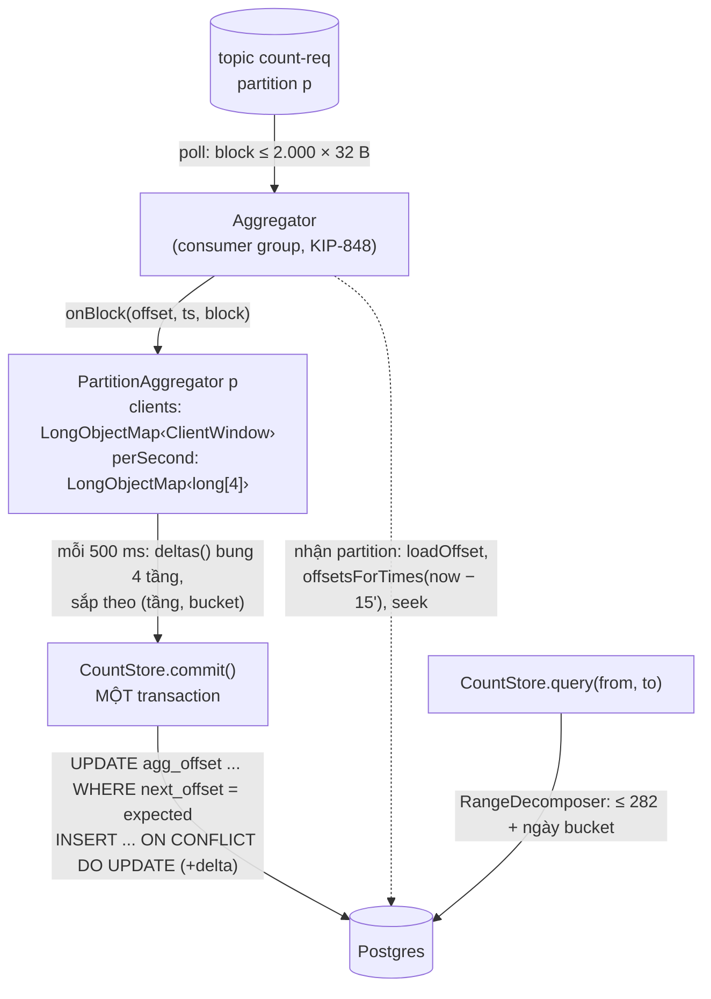

# Bài 08 — Đếm sự kiện: code phía aggregator, khử trùng theo client, commit cùng offset, đọc khoảng bất kỳ

> **Dùng cho:** **Katalon**, nửa sau của bài fake key: "retry có bị đếm hai lần không", "consumer chết giữa chừng thì
> sao", "hỏi 24 giờ qua hay khoảng bất kỳ có nhanh không". Đây là phần interviewer đào sâu nhất, vì nó là chỗ phân biệt
> "dùng Kafka" với "hiểu exactly-once".
>
> **Thời lượng:** đọc 60 phút · lab 10 phút · drill 25 phút
>
> **Code:** [`counting/`](lab/src/main/java/com/prep/cs/counting/): `Tier`, `ClientWindow`, `LongObjectMap`,
> `PartitionAggregator`, `CountStore`, `Aggregator`, `RangeDecomposer`, `Stats` · schema
> [`counting.sql`](lab/src/main/resources/counting.sql) · test: `ClientWindowTest`, `LongObjectMapTest`,
> `CountStoreTest`, `RangeDecomposerTest` · đo: JMH [`CountingBench`](lab/src/main/java/com/prep/cs/counting/bench/CountingBench.java),
> [`AggregatorBench`](lab/src/main/java/com/prep/cs/counting/bench/AggregatorBench.java)
>
> **Cần trước:** [bài 07](07-dem-su-kien-code-ingest.md) (bản ghi 32 byte, block), [bài 04](04-kafka-producer-consumer-tu-code.md)
> (commit offset, rebalance). **Học tiếp:** [bài 09](09-dem-su-kien-chay-that-va-scale.md).

```bash
cd on-bai/chuyen-sau/lab
docker compose -f docker/cluster.yml up -d --wait
mvn -q test -Dtest='ClientWindowTest,LongObjectMapTest,RangeDecomposerTest,CountStoreTest'   # cần Postgres
```

---

## 0. Trọng tâm phỏng vấn

| # | Câu hỏi | Trả lời của senior |
|:-:|---|---|
| 1 | Khử trùng retry bằng gì? | Mỗi client một **cửa sổ 64 bit**: `seq` lớn nhất đã thấy + bitmap 64 seq ngay dưới nó. **2,4 ns** một lần, ~60 B/client. Đúng ý tưởng của idempotent producer Kafka và cửa sổ chống phát lại IPsec |
| 2 | Cộng vào 4 tầng (giây/phút/giờ/ngày) lúc nào? | **Lúc commit**, không phải lúc nhận. Đường nóng chỉ cộng vào ô giây trong RAM: **28,6 ns/request, 0 rác**, so với 214 ns và 152 B khi cộng ngay 4 tầng |
| 3 | Offset Kafka commit ở đâu? | **Trong Postgres, cùng transaction với số đếm.** Hai thứ cùng ghi hoặc cùng không. `enable.auto.commit=false` và không commit offset vào Kafka |
| 4 | Aggregator xác sống? | `UPDATE agg_offset SET next_offset = :next WHERE ... AND next_offset = :expected`. 0 dòng thì rollback: offset chính là fencing token. Bị từ chối thì **nạp lại** từ Postgres, đừng buông partition |
| 5 | Khởi động lại thì state khử trùng ở đâu ra? | Lùi về 15 phút trước (`offsetsForTimes`), đọc lại tới offset đã commit **chỉ để nạp state**, rồi mới đếm tiếp |
| 6 | Hỏi khoảng bất kỳ? | Tham lam từ trái sang: ở mỗi vị trí, lấy tầng **lớn nhất** vừa khít. Tối đa **282 + số ngày** bucket. Một năm lệch 1 giây hai đầu: 645 bucket |

---

## 1. Bản đồ code



| File | Dòng | Việc | Test |
|---|---:|---|---|
| `counting.sql` | 22 | `count_cell(tier, bucket)` + `agg_offset(topic, part)` | — |
| `Tier` | 18 | 4 tầng, `bucketOf(sec)` | — |
| `ClientWindow` | 54 | Cửa sổ 64 bit: NEW / DUPLICATE / STALE / TOO_OLD | `ClientWindowTest` (2) |
| `LongObjectMap` | 111 | Map `long → V` địa chỉ mở, không boxing, xoá backward-shift | `LongObjectMapTest` (1) |
| `PartitionAggregator` | 106 | State một partition: khử trùng + delta theo giây + mốc offset | `CountStoreTest` (4) |
| `CountStore` | 152 | Commit có fencing; truy vấn khoảng | `CountStoreTest` |
| `Aggregator` | ~175 | Consumer, gán partition, replay, commit định kỳ, nạp lại khi bị từ chối | `PipelineTest` (bài 09) |
| `RangeDecomposer` | 51 | Phân rã `[from, to)` thành bucket | `RangeDecomposerTest` (3) |

---

## 2. Bước 1 — Bảng đếm và bảng offset

📄 [`counting.sql`](lab/src/main/resources/counting.sql)

```sql
CREATE TABLE IF NOT EXISTS count_cell (
    tier    smallint NOT NULL,             -- 0 giay, 1 phut, 2 gio, 3 ngay (Tier.ordinal)
    bucket  bigint   NOT NULL,             -- giay epoch cua dau bucket (UTC)
    t       bigint   NOT NULL DEFAULT 0,   -- TRUE
    f       bigint   NOT NULL DEFAULT 0,   -- FALSE
    fk      bigint   NOT NULL DEFAULT 0,   -- FAKE_KEY
    mal     bigint   NOT NULL DEFAULT 0,   -- MALFORMED
    PRIMARY KEY (tier, bucket)
);

-- Offset Kafka KHONG luu o Kafka ma luu o day, cung transaction voi so dem: hai thu cung ghi hoac cung khong.
-- next_offset = offset ke tiep phai doc. Cap nhat co dieu kien (= gia tri cu) de chan aggregator "xac song".
CREATE TABLE IF NOT EXISTS agg_offset (
    topic        text   NOT NULL,
    part         int    NOT NULL,
    next_offset  bigint NOT NULL,
    PRIMARY KEY (topic, part)
);
```

```java
public enum Tier {
    SECOND(1), MINUTE(60), HOUR(3_600), DAY(86_400);
    public long bucketOf(long epochSecond) {
        return Math.floorDiv(epochSecond, seconds) * seconds;   // floorDiv: dung ca voi giay am
    }
}
```

- **Ô = (tầng, bucket)**, bucket là giây epoch của đầu bucket, căn theo **UTC**. Với múi giờ lệch nguyên giờ như
  UTC+7, biên giờ địa phương trùng biên giờ UTC, nên hỏi theo giờ vẫn khít. Riêng "ngày" theo giờ Việt Nam thì không
  thẳng hàng với ngày UTC: phân rã tự rơi xuống tầng giờ ở hai đầu (§9), vẫn đúng, chỉ đọc nhiều dòng hơn.
- **Lưu con đếm, không lưu tỷ lệ.** `successRate` tính lúc đọc (`Stats.successRate()`).
- **Mỗi ngày thêm 87.865 dòng** dù tải là 1 hay 10M request/s: 86.400 + 1.440 + 24 + 1. Giữ ô giây 7 ngày, ô phút 90
  ngày, ô giờ và ngày mãi mãi thì bảng không bao giờ quá vài chục triệu dòng.

---

## 3. Bước 2 — `ClientWindow`: khử trùng bằng 64 bit cho mỗi client

📄 [`ClientWindow.java`](lab/src/main/java/com/prep/cs/counting/ClientWindow.java)

```java
public Verdict accept(int e, long seq, long nowMillis) {
    lastSeenMillis = Math.max(lastSeenMillis, nowMillis);
    if (e < epoch) return Verdict.STALE;
    if (e > epoch) {                          // client khoi dong lai: bat dau cua so moi
        epoch = e;
        highest = seq;
        seen = 1L;
        return Verdict.NEW;
    }
    if (seq > highest) {
        long shift = seq - highest;
        seen = shift >= WIDTH ? 1L : (seen << shift) | 1L;
        highest = seq;
        return Verdict.NEW;
    }
    long back = highest - seq;
    if (back >= WIDTH) return Verdict.TOO_OLD;
    long bit = 1L << back;
    if ((seen & bit) != 0) return Verdict.DUPLICATE;
    seen |= bit;                              // den tre nhung chua thay: van la request moi
    return Verdict.NEW;
}
```

Bit `i` của `seen` = đã thấy `seq = highest − i`. Chạy tay đúng test `retryIsDuplicateLateButUnseenIsNew`:

```text
khởi tạo seq 10           highest 10  seen ...00001   (10)
accept 11  → NEW          highest 11  seen ...00011   (11, 10)          dịch 1
accept 11  → DUPLICATE                                                   bit 0 đã bật: client retry
accept 14  → NEW          highest 14  seen ...11001   (14, 11, 10)      dịch 3; 12, 13 còn trên đường
accept 12  → NEW                      seen ...11101                      tới trễ nhưng chưa thấy: vẫn đếm
accept 13  → NEW                      seen ...11111
accept 12  → DUPLICATE ; accept 10 → DUPLICATE
```

| Verdict | Khi nào | Xử lý |
|---|---|---|
| `NEW` | Lần đầu thấy `(epoch, seq)` | Đếm |
| `DUPLICATE` | Bit đã bật: client retry, hoặc hệ thống tự phát lại | Bỏ, tăng `duplicates` |
| `STALE` | Epoch cũ hơn epoch đang giữ: tiến trình client cũ còn sống | Bỏ, tăng `stale` |
| `TOO_OLD` | Lùi quá 64 seq: không còn biết đã thấy hay chưa | Bỏ, tăng `tooOld`. **Phải luôn bằng 0**; khác 0 là SDK để quá 64 request đang bay |

So với các cách khác:

| Cách khử trùng | State ở 10M request/s, cửa sổ 15 phút | Ghi chú |
|---|---|---|
| Tập `requestId` (UUID) | 9 tỷ id × 16 B = **144 GB** | Không vừa RAM; Redis cũng không |
| Bloom filter cho `requestId` | ~11 GB ở 1% dương tính giả | Dương tính giả = **bỏ nhầm request thật** |
| **Cửa sổ theo client** | **~60 B × số client đang hoạt động** (1M client = 60 MB) | Cần client gán `seq` tăng dần, ≤ 64 request đang bay |

Test thứ hai có cả epoch mới và tiến trình cũ:

```java
ClientWindow w = new ClientWindow(1, 0, 0);
assertThat(w.accept(1, 100, 0)).isEqualTo(NEW);
assertThat(w.accept(1, 37, 0)).isEqualTo(NEW);       // 100 - 37 = 63 < 64: con trong cua so
assertThat(w.accept(1, 36, 0)).isEqualTo(TOO_OLD);   // 64 so ve truoc: khong con biet -> bo, dem rieng
assertThat(w.accept(2, 0, 0)).isEqualTo(NEW);        // client khoi dong lai: epoch 2, seq tu 0
assertThat(w.accept(2, 0, 0)).isEqualTo(DUPLICATE);
assertThat(w.accept(1, 101, 0)).isEqualTo(STALE);    // tien trinh cu (epoch 1) van con gui: xac song
```

JMH `clientWindowAccept`: **2,4 ns**, 0 byte rác. Ở 10M request/s, khử trùng tốn **0,024 core**.

---

## 4. Bước 3 — `LongObjectMap`: map `long → V` không boxing

📄 [`LongObjectMap.java`](lab/src/main/java/com/prep/cs/counting/LongObjectMap.java)

`HashMap<Long, ClientWindow>` tạo một `Long` (16 B) cho mỗi lần `get`/`put` với khoá ngoài [−128, 127]. Ở 10M
request/s, đó là 160 MB rác mỗi giây **chỉ để tra cứu**. Map tự viết dùng hai mảng song song:

```java
private long[] keys;
private Object[] vals;            // null = o trong

public V get(long k) {
    for (int i = slot(k); ; i = (i + 1) & mask) {
        Object v = vals[i];
        if (v == null) return null;
        if (keys[i] == k) return (V) v;
    }
}

public void put(long k, V v) {
    if ((size + 1) * 4 > keys.length * 3) grow();     // he so tai toi da 0.75
    for (int i = slot(k); ; i = (i + 1) & mask) {
        if (vals[i] == null) { keys[i] = k; vals[i] = v; size++; return; }
        if (keys[i] == k) { vals[i] = v; return; }
    }
}
```

**Xoá bằng dịch lùi (backward shift)**, không để lại bia mộ (tombstone). Client im lặng lâu phải bị dọn liên tục; bia
mộ sẽ làm chuỗi dò dài dần tới khi phải dựng lại cả bảng:

```java
private void deleteAt(int i) {
    vals[i] = null;
    size--;
    for (int j = (i + 1) & mask; vals[j] != null; j = (j + 1) & mask) {
        int home = slot(keys[j]);
        // phan tu o j co the doi ve i neu i nam tren duong do tu home toi j
        if (((j - home) & mask) >= ((j - i) & mask)) {
            keys[i] = keys[j];
            vals[i] = vals[j];
            vals[j] = null;
            i = j;
        }
    }
}
```

```text
trước khi xoá B:  ô:  5    6    7    8          home(A)=5, home(B)=5, home(C)=7, home(D)=6
                      A    B    C    D
xoá B (i=6):   j=7: C có home 7; quãng home→j = 0 < quãng i→j = 1 → C không được về 6 (6 nằm trước home của nó)
               j=8: D có home 6; quãng home→j = 2 ≥ quãng i→j = 2 → D dời về 6; giờ i = 8
               j=9: trống → dừng.            kết quả:  A  D  C  _
```

`LongObjectMapTest` so map này với `HashMap` qua 50 vòng `put` và `removeIf` ngẫu nhiên trên khoá âm lẫn dương.

---

## 5. Bước 4 — `PartitionAggregator.onBlock`: đường nóng

📄 [`PartitionAggregator.java`](lab/src/main/java/com/prep/cs/counting/PartitionAggregator.java)

```java
public final int partition;
long committedNext, next, replayUntil;   // offset da ghi o Postgres / offset ke tiep / ranh gioi replay
private final LongObjectMap<ClientWindow> clients = new LongObjectMap<>(1 << 12);
private final LongObjectMap<long[]> perSecond = new LongObjectMap<>(1 << 10);   // giay -> delta[4]
private final Decoded r = new Decoded();

public void onBlock(long offset, long timestampMs, ByteBuffer block) {
    int n = block.getInt();
    boolean replay = offset < replayUntil;           // da dem truoc khi restart: chi nap state khu trung
    for (int i = 0; i < n; i++) {
        RequestRecord.read(block, r);
        ClientWindow w = clients.get(r.clientId);
        ClientWindow.Verdict v;
        if (w == null) {
            clients.put(r.clientId, new ClientWindow(r.epoch, r.seq, timestampMs));
            v = ClientWindow.Verdict.NEW;
        } else {
            v = w.accept(r.epoch, r.seq, timestampMs);
        }
        if (replay) {
            replayed++;
            continue;
        }
        switch (v) {
            case NEW -> add(r);
            case DUPLICATE -> duplicates++;
            case STALE -> stale++;
            case TOO_OLD -> tooOld++;
        }
    }
    if (!replay) next = offset + 1;
}

private void add(Decoded d) {
    counted++;
    long sec = d.tsMillis / 1000;
    long[] c = perSecond.get(sec);
    if (c == null) {
        c = new long[4];
        perSecond.put(sec, c);
    }
    for (int i = 0; i < 4; i++) c[i] += d.counts[i];
}
```

- Mỗi request chỉ có **một lần tra client** và **một lần tra ô giây**. Không cấp phát gì, trừ khi gặp client mới hay giây
  mới.
- **Ba mốc offset** là toàn bộ logic phục hồi:

```text
         replay (chỉ nạp state)          đếm, chưa commit            chưa đọc
  ──────[══════════════════════)[══════════════════════════)────────────────────>  offset
       from              replayUntil = committedNext       next
                         (= next_offset trong Postgres lúc nhận partition)
```

- **Thời gian để dọn client cũ là thời gian của record** (`timestampMs` của block), không phải đồng hồ máy. Replay một
  giờ sau thì kết quả vẫn y như lúc chạy thật, nên phục hồi có tính tất định.

---

## 6. Bước 5 — `deltas()`: bung delta giây ra 4 tầng lúc commit

```java
TreeMap<CountStore.Cell, long[]> deltas() {
    TreeMap<CountStore.Cell, long[]> out = new TreeMap<>();
    perSecond.forEach((sec, c) -> {
        for (Tier t : Tier.values()) {
            long[] acc = out.computeIfAbsent(new CountStore.Cell(t, t.bucketOf(sec)), k -> new long[4]);
            for (int i = 0; i < 4; i++) acc[i] += c[i];
        }
    });
    return out;
}

public record Cell(Tier tier, long bucket) implements Comparable<Cell> {
    public int compareTo(Cell o) {         // thu tu khoa dong: tang roi bucket — moi transaction cung thu tu
        int c = Integer.compare(tier.ordinal(), o.tier.ordinal());
        return c != 0 ? c : Long.compare(bucket, o.bucket);
    }
}
```

- **Vì sao bung lúc commit:** 500 ms ở 1M request/s là 500.000 request nhưng chỉ ~1–3 giây khác nhau. Bung 4 tầng cho
  vài giây rẻ hơn rất nhiều so với 4 lần cập nhật cho mỗi request (§11 đo: 28,6 ns so với 214 ns).
- **Vì sao `TreeMap` sắp theo `(tầng, bucket)`:** mọi aggregator đều cập nhật **cùng** ô ngày, ô giờ, ô phút hiện tại.
  Hai transaction khoá hai ô theo thứ tự ngược nhau sẽ deadlock (`40P01`, [bài 10](10-ledger-tinh-so-du-tu-code.md)).
  Mọi transaction khoá theo cùng một thứ tự thì không bao giờ có vòng chờ.
- **Đúng theo cấu trúc:** ô phút luôn bằng tổng 60 ô giây của nó, vì cả 4 tầng được cộng **cùng một delta trong cùng
  transaction**. Không có job rollup chạy sau, và không có lúc nào hai tầng lệch nhau.

---

## 7. Bước 6 — `CountStore.commit`: một transaction, offset là fencing token

📄 [`CountStore.java`](lab/src/main/java/com/prep/cs/counting/CountStore.java)

```java
public boolean commit(Connection c, String topic, int part, long expected, long next,
                      SortedMap<Cell, long[]> deltas) throws SQLException {
    boolean auto = c.getAutoCommit();
    c.setAutoCommit(false);
    try {
        try (PreparedStatement ps = c.prepareStatement(
                "UPDATE agg_offset SET next_offset = ? WHERE topic = ? AND part = ? AND next_offset = ?")) {
            ps.setLong(1, next);
            ps.setString(2, topic);
            ps.setInt(3, part);
            ps.setLong(4, expected);
            if (ps.executeUpdate() != 1) {          // offset da doi: co aggregator khac commit partition nay
                c.rollback();
                return false;
            }
        }
        if (!deltas.isEmpty()) {
            try (PreparedStatement ps = c.prepareStatement(UPSERT)) {
                for (Map.Entry<Cell, long[]> e : deltas.entrySet()) {     // theo thu tu Cell
                    ...
                    ps.addBatch();
                }
                ps.executeBatch();                  // ca lo trong mot round trip
            }
        }
        c.commit();
        return true;
    } catch (SQLException e) {
        c.rollback();
        throw e;
    } finally {
        c.setAutoCommit(auto);
    }
}
```

```sql
INSERT INTO count_cell (tier, bucket, t, f, fk, mal) VALUES (?, ?, ?, ?, ?, ?)
ON CONFLICT (tier, bucket) DO UPDATE SET t = count_cell.t + EXCLUDED.t, f = count_cell.f + EXCLUDED.f,
    fk = count_cell.fk + EXCLUDED.fk, mal = count_cell.mal + EXCLUDED.mal
```

**Vì sao `UPDATE` offset đứng đầu transaction:** nó khoá dòng `agg_offset` của partition. Hai aggregator cùng commit một
partition thì cái thứ hai **chờ** cái thứ nhất xong, rồi thấy `next_offset` đã đổi và nhận 0 dòng. Không có cách nào hai
delta của cùng một khoảng offset cùng lọt vào bảng.

**Cộng delta (`t = t + EXCLUDED.t`), không ghi đè bằng `GREATEST`** như [Katalon 07 §5.4](../../katalon-prep/katalon-system-design/07-event-counting-10m-100m.md#54-exactly-once-về-hiệu-quả-từ-các-mảnh-at-least-once):
cộng thì chỉ đúng khi mỗi khoảng offset được cộng **đúng một lần**, và điều kiện offset bảo đảm đúng điều đó. Đổi lại,
mỗi partition chỉ cần nhớ delta từ lần commit trước, không phải giữ toàn bộ số đếm của mọi bucket đang mở.

### 7.1 Hai thứ tự của aggregator xác sống, cả hai đều phải đúng

**Thứ tự 1: chủ mới commit trước** (`zombieAggregatorCannotCommitAfterTheNewOwnerDid`). Aggregator A bị GC dừng lâu,
group giao partition cho B. Cả hai cùng đọc offset 0; B đọc thêm offset 1:

```java
zombie.onBlock(0, 0, block(7, 1, 0, 10, 1_792_390_000L, one));
owner.onBlock(0, 0, block(7, 1, 0, 10, 1_792_390_000L, one));
owner.onBlock(1, 0, block(7, 1, 10, 10, 1_792_390_010L, one));
assertThat(owner.commit(store, c, "t")).isTrue();            // 0 -> 2
boolean zombieOk = zombie.commit(store, c, "t");             // muon doi 0 -> 1: offset da la 2
```

```text
[LAB] owner commit ok, zombie commit bi tu choi; tong TRUE = 20 (dung: 20)
```

**Thứ tự 2: xác sống commit trước** (`ownerResyncsWhenZombieCommittedFirst`). A tỉnh dậy và commit trước khi B kịp
commit lần nào (B còn đang replay 15 phút). Giờ **chủ thật** B bị từ chối:

```text
[LAB] xac song commit truoc (0 -> 1), chu that bi tu choi, nap lai tu offset 1: replay 10, dem 10; tong TRUE = 20 (dung: 20)
```

Bản đầu của `Aggregator` xử lý cả hai thứ tự giống nhau: bị từ chối là **buông partition**. Ở thứ tự 2 thì chủ thật
buông, xác sống sắp biết mình mất partition, và **không ai đọc partition đó** tới lần rebalance sau. Không sai số, nhưng
partition đứng. Bản đã sửa nạp lại từ Postgres:

```java
private void commitAll() {
    for (PartitionAggregator pa : List.copyOf(parts.values())) {
        // bi tu choi = aggregator khac (xac song) vua commit partition nay truoc minh: state trong RAM khong con
        // khop voi Postgres. Nap lai offset + dung lai state khu trung, KHONG buong partition.
        if (!commitOne(pa)) assign(new TopicPartition(topic, pa.partition));
    }
}
```

Nạp lại an toàn ở cả hai phía. Chủ thật đếm tiếp từ đúng chỗ xác sống dừng. Còn xác sống, nếu nó cũng nạp lại, chỉ
làm thêm được tới lần `poll()` kế tiếp: lúc đó consumer biết mình đã mất partition (`onPartitionsLost`) và bỏ state.
Mỗi commit thành công vẫn là một đoạn offset nối tiếp, đếm đúng một lần.

---

## 8. Bước 7 — `Aggregator`: consumer, offset trong Postgres, replay để nạp state

📄 [`Aggregator.java`](lab/src/main/java/com/prep/cs/counting/Aggregator.java)

```java
p.put(ConsumerConfig.GROUP_PROTOCOL_CONFIG, "consumer");         // KIP-848 (bai 04)
p.put(ConsumerConfig.ENABLE_AUTO_COMMIT_CONFIG, false);          // offset nam o Postgres
p.put(ConsumerConfig.MAX_POLL_RECORDS_CONFIG, 200);              // 200 block x ~2.000 request
p.put(ConsumerConfig.FETCH_MIN_BYTES_CONFIG, 64 * 1024);
```

**Nhận partition**: offset lấy từ Postgres, rồi lùi về đầu cửa sổ khử trùng để nạp state:

```java
private void assign(TopicPartition tp) {
    long committed = store.loadOffset(db, topic, tp.partition());
    PartitionAggregator pa = new PartitionAggregator(tp.partition(), committed);
    long from = committed;
    if (committed > 0) {
        OffsetAndTimestamp ot = consumer.offsetsForTimes(
                Map.of(tp, System.currentTimeMillis() - dedupWindowMs)).get(tp);      // offset dau tien >= 15' truoc
        long begin = consumer.beginningOffsets(List.of(tp)).get(tp);
        from = Math.max(begin, ot == null ? committed : Math.min(ot.offset(), committed));
    }
    parts.put(tp.partition(), pa);
    consumer.seek(tp, from);
}
```

**Ba sự kiện của group, ba cách xử lý khác nhau** (bài 04 §3):

```java
public void onPartitionsAssigned(Collection<TopicPartition> tps) {
    for (TopicPartition tp : tps) assign(tp);
}
public void onPartitionsRevoked(Collection<TopicPartition> tps) {
    for (TopicPartition tp : tps) {
        PartitionAggregator pa = parts.remove(tp.partition());
        if (pa != null && !crashed) commitOne(pa);   // giao lai sach se: commit phan dang do
    }
}
public void onPartitionsLost(Collection<TopicPartition> tps) {
    tps.forEach(tp -> parts.remove(tp.partition())); // co the da co chu moi: KHONG commit
}
```

- **Revoked** (rebalance êm): mình vẫn là chủ tới lúc trả, nên commit phần đang dở. Người nhận sau bắt đầu đúng chỗ, ít
  phải đọc lại.
- **Lost** (bị loại khỏi group vì quá hạn heartbeat): partition **có thể đã có chủ mới**. Không commit; nếu có commit thì
  fencing cũng chặn, nhưng không thử là đúng thái độ.
- **Chết đột ngột** (`crash()` trong test): không gì được commit, delta trong RAM mất. Chủ mới đọc lại từ offset cũ.

Output thật của `replayRebuildsDedupStateWithoutCountingTwice`. Lần đầu đếm seq 0–49 rồi commit (offset → 1). Khởi
động lại: đọc lại offset 0 chỉ để nạp state, rồi offset 1 chứa seq 40–59 (40–49 là retry):

```text
[LAB] sau restart: replay 50, dem moi 10, bo trung 10
```

Không replay thì 10 retry kia bị đếm hai lần, vì state khử trùng trong RAM đã mất cùng tiến trình cũ.

---

## 9. Bước 8 — `RangeDecomposer`: khoảng bất kỳ thành ít bucket nhất

📄 [`RangeDecomposer.java`](lab/src/main/java/com/prep/cs/counting/RangeDecomposer.java)

```java
public static List<Range> decompose(long from, long to) {
    List<Range> out = new ArrayList<>();
    long x = from;
    while (x < to) {
        Tier pick = Tier.SECOND;
        for (Tier t : Tier.COARSE_FIRST) {                       // DAY, HOUR, MINUTE, SECOND
            if (Math.floorMod(x, t.seconds) == 0 && x + t.seconds <= to) {   // x dung bien VA bucket nam tron
                pick = t;
                break;
            }
        }
        Range last = out.isEmpty() ? null : out.get(out.size() - 1);
        if (last != null && last.tier() == pick && last.toBucket() == x) {
            out.set(out.size() - 1, new Range(pick, last.fromBucket(), x + pick.seconds));  // gop: 1 lan quet index
        } else {
            out.add(new Range(pick, x, x + pick.seconds));
        }
        x += pick.seconds;
    }
    return out;
}
```

```text
[LAB] SECOND [2026-10-19T02:59:58Z, 2026-10-19T03:00:00Z) 2 bucket
[LAB] HOUR   [2026-10-19T03:00:00Z, 2026-10-19T05:00:00Z) 2 bucket
[LAB] SECOND [2026-10-19T05:00:00Z, 2026-10-19T05:00:03Z) 3 bucket
[LAB] mot nam lech 1 giay hai dau: 7 khoang, 645 bucket
```

**Cận trên 282 + số ngày**, không phụ thuộc số event: mép trái tối đa 59 giây + 59 phút + 23 giờ để leo lên biên ngày;
giữa là các ngày; mép phải tối đa 23 giờ + 59 phút + 59 giây. 2 × (59 + 59 + 23) = 282. Một năm lệch 1 giây hai đầu:
282 + 363 ngày nguyên = 645 ✓.

`randomRangesCoverExactlyTheSameSeconds` kiểm 2.000 khoảng ngẫu nhiên: các range **nối liền, không hở, không chồng**,
mỗi range bắt đầu đúng biên tầng của nó, và tổng số giây phủ đúng bằng `to − from`.

---

## 10. Bước 9 — `CountStore.query`: một câu SQL

```java
public Stats query(long fromSec, long toSec) throws SQLException {
    List<RangeDecomposer.Range> ranges = RangeDecomposer.decompose(fromSec, toSec);
    StringBuilder sql = new StringBuilder(
            "SELECT coalesce(sum(t),0), coalesce(sum(f),0), coalesce(sum(fk),0), coalesce(sum(mal),0), count(*) "
                    + "FROM count_cell WHERE ");
    for (int i = 0; i < ranges.size(); i++) {
        sql.append(i == 0 ? "" : " OR ").append("(tier = ? AND bucket >= ? AND bucket < ?)");
    }
    ...
}
```

Câu SQL cho ví dụ trên là ba điều kiện `OR`. Postgres quét index khoá chính `(tier, bucket)` ba đoạn (BitmapOr), đọc
đúng 7 dòng. `count(*)` trả về số dòng đã đọc (`bucketsRead`) để chứng minh chi phí đọc.

Output thật của `anyRangeMatchesBruteForceOverThreeDaysOfData`: 3 ngày dữ liệu ngẫu nhiên, 300 khoảng ngẫu nhiên, so
với đếm thủ công từng giây:

```text
[LAB] 300 khoang ngau nhien trong 3 ngay: deu khop dem thu cong; doc toi da 142 dong; ca 3 ngay: TRUE=88260 FALSE=44306 FAKE_KEY=18997 MALFORMED=6317 successRate=0.6658 (doc 85 bucket)
```

"24 giờ qua" lúc 10:13:27 là 33 giây + 46 phút + 13 giờ (tới nửa đêm UTC) + 10 giờ + 13 phút + 27 giây = **142 dòng
index**, dưới 1 ms. Không cần cache phía trước Postgres cho câu hỏi này.

---

## 11. Bước 10 — Đo: một luồng aggregator làm được bao nhiêu

### 11.1 JMH: cộng vào ô giây so với cộng ngay 4 tầng

Output [`results/e-countingbench.txt`](lab/results/e-countingbench.txt). Một block 2.000 request của 200 client, mỗi
vòng toàn request mới:

| Benchmark | / block 2.000 request | / request | Rác / block |
|---|---:|---:|---:|
| `aggregateBlockOf2000` (bài này: `LongObjectMap` + delta theo giây) | 57,1 µs ± 34 | **28,6 ns** | **0,4 B** |
| `aggregateBlockOf2000Naive` (`HashMap<Long,…>` + `TreeMap<Cell,…>` cộng ngay 4 tầng) | 427 µs ± 259 | 214 ns | 304.003 B |
| `clientWindowAccept` | | 2,4 ns | 0 |

Bản "ngây thơ" chính là phiên bản đầu tiên của aggregator, giữ lại trong benchmark để so. Nó chậm ~7,5 lần và sinh
152 B rác mỗi request: `Long` cho mỗi lần tra, 4 `Cell` mới và 4 lần so sánh cây cho mỗi request.

### 11.2 `AggregatorBench`: Kafka thật, Postgres thật, một luồng

Ghi sẵn 20.000 client × 500 seq = 10,5 triệu request (5% gửi trùng) thành block 2.000 vào topic 12 partition, rồi
**một** luồng đọc hết: khử trùng, cộng dồn, commit Postgres mỗi giây (offset + delta cùng transaction):

```text
da ghi 10,499,262 request (20,000 client x 500 seq, ~5% trung) vao agg-bench-80115
1 luong, 12 partition: 10,499,262 request trong 2.1 s = 5,078,833 request/s; dem 10,000,000, bo trung 499,262; 24 lan commit, tong 304 ms trong Postgres (14.7% thoi gian)
```

- **~5,1 triệu request/giây trên một luồng** (lần chạy thứ hai: 5,3 triệu), đã gồm đọc Kafka, giải nén lz4, khử trùng,
  cộng dồn và commit Postgres. 10M request/s chỉ cần 2 luồng ở 100% CPU. Bài 06 vẫn chọn 12 partition: mỗi luồng dùng
  ~1/6 sức, và phần dư chính là **tốc độ đọc bù sau sự cố**. Aggregator ngừng 1 giờ ở 10M request/s để lại 36 tỷ
  request; 12 luồng × 5M − 10M đang tới = 50M/s ròng, đọc bù xong trong ~12 phút.
- **15% thời gian nằm trong Postgres**, dù đây là trường hợp xấu: dữ liệu bench trải 500 giây event time, nên mỗi lần
  commit ghi ~500 ô giây cho mỗi partition. Ở tải thật, 500 ms dữ liệu chỉ chạm vài ô giây. Số dòng mỗi commit tỷ lệ
  với số **giây khác nhau**, không với số request, nên phần Postgres không lớn lên theo tải.

---

## 12. Bước 11 — Dọn client im lặng, và các metric bắt buộc

```java
/** Bo client im lang lau hon cua so khu trung (tinh theo thoi gian cua record, khong theo dong ho may). */
public int evictIdle(long olderThanMs) {
    return clients.removeIf(w -> w.lastSeenMillis < olderThanMs);
}
```

Không dọn thì map client chỉ lớn lên: mỗi agent CI từng chạy một lần nằm trong RAM mãi mãi. Dọn client im lặng hơn 15
phút: nó không còn retry hợp lệ nào (SDK bỏ cuộc trước 15 phút, bài 06 §4.2), nên quên nó là an toàn.

| Metric (theo partition) | Bình thường | Lệch nghĩa là |
|---|---|---|
| `tooOld` | **0** | SDK để quá 64 request đang bay: đang **bỏ request thật** |
| `stale` | ~0 | Hai tiến trình cùng `clientId`: cấu hình sai ở client |
| `duplicates` / `counted` | vài % | Tăng vọt: bão retry (ingest chậm, Kafka lỗi) |
| `replayed` lúc nhận partition | ~ tốc độ × 15 phút | Lớn bất thường: cửa sổ khử trùng đặt quá dài, khởi động chậm |
| `fencedCommits` | 0 | Có xác sống: GC dừng lâu, mạng chập chờn |
| Lag consumer, độ trễ commit | phẳng, < 1 s | Số trên dashboard đang trễ |

---

## 13. Đổi số partition của topic đếm

State khử trùng nằm **theo partition**, và partition chọn bằng `hash(clientId) % N`. Tăng N thì phần lớn client đổi
partition (bài 05 §8: 6 → 12 là 50%). Bản retry của một request cũ có thể vào partition mới, nơi chưa có cửa sổ của
client đó, và bị **đếm hai lần**. Quy trình đúng là **dừng, xả, tăng**:

1. Cho ingest trả 503 (client giữ request và retry sau).
2. Chờ aggregator commit tới cuối mọi partition: `agg_offset.next_offset` = log end offset.
3. Tăng partition; ingest khởi động lại với N mới.
4. Mở lại ingest. Mọi request **mới** của một client vào partition mới, và chưa có retry nào "bay" qua ranh giới.

Mất vài phút nhận dữ liệu. Vì vậy hãy chọn N dư từ đầu (bài 05 §10.3: 12–16 cho 10M request/s).

---

## 14. Drill (25 phút)

1. Viết tay `ClientWindow.accept()` rồi chạy tay chuỗi `10, 11, 11, 14, 12, 13, 12, 10` như §3.
2. Viết tay `RangeDecomposer.decompose()`; tự kiểm với `[02:59:58, 05:00:03)` và chứng minh cận 282 + số ngày.
3. Viết câu `UPDATE` có điều kiện cùng transaction với upsert; giải thích cả hai thứ tự của §7.1.
4. Nói trong 2 phút: vì sao **không** commit offset vào Kafka ở thiết kế này.

---

## 15. Follow-up hay gặp

<details>
<summary><b>Q1. Sao không commit offset vào Kafka bằng transaction Kafka (exactly-once của Kafka)?</b></summary>

Transaction Kafka chỉ bao các lần ghi vào **Kafka** và offset của consumer (bài 04 §6). Đích ở đây là Postgres, nằm
ngoài transaction đó. Commit offset vào Kafka sau khi ghi Postgres thì chết giữa hai bước sẽ đếm lại; commit trước thì
chết giữa hai bước sẽ mất. Cách đúng duy nhất là để offset sống **cùng chỗ** với kết quả, trong cùng transaction. Đây
là mục "Storing Offsets Outside Kafka" trong javadoc của `KafkaConsumer`.
</details>

<details>
<summary><b>Q2. Event tới trễ 3 tiếng (client offline rồi gửi bù) thì sao?</b></summary>

Nó vẫn có `seq` mới nên là `NEW`, và được cộng vào **ô giây của 3 tiếng trước** (event time), cùng các ô phút, giờ, ngày
tương ứng. Số của quá khứ thay đổi: dashboard "hôm qua" có thể nhích lên. Đó là đúng nghĩa của event time. Nếu cần số
"chốt" không đổi (để tính tiền), thêm cột `final` do job đối soát ghi, và đọc `COALESCE(final, live)`
([Katalon 07 §5.4](../../katalon-prep/katalon-system-design/07-event-counting-10m-100m.md#54-exactly-once-về-hiệu-quả-từ-các-mảnh-at-least-once)).
</details>

<details>
<summary><b>Q3. Ô ngày bị mọi aggregator cập nhật: có thành dòng nóng không?</b></summary>

Có, nhưng ở tần suất thấp: 12 partition × 2 commit/giây = 24 lần cập nhật/giây cho mỗi ô ngày, ô giờ, ô phút hiện tại.
Mỗi lần giữ khoá dòng vài ms, tức dòng bận ~5–10% thời gian. Lab đo một dòng nóng chịu được vài trăm giao dịch/giây
([bài 10](10-ledger-tinh-so-du-tu-code.md)), nên còn dư 20 lần. Nếu cần nhiều partition hơn: tăng chu kỳ commit, hoặc
chia ô ngày thành 16 ô con như tài khoản nóng của bài 10, rồi cộng 16 ô lúc đọc.
</details>

<details>
<summary><b>Q4. Cửa sổ 64 bit, sao không 128 hay 1.024?</b></summary>

64 bit là một thanh ghi: dịch, OR, AND, đều một lệnh máy. 128 bit cần hai `long` và phép dịch qua biên. Với SDK gửi
tuần tự hoặc ≤ 8 request song song, 64 là dư nhiều. Nếu SDK thật sự cần 1.000 request song song, cách đúng là cho nó
nhiều `clientId` con (bài 06 Q4), chứ không phải cửa sổ to hơn.
</details>

---

## 16. Checklist

- [ ] Viết được `ClientWindow.accept()` và giải thích 4 verdict; so được với tập requestId và Bloom filter bằng số.
- [ ] Giải thích xoá backward-shift và vì sao không dùng tombstone.
- [ ] Vẽ được ba mốc offset (from, replayUntil, next) và nói replay để làm gì.
- [ ] Giải thích vì sao bung 4 tầng lúc commit, vì sao sắp `Cell`, vì sao ô phút luôn khớp ô giây.
- [ ] Viết được transaction commit có fencing; xử lý đúng cả hai thứ tự xác sống.
- [ ] Phân biệt Revoked, Lost, crash; mỗi cái commit hay không.
- [ ] Viết được `RangeDecomposer`, chứng minh 282 + số ngày.
- [ ] Đọc bảng JMH (28,6 ns so với 214 ns) và kết quả `AggregatorBench`.
