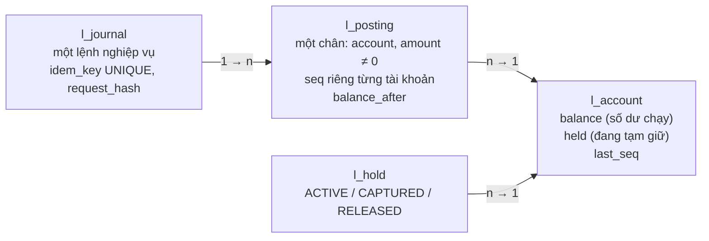

# Bài 10 — Sổ cái và số dư từ code: ví trong RAM, bốn phiên bản trên Postgres, bốn cách đọc số dư, tạm giữ, tài khoản nóng

> **Dùng cho:** **NAB** (ngân hàng: chuyển tiền, số dư, sao kê, đối soát) và **Katalon** (họ bài race condition trên số
> dư, [Katalon 06](../../katalon-prep/katalon-system-design/06-race-condition-balance-ledger.md)). Bài này viết lại từ
> đầu `transfer()` và `balance()`, **mỗi phiên bản sửa đúng một lỗi của phiên bản trước**, và mỗi lỗi có một test chạy
> trên Postgres 16 thật cho ra con số.
>
> **Thời lượng:** đọc 60 phút · lab 10 phút · drill 25 phút
>
> **Code:** [`ledger/mem/`](lab/src/main/java/com/prep/cs/ledger/mem/): `Wallets`, `WalletStress` ·
> [`ledger/db/`](lab/src/main/java/com/prep/cs/ledger/db/): `LedgerDb`, `Ledgers` (V1–V4), `BalanceReads`, `Holds` ·
> schema [`ledger_cs.sql`](lab/src/main/resources/ledger_cs.sql) · test: `MemWalletTest`, `LedgerDbTest`,
> `BalanceReadTest`, `HoldsAndHotAccountTest` · output thật: [`results/test-output.txt`](lab/results/test-output.txt)
>
> **Cần trước:** [gd1 bài 04](../gd1-nen-tang/04-postgres-concurrency.md) (khoá, isolation). Lý thuyết kế toán kép,
> đảo bút toán, đọc từ replica, chốt theo mốc xmin: [gd1 bài 05](../gd1-nen-tang/05-ledger-va-balance.md). Bài này
> không lặp lại những phần đó; nó đi sâu vào **code và số đo**.

```bash
cd on-bai/chuyen-sau/lab
docker compose -f docker/cluster.yml up -d --wait          # chỉ cần Postgres
mvn -q test -Dtest='MemWalletTest,LedgerDbTest,BalanceReadTest,HoldsAndHotAccountTest'   # ~3,5 phút
```

---

## 0. Trọng tâm phỏng vấn

| # | Câu hỏi | Trả lời của senior |
|:-:|---|---|
| 1 | Viết `transfer(from, to, amount)` an toàn? | **Một câu `UPDATE`** cho mỗi chân: `SET balance = balance + :amt, last_seq = last_seq + 1 WHERE id = :id AND balance - held + :amt >= 0 RETURNING last_seq, balance`. Vừa khoá dòng, vừa kiểm đủ tiền, vừa cấp seq, vừa đổi số dư |
| 2 | Sao không `SELECT` số dư, kiểm trong Java, rồi `UPDATE`? | Khe giữa đọc và ghi: lab cho 50 lệnh rút 10 từ 100 **đều thành công**, A + B = 570 thay vì 100 |
| 3 | Khoá hai tài khoản thì deadlock? | Khoá theo **id tăng dần**, không theo chiều chuyển. Lab: không thứ tự thì 145/200 lệnh bị Postgres giết (`40P01`); có thứ tự thì 800/800, 0 deadlock |
| 4 | Retry của client làm chuyển hai lần? | `idem_key UNIQUE` + `INSERT ... ON CONFLICT DO NOTHING RETURNING id`. Cùng key cùng nội dung → phát lại; cùng key khác nội dung → từ chối. Lab: 20 request cùng key → chạy thật 1, phát lại 19 |
| 5 | Đọc số dư thế nào? | Hiện tại: cột `balance` (O(1), 0,4 ms). Tại thời điểm t: `balance_after` của posting cuối ≤ t qua index (0,5 ms). `SUM` chỉ để đối soát (201 ms cho 1M dòng). Sao kê: keyset, không `OFFSET` (0,5 ms so với 183 ms) |
| 6 | Tài khoản nóng (merchant)? | Mọi giao dịch xếp hàng trên **một dòng**. Lab: ~500/s. Chia 16 ô con ×1,9; gom logic vào một hàm Postgres (1 round trip) ×1,7 trên một dòng. Thời gian giữ khoá gồm cả **round trip mạng** |

---

## 1. Mô hình: journal, posting, account, và sáu bất biến



| # | Bất biến | Ai giữ |
|:-:|---|---|
| 1 | Mỗi journal cân bằng: tổng `amount` các posting = 0 | Code ghi đủ hai chân trong một transaction; đối soát kiểm |
| 2 | `balance` = tổng `amount` mọi posting của tài khoản | Đổi `balance` **cùng câu, cùng transaction** với việc ghi posting |
| 3 | `seq` của một tài khoản là 1, 2, 3... không hở, `last_seq` = seq cuối | `last_seq = last_seq + 1` dưới khoá dòng; `UNIQUE (account_id, seq)` |
| 4 | `balance_after` của posting n = `balance_after` của n−1 + `amount` | Lấy từ `RETURNING balance` của chính câu `UPDATE` |
| 5 | `held` = tổng hold `ACTIVE` | Đổi `held` cùng transaction với trạng thái hold |
| 6 | `balance − held ≥ 0` trừ tài khoản hệ thống | Điều kiện trong `UPDATE` + `CHECK` ở bảng (lớp cuối) |

📄 [`ledger_cs.sql`](lab/src/main/resources/ledger_cs.sql), những dòng quan trọng:

```sql
CREATE TABLE IF NOT EXISTS l_account (
    id              bigint  PRIMARY KEY,
    allow_negative  boolean NOT NULL DEFAULT false,   -- tai khoan he thong (quy, doanh thu) duoc am
    balance         bigint  NOT NULL DEFAULT 0,       -- so du chay = SUM(posting), doi CUNG transaction voi posting
    held            bigint  NOT NULL DEFAULT 0,       -- tong tien dang tam giu: kha dung = balance - held
    last_seq        bigint  NOT NULL DEFAULT 0,       -- seq cua posting cuoi; tang duoi khoa dong
    CHECK (allow_negative OR balance - held >= 0)     -- lop cuoi: DB tu choi neu code co lo hong
);
CREATE TABLE IF NOT EXISTS l_journal (
    id            bigint      GENERATED ALWAYS AS IDENTITY PRIMARY KEY,
    idem_key      text        NOT NULL UNIQUE,         -- khoa nghiep vu cua lenh: retry cung key = cung lenh
    request_hash  text        NOT NULL,                -- cung key ma khac noi dung -> tu choi
    created_at    timestamptz NOT NULL DEFAULT clock_timestamp()
);
CREATE TABLE IF NOT EXISTS l_posting (
    ...
    seq            bigint      NOT NULL,               -- 1, 2, 3... rieng tung tai khoan, khong ho
    amount         bigint      NOT NULL CHECK (amount <> 0),
    balance_after  bigint      NOT NULL,               -- so du ngay sau dong nay: sao ke, so du tai thoi diem
    UNIQUE (account_id, seq)
);
CREATE INDEX IF NOT EXISTS l_posting_account_time ON l_posting (account_id, created_at);
```

- **Tiền là `bigint` đơn vị nhỏ nhất** (đồng, xu). Không bao giờ `float`/`double`.
- **`clock_timestamp()`** chứ không `now()`: `now()` là giờ **bắt đầu** transaction, nên hai posting của hai transaction
  có thể mang giờ ngược với thứ tự commit.
- **Mở tài khoản cũng là một bút toán**: `LedgerDb.open()` ghi journal "nạp đầu kỳ" từ tài khoản hệ thống 0 (được âm).
  Ngay từ đầu, số dư = tổng posting và đối soát được.

---

## 2. Bước 1 — Trong RAM trước: ba lỗi kinh điển bằng chính Java

Trước khi có database, thấy ba lỗi trên bốn cái ví trong RAM
([`Wallets.java`](lab/src/main/java/com/prep/cs/ledger/mem/Wallets.java)). Cùng một tải: 8 luồng × 200.000 lần chuyển
ngẫu nhiên giữa 8 tài khoản, mỗi tài khoản 1.000. Tổng tiền phải luôn là 8.000.

```java
/** V1: doc - kiem - ghi tren long[] khong dong bo. */
public boolean transfer(int from, int to, long amount) {
    long fromBal = b[from];                 // (1) doc
    if (fromBal < amount) return false;     // (2) kiem
    b[from] = fromBal - amount;             // (3) ghi gia tri TUYET DOI tinh tu lan doc cu
    b[to] = b[to] + amount;                 // doc-sua-ghi, cung khong nguyen tu
    return true;
}

/** V2: mot khoa cho ca vi. */
public synchronized boolean transfer(int from, int to, long amount) { ... }

/** V3: moi tai khoan mot khoa, khoa from roi khoa to. */
int first(int from, int to) { return from; }

/** V4: van moi tai khoan mot khoa, nhung LUON khoa id nho truoc. */
int first(int from, int to) { return Math.min(from, to); }
```

[`WalletStress`](lab/src/main/java/com/prep/cs/ledger/mem/WalletStress.java) có một luồng canh: 2 giây không tiến
thì hỏi JVM có deadlock không (`ThreadMXBean.findDeadlockedThreads()`) và in ai chờ khoá của ai:

```text
[LAB] Naive            157 ms, 10,191,082 giao dich/s, tong tien truoc 8,000 sau 10,640 (LECH 2640), so du nho nhat 183
[LAB] GlobalLock       284 ms,  5,633,802 giao dich/s, tong tien truoc 8,000 sau 8,000 (giu nguyen), so du nho nhat 181
[LAB] PerAccountLock DEADLOCK sau 445 giao dich
  chuyen-0 cho khoa NonfairSync@ba54932, khoa do dang nam trong tay chuyen-6
  chuyen-6 cho khoa NonfairSync@3c947bc5, khoa do dang nam trong tay chuyen-2
[LAB] OrderedLock      232 ms,  6,896,551 giao dich/s, tong tien truoc 8,000 sau 8,000 (giu nguyen), so du nho nhat 103
```

- **Naive tạo ra 2.640 đồng từ hư không** ở lần chạy này. Ở các lần chạy khác của cùng test: **mất** 6.750 đồng, hay
  **tạo** 88.264 đồng. Lỗi đếm sai không có chiều cố định; nó phụ thuộc thứ tự chen nhau của các luồng.
- **Khoá theo chiều chuyển** treo sau 445 giao dịch. Vòng chờ có thể dài hơn hai luồng: ở đây 0 chờ 6, 6 chờ 2...
- **Khoá theo id tăng dần** đúng và không bao giờ treo: mọi luồng lấy khoá theo cùng một thứ tự toàn cục, nên không thể
  có vòng chờ.
- Đừng đọc cột thông lượng: 8 luồng tranh 8 tài khoản trên máy 4 vCPU, chênh lệch giữa các lần chạy lớn hơn chênh lệch
  giữa các cách.

Ba lỗi này (đọc-kiểm-ghi, khoá ngược chiều, không thứ tự khoá) sẽ gặp lại y hệt trên Postgres.

---

## 3. Bước 2 — V1 `ReadCheckWrite`: code "bình thường" nhất, và sai

📄 [`Ledgers.java`](lab/src/main/java/com/prep/cs/ledger/db/Ledgers.java)

```java
long bal;
try (PreparedStatement ps = c.prepareStatement("SELECT balance FROM l_account WHERE id = ?")) {
    ps.setLong(1, from);
    try (ResultSet rs = ps.executeQuery()) { rs.next(); bal = rs.getLong(1); }   // (1) doc: anh chup luc nay
}
if (bal < amount) { c.rollback(); return Receipt.rejectedReceipt(); }        // (2) kiem trong Java
long j = LedgerDb.insertJournal(c, key, key);
try (PreparedStatement ps = c.prepareStatement(
        "UPDATE l_account SET balance = ?, last_seq = last_seq + 1 WHERE id = ? RETURNING last_seq")) {
    ps.setLong(1, bal - amount);                                               // (3) ghi gia tri tinh tu lan doc cu
    ...
}
```

Test: tài khoản A có 100, **50 lệnh** rút 10 cùng lúc sang B (mỗi lệnh một connection):

```text
[LAB] V1: 50 lenh chuyen 10 tu tai khoan co 100 -> thanh cong 50; so du A = 70, B = 500 (A + B = 570, dung phai la 100)
  doi soat: {balance <> tong posting=1, chuoi balance_after bi dut=38}
```

- **Cả 50 lệnh đều "đủ tiền"** vì phần lớn đọc thấy A = 100 hay 90 trước khi ai kịp ghi. `UPDATE ... SET balance = ?`
  ghi **giá trị tuyệt đối** tính từ ảnh chụp cũ, nên `READ COMMITTED` không cứu được: câu `UPDATE` chờ khoá dòng rồi ghi
  đè con số đã cũ (lost update).
- B nhận đủ 500 vì chân của B dùng `balance = balance + ?` (tương đối). **Hệ thống tạo ra 470 đồng.**
- **Đối soát bắt được ngay:** số dư của A khác tổng posting của A, và chuỗi `balance_after` đứt ở 38 chỗ. Đối soát
  không ngăn lỗi, nhưng làm lỗi **hiện ra** (§7).

---

## 4. Bước 3 — V2 `AtomicUnordered`: kiểm và trừ trong một câu, nhưng khoá ngược chiều

Sửa khe đọc-ghi bằng **một câu** làm cả bốn việc
([`LedgerDb.applyLeg`](lab/src/main/java/com/prep/cs/ledger/db/LedgerDb.java)):

```java
static Long applyLeg(Connection c, long journalId, long account, long amount) throws SQLException {
    long seq, after;
    try (PreparedStatement ps = c.prepareStatement("""
            UPDATE l_account SET balance = balance + ?, last_seq = last_seq + 1
             WHERE id = ? AND (allow_negative OR balance - held + ? >= 0)
            RETURNING last_seq, balance""")) {
        ps.setLong(1, amount);
        ps.setLong(2, account);
        ps.setLong(3, amount);
        try (ResultSet rs = ps.executeQuery()) {
            if (!rs.next()) return null;                       // 0 dong = khong du tien
            seq = rs.getLong(1);
            after = rs.getLong(2);
        }
    }
    insertPosting(c, journalId, account, seq, amount, after);
    return after;
}
```

Một câu `UPDATE` này:

1. **Khoá dòng** tài khoản tới hết transaction.
2. **Kiểm đủ tiền trên giá trị mới nhất**: trong `READ COMMITTED`, nếu dòng vừa bị transaction khác đổi thì Postgres
   chờ nó xong rồi **đánh giá lại `WHERE` trên phiên bản mới** (EvalPlanQual). Không thể kiểm trên số cũ.
3. **Cấp `seq`** liên tục dưới khoá: không hở, không trùng.
4. **Trả số dư sau** để ghi `balance_after` mà không cần đọc lại.

Nhưng V2 khoá `from` rồi mới khoá `to`. Hai lệnh A→B và B→A chạy cùng lúc:

```text
[LAB] V2: 200 lenh A<->B nguoc chieu -> 55 thanh cong, 145 bi Postgres giet vi deadlock (40P01)
  ERROR: deadlock detected
    Detail: Process 12899 waits for ShareLock on transaction 93806; blocked by process 12896.
  Process 12896 waits for ShareLock on transaction 93808; blocked by process 12902.
  Process 12902 waits for ExclusiveLock on tuple (0,20) of relation 16389 of database 16384; blocked by process 12899.
    Hint: See server log for query details.
    Where: while updating tuple (0,20) in relation "l_account"
```

Đọc thông báo deadlock của Postgres:

- **`ShareLock on transaction X`**: Postgres không giữ một khoá riêng cho mỗi dòng trong bộ nhớ. Dòng bị khoá được ghi
  dấu bằng id transaction khoá nó, và ai muốn dòng đó thì **chờ transaction X kết thúc**.
- **`ExclusiveLock on tuple (0,20)`**: khi nhiều người cùng chờ một dòng, họ xếp hàng bằng khoá tuple. Process 12902
  đứng đầu hàng chờ dòng ở trang 0, vị trí 20.
- Vòng ở đây có **ba** process: 12899 → 12896 → 12902 → 12899. Sau `deadlock_timeout` (1 giây mặc định), Postgres giết
  một transaction trong vòng.
- **Số cái vẫn đúng** (`assertThat(db.reconcile()).isEmpty()`): transaction bị giết rollback sạch. Deadlock là lỗi
  **khả dụng**, không phải lỗi **đúng sai**: 145/200 lệnh thất bại, client phải retry.

---

## 5. Bước 4 — V3 `Final`: idempotency key, khoá theo id, bản đúng

```java
public Receipt transferInTx(Connection c, String key, long from, long to, long amount) throws SQLException {
    if (from == to || amount <= 0) throw new IllegalArgumentException("lenh khong hop le");
    String hash = from + ">" + to + ":" + amount;              // noi dung da chuan hoa cua lenh
    TreeMap<Long, Long> legs = new TreeMap<>();                // id tang dan = thu tu khoa
    legs.put(from, -amount);
    legs.put(to, amount);
    Long j;
    // (1) gianh key: request trung den cung luc se CHO o unique index toi khi ben kia commit/rollback
    try (PreparedStatement ps = c.prepareStatement("""
            INSERT INTO l_journal (idem_key, request_hash) VALUES (?, ?)
            ON CONFLICT (idem_key) DO NOTHING RETURNING id""")) {
        ps.setString(1, key);
        ps.setString(2, hash);
        try (ResultSet rs = ps.executeQuery()) { j = rs.next() ? rs.getLong(1) : null; }
    }
    if (j == null) return replay(c, key, hash);               // key da co: lenh nay chay roi
    // (2) tung chan theo id tang dan: khoa + kiem du tien + cap seq + doi so du, mot cau UPDATE
    for (var leg : legs.entrySet()) {
        if (LedgerDb.applyLeg(c, j, leg.getKey(), leg.getValue()) == null) {
            return Receipt.rejectedReceipt();                  // nguoi goi rollback: bo ca journal, key tu do
        }
    }
    return new Receipt(j, false, false);
}
```

Bốn điểm, mỗi điểm sửa một lỗi:

| Dòng | Sửa lỗi gì |
|---|---|
| `TreeMap` theo id | Deadlock của V2: mọi transaction khoá theo cùng một thứ tự toàn cục |
| `INSERT ... ON CONFLICT DO NOTHING RETURNING id` **trước** khi đụng tiền | Retry chuyển hai lần. Hai request cùng key tới cùng lúc: cái thứ hai **chờ ở unique index** tới khi cái thứ nhất commit, rồi nhận "đã có" |
| `request_hash` | Client dùng lại key cho một lệnh **khác** (bug client): từ chối thay vì phát lại nhầm |
| Không đủ tiền → rollback **cả journal** | Key được giải phóng: client nạp thêm tiền rồi thử lại cùng key vẫn chạy được |

```text
[LAB] V3: 800 lenh A<->B nguoc chieu: 800 thanh cong, 0 deadlock, 398 lenh/s (8 luong)
[LAB] V3: 50 lenh rut 10 tu 100 cung luc -> 10 thanh cong, so du 0
[LAB] V3: 20 request cung idempotency key -> chay that 1, phat lai 19; doi soat: []
```

Và `sameKeyDifferentContentIsRejected`: cùng key `k-1` với 100 rồi 999 → `idempotency key k-1 da dung cho mot lenh
KHAC`.

---

## 6. Bước 5 — V4 `ServerSide`: cả lệnh trong một round trip

Cùng logic V3, nhưng chạy trong một hàm PL/pgSQL. Java chỉ gọi **một** câu `SELECT l_transfer(?, ?, ?, ?)`:

```sql
CREATE OR REPLACE FUNCTION l_transfer(p_key text, p_from bigint, p_to bigint, p_amount bigint)
RETURNS bigint LANGUAGE plpgsql AS $$
DECLARE
    j bigint;
    h text := p_from || '>' || p_to || ':' || p_amount;
    leg record;
    s bigint;
    b bigint;
BEGIN
    INSERT INTO l_journal (idem_key, request_hash) VALUES (p_key, h)
    ON CONFLICT (idem_key) DO NOTHING RETURNING id INTO j;
    IF j IS NULL THEN                                   -- lenh da chay: phat lai
        SELECT id INTO j FROM l_journal WHERE idem_key = p_key AND request_hash = h;
        IF j IS NULL THEN RAISE EXCEPTION 'idempotency key % da dung cho mot lenh KHAC', p_key; END IF;
        RETURN j;
    END IF;
    FOR leg IN SELECT * FROM (VALUES (p_from, -p_amount), (p_to, p_amount)) v(acc, amt) ORDER BY acc LOOP
        UPDATE l_account SET balance = balance + leg.amt, last_seq = last_seq + 1
         WHERE id = leg.acc AND (allow_negative OR balance - held + leg.amt >= 0)
        RETURNING last_seq, balance INTO s, b;
        IF NOT FOUND THEN RAISE EXCEPTION USING ERRCODE = 'P0001', MESSAGE = 'khong du tien'; END IF;
        INSERT INTO l_posting (journal_id, account_id, seq, amount, balance_after) VALUES (j, leg.acc, s, leg.amt, b);
    END LOOP;
    RETURN j;
END $$;
```

V3 từ Java tốn 6 round trip cho một lệnh: `INSERT journal`, `UPDATE` + `INSERT posting` cho mỗi chân, rồi `COMMIT`.
Dòng khoá sau (id lớn hơn, như merchant ở §10) bị giữ qua **3 round trip cuối**: `UPDATE`, `INSERT posting`, `COMMIT`.
Trong lúc đó Postgres gần như không làm gì, chỉ chờ Java gửi câu tiếp theo. V4 chỉ giữ khoá trong phần cuối của hàm và
lúc `COMMIT`, không còn chờ mạng. §10 đo xem đáng bao nhiêu.

Đánh đổi phải nói: logic nằm trong DB thì khó test bằng unit test, khó deploy theo version, khó quan sát. Chỉ dùng cho
**đường nóng đã đo** là nút thắt, như tài khoản merchant.

---

## 7. Bước 6 — Đối soát: năm truy vấn phải trả về rỗng

📄 `LedgerDb.reconcile()`, chạy sau **mọi** test:

```sql
-- 1. journal khong can bang
SELECT journal_id FROM l_posting GROUP BY journal_id HAVING sum(amount) <> 0;
-- 2. balance <> tong posting
SELECT a.id FROM l_account a LEFT JOIN l_posting p ON p.account_id = a.id
GROUP BY a.id, a.balance HAVING a.balance <> coalesce(sum(p.amount), 0);
-- 3. seq bi ho hoac last_seq sai
SELECT a.id FROM l_account a LEFT JOIN l_posting p ON p.account_id = a.id
GROUP BY a.id, a.last_seq HAVING a.last_seq <> count(p.id) OR a.last_seq <> coalesce(max(p.seq), 0);
-- 4. chuoi balance_after bi dut
SELECT id FROM (SELECT id, balance_after - amount AS before,
       lag(balance_after, 1, 0::bigint) OVER (PARTITION BY account_id ORDER BY seq) AS prev
  FROM l_posting) x WHERE before <> prev;
-- 5. held <> tong hold ACTIVE
SELECT a.id FROM l_account a LEFT JOIN l_hold h ON h.account_id = a.id AND h.status = 'ACTIVE'
GROUP BY a.id, a.held HAVING a.held <> coalesce(sum(h.amount), 0);
```

| Truy vấn | Bắt được |
|---|---|
| 1 | Code ghi thiếu một chân, hay hai chân lệch số tiền |
| 2 | Lost update như V1; ai đó `UPDATE balance` tay mà không ghi posting |
| 3 | Seq cấp ngoài khoá (hai posting cùng seq bị `UNIQUE` chặn, nhưng hở seq thì chỉ truy vấn này thấy) |
| 4 | `balance_after` tính từ số cũ: sao kê in sai dù số dư cuối có thể đúng |
| 5 | Hold đổi trạng thái mà quên đổi `held`: tiền "kẹt" hay "thả nhầm" |

Ở production, chạy theo **lô tài khoản đã đổi** trong ngày (không quét cả bảng), trên replica, và cảnh báo khi khác
rỗng. Đối soát là cách duy nhất để chứng minh với kiểm toán rằng số dư đúng.

---

## 8. Bước 7 — Bốn cách đọc số dư, đo trên 1 triệu posting

📄 [`BalanceReads.java`](lab/src/main/java/com/prep/cs/ledger/db/BalanceReads.java). `BalanceReadTest` nạp **1 triệu
posting** cho tài khoản 7 (mỗi 20 giây một posting từ 01/01/2026) cùng 1 triệu chân đối ứng, rồi đo mỗi cách 7 lần lấy
trung vị:

```java
public long sum(long account)     // SELECT coalesce(sum(amount), 0) FROM l_posting WHERE account_id = ?
public long running(long account) // SELECT balance FROM l_account WHERE id = ?
public long at(long account, Instant t) {
    // SELECT balance_after FROM l_posting WHERE account_id = ? AND created_at <= ?
    // ORDER BY created_at DESC, seq DESC LIMIT 1
}
public List<Line> statement(long account, long afterSeq, int limit) {
    // SELECT seq, amount, balance_after FROM l_posting WHERE account_id = ? AND seq > ? ORDER BY seq LIMIT ?
}
```

```text
[LAB] nap 2 trieu posting trong 44.1 s
[LAB] sum: SUM(amount) 1 trieu dong                  201.107 ms   -> 20000030
[LAB] running: cot balance cua tai khoan               0.381 ms   -> 20000030
[LAB] at(2026-03-25T08:00:00Z): posting cuoi <= t      0.532 ms   -> 7200000
[LAB] sao ke keyset: 50 dong sau seq 900.000           0.505 ms   -> 50
[LAB] sao ke OFFSET 900.000 LIMIT 50                 183.420 ms   -> 50
```

| Cách | Độ phức tạp | Đo | Dùng cho |
|---|---|---|---|
| `sum` | O(n) | 201 ms | **Đối soát** (§7), không bao giờ cho API |
| `running` | O(1) | 0,38 ms | Số dư hiện tại |
| `at(t)` | O(log n) | 0,53 ms | Số dư lúc 08:00 ngày 25/3, chốt sổ cuối ngày, tính lãi theo ngày |
| `statement` keyset | O(log n + trang) | 0,51 ms | Sao kê: mỗi trang tốn như nhau |
| `OFFSET 900.000` | O(offset) | 183 ms | **Không dùng**: Postgres phải đọc rồi bỏ 900.000 dòng |

`EXPLAIN (ANALYZE, BUFFERS)` cho thấy vì sao:

```text
[LAB] EXPLAIN SELECT coalesce(sum(amount), 0) FROM l_posting WHERE account_id = 7
        Finalize Aggregate (actual rows=1 loops=1)
          ->  Gather (actual rows=3 loops=1)
                Workers Planned: 2
                ->  Partial Aggregate (actual rows=1 loops=3)
                      ->  Parallel Seq Scan on l_posting (actual rows=333333 loops=3)
                            Filter: (account_id = 7)
                            Rows Removed by Filter: 333333
                            Buffers: shared hit=20619
        Execution Time: 107.144 ms
[LAB] EXPLAIN SELECT balance_after FROM l_posting WHERE account_id = 7 AND created_at <= '2026-03-25T08:00:00Z' ORDER BY created_at DESC, seq DESC LIMIT 1
        Limit (actual rows=1 loops=1)
          Buffers: shared hit=4
          ->  Incremental Sort (actual rows=1 loops=1)
                Presorted Key: created_at
                ->  Index Scan Backward using l_posting_account_time on l_posting (actual rows=2 loops=1)
                      Index Cond: ((account_id = 7) AND (created_at <= '2026-03-25 08:00:00+00'::timestamp with time zone))
                      Buffers: shared hit=4
        Execution Time: 0.061 ms
```

- `SUM` đọc **20.619 trang** (cả bảng, 3 luồng song song). Tài khoản chiếm một nửa bảng, nên index cũng không giúp
  được nhiều: đằng nào cũng phải cộng 1 triệu số.
- `at(t)` đọc **4 trang**: đi xuống B-tree `(account_id, created_at)` tới đúng chỗ rồi lùi lại một bước.
- `at(t)` chỉ đúng nhờ `balance_after` được ghi **cùng lúc** với posting, dưới khoá dòng. Không có cột này thì "số dư
  lúc t" lại là một `SUM` trên mọi posting ≤ t.

---

## 9. Bước 8 — Tạm giữ tiền: số dư khả dụng

📄 [`Holds.java`](lab/src/main/java/com/prep/cs/ledger/db/Holds.java). Luồng thẻ/ví: **authorize** giữ tiền (chưa
chuyển) → **capture** (chuyển thật, nhả giữ) hoặc **release** (nhả giữ). Khả dụng = `balance − held`.

```java
// authorize: giu tien neu KHA DUNG du, cung mot cau (khong khe doc-ghi)
UPDATE l_account SET held = held + ? WHERE id = ? AND balance - held - ? >= 0 RETURNING held

// capture: trong MOT transaction
UPDATE l_hold SET status = 'CAPTURED' WHERE id = ? AND status = 'ACTIVE' RETURNING account_id, amount   -- chi mot lan
UPDATE l_account SET held = held - ? WHERE id = ?                                                    -- nha giu
ledger.transferInTx(c, "capture:" + holdId, account, to, amount);    // chuyen that, key theo hold: capture lai = phat lai
```

```text
[LAB] so du 100: giu 40 -> hold 1, giu 40 -> hold 2, giu 40 -> TU CHOI; so du 100, kha dung 20
[LAB] capture hold 1, release hold 2: so du 60, kha dung 60, merchant 40; doi soat []
[LAB] 50 lenh giu 10 cung luc tren kha dung 60 -> 6 duoc giu, kha dung con 0
```

- **`WHERE status = 'ACTIVE'`** là máy trạng thái trong một câu: capture một hold đã release trả 0 dòng (test kiểm
  `capture(h2)` sau `release(h2)` là `false`). Capture hai lần cũng chỉ một lần thành công.
- **`transferInTx` dùng transaction của người gọi**: nếu chuyển thất bại thì việc đổi trạng thái hold và `held` cũng
  rollback. Không có lúc nào hold đã `CAPTURED` mà tiền chưa đi.
- **`expires_at`**: một job định kỳ release các hold hết hạn (`... WHERE status = 'ACTIVE' AND expires_at < now()
  FOR UPDATE SKIP LOCKED`). Không có job này thì tiền khách bị giữ mãi.
- **50 lệnh giữ đồng thời trên khả dụng 60 → đúng 6 lệnh thành công**: điều kiện `balance − held − amount ≥ 0` được
  đánh giá lại trên phiên bản mới nhất sau mỗi lần chờ khoá.

---

## 10. Bước 9 — Tài khoản nóng: một dòng mà mọi giao dịch tranh nhau

`HoldsAndHotAccountTest`: 16 luồng, mỗi luồng chuyển từ tài khoản **riêng của nó** vào **cùng một** merchant trong 5
giây. Chân khách không bao giờ tranh nhau; chỉ chân merchant tranh nhau. Đo bốn biến thể:

```text
[LAB] 16 luong tra tien vao MOT dong merchant: 495 giao dich/s; vao 16 o merchant: 921 giao dich/s (x1.9); so du merchant = SUM 16 o = 4,605
[LAB] cung hai tai do, synchronous_commit = off (COMMIT khong cho fsync WAL): MOT dong 449/s, 16 o 778/s
[LAB] ham l_transfer (1 round trip): MOT dong 852/s, 16 o 1,964/s
```

| Biến thể | Một dòng merchant | 16 ô merchant |
|---|---:|---:|
| V3 từ Java (khoá merchant qua 3 round trip) | 495/s | 921/s |
| V3 + `synchronous_commit = off` | 449/s | 778/s |
| **V4 hàm Postgres (1 round trip)** | **852/s** | **1.964/s** |

Ba bài học, đều trái trực giác:

1. **Thông lượng của một dòng nóng = 1 / thời gian giữ khoá**, và thời gian giữ khoá **gồm cả round trip mạng** giữa
   các câu lệnh trong transaction. 495/s nghĩa là mỗi transaction giữ dòng merchant ~2 ms. Phần lớn số đó là chờ Java
   gửi câu tiếp theo, không phải Postgres làm việc.
2. **`synchronous_commit = off` không giúp gì** (449 so với 495, trong sai số). Nếu fsync WAL là nút thắt thì nó phải
   giúp nhiều. Nó không giúp, nên nút thắt là round trip. Và nó còn có giá: mất tới ~3 × `wal_writer_delay` giao dịch đã
   báo thành công khi máy sập. Với tiền, đừng bật.
3. **Gom vào một round trip (V4) cho ×1,7 trên một dòng.** Chia 16 ô con (merchant = tổng 16 tài khoản con) cho ×1,9.
   Cả hai cùng lúc cho ×4. Máy lab 4 vCPU chạy 16 luồng cùng Postgres, nên trần CPU tới sớm. Máy thật nhiều core hơn
   thì chia ô lợi hơn.

Chia ô con có giá phải nói: **đọc số dư merchant = `SUM` 16 dòng**, và kiểm "đủ tiền" khi rút từ merchant phải chọn ô
còn đủ tiền hoặc gom tiền về trước. Thường chỉ chia cho tài khoản **nhận nhiều, chi ít** (merchant, quỹ thu), rồi một
job gom định kỳ về tài khoản chính. Cách không khoá dòng nóng (chốt theo mốc xmin) ở
[gd1 bài 05 bước 10](../gd1-nen-tang/05-ledger-va-balance.md#bước-10--tài-khoản-nóng-không-khoá-chốt-theo-mốc-xmin).

---

## 11. Vẽ trên bảng trắng

```text
transfer(key, from, to, amt)  — MỘT transaction
  1. INSERT l_journal(idem_key, hash) ON CONFLICT DO NOTHING RETURNING id   → null: phát lại / khác nội dung: từ chối
  2. for acc in sort(from, to):                                            ← thứ tự id: không deadlock
       UPDATE l_account SET balance = balance + δ, last_seq = last_seq + 1
        WHERE id = acc AND balance - held + δ >= 0 RETURNING last_seq, balance   ← khoá + kiểm + seq + số dư
       0 dòng → ROLLBACK (không đủ tiền; key được thả)
       INSERT l_posting(journal, acc, seq, δ, balance_after)
  3. COMMIT
đọc:   hiện tại = l_account.balance │ lúc t = balance_after posting cuối ≤ t (index) │ sao kê = keyset theo seq
kiểm:  5 truy vấn đối soát = rỗng   │ nóng: 1/thời gian giữ khoá → bớt round trip, chia ô con
```

---

## 12. Drill (25 phút): viết tay `transfer()` an toàn

Không IDE, 15 phút viết, 10 phút tự chấm:

- [ ] Một transaction; `INSERT ... ON CONFLICT DO NOTHING RETURNING` giành key **trước** khi đụng tiền.
- [ ] Hai chân sắp theo id; mỗi chân một câu `UPDATE ... WHERE ... balance - held + δ >= 0 RETURNING`.
- [ ] 0 dòng → rollback cả lệnh; nói được vì sao key phải được thả.
- [ ] `seq` và `balance_after` lấy từ `RETURNING`, không `SELECT` lại.
- [ ] Cùng key khác nội dung → từ chối, không phát lại.
- [ ] Không `float`; không `now()`; không `SELECT` rồi kiểm trong Java.
- [ ] Nói được 3 lỗi của V1/V2 và con số lab của mỗi lỗi (A + B = 570; 145/200 deadlock).

---

## 13. Follow-up hay gặp

<details>
<summary><b>Q1. Sao không dùng <code>SERIALIZABLE</code> cho xong?</b></summary>

Được, nhưng phải retry mọi lỗi `40001`, và dưới tải tranh chấp (tài khoản nóng) tỷ lệ retry tăng vọt. Bản V3 đúng ở
`READ COMMITTED` vì mọi bất biến nằm trong **một câu `UPDATE`** có điều kiện trên đúng dòng bị khoá. Không có gì đọc
ở câu này rồi dùng ở câu khác. `SERIALIZABLE` cần cho quy tắc trải trên **nhiều dòng** mà không khoá được dòng nào
(write skew, [gd1 bài 04 bước 6](../gd1-nen-tang/04-postgres-concurrency.md#bước-6--write-skew-quy-tắc-nằm-trên-nhiều-dòng)).
</details>

<details>
<summary><b>Q2. <code>SELECT ... FOR UPDATE</code> rồi kiểm trong Java có đúng không?</b></summary>

Đúng (khoá trước khi đọc nên không còn khe), nhưng thêm một round trip trong lúc giữ khoá: chậm hơn trên tài khoản nóng
(§10 bài học 1). Và phải khoá **cả hai** dòng theo thứ tự id trước khi kiểm. Một câu `UPDATE ... WHERE ... RETURNING`
làm cùng việc trong một round trip.
</details>

<details>
<summary><b>Q3. Sửa một giao dịch sai thế nào?</b></summary>

Không bao giờ `UPDATE` hay `DELETE` posting. Ghi một **journal đảo** (các chân ngược dấu) tham chiếu journal gốc. Sổ cái
append-only nên lịch sử và sao kê luôn giải thích được
([gd1 bài 05 bước 6](../gd1-nen-tang/05-ledger-va-balance.md#bước-6--đảo-bút-toán-thêm-dòng-không-sửa-dòng)).
</details>

<details>
<summary><b>Q4. Bảng posting lên hàng tỷ dòng thì sao?</b></summary>

Đường đọc không đổi: `running` O(1), `at(t)` và sao kê đi theo index `(account_id, ...)`. Bảng lớn thì partition theo
thời gian (tháng) để vacuum, index và lưu trữ lạnh từng phần; giữ `balance_after` nên không bao giờ cần `SUM` toàn
lịch sử. `SUM` chỉ chạy trong đối soát theo lô ngày.
</details>

<details>
<summary><b>Q5. Hai dịch vụ (ví và thẻ) cùng trừ một tài khoản?</b></summary>

Một tài khoản chỉ có **một chủ ghi**: dịch vụ sổ cái. Các dịch vụ khác gọi API của nó (đồng bộ với idempotency key),
hoặc gửi lệnh qua Kafka với outbox ([gd1 bài 09](../gd1-nen-tang/09-outbox-notification.md)). Hai dịch vụ cùng
`UPDATE` một bảng số dư là mất bất biến 2 và 4 ngay khi một bên quên ghi posting.
</details>

---

## 14. Checklist

- [ ] Kể được 6 bất biến và ai giữ từng cái.
- [ ] Chạy lại được ba lỗi trong RAM; đọc được output deadlock của `ThreadMXBean`.
- [ ] Giải thích V1 sai vì đâu (giá trị tuyệt đối từ ảnh chụp cũ) và đối soát bắt được gì.
- [ ] Viết được `applyLeg`; giải thích EvalPlanQual trong `READ COMMITTED`.
- [ ] Đọc được thông báo deadlock 3 process của Postgres.
- [ ] Viết được V3; nói được 4 điểm sửa lỗi.
- [ ] Viết 5 truy vấn đối soát và nói mỗi truy vấn bắt lỗi gì.
- [ ] Chọn đúng cách đọc số dư cho 4 câu hỏi; giải thích 20.619 trang so với 4 trang.
- [ ] Giải thích tài khoản nóng bằng "1 / thời gian giữ khoá", và vì sao `synchronous_commit = off` không giúp.
