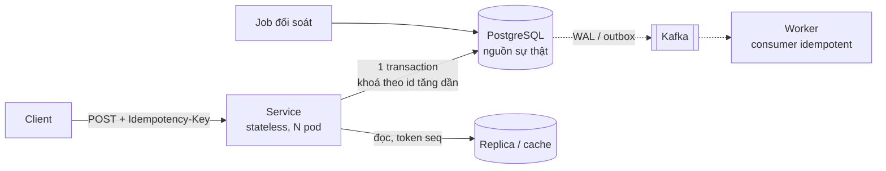

# Bài 00 — Dẫn một buổi system design 45 phút: khung, ước lượng, vẽ, và code tại chỗ

> **Dùng cho:** mọi vòng system design của **Katalon** và **NAB**. Đọc bài này trước, rồi đọc lại sau khi xong
> bài 01–09, vì lúc đó mỗi mục ở đây đều có một ví dụ bạn đã tự chạy.
>
> **Thời lượng:** đọc 25 phút · luyện nói 20 phút
>
> **Không lặp lại thứ đã có:** [năm trục nhận dạng](../../katalon-prep/katalon-system-design/README.md#1-nhận-họ-bài-trong-30-giây--5-trục-phân-loại)
> và [khung 45 phút](../../katalon-prep/katalon-system-design/README.md#6-khung-45-phút) ở Katalon README;
> [quy đổi và bảng latency](../../java-system-design/10-implement-gd1-nen-tang.md#11-quy-đổi-phải-nhẩm-được) ở tuần 1.
> Bài này nói **cái senior làm thêm** ở mỗi bước, có ví dụ từ lab.

---

## 0. Bộ "Ôn bài" dùng thế nào

Mỗi bài 01–09 có cùng khung, để luyện theo đúng nhịp phỏng vấn:

| Mục | Dùng để |
|---|---|
| **0. Trọng tâm phỏng vấn** | Đọc lại 5 phút trước khi vào phòng: câu hỏi hay gặp và câu trả lời một hơi |
| **1. Lý thuyết cốt lõi** | Chỉ phần dùng được để suy luận, không phải giáo trình |
| **2. Real case dựng từ đầu** | Từng bước, code thật trong lab, giải thích ngay dưới mỗi đoạn |
| **3. Lab** | Bảng test, test nào chứng minh điều gì, kèm output thật |
| **4. Vẽ design** | Sơ đồ + đoạn "nói gì khi vẽ" 40–60 giây |
| **5. Live coding drill** | Đoạn code 10–20 phút phải viết được không nhìn, và tiêu chí chấm |
| **6. Follow-up** | Câu hỏi đào sâu, trả lời mẫu |
| **7. Checklist** | Tự kiểm tra trước khi coi là "xong" |

Lab là **một** project Maven ([`lab/`](lab/README.md)): 79 test, Postgres 16 thật (embedded), Redis thật (nếu
máy có `redis-server`), khoảng 30 giây. Chạy trước khi đọc, rồi đọc với output bên cạnh.

---

## 1. Khung 45 phút: senior làm thêm gì ở từng bước

| Phút | Bước | Ai cũng làm | **Senior làm thêm** | Ví dụ từ bộ bài |
|---:|---|---|---|---|
| 0–5 | Clarify | Hỏi chức năng, quy mô | Hỏi **bất biến** ("số dư được âm không?", "chính xác tuyệt đối hay xấp xỉ?") và **ai ghi cùng lúc** | Bài 06: *"lãi tính trên số dư trước hay sau khoản trả trong ngày?"*, câu hỏi nghiệp vụ quyết định thiết kế |
| 5–10 | Estimate | QPS, storage | Ra **một quyết định** từ con số: "ghi 100/s là nhỏ, nút thắt ở đọc" | Bài 07: ghi 40/s nên không over-engineer phần sinh mã |
| 10–15 | API + model | Endpoint, bảng | **Mã lỗi và idempotency** trong hợp đồng; cột nào là nguồn sự thật, cột nào dẫn xuất | Bài 02: bảng status 201/409/422/402/504; bài 05: `balance` là dẫn xuất |
| 15–30 | High-level | Box và arrow | Ba đường: **ghi**, **đọc**, **đối soát**. Đánh số lên mũi tên | Bài 05: đường ghi một transaction; đường đọc với token seq; năm truy vấn đối soát |
| 30–40 | Deep dive | Đào một component | Chọn chỗ có **tranh chấp hoặc thất bại**, đưa ra bằng chứng (test, số) | Bài 04: interleaving hai transaction; bài 02: fencing |
| 40–45 | Trade-off | "Có thể dùng Kafka" | Mỗi lựa chọn kèm câu **"đánh đổi là…"**, và nói **cái gì vỡ trước khi ×10** | Bài 01: trần 181 req/s; bài 09: `SKIP LOCKED` mất thứ tự giữa aggregate |

**Câu mở đầu dùng cho mọi đề (30 giây):** *"Trước khi vẽ, tôi muốn chốt ba thứ: tải thật là bao nhiêu và đơn vị
là gì; dữ liệu nào phải chính xác tuyệt đối; và có những ai cùng ghi vào một thứ. Ba câu đó quyết định 80% thiết
kế."*

---

## 2. Năm trục, và bài nào trả lời trục đó

| Trục ([README Katalon §1](../../katalon-prep/katalon-system-design/README.md#1-nhận-họ-bài-trong-30-giây--5-trục-phân-loại)) | Khi câu trả lời là "có" | Bài |
|---|---|---|
| 1. Ghi nặng hay đọc nặng | Đọc nặng: cache, replica | [08](08-cache-consistency.md), [05 §bước 8](05-ledger-va-balance.md#bước-8--đọc-từ-replica-mà-không-lùi-số-dư-read-your-writes) |
| 2. Đọc theo khoảng thời gian | Rollup theo bucket (họ A) | [doc 04 Katalon](../../katalon-prep/katalon-system-design/04-event-counting-10k.md) |
| 3. Tài nguyên hữu hạn nhiều bên tranh | Quota, giới hạn đồng thời, hàng đợi | [01](01-littles-law-pool-timeout.md), [03](03-rate-limiter.md) |
| 4. Chính xác tuyệt đối | Raw + idempotent + đối soát | [02](02-idempotency-key.md), [05](05-ledger-va-balance.md), [09](09-outbox-notification.md) |
| 5. Đọc → tính → ghi | Concurrency, không phải performance | [04](04-postgres-concurrency.md), [05](05-ledger-va-balance.md), [06](06-race-tinh-lai-vs-thanh-toan.md) |

---

## 3. Ước lượng: con số để **ra quyết định**, không để khoe

Quy đổi và bảng latency đã có ở [tuần 1 §1.1–1.2](../../java-system-design/10-implement-gd1-nen-tang.md#11-quy-đổi-phải-nhẩm-được).
Thêm **bảng sức chứa** (bậc độ lớn trên phần cứng phổ thông; đo lại trước khi ký SLA):

| Thành phần | Bậc độ lớn | Dùng để nói |
|---|---|---|
| Postgres một node, ghi đơn giản có index | 5.000–20.000 TPS | "100 ghi/s là việc của một node, không cần shard" |
| Postgres đọc theo khoá chính (nóng trong RAM) | 20.000–100.000 QPS | "Đọc 10k/s: một primary + replica, cache cho phần nóng" |
| Redis một node | ~100.000 lệnh/s | "Rate limit cho 20 pod: một Redis thừa" |
| Một partition Kafka | ~10 MB/s ghi | "Số partition là trần song song của consumer" |
| Một pod Spring Boot, endpoint nhẹ | 1.000–5.000 req/s | "300 req/s: 2 pod cho HA, không phải cho tải" |
| Round trip trong AZ | 0,5–1 ms | "Mỗi query trả ít nhất chừng này: N+1 là N ms" |

**Ví dụ 90 giây, nói thành lời** (ví điện tử, 2 triệu user, 10 giao dịch/user/tháng):

```text
Ghi     2×10^6 × 10 / 2,5×10^6 s ≈ 8 TPS trung bình, đỉnh ×5 (ngày lương) ≈ 40 TPS   → một Postgres thừa
Posting 20 M giao dịch/tháng × 2 posting × ~150 B ≈ 6 GB/tháng ≈ 72 GB/năm         → partition theo tháng
Đọc số dư  mở app ×5/ngày → 10 M/ngày ≈ 115/s, đỉnh ~600/s                          → O(1) từ dòng account, replica
Pool    40 TPS × 5 ms giữ connection = 0,2 connection đang bận                      → pool 10 là dư; nút thắt không ở đây
Kết luận: bài này KHÔNG phải bài scale. Là bài ĐÚNG ĐẮN (race, idempotency, đối soát) → dồn thời gian vào đó.
```

Câu cuối là thứ phân biệt senior: **ước lượng để biết nên dồn 30 phút còn lại vào đâu.**

---

## 4. Vẽ trên bảng: quy ước để người xem đọc được

- **Hộp chữ nhật** là service (ghi rõ stateless); **hình trụ** là kho dữ liệu (ghi rõ nguồn sự thật hay bản
  sao); **hai vạch** là hàng đợi/stream.
- **Mũi tên liền** là gọi đồng bộ; **mũi tên đứt** là bất đồng bộ. Ghi nhãn **động từ + số**: "UPDATE account,
  40/s", "WAL, trễ < 1 s".
- Vẽ **ba đường** bằng ba màu nếu có: ghi (đỏ), đọc (xanh), đối soát/batch (xám). Phần lớn lỗi nằm ở chỗ ba
  đường gặp nhau (bài 06: batch gặp đường ghi).
- Đánh dấu **nơi có khoá**, **nơi có idempotency key**, **nơi có timeout**. Interviewer sẽ chỉ vào đó mà hỏi.

Mẫu Mermaid dùng lại (mọi bài đều có một sơ đồ theo mẫu này):



---

## 5. Code tại chỗ trong vòng system design

Interviewer giỏi sẽ chỉ vào **một** hộp và nói *"viết phần lõi của cái này"*. Phần lõi gần như luôn là một trong
tám đoạn sau, và mỗi đoạn có một bài drill:

| Họ chỉ vào | Đoạn lõi phải viết | Drill |
|---|---|---|
| "Trừ tiền / trừ kho an toàn" | `UPDATE … WHERE balance >= x` + khoá theo id + idempotency | [05 §5](05-ledger-va-balance.md#5-live-coding-drill-20-phút-viết-transferfrom-to-amount-an-toàn) |
| "Retry không trừ hai lần" | `INSERT … ON CONFLICT DO NOTHING` + replay | [02 §5](02-idempotency-key.md#5-live-coding-drill-20-phút) |
| "Rate limiter" | Token bucket thread-safe | [03 §5](03-rate-limiter.md#5-live-coding-drill-10-phút-token-bucket-thread-safe) |
| "Gọi đối tác chậm" | Bulkhead + timeout + fallback | [01 §5](01-littles-law-pool-timeout.md#5-live-coding-drill-15-phút-bulkhead--timeout-cho-lời-gọi-đối-tác) |
| "Hai request cùng sửa" | Atomic `@Modifying` / `@Lock` / `@Version` + retry ngoài | [04 §5](04-postgres-concurrency.md#5-live-coding-drill-15-phút) |
| "Batch đua với online" | `FOR UPDATE` theo id + `SKIP LOCKED` + key tự nhiên | [06 §6](06-race-tinh-lai-vs-thanh-toan.md#6-live-coding-drill-15-phút-viết-accrueoneloanid-date-an-toàn-với-thanh-toán-đồng-thời) |
| "ID phân tán / link ngắn" | Snowflake + base62 | [07 §5](07-id-generator-url-shortener.md#5-live-coding-drill-15-phút) |
| "Cache key nóng" | Single-flight | [08 §5](08-cache-consistency.md#5-live-coding-drill-10-phút-getorload-chống-stampede) |
| "Gửi sự kiện sau khi lưu" | Outbox relay `SKIP LOCKED` + inbox | [09 §5](09-outbox-notification.md#5-live-coding-drill-15-phút-relay--consumer) |

**Nhịp 15 phút cho một đoạn lõi:**

1. **(1 phút) Nói bất biến và chữ ký hàm**: *"hàm này đảm bảo số dư không âm và gọi hai lần cùng key chỉ trừ một
   lần"*.
2. **(8 phút) Viết**, nói to từng quyết định: vì sao `ORDER BY id`, vì sao điều kiện nằm trong `WHERE`.
3. **(3 phút) Nói test**: hai luồng + `CyclicBarrier` trên Postgres thật; assert bất biến, không assert thời gian.
4. **(3 phút) Nói giới hạn**: chỗ nào sẽ vỡ khi ×10, chỗ nào bạn cố ý chưa làm.

---

## 6. Ngôn ngữ trade-off: mẫu câu (Việt, và tiếng Anh cho vòng NAB)

| Tình huống | Mẫu câu |
|---|---|
| Chọn một phương án | "Tôi chọn X vì Y. Đánh đổi là Z, chấp nhận được vì W." / *"I'd go with X because Y. The trade-off is Z, which is acceptable here because W."* |
| Từ chối phương án "xịn" | "Kafka đúng về dài hạn, nhưng với 40 TPS nó thêm độ phức tạp mà không giải quyết vấn đề hiện tại." / *"Kafka is the right long-term direction, but at 40 TPS it adds complexity without solving today's problem."* |
| Nêu điều kiện kích hoạt | "Tôi sẽ chuyển sang single-writer khi một account vượt ~1.000 ghi/giây." / *"I'd switch to a single-writer model once a single account exceeds ~1,000 writes per second."* |
| Thừa nhận giới hạn | "Đây là xáo trộn, không phải mã hoá; cần chống dò thật thì tôi dùng Feistel có khoá." |
| Hỏi lại nghiệp vụ | "Đây là quyết định nghiệp vụ, tôi sẽ hỏi kế toán: …" / *"That's a business decision. I'd confirm with finance whether…"* |
| Nói bằng chứng | "Tôi không nói 'đã sửa' khi chưa có số: trước khi sửa, đối soát cho ra N dòng lệch; sau khi sửa là 0." |

---

## 7. Lịch ôn đề xuất (khớp tuần 1–4 của lộ trình)

| Tuần lộ trình | Bài ôn | Ưu tiên Katalon | Ưu tiên NAB |
|---|---|:-:|:-:|
| Tuần 1: ước lượng, chi phí request | 00, 01 | ★★ | ★★ |
| Tuần 2: API, rate limiter | 02, 03 | ★★★ | ★★★ |
| Tuần 3: DB sâu, ID, shortener | 04, 05, 06, 07 | ★★★ | ★★★ (05, 06 là vũ khí chính) |
| Tuần 4: cache, notification | 08, 09 | ★★ | ★★★ (09 lấp gap event-driven) |
| Trước phỏng vấn 3 ngày | 10 (mock) + mục 0 của mọi bài | | |

---

## 8. Checklist

- [ ] Nói câu mở đầu 30 giây không vấp
- [ ] Với một đề bất kỳ: ước lượng trong 90 giây và rút ra **một** quyết định
- [ ] Vẽ đủ ba đường ghi / đọc / đối soát, đánh dấu khoá, idempotency key, timeout
- [ ] Viết được ít nhất 6/9 đoạn lõi ở §5 trong 15 phút mỗi đoạn
- [ ] Mỗi lựa chọn trong bài nói đều có câu "đánh đổi là…"
