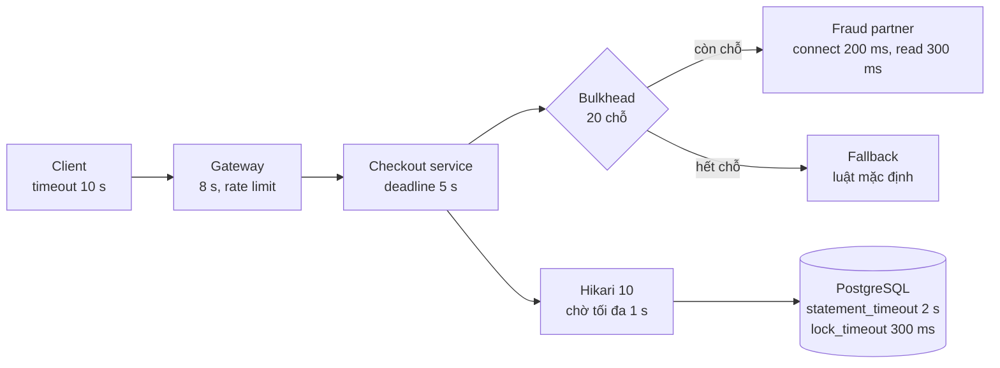

# Bài 01 — Little's Law, kích thước pool, timeout và backpressure: con số đứng sau mọi quyết định

> **Dùng cho:** **Katalon** (họ B: chia tài nguyên hữu hạn; họ F: timeout, backpressure; câu "10k lên 10M thì
> sao") · **NAB** (vòng technical: connection pool, virtual thread Java 21, `@Transactional` giữ connection)
>
> **Thời lượng:** đọc 35 phút · lab 15 phút · drill 15 phút
>
> **Lab:** [`lab/…/pool/`](lab/src/main/java/com/prep/onbai/pool/) · test `PoolSizingTest` (5 test, mô phỏng tất
> định + một deadlock pool thật trên Postgres)
>
> **Nối với:** tuần 1 của [lộ trình](../../java-system-design/10-implement-gd1-nen-tang.md#13-littles-law--công-thức-dùng-nhiều-nhất-cả-lộ-trình),
> [perf-lab](../../java-system-design/perf-lab/README.md) P09 (giữ connection khi gọi mạng), P10 (không timeout),
> P12 (pinning), P13 (hàng đợi vô hạn) đo bằng thread thật.

```bash
cd on-bai/gd1-nen-tang/lab
mvn -q test -Dtest=PoolSizingTest   # ~2 giây: mô phỏng 1,5 triệu request, không sleep
```

---

## 0. Trọng tâm phỏng vấn

| Interviewer hỏi | Senior trả lời |
|---|---|
| "Pool DB bao nhiêu connection?" | Tính từ **L = λ × W**: 2.000 req/s × 5 ms giữ connection = 10 đang bận trung bình. Cộng dư cho đỉnh và để utilization < ~70% → 15. **Tổng mọi pod** ≤ `max_connections` của DB |
| "Thêm thread / thêm pod có nhanh hơn không?" | Không, nếu nút thắt là pool hay DB. Trần = `pool / thời gian giữ`. Thêm thread chỉ làm hàng đợi dài hơn |
| "Virtual thread giải quyết hết?" | Nó làm **chờ** rẻ đi, không tăng **sức chứa** của DB. 10.000 virtual thread vẫn xếp hàng trước 10 connection |
| "p99 tăng vọt khi tải mới 90%?" | Đúng lý thuyết hàng đợi: thời gian chờ tỉ lệ `ρ/(1−ρ)`. Từ 90% lên 99%, phần chờ tăng ~10 lần. Lab đo: p99 46 ms ở ρ=0,5, 250 ms ở ρ=0,99 |
| "Quá tải thì sao?" | Timeout theo tầng + hàng đợi **có giới hạn** + từ chối sớm (`429`/`503` + `Retry-After`). Từ chối ở cửa tốt hơn để request chết trong hàng đợi |

Câu chốt: *"Pool size không phải nút tăng tốc. Nó là **giới hạn đồng thời** tôi cho phép vào DB. Muốn nhanh
hơn thì giảm **thời gian giữ**, không tăng pool."*

---

## 1. Lý thuyết cốt lõi

### 1.1 `L = λ × W`, ba cách dùng

```text
L  số thứ đang ở trong hệ thống   (request đang xử lý, connection đang bận, message đang xử lý)
λ  tốc độ đi qua (mỗi giây)
W  thời gian mỗi thứ ở lại
```

📄 [`LittlesLaw.java`](lab/src/main/java/com/prep/onbai/pool/LittlesLaw.java)

```java
/** Bao nhieu viec dang dong thoi: 2.000 req/s x 50 ms = 100 request dang bay. */
public static double inFlight(double perSecond, double latencyMs) {
    return perSecond * latencyMs / 1000.0;
}

/** Tran thong luong cua mot pool: 10 connection, giu 55 ms moi lan -> 181 req/s, bat ke bao nhieu thread/pod. */
public static double maxThroughput(int poolSize, double holdMs) {
    return poolSize * 1000.0 / holdMs;
}
```

1. **Biết λ, W, ra L:** cần bao nhiêu connection/thread/consumer.
2. **Biết L tối đa (pool), W, ra trần λ:** hệ thống chịu được bao nhiêu.
3. **Thấy L tăng mà λ không đổi, nghĩa là W tăng:** có thứ gì chậm đi. Đây là cách đọc dashboard
   `hikaricp_connections_active` tăng dần.

Định luật đúng cho **mọi** hệ ổn định, không cần giả định phân phối. Đó là lý do nó dùng được trên bảng
trắng mà không cần mô phỏng.

### 1.2 Vì sao latency nổ khi utilization tiến về 1

`ρ = λ × W / c` (c = số server, ở đây là số connection). Với hàng đợi M/M/c, thời gian chờ tỉ lệ khoảng
`ρ/(1−ρ)`: ρ=0,5 cho hệ số 1, ρ=0,9 cho 9, ρ=0,99 cho 99. **Biến động** (request đến dồn cục, query lúc nhanh
lúc chậm) là thứ tạo ra hàng đợi, kể cả khi trung bình còn dư. Lab mô phỏng đúng 10 connection, giữ trung
bình 10 ms:

```text
[LAB] 10 conn, giu 10ms: rho=0.50 thong luong=498/s p50=7.0ms p99=46.2ms (cho p99=2.6ms) bo cuoc=0
[LAB] 10 conn, giu 10ms: rho=0.70 thong luong=697/s p50=7.8ms p99=47.2ms (cho p99=10.5ms) bo cuoc=0
[LAB] 10 conn, giu 10ms: rho=0.80 thong luong=797/s p50=9.2ms p99=49.3ms (cho p99=18.8ms) bo cuoc=0
[LAB] 10 conn, giu 10ms: rho=0.90 thong luong=897/s p50=13.5ms p99=63.0ms (cho p99=42.4ms) bo cuoc=0
[LAB] 10 conn, giu 10ms: rho=0.95 thong luong=946/s p50=20.7ms p99=100.8ms (cho p99=87.4ms) bo cuoc=0
[LAB] 10 conn, giu 10ms: rho=0.99 thong luong=986/s p50=58.6ms p99=249.9ms (cho p99=241.5ms) bo cuoc=0
```

Đọc cột "chờ p99": 2,6 ms ở 50% tải, 241 ms ở 99% tải. **Throughput gần như không tăng** (897 lên 986)
nhưng p99 tăng gần 4 lần. Đây là lý do mục tiêu sizing là **~60–70% utilization lúc đỉnh**, không phải
100%.

### 1.3 Pool DB: số thật, không phải cảm giác

- **Điểm xuất phát** (wiki PostgreSQL, HikariCP "About Pool Sizing"):
  `connections ≈ (số core DB × 2) + số đĩa hiệu dụng`. DB 8 core, SSD thì khoảng 16–20 connection **cho
  cả cụm app**, không phải mỗi pod.
- **Vì sao nhiều connection lại chậm hơn:** DB chỉ có N core. 200 query đồng thời trên 8 core nghĩa là
  context switch, tranh chấp khoá, cache CPU bị xoá. Throughput đi ngang hoặc giảm, latency tăng.
- **Ràng buộc cứng:** `pods × maximumPoolSize ≤ max_connections − dư cho admin/replication`. 20 pod × 20 =
  400 connection lên một Postgres 8 core là quá nhiều. Đặt **PgBouncer** (transaction pooling) ở giữa, hoặc
  giảm pool mỗi pod.

### 1.4 Timeout theo tầng: ngân sách thời gian (deadline budget)

Mỗi tầng phải hết giờ **trước** tầng gọi nó, nếu không thì tầng dưới vẫn làm việc cho một client đã bỏ đi:

| Tầng | Ví dụ | Vì sao |
|---|---|---|
| Client / app mobile | 10 s | Người dùng hết kiên nhẫn |
| Gateway / ALB | 8 s | Nhỏ hơn client |
| Service tổng (deadline của request) | 5 s | Truyền deadline còn lại xuống từng lời gọi |
| Gọi đối tác (HTTP) | connect 200 ms, read 300–800 ms | Không có timeout là treo vô hạn (perf-lab P10) |
| Lấy connection (`connectionTimeout`) | 500–1.000 ms | Mặc định Hikari 30 s, quá dài cho API |
| Câu SQL (`statement_timeout`) | 1–2 s | Query chạy hoang không giữ connection mãi |
| Chờ khoá (`lock_timeout`) | 200–500 ms | Fail fast thay vì dồn thread ([bài 04](04-postgres-concurrency.md)) |

### 1.5 Backpressure: từ chối ở cửa tốt hơn chết trong hàng đợi

Hàng đợi vô hạn **không chữa quá tải**, nó chỉ hoãn cái chết: mọi request đều chậm, bộ nhớ phình, rồi OOM
(perf-lab P13). Có ba công cụ, dùng cùng nhau:

1. **Hàng đợi có giới hạn + thời gian chờ tối đa.** Chờ quá thì bỏ (`connectionTimeout` là một dạng).
2. **Giới hạn đồng thời ở cửa** (bulkhead/concurrency limiter). Hết chỗ thì `429`/`503` **ngay**, không xếp
   hàng.
3. **Retry có ngân sách và jitter** ở client, để lệnh bị từ chối không quay lại cùng lúc thành bão retry
   (ops-lab).

### 1.6 Virtual thread (Java 21): đúng chỗ, sai chỗ

- **Đúng:** request chủ yếu **chờ IO** (gọi HTTP, chờ DB). Mỗi virtual thread vài trăm byte, chặn
  thì nhả carrier thread. Một pod giữ được 10.000 request đang chờ thay vì 200.
- **Sai:** nghĩ nó tăng sức chứa DB. 10 connection vẫn là 10. Không có giới hạn đồng thời ở cửa, virtual
  thread **dồn hết áp lực xuống pool** nhanh hơn, và `connectionTimeout` nổ hàng loạt.
- **Bẫy:** JDK 21–23, `synchronized` bao quanh IO **ghim** (pin) carrier thread (perf-lab P12, chênh ~200
  lần). JDK 24 (JEP 491) đã bỏ hạn chế này. Còn đang chạy 21 thì dùng `ReentrantLock` quanh IO.

---

## 2. Real case: checkout gọi đối tác chấm gian lận **trong** transaction

Đề: service checkout nhận **300 req/s** lúc đỉnh. Mỗi request đọc giỏ hàng (DB ~2 ms), gọi đối tác chấm
điểm gian lận (~50 ms), ghi đơn hàng (DB ~3 ms). Pool 10 connection. Code hiện tại:

```java
@Transactional                                  // mo transaction = LAY connection ngay tu day
public Order checkout(Cart c) {
    Cart cart = carts.load(c.id());             // 2 ms DB
    Score s = fraudClient.score(cart);          // 50 ms MANG, connection van bi giu
    return orders.save(Order.from(cart, s));    // 3 ms DB
}                                               // nha connection o day: giu ~55 ms
```

### Bước 1 — Ước lượng trên bảng, 30 giây

```text
Thời gian giữ connection W = 2 + 50 + 3 = 55 ms
Trần throughput = pool / W = 10 / 0,055 s ≈ 182 req/s      < 300 req/s cần
Connection cần  L = 300 × 0,055 = 16,5 > 10                → quá tải ~65%
```

Kết luận trước khi viết dòng code nào: **hệ thống này sập lúc đỉnh**, bất kể bao nhiêu thread hay pod (pool
mỗi pod 10, nhưng nhiều pod thì nhân lên, và DB thì có trần riêng).

### Bước 2 — Mô phỏng thay vì đoán: hàng đợi sự kiện rời rạc

📄 [`QueueSimulator.java`](lab/src/main/java/com/prep/onbai/pool/QueueSimulator.java)

```java
for (int i = 0; i < c.requests(); i++) {
    now += exponential(rnd, 1000.0 / c.arrivalsPerSec()); // thoi diem request i den (ms)
    double start = Math.max(now, freeAt.peek());
    if (start - now > c.maxWaitMs()) {
        timedOut++;                                       // cho qua lau: bo cuoc, server khong bi chiem
        continue;
    }
    freeAt.poll();
    double end = start + exponential(rnd, c.meanHoldMs());
    freeAt.add(end);
    wait[done] = start - now;
    latency[done++] = end - now;
    lastEnd = Math.max(lastEnd, end);
}
```

Vài dòng này mô phỏng chính xác một pool FIFO c server. `freeAt` là min-heap "lúc nào server ranh". Request
đến thì bắt đầu ở `max(lúc đến, server ranh sớm nhất)`. Với FIFO, thời điểm bắt đầu của một request chỉ
phụ thuộc request **đến trước** nó, nên quyết định bỏ cuộc (chờ quá `maxWaitMs`, giống `connectionTimeout`
của Hikari) tính ngay lúc đến là đúng. Seed cố định thì kết quả tất định: test assert được, không `sleep`,
không flaky.

### Bước 3 — Con số của hệ thống hiện tại

```text
[LAB] giu 5ms : rho=0.15 thong luong=299/s p50=3.5ms p99=23.0ms (cho p99=0.0ms) bo cuoc=0
[LAB] giu 55ms: rho=1.65 thong luong=181/s p50=1030.2ms p99=1245.6ms (cho p99=999.9ms) bo cuoc=39413 | tran Little = 182/s
```

- Giữ 55 ms: throughput **kẹt ở 181/s**, khớp tính tay 182. 39% request bỏ cuộc sau khi chờ đủ 1 giây.
  Request được phục vụ cũng mất hơn 1 s (p50 1.030 ms), vì phần lớn thời gian là đứng chờ connection.
- Chỉ giữ connection cho phần DB (5 ms): ρ = 0,15, p99 23 ms, không ai bỏ cuộc.

### Bước 4 — Sửa: không giữ connection khi gọi mạng

```java
public Order checkout(Cart c) {
    Cart cart = tx.execute(s -> carts.load(c.id()));            // tx1: 2 ms, nha connection
    Score score = fraudClient.score(cart);                      // 50 ms, KHONG giu connection, co timeout
    return tx.execute(s -> orders.saveIfCartUnchanged(cart, score)); // tx2: 3 ms, kiem tra cart chua doi (version)
}
```

Cái giá phải nói ra, vì interviewer sẽ hỏi:

- **Giữa tx1 và tx2 không còn nguyên tử.** Giỏ hàng có thể đổi trong 50 ms đó. Bảo vệ bằng optimistic check
  ở tx2 (`WHERE cart.version = ?`) hoặc chấp nhận và chấm lại ([bài 04](04-postgres-concurrency.md) cách 3).
- **tx2 có thể chạy hai lần nếu client retry:** cần idempotency key ([bài 02](02-idempotency-key.md)).
- **Cần gửi sự kiện sau khi ghi đơn:** dùng outbox, không gọi broker trong transaction ([bài 09](09-outbox-notification.md)).

### Bước 5 — Khi vẫn quá tải: timeout trong hàng đợi so với từ chối ở cửa

```text
[LAB] qua tai 150%, cho vo han : rho=1.50 thong luong=1002/s p50=9991.3ms p99=19635.2ms (cho p99=19626.9ms) bo cuoc=0
[LAB] qua tai 150%, cho <= 100ms: rho=1.50 thong luong=998/s p50=105.1ms p99=143.4ms (cho p99=100.0ms) bo cuoc=19925
```

- **Chờ vô hạn:** throughput vẫn ~1.000/s (đã max), nhưng p50 **10 giây**. Mọi người đều chậm, kể cả người
  đến sớm. Đây là "chết từ từ".
- **Chờ tối đa 100 ms:** ~1/3 request bị bỏ, 2/3 còn lại có p99 143 ms. Hệ thống **sống**.
- Chi tiết tinh tế: p50 của người được phục vụ là **105 ms**, tức là ai cũng đứng chờ gần hết 100 ms, vì
  hàng đợi luôn đầy. Tốt hơn nữa là **từ chối ngay ở cửa** khi số request đang xử lý vượt ngưỡng
  (concurrency limiter, §5). Người bị từ chối nhận lỗi trong 1 ms thay vì 100 ms, và hàng đợi không bao giờ
  đầy.

### Bước 6 — Pool tự deadlock: `REQUIRES_NEW` cần connection thứ hai

📄 [`NestedTransactions.java`](lab/src/main/java/com/prep/onbai/pool/NestedTransactions.java)

```java
public void handleRequest(CyclicBarrier allHoldFirst) {
    outer.executeWithoutResult(s -> {
        jdbc.queryForObject("SELECT 1", Integer.class);              // connection #1 dang bi giu
        await(allHoldFirst);
        requiresNew.executeWithoutResult(s2 ->                         // xin connection #2
                jdbc.queryForObject("SELECT 2", Integer.class));
    });
}
```

```text
[LAB] REQUIRES_NEW, 4 request: pool 4 -> 0 ok, 4 timeout | pool 5 -> 4 ok
```

Bốn request, pool 4: ai cũng giữ connection #1 và chờ #2. Không ai xong, tất cả hết `connectionTimeout`. Đây
là **deadlock trong pool**, Postgres không phát hiện được vì nó xảy ra ở tầng app. Công thức HikariCP:

```java
/**
 * Pool toi thieu de KHONG tu deadlock khi moi thread can nhieu connection cung luc (REQUIRES_NEW, hai DataSource...):
 * Tn x (Cm - 1) + 1  (cong thuc tu wiki HikariCP "About Pool Sizing").
 */
public static int deadlockFreePool(int maxThreads, int maxConnectionsPerThread) {
    return maxThreads * (maxConnectionsPerThread - 1) + 1;
}
```

4 thread × (2 − 1) + 1 = **5**: luôn còn ít nhất một thread lấy đủ hai connection, xong, rồi nhả. Cách sửa
tốt hơn công thức là **bỏ nhu cầu hai connection**: audit thì ghi qua outbox hoặc sau commit thay vì
`REQUIRES_NEW` ([bài 04 bước 11](04-postgres-concurrency.md#bước-11--self-invocation-requires_new-bị-bỏ-qua-mà-không-báo)).

### Bước 7 — Cấu hình Spring Boot tương ứng

```yaml
spring:
  datasource:
    hikari:
      maximum-pool-size: 10        # gioi han DONG THOI vao DB; tong moi pod <= max_connections
      connection-timeout: 1000     # ms cho lay connection; mac dinh 30000 qua lau cho API
      connection-init-sql: SET statement_timeout = '2s'
  threads:
    virtual:
      enabled: true                # Spring Boot 3.2+: request chay tren virtual thread
server:
  tomcat:
    accept-count: 100              # hang doi TCP khi het cho; khong phai thuoc chua qua tai
```

Bật virtual thread thì **bắt buộc** có giới hạn đồng thời ở tầng app (bulkhead, §5). Không có nó, mọi
request đổ thẳng xuống pool.

---

## 3. Lab — bảng test

| Test | Chứng minh |
|---|---|
| `littlesLawArithmetic` | 2.000 × 50 ms = 100; 10/55 ms = 181,8/s; pool cho 70% utilization; Tn×(Cm−1)+1 |
| `latencyExplodesAsUtilizationApproachesOne` | p99 tăng đơn điệu theo ρ; ở 0,99 gấp > 5 lần ở 0,5 |
| `holdingTheConnectionDuringARemoteCallCapsThroughput` | Giữ 55 ms thì kẹt 160–190/s; giữ 5 ms thì không ai bỏ cuộc |
| `aBoundedWaitShedsLoadButKeepsLatencyBounded` | Chờ vô hạn p99 > 10 s; chờ ≤ 100 ms bỏ 25–45% và p99 bị chặn |
| `requiresNewDeadlocksAPoolThatIsTooSmall` | Hikari thật + Postgres thật: pool 4 timeout cả 4, pool 5 qua hết |

**Bài tập (20 phút):** thêm vào `QueueSimulator` tham số `maxQueue`: request đến lúc đã có `maxQueue`
người chờ thì bị từ chối **ngay**. So p50 của người được phục vụ với bản `maxWaitMs = 100`. Bạn sẽ thấy
từ chối ở cửa cho p50 gần bằng thời gian xử lý (~7 ms), không phải ~105 ms.

---

## 4. Vẽ: đường đi của request và ngân sách thời gian



**Nói khi vẽ:** *"Mỗi mũi tên có một timeout, tầng dưới ngắn hơn tầng trên. Gọi đối tác nằm ngoài
transaction và sau một bulkhead. Hết chỗ thì chạy luật mặc định chứ không xếp hàng. Pool DB tính theo
Little's Law: 300 req/s × 5 ms = 1,5 connection trung bình, đỉnh × 3, dư để utilization dưới 70%, ra 10.
Tổng các pod không vượt `max_connections`. Quá tải thì từ chối ở gateway bằng 429 có `Retry-After`."*

---

## 5. Live coding drill (15 phút): bulkhead + timeout cho lời gọi đối tác

```java
public final class FraudClient {
    private final Semaphore permits = new Semaphore(20);             // bulkhead: toi da 20 cuoc goi dong thoi
    private final HttpClient http = HttpClient.newBuilder()
            .connectTimeout(Duration.ofMillis(200)).build();
    private final URI uri;

    public FraudClient(URI uri) { this.uri = uri; }

    /** Empty = khong co diem: nguoi goi ap luat mac dinh (vd: don nho thi duyet, don lon thi giu lai). */
    public Optional<Integer> score(String orderJson) {
        if (!permits.tryAcquire()) {
            return Optional.empty();                                  // het cho: tu choi NGAY, khong xep hang
        }
        try {
            HttpRequest req = HttpRequest.newBuilder(uri)
                    .timeout(Duration.ofMillis(300))                  // tran thoi gian cho response
                    .header("Content-Type", "application/json")
                    .POST(HttpRequest.BodyPublishers.ofString(orderJson)).build();
            HttpResponse<String> res = http.send(req, HttpResponse.BodyHandlers.ofString());
            return res.statusCode() == 200 ? Optional.of(Integer.parseInt(res.body().trim())) : Optional.empty();
        } catch (HttpTimeoutException e) {
            return Optional.empty();
        } catch (IOException e) {
            return Optional.empty();
        } catch (InterruptedException e) {
            Thread.currentThread().interrupt();
            return Optional.empty();
        } finally {
            permits.release();
        }
    }
}
```

**Interviewer chấm:**

- [ ] `tryAcquire()` không chờ (hoặc chờ rất ngắn): bulkhead để **từ chối**, không để xếp hàng
- [ ] `release()` trong `finally`
- [ ] Hai timeout khác nhau: connect và request
- [ ] Khôi phục cờ interrupt
- [ ] Fallback là **quyết định nghiệp vụ**, nói ra được (duyệt đơn nhỏ, giữ đơn lớn chờ duyệt tay)
- [ ] Nói thêm: Resilience4j có sẵn `Bulkhead` + `TimeLimiter` + `CircuitBreaker`; circuit breaker giải bài
      **khác** bulkhead (ngừng gọi bên đang chết, so với giới hạn số cuộc gọi đồng thời)

---

## 6. Follow-up

<details>
<summary><b>Q1. Autoscale theo CPU có cứu được không?</b></summary>

Service chủ yếu chờ IO thì CPU thấp ngay cả khi quá tải: thread đứng chờ connection không tốn CPU. Autoscale
theo CPU sẽ không kích hoạt. Tệ hơn, nếu nó kích hoạt thì thêm pod nghĩa là thêm connection vào cùng một DB
đã bão hoà. Scale theo **độ dài hàng đợi / p99 / số request đang xử lý**, và nhớ trần ở DB.
</details>

<details>
<summary><b>Q2. Little's Law cho Kafka consumer?</b></summary>

`L` = số message đang xử lý dở; `λ` = tốc độ tiêu thụ; `W` = thời gian xử lý mỗi message. Lag tăng nghĩa là
`λ_vào > λ_ra`. Muốn tăng `λ_ra` thì tăng song song: số partition giới hạn số consumer trong một group, nên
partition là **trần song song**. Hoặc giảm `W` (batch ghi DB). Đây là nội dung giai đoạn 2, cùng một công
thức.
</details>

<details>
<summary><b>Q3. p99 hay trung bình?</b></summary>

SLO luôn theo percentile. Trung bình giấu đuôi: 99 request 10 ms + 1 request 5 s cho trung bình 60 ms, trông
đẹp, nhưng 1% người dùng chờ 5 giây. Một trang gọi 20 service thì xác suất dính ít nhất một p99 là
1 − 0,99²⁰ ≈ 18%. Đuôi của service con thành **trung vị** của trang. Đó là lý do quan tâm p99 của từng
tầng.
</details>

<details>
<summary><b>Q4. PgBouncer transaction pooling có bẫy gì?</b></summary>

Connection server được chia lại sau **mỗi transaction**, nên mọi trạng thái mức session không dùng được:
prepared statement mức session (PgJDBC cần `prepareThreshold=0` với PgBouncer cũ), `SET` không `LOCAL`,
advisory lock mức session, `LISTEN/NOTIFY`, temp table. Đổi lại, 400 connection phía app chỉ dùng 20
connection thật phía DB.
</details>

<details>
<summary><b>Q5. Retry khi bị 503 có làm tệ hơn không?</b></summary>

Có, nếu không kiểm soát: 1.000 client cùng retry sau đúng 1 giây tạo thành sóng thứ hai (thundering herd). Cần
ba thứ: backoff mũ, **jitter** (lab bài 09 có `Backoff.fullJitterMs`), và **retry budget** (ví dụ retry
không vượt 10% tổng request). Server trả `Retry-After` để client không đoán.
</details>

---

## 7. Checklist

- [ ] Tính nhẩm pool từ λ và W, nêu ràng buộc tổng pod ≤ `max_connections`
- [ ] Giải thích vì sao p99 nổ khi ρ → 1, dẫn số lab (46 ms đến 250 ms)
- [ ] Tính trần 181 req/s của checkout giữ connection 55 ms, và sửa bằng hai transaction ngắn, nói được cái giá
- [ ] Phân biệt timeout trong hàng đợi với từ chối ở cửa (p50 105 ms so với ~7 ms)
- [ ] Giải thích deadlock pool của `REQUIRES_NEW` và công thức Tn × (Cm − 1) + 1
- [ ] Nói đúng về virtual thread: chờ rẻ, không tăng sức chứa DB, bẫy pinning trên JDK 21–23
- [ ] Viết bulkhead + timeout trong 15 phút
