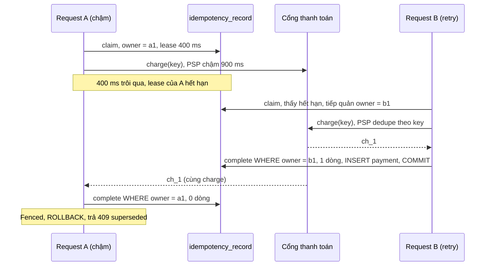
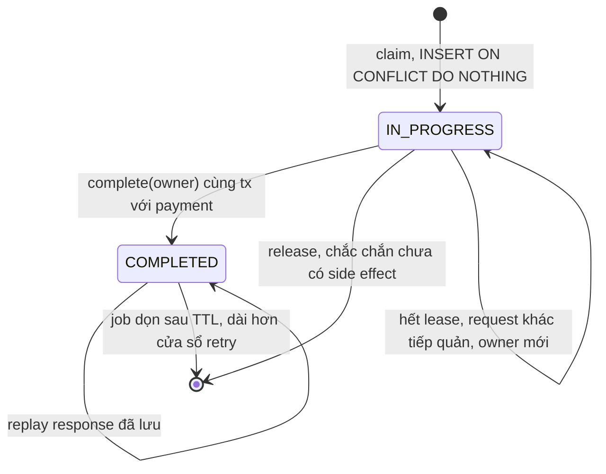

# Bài 02 — Idempotency key cho API có tiền: từ unique index tới lease và fencing token

> **Dùng cho:** **NAB** (API thanh toán, gần như chắc chắn bị hỏi) · **Katalon** (họ C và F: ingest
> at-least-once, retry an toàn; đề đếm sự kiện dùng `event_id` làm key)
>
> **Thời lượng:** đọc 35 phút · lab 20 phút · drill 20 phút
>
> **Lab:** [`lab/…/idempotency/`](lab/src/main/java/com/prep/onbai/idempotency/) (Spring Boot, MockMvc, PSP giả
> tiêm lỗi được) · schema [`idempotency.sql`](lab/src/main/resources/idempotency.sql) · test `IdempotencyApiTest` (7 test)
>
> **Nối với:** [4 quy tắc ở tuần 2](../../java-system-design/10-implement-gd1-nen-tang.md#24-idempotency-key--4-quy-tắc).
> Bài này giữ nguyên 4 quy tắc đó và thêm phần khó nhất: **side effect nằm ngoài database**.

```bash
cd on-bai/gd1-nen-tang/lab
mvn -q test -Dtest=IdempotencyApiTest   # ~3 giây
```

---

## 0. Trọng tâm phỏng vấn

Câu hỏi gốc: *"Client gọi `POST /payments`, mạng timeout, client retry. Làm sao không trừ tiền hai lần?"*
Câu trả lời junior là "dùng idempotency key". Câu trả lời senior trả lời **sáu câu hỏi tiếp theo** trước
khi interviewer kịp hỏi:

| # | Câu hỏi tiếp theo | Trả lời |
|:-:|---|---|
| 1 | Ai sinh key, phạm vi? | Client, **một lần cho một ý định**, gửi lại khi retry. Key duy nhất trong phạm vi `(client, key)` |
| 2 | Hai request cùng key đến **cùng lúc**? | Unique index quyết định ai là chủ. Người đến sau nhận `409` (đang xử lý) hoặc response đã lưu |
| 3 | Cùng key, khác nội dung? | `422`. So bằng hash nội dung **đã chuẩn hoá** |
| 4 | Side effect ở **ngoài** DB (cổng thanh toán)? | Không có transaction chung. Truyền **chính key đó** xuống PSP, giữ trạng thái `IN_PROGRESS` có **lease**, chốt kết quả và side effect DB trong một transaction |
| 5 | Lỗi thì giữ key hay trả key? | Phân loại lỗi: **chắc chắn chưa xảy ra** thì trả key; **không biết** (timeout) thì giữ, retry sau lease; **kết quả nghiệp vụ** (thẻ bị từ chối) thì lưu và replay |
| 6 | Request cũ chết giữa chừng, request mới tiếp quản, request cũ sống lại? | **Fencing token**: chỉ chủ hiện tại mới chốt được; chủ cũ bị chặn và rollback |

Câu chốt: *"Exactly-once **hiệu ứng** = giao at-least-once + xử lý idempotent. Không ai giao được
exactly-once qua mạng; ta làm cho lần thứ hai vô hại."*

---

## 1. Lý thuyết cốt lõi

### 1.1 Vì sao retry là chuyện bình thường, không phải ngoại lệ

Mọi tầng đều có thể gửi lại: người dùng bấm hai lần, app mobile retry khi đổi sóng, SDK retry khi timeout,
load balancer/gateway retry khi upstream reset, consumer Kafka xử lý lại sau rebalance. **Timeout không có
nghĩa là thất bại.** Nó nghĩa là *không biết*. Lệnh có thể đã chạy xong, chỉ có response bị mất.

### 1.2 Hai pattern, chọn theo chỗ side effect nằm

| | Pattern A: side effect **trong** DB | Pattern B: side effect **ngoài** DB |
|---|---|---|
| Ví dụ | Ghi sổ cái, chuyển tiền nội bộ ([bài 05](05-ledger-va-balance.md)) | Gọi PSP trừ thẻ, gửi SMS, gọi ngân hàng khác |
| Cơ chế | **Một** transaction: `INSERT key` + side effect. Unique index tuần tự hoá request trùng | Máy trạng thái `IN_PROGRESS → COMPLETED` + lease + fencing; key truyền xuống bên ngoài |
| Request trùng đồng thời | Chờ ở unique index, rồi replay | `409` + `Retry-After` |
| Crash giữa chừng | Rollback sạch, như chưa có gì | Bản ghi kẹt `IN_PROGRESS`, hết lease thì người sau tiếp quản |

Pattern A đơn giản hơn nhiều. **Nếu kéo được side effect vào DB thì làm.** Ví dụ: thay vì gọi email service
trực tiếp, ghi vào outbox ([bài 09](09-outbox-notification.md)) trong cùng transaction. Pattern B chỉ dành
cho thứ thật sự không kéo vào được.

### 1.3 Ba loại thất bại, ba cách xử lý

| Loại | Ví dụ | Side effect đã xảy ra? | Xử lý key |
|---|---|---|---|
| **Chắc chắn chưa** | Connection refused, `400` validation từ PSP | Không | **Trả key** (xoá bản ghi), client retry ngay |
| **Không biết** | Timeout, connection reset sau khi gửi | Có thể | **Giữ** `IN_PROGRESS`; retry sau lease sẽ gọi lại PSP **cùng key**, PSP tự dedupe |
| **Kết quả nghiệp vụ** | Thẻ bị từ chối, không đủ hạn mức | Không, nhưng là câu trả lời **xác định** | **Lưu** như response thành công, replay `402` |

Nhầm loại 2 thành loại 1 (trả key khi timeout) thì retry tạo **charge thứ hai** nếu PSP không dedupe.
Nhầm loại 3 thành loại 1 thì cùng key mà lúc `402` lúc `201`, vi phạm định nghĩa idempotent.

### 1.4 Key tự nhiên tốt hơn UUID khi nghiệp vụ có sẵn

UUID do client sinh chống được *retry của cùng client*. Nó **không** chống được hai nguồn khác nhau cùng
gửi một ý định (job chạy lại, hai instance cùng phát lệnh). Khi nghiệp vụ tự có khoá như
`accrual:{khoản vay}:{ngày}` hay `event_id` trong bài đếm sự kiện của Katalon, hãy dùng khoá đó ([bài
06](06-race-tinh-lai-vs-thanh-toan.md), doc 06 §12.2 quyết định #5).

---

## 2. Real case: API thanh toán gọi cổng PSP, dựng từ đầu

### Bước 1 — Hợp đồng HTTP trước, code sau

| Tình huống | Status | Header |
|---|---|---|
| Lần đầu, thành công | `201` + body | |
| Cùng key, cùng body, đã xong | `201` + **đúng body cũ, từng byte** | `Idempotent-Replayed: true` |
| Thiếu key | `400` | |
| Cùng key, khác body | `422 idempotency_key_reused` | |
| Cùng key, request kia đang chạy | `409 request_in_progress` | `Retry-After: n` |
| Thẻ bị từ chối (lưu lại) | `402 card_declined`; lần sau cũng `402` | `Idempotent-Replayed: true` |
| PSP từ chối kết nối (key được trả) | `503 psp_down` | |
| PSP timeout (key bị giữ) | `504 psp_timeout` | `Retry-After` = lease |
| Bị request khác tiếp quản | `409 superseded` | |

Viết bảng này ra trước giúp interviewer thấy bạn nghĩ từ phía client. Đây cũng chính là đặc tả của test.

### Bước 2 — Schema: một bảng trạng thái, một bảng nghiệp vụ

📄 [`idempotency.sql`](lab/src/main/resources/idempotency.sql)

```sql
CREATE TABLE IF NOT EXISTS idempotency_record (
    scope         text        NOT NULL,      -- client/merchant: key chi can duy nhat TRONG pham vi cua ho
    key           text        NOT NULL,
    request_hash  text        NOT NULL,      -- cung key, khac noi dung -> 422
    status        text        NOT NULL CHECK (status IN ('IN_PROGRESS', 'COMPLETED')),
    owner_token   uuid        NOT NULL,      -- ai dang giu lease; doi khi bi tiep quan (fencing token)
    locked_until  timestamptz NOT NULL,      -- lease: qua han -> request sau duoc tiep quan
    response_code int,
    response_body text,                      -- tra lai NGUYEN VAN khi replay
    created_at    timestamptz NOT NULL DEFAULT now(),
    PRIMARY KEY (scope, key)
);

CREATE TABLE IF NOT EXISTS payment (
    id            uuid        PRIMARY KEY,
    scope         text        NOT NULL,
    idem_key      text        NOT NULL,
    amount_minor  bigint      NOT NULL CHECK (amount_minor > 0),   -- tien = so nguyen don vi nho nhat
    currency      text        NOT NULL,
    psp_charge_id text        NOT NULL,
    created_at    timestamptz NOT NULL DEFAULT now(),
    UNIQUE (scope, idem_key)                 -- luoi an toan cuoi: mot key, mot payment
);
```

- **`PRIMARY KEY (scope, key)`:** key của client A không đụng key của client B. Không có scope thì một
  client đoán được key của client khác và đọc được response của họ. Đó là lỗ hổng bảo mật.
- **`owner_token` là fencing token.** Mỗi lần ai đó giành hoặc tiếp quản key thì token đổi.
- **`locked_until` so bằng `clock_timestamp()` của DB**, không bằng đồng hồ từng pod. Lệch đồng hồ giữa
  các pod không làm lease sai.
- **`payment UNIQUE (scope, idem_key)`:** lưới an toàn cuối. Dù logic phía trên có bug, một key không thể
  sinh hai payment.

### Bước 3 — `claim()`: giành key, hoặc biết ngay mình nên làm gì

📄 [`IdempotencyStore.java`](lab/src/main/java/com/prep/onbai/idempotency/IdempotencyStore.java)

```java
/** Chay NGOAI transaction nghiep vu (autocommit): IN_PROGRESS phai hien ra cho request khac ngay lap tuc. */
public Claim claim(String scope, String key, String requestHash, Duration lease) {
    UUID me = UUID.randomUUID();
    String leaseSql = lease.toMillis() + " milliseconds";
    int inserted = jdbc.update("""
            INSERT INTO idempotency_record (scope, key, request_hash, status, owner_token, locked_until)
            VALUES (?, ?, ?, 'IN_PROGRESS', ?, clock_timestamp() + ?::interval)
            ON CONFLICT (scope, key) DO NOTHING""", scope, key, requestHash, me, leaseSql);
    if (inserted == 1) {
        return new Acquired(me, false);
    }
    // ... doc dong hien co
    if (!requestHash.equals(row.get("request_hash"))) {
        return new Mismatch();
    }
    if ("COMPLETED".equals(row.get("status"))) {
        return new Replay((Integer) row.get("response_code"), (String) row.get("response_body"));
    }
    long remaining = ((Number) row.get("remaining_ms")).longValue();
    if (remaining > 0) {
        return new InProgress(remaining);
    }
    // Lease het han: chu cu co le da chet giua chung. Tiep quan co dieu kien -> hai nguoi cung thay thi chi mot thang.
    int took = jdbc.update("""
            UPDATE idempotency_record SET owner_token = ?, locked_until = clock_timestamp() + ?::interval
             WHERE scope = ? AND key = ? AND status = 'IN_PROGRESS' AND locked_until <= clock_timestamp()""",
            me, leaseSql, scope, key);
    return took == 1 ? new Acquired(me, true) : new InProgress(lease.toMillis());
}
```

- **Vì sao `claim` chạy autocommit, không nằm trong transaction nghiệp vụ:** `IN_PROGRESS` phải **hiện ra
  ngay** cho request trùng. Nếu nằm trong transaction dài (đang chờ PSP), request trùng sẽ chờ ở unique
  index suốt thời gian đó, giữ thread và connection ([bài 01](01-littles-law-pool-timeout.md)).
- **Kiểm `Mismatch` trước mọi thứ**, kể cả khi đang `IN_PROGRESS`. Key bị dùng sai thì báo ngay.
- **Tiếp quản là một `UPDATE` có điều kiện** (`locked_until <= now`). Hai request cùng thấy lease hết hạn
  thì chỉ một câu `UPDATE` trả 1 dòng. Đây lại là atomic compare-and-set của bài 04.
- `sealed interface Claim` + `switch` pattern matching (Java 21) làm compiler ép xử lý đủ bốn trường hợp:

📄 [`PaymentService.java`](lab/src/main/java/com/prep/onbai/idempotency/PaymentService.java)

```java
public Outcome pay(String scope, String key, PaymentRequest req) {
    return switch (store.claim(scope, key, req.hash(), lease)) {
        case Mismatch m -> new Outcome(422, error("idempotency_key_reused", "key da dung cho mot request khac noi dung"), false, 0);
        case Replay r -> new Outcome(r.code(), r.body(), true, 0);
        case InProgress p -> new Outcome(409, error("request_in_progress", "request cung key dang chay"), false, p.retryAfterMs());
        case Acquired a -> execute(scope, key, req, a.owner());
    };
}
```

### Bước 4 — Gọi PSP **ngoài** transaction, truyền key xuống, phân loại lỗi

```java
private Outcome execute(String scope, String key, PaymentRequest req, UUID owner) {
    FakePsp.Charge charge;
    try {
        charge = psp.charge(scope + ":" + key, req.amountMinor(), req.currency()); // key truyen xuong: PSP dedupe
    } catch (FakePsp.Declined e) {
        return finish(scope, key, owner, 402, error("card_declined", e.getMessage()), () -> {});
    } catch (FakePsp.Down e) {
        store.release(scope, key, owner); // chac chan chua tru tien -> tra key
        return new Outcome(503, error("psp_down", e.getMessage()), false, 0);
    } catch (FakePsp.Timeout e) {
        // KHONG biet PSP da tru tien chua -> giu IN_PROGRESS; retry sau lease se goi lai PSP CUNG key
        return new Outcome(504, error("psp_timeout", e.getMessage()), false, lease.toMillis());
    }
    // ... buoc 5
}
```

- **Ngoài transaction:** giữ connection DB trong lúc chờ mạng là cách nhanh nhất để cạn pool. Lab bài 01
  đo được: giữ 55 ms thay vì 5 ms thì trần thông lượng còn 181 req/s.
- **Truyền key xuống PSP** là **điều kiện sống còn** của pattern B. Stripe, Adyen, PayPal đều nhận
  idempotency key. Đối tác không nhận key thì phải tự làm phía mình: trước khi gọi lại, **hỏi trạng thái**
  theo mã tham chiếu đã gửi lần trước.
- `FakePsp` tiêm được đúng ba loại lỗi ở §1.3 để test từng nhánh.

### Bước 5 — `finish()`: chốt kết quả và side effect DB trong **một** transaction, có fencing

```java
/** Chot ket qua + side effect DB trong MOT transaction, co kiem tra fencing token truoc. */
private Outcome finish(String scope, String key, UUID owner, int code, String body, Runnable sideEffect) {
    try {
        tx.executeWithoutResult(s -> {
            if (!store.complete(scope, key, owner, code, body)) {
                throw new Fenced(); // da bi tiep quan: rollback, khong ghi gi
            }
            sideEffect.run();
        });
        return new Outcome(code, body, false, 0);
    } catch (Fenced e) {
        return new Outcome(409, error("superseded", e.getMessage()), false, 0);
    }
}
```

```java
/** Goi TRONG transaction nghiep vu: ket qua va side effect DB cung commit hoac cung rollback. */
public boolean complete(String scope, String key, UUID owner, int code, String body) {
    return jdbc.update("""
            UPDATE idempotency_record SET status = 'COMPLETED', response_code = ?, response_body = ?
             WHERE scope = ? AND key = ? AND owner_token = ? AND status = 'IN_PROGRESS'""",
            code, body, scope, key, owner) == 1;
}
```

Kịch bản fencing chặn, với lease 400 ms:



```text
[LAB] fencing: B tiep quan -> 201, A cham toi sau -> 409 {"error":"superseded","message":"key da bi request khac tiep quan"}; payment = 1, PSP tru tien 1 lan
```

Không có fencing thì A cũng ghi `COMPLETED` và chèn payment thứ hai. `UNIQUE (scope, idem_key)` sẽ chặn
bằng lỗi `500`, tức là lưới an toàn cuối có tác dụng nhưng trải nghiệm xấu. Fencing token là cùng một ý
tưởng với fencing token của distributed lock (Kleppmann), áp vào bài toán nhỏ.

### Bước 6 — Controller: hợp đồng HTTP thành code

📄 [`PaymentController.java`](lab/src/main/java/com/prep/onbai/idempotency/PaymentController.java)

```java
@PostMapping("/payments")
public ResponseEntity<String> create(@RequestHeader(value = "Idempotency-Key", required = false) String key,
                                     @RequestHeader(value = "X-Client-Id", defaultValue = "demo") String client,
                                     @RequestBody PaymentRequest body) {
    if (key == null || key.isBlank() || key.length() > 255) {
        return ResponseEntity.badRequest().contentType(MediaType.APPLICATION_JSON)
                .body("{\"error\":\"idempotency_key_required\"}");
    }
    Outcome o = payments.pay(client, key, body);
    ResponseEntity.BodyBuilder res = ResponseEntity.status(o.code()).contentType(MediaType.APPLICATION_JSON);
    if (o.replayed()) {
        res.header("Idempotent-Replayed", "true");
    }
    if (o.retryAfterMs() > 0) {
        res.header("Retry-After", String.valueOf(Math.max(1, (o.retryAfterMs() + 999) / 1000)));
    }
    return res.body(o.body());
}
```

`scope` lấy từ danh tính đã xác thực (ở lab là header `X-Client-Id` cho gọn; thật thì lấy từ JWT, không tin
header). Response lưu dạng chuỗi JSON (map đã sắp key bằng `TreeMap`), nên replay **giống từng byte**.

### Bước 7 — Hash nội dung đã chuẩn hoá, không hash chuỗi JSON

```java
/** Dau van tay CHUAN HOA cua noi dung (khong phai cua chuoi JSON, vi thu tu field co the khac). */
public String hash() {
    String canonical = customerId + "|" + amountMinor + "|" + currency;
    // ... SHA-256
}
```

`{"a":1,"b":2}` và `{"b":2,"a":1}` là **cùng** request. Hash chuỗi thô sẽ báo `422` oan. Hash nội dung
sau khi parse thì không.

---

## 3. Lab — bảng test và output thật

| Test | Chứng minh | Output |
|---|---|---|
| `secondCallWithTheSameKeyReplaysTheFirstResponseByteForByte` | Replay giống từng byte, PSP 1 lần | `lan 2: 201 Idempotent-Replayed=true` |
| `sameKeyWithADifferentBodyIs422AndAMissingKeyIs400` | `422`, `400` | — |
| `tenConcurrentDuplicatesChargeExactlyOnce` | 10 request trùng **cùng lúc** | `{201=1, 409=9}, PSP tru tien 1 lan` |
| `aDeclinedCardIsAStoredOutcomeNotARetryableError` | `402` được lưu, lần hai không gọi PSP | — |
| `pspDownMeansNothingHappenedSoTheKeyIsReleased` | `503` rồi retry ngay ra `201` | — |
| `aTimeoutAfterTheChargeIsRetriedSafelyAfterTheLease` | `504` → `409` → (sau lease) `201`, PSP trừ 1 lần | `504 -> 409 (Retry-After 1s) -> 201` |
| `aSlowOwnerWhoseLeaseExpiredIsFencedOff` | Chủ cũ bị chặn | `B 201, A 409 superseded, payment = 1` |

**Bài tập (15 phút):** xoá điều kiện `AND owner_token = ?` trong `complete()` rồi chạy lại test fencing.
Bạn sẽ thấy `DuplicateKeyException` từ `UNIQUE (scope, idem_key)`. Lưới an toàn cuối cứu được dữ liệu,
nhưng request nhận `500`.

---

## 4. Vẽ: máy trạng thái



**Nói khi vẽ (45 giây):** *"Key do client sinh, phạm vi theo client. Bước một giành key bằng unique index,
autocommit, để request trùng thấy ngay `IN_PROGRESS`. Gọi PSP ngoài transaction và truyền chính key đó
xuống để PSP dedupe. Chốt kết quả bằng `UPDATE` có điều kiện theo owner token, cùng transaction với dòng
payment. Ba loại lỗi xử lý ba kiểu: chắc chắn chưa thì trả key, không biết thì giữ chờ lease, kết quả
nghiệp vụ thì lưu và replay. Bản ghi giữ lâu hơn cửa sổ retry dài nhất của client, rồi job dọn."*

---

## 5. Live coding drill (20 phút)

**Đề:** *"Viết idempotency cho `POST /transfers` nội bộ (chỉ ghi DB)."* Đây là **pattern A**, đừng mang
lease ra khi không cần. Bảng rút gọn cho bảng trắng:
`idempotency_record(scope, key, request_hash, status, response_body, PRIMARY KEY (scope, key))`.

```java
@Transactional
public TransferResult transfer(String clientId, String key, TransferRequest req) {
    String hash = req.canonicalHash();
    int fresh = jdbc.update("""
        INSERT INTO idempotency_record (scope, key, request_hash, status)
        VALUES (?, ?, ?, 'COMPLETED')
        ON CONFLICT (scope, key) DO NOTHING""", clientId, key, hash);
    if (fresh == 0) {                               // request trung: da cho o unique index toi khi ben kia xong
        var row = jdbc.queryForMap("SELECT request_hash, response_body FROM idempotency_record WHERE scope = ? AND key = ?",
                                   clientId, key);
        if (!hash.equals(row.get("request_hash"))) throw new KeyReusedException();          // 422
        return json.readValue((String) row.get("response_body"), TransferResult.class);     // replay
    }
    TransferResult result = ledger.transfer(req);   // side effect, CUNG transaction
    jdbc.update("UPDATE idempotency_record SET response_body = ? WHERE scope = ? AND key = ?",
                json.writeValueAsString(result), clientId, key);
    return result;
}
```

**Điểm interviewer chấm:**

- [ ] Nhận ra đây là pattern A: một transaction, không cần `IN_PROGRESS`/lease
- [ ] Giải thích request trùng **chờ ở unique index** cho tới khi request đầu commit (hoặc rollback và chạy
      lại từ đầu)
- [ ] `422` khi khác hash; replay đúng response cũ
- [ ] Nói được khi nào phải nâng lên pattern B (side effect ngoài DB), và ba loại lỗi
- [ ] Nói được TTL của bản ghi > cửa sổ retry của client (quy tắc 4)

Biến thể hay gặp: *"làm thành `Filter`/`HandlerInterceptor` cho mọi POST"*. Được, nhưng nói rõ cái giá:
filter không biết side effect ở đâu, nên chỉ làm được pattern B chung chung. Body request phải đọc hai lần
(`ContentCachingRequestWrapper`). Response phải bắt lại để lưu (`ContentCachingResponseWrapper`).

---

## 6. Follow-up

<details>
<summary><b>Q1. Lưu key ở Redis cho nhanh được không?</b></summary>

Dùng `SET key value NX PX lease` để giành key thì nhanh. Nhưng (1) response và side effect DB không cùng
transaction với Redis, nên crash giữa hai bên làm lệch; (2) Redis failover bất đồng bộ có thể **mất** bản
ghi vừa ghi, và retry sau đó chạy lại side effect. Với tiền, bản ghi idempotency nằm **cùng DB** với side
effect. Redis chỉ hợp làm lớp chặn sớm (giảm tải) phía trước, không làm nguồn sự thật.
</details>

<details>
<summary><b>Q2. Giữ bản ghi bao lâu?</b></summary>

Lâu hơn cửa sổ retry dài nhất của mọi client (Stripe giữ 24 giờ). Hết hạn mà client retry thì request
**chạy lại thật**, mất idempotency một cách im lặng. Dọn bằng job xoá theo `created_at`, hoặc partition theo
ngày rồi `DROP` partition cũ (O(1), không VACUUM nặng).
</details>

<details>
<summary><b>Q3. Request trùng nên chờ hay trả 409 ngay?</b></summary>

Pattern A: chờ ở unique index là tự nhiên (vài ms). Pattern B: trả `409 + Retry-After` thay vì treo thread
chờ PSP; treo N thread vì một client bấm liên tục là tự DoS. Có thể chờ ngắn (long-poll vài trăm ms) rồi
mới `409`, để giảm số vòng retry.
</details>

<details>
<summary><b>Q4. GET/PUT/DELETE có cần key không?</b></summary>

`GET`, `PUT` (thay toàn bộ), `DELETE` vốn idempotent theo ngữ nghĩa HTTP: gọi hai lần, trạng thái cuối như
nhau (response có thể khác, ví dụ `DELETE` lần hai trả `404`). `POST` tạo mới và `PATCH` tương đối
(`balance += 10`) thì không. Đó là chỗ cần key.
</details>

<details>
<summary><b>Q5. Consumer Kafka thì sao?</b></summary>

Cùng tư tưởng, khác chỗ đặt: bảng `inbox(consumer, message_id)` + side effect trong một transaction (pattern
A ở phía consumer). Lab bài 09 có `NotificationConsumer`: relay chết giữa chừng, message bị giao hai lần, vẫn
chỉ một email.
</details>

<details>
<summary><b>Q6. Kẻ xấu gửi key của người khác?</b></summary>

`scope` lấy từ danh tính **đã xác thực**, không từ header client tự khai. Key chỉ duy nhất trong scope, nên
đoán được key của người khác cũng không đọc được response của họ. Giới hạn độ dài key (≤ 255) để không ai
nhét 1 MB vào index.
</details>

---

## 7. Checklist

- [ ] Phân biệt pattern A (một transaction) và pattern B (lease + fencing); chọn đúng cho đề
- [ ] Đọc thuộc bảng status code ở bước 1
- [ ] Phân loại ba kiểu lỗi và cách xử lý key cho từng kiểu
- [ ] Giải thích fencing token bằng sơ đồ A chậm, B tiếp quản
- [ ] Biết vì sao `claim` autocommit, vì sao gọi PSP ngoài transaction
- [ ] Code drill §5 trong 20 phút; nói được khi nào nâng lên pattern B
