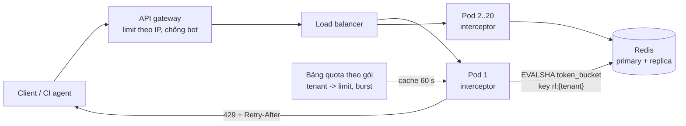

# Bài 03 — Rate limiter: token bucket, cửa sổ trượt, và bản phân tán bằng Redis Lua

> **Dùng cho:** **Katalon** (multi-tenant: một tenant lớn không được làm nghẹt tenant khác; họ B) · **NAB**
> (API gateway, chống dò OTP/mật khẩu). "Design a rate limiter" là đề kinh điển, có cả phần **code tại chỗ**.
>
> **Thời lượng:** đọc 30 phút · lab 15 phút · drill 10 phút
>
> **Lab:** [`lab/…/ratelimit/`](lab/src/main/java/com/prep/onbai/ratelimit/) · script
> [`token_bucket.lua`](lab/src/main/resources/ratelimit/token_bucket.lua) · test `RateLimiterTest` (6 test; 3 test dùng
> `redis-server` thật trên cổng ngẫu nhiên, máy không có Redis thì tự skip)
>
> **Nối với:** [Lab 2 tuần 2](../../java-system-design/10-implement-gd1-nen-tang.md#lab-2--rate-limiter-phân-tán-trong-spring-boot-thứ-bảy-34-giờ)
> (bản Spring Boot + Redis đầy đủ hơn ở lộ trình).

```bash
cd on-bai/gd1-nen-tang/lab
mvn -q test -Dtest=RateLimiterTest   # macOS: brew install redis (không cần chạy sẵn, test tự bật)
```

---

## 0. Trọng tâm phỏng vấn

| Interviewer dò | Senior trả lời |
|---|---|
| Thuật toán nào? | **Token bucket** mặc định: cho burst có kiểm soát, O(1) bộ nhớ mỗi key, hai tham số dễ giải thích (dung lượng, tốc độ nạp). Cần chính xác tuyệt đối theo cửa sổ thì sliding log; cần rẻ thì sliding window counter (xấp xỉ) |
| Nhiều pod thì sao? | Trạng thái phải **dùng chung**: Redis, và đọc-tính-ghi **nguyên tử** (Lua). Chia limit cho số pod thì sai khi load balancer không đều |
| Bản Redis hay sai ở đâu? | `GET` rồi `SET` là hai lệnh, nên race (lab: limit 100 cho qua 101). `INCR` rồi `EXPIRE`: chết giữa hai lệnh thì key **không bao giờ hết hạn** |
| Redis chết thì sao? | Chọn **fail-open** hay **fail-closed** theo rủi ro. API thường fail-open (kèm limiter cục bộ dự phòng); chống dò OTP thì fail-closed |
| Trả gì cho client? | `429` + `Retry-After` + `RateLimit-Limit/Remaining/Reset`. Client tử tế sẽ tự lùi |

---

## 1. Lý thuyết cốt lõi

### 1.1 Năm thuật toán, so sánh một bảng

| Thuật toán | Ý tưởng | Bộ nhớ / key | Burst | Chính xác | Dùng khi |
|---|---|---|---|---|---|
| **Token bucket** | Xô chứa tối đa `C` token, nạp `r`/giây; mỗi request lấy 1 | 2 số | Cho phép tới `C` | Đúng với định nghĩa của nó | Mặc định cho API |
| Leaky bucket | Hàng đợi xả đều `r`/giây | Hàng đợi | Không (làm phẳng) | Đúng | Làm mượt đầu ra (gửi SMS theo tốc độ nhà mạng) |
| Fixed window | Đếm trong `[kW, (k+1)W)` | 1 số | **Gấp đôi ở biên** | Sai ở biên | Quota thô (theo ngày) |
| Sliding log | Lưu mọi mốc thời gian trong cửa sổ | O(limit) | Không | **Tuyệt đối** | Limit nhỏ, cần chính xác (OTP 5 lần/giờ) |
| Sliding window counter | `cur + prev × (phần cửa sổ trước còn lại)` | 2 số | Gần như không | Xấp xỉ | Limit lớn, cần rẻ |

### 1.2 Bốn câu hỏi thiết kế trước khi chọn thuật toán

1. **Limit theo gì?** user, API key, tenant, IP (sau NAT nhiều người chung IP), endpoint. Thường là **nhiều
   tầng**: theo IP ở gateway (chống bot), theo tenant ở service (công bằng).
2. **Đặt ở đâu?** Gateway (chặn sớm, rẻ, nhưng không biết ngữ cảnh nghiệp vụ) hay trong service (biết
   tenant, chi phí từng endpoint). Katalon multi-tenant: **tenant quota trong service**.
3. **Mỗi request tốn bao nhiêu?** Export báo cáo đắt hơn đọc một test case thì cho request lấy `cost` token
   thay vì 1. Script Lua của lab nhận sẵn tham số này.
4. **Vượt thì làm gì?** `429` ngay (đa số), xếp hàng (leaky bucket), hay giảm chất lượng (trả dữ liệu
   cache).

---

## 2. Real case: quota API cho nền tảng multi-tenant, 20 pod

Đề: public API của một nền tảng test (kiểu TestOps). Mỗi tenant 100 req/s trung bình, burst tối đa 200.
20 pod sau load balancer. Một tenant chạy CI hỏng gửi 5.000 req/s không được làm chậm tenant khác.

### Bước 1 — Token bucket trong bộ nhớ, thread-safe, test tất định

📄 [`TokenBucket.java`](lab/src/main/java/com/prep/onbai/ratelimit/TokenBucket.java)

```java
public boolean tryAcquire(String key) {
    boolean[] granted = new boolean[1];
    buckets.compute(key, (k, s) -> {
        long now = nanoClock.getAsLong();
        double tokens = s == null ? capacity : Math.min(capacity, s.tokens() + (now - s.lastNanos()) * refillPerNano);
        if (tokens >= 1) {
            tokens -= 1;
            granted[0] = true;
        }
        return new State(tokens, now);
    });
    return granted[0];
}
```

- **Không cần thread nạp token định kỳ.** Nạp "lười" lúc có request: `tokens += (now − last) × rate`, chặn
  trên ở `capacity`. Mọi bản thật (Guava `RateLimiter`, Bucket4j, Redis Lua) đều làm vậy.
- **`ConcurrentHashMap.compute` khoá đúng bin của key đó.** Đọc-tính-ghi nguyên tử cho một key, key khác
  không chờ nhau. Không cần `synchronized` toàn cục (perf-lab P11 đo cái giá của khoá toàn cục).
- **Đồng hồ tiêm vào (`LongSupplier nanoClock`).** Test đẩy thời gian bằng tay, không `sleep`:

```java
TokenBucket bucket = new TokenBucket(5, 2, nanos::get); // burst 5, trung binh 2/s
// 20 lan thu ngay lap tuc -> 5 qua (burst); dong ho +1 giay -> them dung 2
```

- Test tranh chấp: 16 luồng × 1.000 lần với đồng hồ đứng yên, capacity 100, cho ra **đúng 100**.

**Lưu ý production:** map này lớn theo số key (mỗi IP, mỗi user). Thay bằng Caffeine với
`expireAfterAccess`, nếu không đây chính là anti-pattern cache không giới hạn (perf-lab P18).

### Bước 2 — Cửa sổ: lỗ hổng ở biên, đo bằng số

📄 [`WindowCounters.java`](lab/src/main/java/com/prep/onbai/ratelimit/WindowCounters.java)

```java
/** Cua so truot XAP XI: count(hien tai) + count(truoc) x phan cua so truoc con nam trong cua so truot. 2 so nguyen moi key. */
// ...
double elapsed = (double) (now - idx * windowMillis) / windowMillis;   // 0..1 trong cua so hien tai
double estimate = st.previous() * (1 - elapsed) + st.current();
ok[0] = estimate < limit;
```

Test bắn 100 request lúc 59.999 ms và 100 request lúc 60.001 ms, limit 100/phút:

```text
[LAB] limit 100/phut, 200 request trong 2 ms quanh bien phut: fixed 200, sliding log 100, sliding counter 101
```

- **Fixed window cho qua 200 trong 2 ms**, gấp đôi limit. Đây là câu hỏi bẫy kinh điển.
- **Sliding log** đúng tuyệt đối (100), giá là lưu 100 mốc thời gian mỗi key.
- **Sliding counter** cho **101**: `100 × (1 − 1/60000) = 99,998 < 100`, nên lọt thêm một request. Nó là
  công thức **xấp xỉ**, và đó là đúng bản chất. Cloudflare báo sai số cỡ 0,003% trên lưu lượng thật. Nói
  được con số "lệch 1" này cho thấy bạn hiểu cơ chế chứ không thuộc lòng.

### Bước 3 — Lên 20 pod: vì sao trong bộ nhớ không đủ

- Mỗi pod một bucket thì limit thật bằng **20 × 100**.
- Chia limit cho số pod (mỗi pod 5 req/s) thì sai khi load balancer không đều (sticky session, kết nối
  HTTP/2 dài). Một pod nhận 30% lưu lượng của tenant sẽ chặn oan.
- Cần **trạng thái dùng chung**: Redis (độ trễ ~0,5 ms trong cùng AZ, 100k+ lệnh/giây mỗi node).

### Bước 4 — Bản Redis sai: `GET` rồi `SET`

📄 [`RedisRateLimiters.java`](lab/src/main/java/com/prep/onbai/ratelimit/RedisRateLimiters.java)

```java
/**
 * SAI: GET roi SET la HAI lenh. Hai instance cung GET 99 -> cung SET 100 -> limit 100 cho qua 101.
 * gap = cho test chen instance khac vao giua hai lenh.
 */
public boolean naiveGetThenSet(String key, int limit, Runnable gap) {
    String v = redis.get(key);
    int count = v == null ? 0 : Integer.parseInt(v);
    if (count >= limit) {
        return false;
    }
    gap.run();
    redis.set(key, String.valueOf(count + 1), SetParams.setParams().px(60_000));
    return true;
}
```

```text
[LAB] GET roi SET, limit 100, dang o 99: A=true B=true -> bo dem = 100
```

Hai instance cùng thấy 99, cùng cho qua, bộ đếm vẫn ghi 100: **101 request qua limit 100**, và bộ đếm
không hề biết. Cùng một TOCTOU như bài 04, chỉ khác là trên Redis. `WATCH/MULTI` (optimistic) chữa được
nhưng retry nhiều khi tranh chấp cao.

### Bước 5 — `INCR` đúng cách (cửa sổ cố định)

```java
/**
 * DUNG nhung co gioi han: INCR nguyen tu -> khong bao gio dem sai. Cua so co dinh (lo hong o bien).
 * SET NX PX tao key KEM TTL trong mot lenh: tranh bay "INCR roi EXPIRE", chet giua hai lenh = key khong bao gio het han.
 */
public boolean fixedWindowIncr(String key, int limit, long windowMillis) {
    String k = key + ":" + (System.currentTimeMillis() / windowMillis);
    redis.set(k, "0", SetParams.setParams().nx().px(windowMillis * 2));
    return redis.incr(k) <= limit;
}
```

Bẫy `INCR` rồi `EXPIRE` nổi tiếng: pod chết đúng giữa hai lệnh thì key không có TTL, bộ đếm tăng mãi, và
user đó bị chặn **vĩnh viễn**. `SET … NX PX` tạo key **kèm** TTL trong một lệnh; `INCR` sau đó không xoá TTL.
Tên key có số thứ tự cửa sổ, nên cửa sổ mới là key mới.

### Bước 6 — Token bucket bằng Lua: nguyên tử, dùng đồng hồ của Redis

📄 [`token_bucket.lua`](lab/src/main/resources/ratelimit/token_bucket.lua)

```lua
local t = redis.call('TIME')                                 -- dong ho cua Redis: moi instance app dung chung
local now = tonumber(t[1]) * 1000000 + tonumber(t[2])        -- micro giay
local capacity = tonumber(ARGV[1])
local per_us = tonumber(ARGV[2]) / 1000000
local want = tonumber(ARGV[3])

local state = redis.call('HMGET', KEYS[1], 'tokens', 'ts')
local tokens = tonumber(state[1]) or capacity
local ts = tonumber(state[2]) or now
tokens = math.min(capacity, tokens + math.max(0, now - ts) * per_us)

local allowed = 0
if tokens >= want then
  tokens = tokens - want
  allowed = 1
end
redis.call('HSET', KEYS[1], 'tokens', tokens, 'ts', now)
-- bucket day lai sau capacity/refill giay: het han luc do, key nguoi khong song mai
redis.call('PEXPIRE', KEYS[1], math.ceil(capacity / per_us / 1000) + 1000)
return {allowed, math.floor(tokens)}
```

- **Nguyên tử:** Redis chạy script **trọn vẹn trên một luồng**, không lệnh nào chen vào giữa `HMGET` và
  `HSET`.
- **`redis.call('TIME')`:** dùng đồng hồ của Redis, nên đồng hồ lệch giữa các pod không làm sai số token.
  Redis 7 nhân bản *hiệu ứng* của script (effects replication), nên gọi `TIME` rồi ghi là hợp lệ.
- **`EVALSHA`:** tải script một lần (`SCRIPT LOAD`), sau đó gửi SHA thay vì cả đoạn script.
- **`PEXPIRE`:** key của user không quay lại tự biến mất sau khi xô đầy, nên Redis không phình.
- **Redis Cluster:** đặt key dạng `rl:{tenantId}` (hash tag) nếu script cần nhiều key cùng tenant, để
  chúng nằm cùng một slot.

```text
[LAB] Lua token bucket, 4 instance x 8 luong x 50 lan, capacity 100: cho qua 100
```

1.600 lần thử từ 4 "pod" (4 connection pool riêng), capacity 100: đúng 100 lần qua.

### Bước 7 — Gắn vào Spring: interceptor, header, fail-open

*(Khung tích hợp, không nằm trong lab; phần lõi `RedisRateLimiters` đã test ở trên.)*

```java
public class TenantRateLimitInterceptor implements HandlerInterceptor {
    private final RedisRateLimiters limiter;
    private final TokenBucket localFallback;          // du phong khi Redis chet: limit / so pod, chap nhan sai so

    @Override
    public boolean preHandle(HttpServletRequest req, HttpServletResponse res, Object handler) {
        String tenant = (String) req.getAttribute("tenantId");   // tu JWT DA XAC THUC, khong tu header client
        boolean allowed;
        int remaining = -1;
        try {
            RedisRateLimiters.Decision d = limiter.tokenBucket("rl:{" + tenant + "}", 200, 100);
            allowed = d.allowed();
            remaining = d.remaining();
        } catch (JedisException redisDown) {
            allowed = localFallback.tryAcquire(tenant);           // fail-open co kiem soat
        }
        res.setHeader("RateLimit-Limit", "100");
        if (remaining >= 0) res.setHeader("RateLimit-Remaining", String.valueOf(remaining));
        if (allowed) return true;
        res.setStatus(429);
        res.setHeader("Retry-After", "1");
        return false;
    }
}
```

---

## 3. Lab — bảng test

| Test | Chứng minh |
|---|---|
| `tokenBucketAllowsABurstThenTheRefillRate` | Burst 5, sau 1 s thêm đúng 2; key khác bucket khác |
| `tokenBucketIsExactUnderContention` | 16 luồng × 1.000 lần cho đúng 100 |
| `fixedWindowLets2xThroughAtTheBoundarySlidingVariantsDoNot` | 200 / 100 / 101 |
| `redisGetThenSetOverAdmitsWhenTwoInstancesInterleave` | Hai instance chen nhau, 101 qua limit 100 |
| `luaTokenBucketIsExactAcrossInstances` | 4 instance, 32 luồng, đúng 100 |
| `incrIsNeverWrongButStillHasTheBoundaryProblem` | `INCR` đếm đúng 100/150, key có TTL |

---

## 4. Vẽ design



**Nói khi vẽ (40 giây):** *"Hai tầng. Gateway limit theo IP để chặn bot rẻ. Trong service, interceptor
limit theo tenant bằng token bucket chạy trong Lua trên Redis: nguyên tử, dùng đồng hồ Redis, một round trip
~0,5 ms. Quota theo gói cước lấy từ config, cache 60 giây. Redis chết thì fail-open với limiter cục bộ chia
theo số pod, chấp nhận sai số tạm thời. Riêng endpoint OTP thì fail-closed. Trả 429 với Retry-After và
header RateLimit."*

---

## 5. Live coding drill (10 phút): token bucket thread-safe

Đề code kinh điển. Viết **không nhìn**, rồi so với bước 1:

```java
public final class RateLimiter {
    private final double capacity, refillPerNano;
    private double tokens;
    private long last;

    public RateLimiter(double capacity, double perSecond) {
        this.capacity = capacity;
        this.refillPerNano = perSecond / 1e9;
        this.tokens = capacity;
        this.last = System.nanoTime();
    }

    public synchronized boolean tryAcquire() {          // MOT key: synchronized la du va dung
        long now = System.nanoTime();
        tokens = Math.min(capacity, tokens + (now - last) * refillPerNano);
        last = now;
        if (tokens < 1) return false;
        tokens -= 1;
        return true;
    }
}
```

**Interviewer chấm:**

- [ ] `System.nanoTime()` (đơn điệu), **không** `currentTimeMillis()` (nhảy khi NTP chỉnh giờ)
- [ ] Nạp lười, chặn trên `capacity`
- [ ] Thread-safe. Hỏi tiếp "nhiều key?" thì chuyển sang `ConcurrentHashMap.compute`; "nhiều pod?" thì Redis
      Lua
- [ ] Nói được burst = capacity, trung bình = refill rate
- [ ] Biến thể: `tryAcquire(int cost)`, và `long nanosUntilAvailable()` để trả `Retry-After`

---

## 6. Follow-up

<details>
<summary><b>Q1. Thêm 0,5 ms mỗi request cho Redis có đắt không?</b></summary>

Với API 20–100 ms thì không đáng kể. Nếu đắt (hàng trăm nghìn req/s): mỗi pod **mượn token theo lô** (lấy
20 token một lần từ Redis, tiêu cục bộ). Giảm 20 lần số lệnh Redis, đổi lại sai số tối đa 20 × số pod ở
biên.
</details>

<details>
<summary><b>Q2. Một tenant cực lớn làm nóng một key Redis?</b></summary>

Một key Redis xử lý được vài chục nghìn lệnh/giây, đủ cho phần lớn tenant. Vượt thì tách bucket của tenant
đó thành N bucket con (`rl:{t}:0..N−1`), mỗi bucket `limit/N`, pod chọn theo hash. Cùng ý tưởng tách
account nóng ở [bài 05](05-ledger-va-balance.md).
</details>

<details>
<summary><b>Q3. Nhiều region?</b></summary>

Limit chính xác toàn cầu cần round trip xuyên region (100+ ms), không chấp nhận được. Chia quota theo
region (mỗi region một phần, điều chỉnh định kỳ theo lưu lượng thật), chấp nhận sai số. Thường "đúng trong
mỗi region, xấp xỉ toàn cầu" là đủ cho rate limit. Billing quota thì đối soát sau.
</details>

<details>
<summary><b>Q4. Rate limit, quota, concurrency limit khác nhau thế nào?</b></summary>

**Rate limit:** tốc độ (100 req/s). **Quota:** tổng theo kỳ (1 triệu lần chạy test/tháng, gắn billing, cần
chính xác và bền, nên lưu DB). **Concurrency limit:** số việc **đang chạy** cùng lúc (tối đa 50 test session
song song của một tenant). Đề Katalon "chia máy chạy test" (họ B) là concurrency limit + hàng đợi có trọng
số, không phải rate limit.
</details>

<details>
<summary><b>Q5. Leaky bucket khác token bucket ở đâu?</b></summary>

Token bucket **cho phép burst** tới capacity rồi giới hạn trung bình. Leaky bucket **làm phẳng**: đầu ra luôn
đều, burst bị xếp hàng (hoặc rơi nếu đầy). Gửi SMS qua nhà mạng giới hạn 50 tin/giây thì leaky bucket. API
cho người dùng thì token bucket.
</details>

---

## 7. Checklist

- [ ] Bảng so sánh năm thuật toán, nói được burst / bộ nhớ / độ chính xác
- [ ] Giải thích lỗ hổng biên của fixed window và con số "lệch 1" của sliding counter
- [ ] Chỉ ra race của `GET`/`SET` và bẫy `INCR`/`EXPIRE`
- [ ] Viết lại script Lua token bucket, giải thích `TIME`, `PEXPIRE`, `EVALSHA`, hash tag
- [ ] Nói được chính sách fail-open/fail-closed theo loại endpoint
- [ ] Code token bucket thread-safe trong 10 phút
