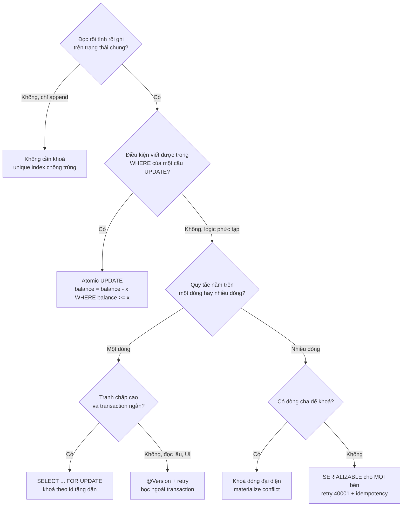

# Bài 04 — Postgres concurrency cho dev Java: MVCC, bốn cách chống lost update, write skew, và bẫy Spring/JPA

> **Dùng cho:** **NAB** (vòng technical hỏi thẳng Spring `@Transactional`, JPA locking, isolation) ·
> **Katalon** (họ G, nền của mọi câu "hai request cùng sửa một thứ")
>
> **Thời lượng:** đọc 40 phút · lab 25 phút · drill 15 phút
>
> **Lab:** [`lab/…/pgconcurrency/`](lab/src/main/java/com/prep/onbai/pgconcurrency/) · test
> `IsolationAnomaliesTest` (10 test, JDBC tay) · `JpaPitfallsTest` (5 test, Spring Boot + Hibernate 6.5)
>
> **Nối với:** tuần 3 của [lộ trình giai đoạn 1](../../java-system-design/10-implement-gd1-nen-tang.md#tuần-3--database-sâu-url-shortener-id-generator)
> (Lab 3A lost update, Lab 3C N+1). [Bài 05](05-ledger-va-balance.md) và [bài 06](06-race-tinh-lai-vs-thanh-toan.md)
> dùng mọi thứ ở đây.

```bash
cd on-bai/gd1-nen-tang/lab
mvn -q test -Dtest='IsolationAnomaliesTest,JpaPitfallsTest'   # ~8 giây
```

---

## 0. Trọng tâm phỏng vấn

| Câu hỏi | Trả lời senior, một hơi |
|---|---|
| "Isolation mặc định của Postgres? Nó chặn gì?" | `READ COMMITTED`. Chặn dirty read, **không** chặn lost update kiểu đọc-sửa-ghi, không chặn write skew. Mỗi **câu lệnh** có snapshot riêng |
| "Chống lost update thế nào?" | Bốn cách, chọn theo hình dạng bài toán: atomic `UPDATE`, `SELECT … FOR UPDATE`, optimistic version (CAS), `REPEATABLE READ` + retry `40001` |
| "Optimistic hay pessimistic?" | Tranh chấp thấp, transaction dài (form UI) thì optimistic. Tranh chấp cao trên **cùng dòng**, transaction ngắn thì pessimistic. Điều kiện viết được trong `WHERE` thì atomic `UPDATE`, khỏi chọn |
| "Write skew là gì, cái gì chặn được?" | Hai transaction đọc chồng lấn, ghi **hai dòng khác nhau**, cùng vi phạm một quy tắc nhiều dòng. Version không bắt được. Chặn bằng khoá một dòng đại diện, hoặc `SERIALIZABLE` cho **mọi** bên |
| "`@Transactional` không chạy khi nào?" | Gọi qua `this` (self-invocation), method `private`/`final`, exception checked (không rollback mặc định), bean không do Spring quản lý |

**Ba điều chỉ người đã chạy thật mới nói được** (lab có bằng chứng):

1. *"SSI chỉ bắt được write skew khi **cả hai** transaction đều `SERIALIZABLE`. Một bên `READ COMMITTED`
   là mất bảo vệ."* ([bước 6](#bước-6--write-skew-quy-tắc-nằm-trên-nhiều-dòng))
2. *"Hibernate 6 trên Postgres sinh `FOR NO KEY UPDATE` cho `PESSIMISTIC_WRITE`, không phải `FOR UPDATE`.
   Writer vẫn loại trừ nhau, nhưng nó không chặn FK check của bảng con, nên ít deadlock hơn."*
   ([bước 9](#bước-9--lockpessimistic_write-thật-ra-sinh-ra-gì))
3. *"`@Modifying` bulk update đi thẳng xuống DB, bỏ qua `@Version` và persistence context. Phải tự tăng
   version và `clearAutomatically`."* ([bước 10](#bước-10--atomic-update-bằng-spring-data-modifying))

---

## 1. Lý thuyết cốt lõi: MVCC đủ để suy luận

### 1.1 Postgres giữ nhiều phiên bản của một dòng

Mỗi phiên bản (tuple) mang `xmin` (transaction tạo ra nó) và `xmax` (transaction xoá hoặc thay nó).
`UPDATE` **không sửa tại chỗ**: nó tạo tuple mới, đánh dấu tuple cũ hết hạn. Một transaction thấy tuple
nào là do **snapshot** của nó quyết định: danh sách transaction đã commit lúc snapshot được chụp.

| Isolation (Postgres) | Snapshot chụp lúc nào | Hệ quả |
|---|---|---|
| `READ COMMITTED` *(mặc định)* | **Mỗi câu lệnh** một snapshot mới | Hai `SELECT` trong cùng transaction có thể thấy hai kết quả |
| `REPEATABLE READ` | **Câu lệnh đầu tiên** của transaction | Thấy một thế giới đứng yên. Ghi đè dòng người khác đã đổi thì nhận `40001` |
| `SERIALIZABLE` | Như RR + theo dõi phụ thuộc đọc/ghi (SSI) | Phát hiện cấu trúc nguy hiểm thì abort `40001`. Không khoá thêm |

Postgres không có `READ UNCOMMITTED` thật (nó chạy như RC). `REPEATABLE READ` của Postgres là
*snapshot isolation*, mạnh hơn chuẩn SQL: không có phantom read.

### 1.2 Hai cơ chế ở `READ COMMITTED` mà mọi lý luận dựa vào

1. **Khoá dòng khi ghi.** `UPDATE`/`DELETE`/`SELECT … FOR UPDATE` khoá dòng tới hết transaction. Người đến
   sau **chờ**.
2. **Đánh giá lại sau khi chờ (EvalPlanQual).** Khi người giữ khoá commit, người đang chờ **đọc lại phiên
   bản mới nhất** của dòng, kiểm lại `WHERE` trên phiên bản đó, rồi mới ghi. Đó là lý do
   `SET balance = balance + 10` đúng còn `SET balance = 110` (số tính sẵn) thì sai: biểu thức được tính
   trên dòng mới, còn hằng số thì không.

### 1.3 Bảng dị thường: thứ phải thuộc

| Dị thường | Ví dụ | RC | RR (PG) | SER (PG) |
|---|---|:-:|:-:|:-:|
| Dirty read | Đọc dữ liệu chưa commit | chặn | chặn | chặn |
| Non-repeatable read | Đọc hai lần ra hai số | **có** | chặn | chặn |
| Lost update (đọc → tính → ghi đè) | 100 +10 +10 = 110 | **có** | `40001` | `40001` |
| Write skew | Hai người rút hai ví của một quỹ chung | **có** | **có** | `40001`* |
| Phantom | `COUNT(*)` đổi giữa hai lần đọc | **có** | chặn | chặn |

\* chỉ khi **mọi** transaction tham gia đều `SERIALIZABLE`.

---

## 2. Real case: quỹ chung và ví điểm, dựng và phá từng bước

### Bước 1 — Công cụ: viết interleaving thành dòng thời gian

Race không tái hiện được bằng "chạy 1.000 lần mong trúng". Lab dùng hai connection thật, mỗi connection
một luồng, và **chọn thứ tự từng câu lệnh**. Lệnh có thể bị chặn thì chạy `async` và trả `Future`:

📄 [`Tx.java`](lab/src/main/java/com/prep/onbai/pgconcurrency/Tx.java)

```java
/** Chay lenh tren luong rieng cua transaction nay: tra Future de test kiem tra no co dang bi chan khong. */
public <T> Future<T> async(Callable<T> work) {
    return thread.submit(work);
}
```

Muốn biết một lệnh **đang bị chặn** thì không đoán bằng `sleep`, mà hỏi Postgres:

📄 [`Locks.java`](lab/src/test/java/com/prep/onbai/testsupport/Locks.java)

```java
try (Connection c = ds.getConnection(); PreparedStatement ps = c.prepareStatement(
        "SELECT count(*) FROM pg_stat_activity WHERE datname = current_database() AND wait_event_type = 'Lock'")) {
```

Connection riêng ở chế độ autocommit, vì trong một transaction, `pg_stat_activity` bị **chụp một lần**
và giữ nguyên tới cuối. Hỏi lại trong cùng transaction thì luôn ra số cũ.

### Bước 2 — Lost update ở `READ COMMITTED`

```java
try (Tx t1 = Tx.begin(ds, READ_COMMITTED); Tx t2 = Tx.begin(ds, READ_COMMITTED)) {
    int a = t1.queryInt(READ);                                               // T1 doc 100
    int b = t2.queryInt(READ);                                               // T2 doc 100
    t1.update("UPDATE counter_account SET balance = ? WHERE id = 1", a + 10);
    t1.commit();                                                             // 110
    t2.update("UPDATE counter_account SET balance = ? WHERE id = 1", b + 10); // ghi 110 tu so CU
    t2.commit();
}
```

```text
[LAB] lost update o READ COMMITTED: 100 +10 +10 = 110
```

Không có exception. `T2` có chờ khoá của `T1` (nếu chạy chồng nhau), có đánh giá lại `WHERE id = 1` (vẫn
đúng), rồi ghi **hằng số 110** tính từ lần đọc cũ. Đây là code JPA điển hình:
`w.setBalance(w.getBalance() + 10)` mà không có `@Version`.

### Bước 3 — Cách 1: để DB làm đọc-sửa-ghi (atomic `UPDATE`)

```java
t1.update("UPDATE counter_account SET balance = balance + 10 WHERE id = 1");
Future<Integer> f = t2.async(() -> t2.update("UPDATE counter_account SET balance = balance + 10 WHERE id = 1"));
Locks.awaitWaiters(ds, 1); // T2 cho khoa dong cua T1
t1.commit();
f.get(5, TimeUnit.SECONDS); // T2 doc LAI dong moi nhat (110) roi cong
```

Kết quả 120. **Rẻ nhất, không retry, không khoá dài.** Dùng được khi logic diễn đạt được thành biểu thức
SQL, kể cả có điều kiện: `… WHERE balance >= 10` ([bài 05](05-ledger-va-balance.md)). Đa số bài "trừ kho,
trừ tiền, tăng counter" thuộc loại này.

### Bước 4 — Cách 2: `SELECT … FOR UPDATE` (pessimistic)

```java
int a = t1.queryInt(READ + " FOR UPDATE");
Future<Integer> fb = t2.async(() -> t2.queryInt(READ + " FOR UPDATE"));
Locks.awaitWaiters(ds, 1);
t1.update("UPDATE counter_account SET balance = ? WHERE id = 1", a + 10);
t1.commit();
int b = fb.get(5, TimeUnit.SECONDS); // 110: T2 doc SAU khi T1 commit
```

Dùng khi phải **đọc nhiều thứ rồi mới quyết định** (đọc số dư, tra bảng lãi suất, tính, ghi). Đây là
bài 06. Hai luật đi kèm: **transaction ngắn**, không gọi mạng khi đang giữ khoá ([bài 01](01-littles-law-pool-timeout.md));
và **khoá theo id tăng dần** khi khoá nhiều dòng ([bài 05](05-ledger-va-balance.md), test
`lockingInRequestOrderDeadlocks` cho ra `40P01`).

### Bước 5 — Cách 3 và 4: phát hiện xung đột thay vì ngăn

**Optimistic (compare-and-set theo version):**

```java
String cas = "UPDATE counter_account SET balance = ?, version = version + 1 WHERE id = 1 AND version = ?";
// T1, T2 cung doc (100, version 0)
assertThat(t1.update(cas, r1[0] + 10, r1[1])).isEqualTo(1);
t1.commit();
assertThat(t2.update(cas, r2[0] + 10, r2[1])).isZero(); // version da doi -> 0 dong: XUNG DOT
t2.rollback();
// retry = transaction MOI, doc lai tu dau -> 120
```

**`REPEATABLE READ`**: ghi đè dòng đã bị người khác đổi sau snapshot của mình thì Postgres tự abort:

```text
[LAB] REPEATABLE READ: 40001 ERROR: could not serialize access due to concurrent update
```

Hai cách này giống nhau ở chỗ **không chờ, mà phát hiện rồi bắt retry**. Vì vậy cả hai đòi hỏi
(a) retry **bọc ngoài** transaction, mỗi lần thử là một transaction mới đọc lại từ đầu;
(b) thao tác idempotent nếu retry có thể lặp side effect ([bài 02](02-idempotency-key.md)).

### Bước 6 — Write skew: quy tắc nằm trên nhiều dòng

Quỹ chung một hộ gia đình: hai ví 50 + 50, quy tắc **tổng của hộ ≥ 0**. Hai người cùng kiểm tra tổng
(100 ≥ 90, OK) rồi mỗi người rút 90 từ **ví của mình**:

```java
assertThat(t1.queryInt(HOUSEHOLD_SUM)).isEqualTo(100); // 100 - 90 >= 0: OK
assertThat(t2.queryInt(HOUSEHOLD_SUM)).isEqualTo(100); // OK
t1.update(WITHDRAW_90, 1);                             // hai ben ghi HAI DONG KHAC NHAU
t2.update(WITHDRAW_90, 2);                             // -> khong ai cho ai, khong xung dot
t1.commit();
t2.commit();
```

```text
[LAB] write skew o READ COMMITTED: tong cua ho = -80
[LAB] write skew o REPEATABLE READ: tong cua ho = -80
```

`REPEATABLE READ` cũng thua: không ai ghi đè dòng của ai, nên không có "concurrent update" nào để phát
hiện. `@Version` trên từng ví cũng thua, cùng lý do. Đây là lỗi doc 06 gặp: hai bên INSERT hai posting
khác nhau.

**`SERIALIZABLE` bắt được, nhưng có điều kiện:**

```java
try (Tx t1 = Tx.begin(ds, SERIALIZABLE); Tx t2 = Tx.begin(ds, READ_COMMITTED)) { // mot ben quen SERIALIZABLE
    // ... cung kich ban
    t2.commit(); // SSI chi theo doi cac transaction SERIALIZABLE
}
```

```text
[LAB] SERIALIZABLE ca hai: 40001 ERROR: could not serialize access due to read/write dependencies among transactions | mot ben READ COMMITTED: tong = -80
```

SSI theo dõi phụ thuộc đọc/ghi **giữa các transaction `SERIALIZABLE`**. Một transaction `READ COMMITTED`
ghi vào chỗ transaction `SERIALIZABLE` đã đọc thì không bị kiểm. Trong một codebase 562 `@Transactional`
(doc 06), "bật `SERIALIZABLE` cho đường quan trọng" mà quên đường còn lại thì **không được bảo vệ gì
cả**.

**Cách thực dụng hơn: khoá một dòng đại diện cho quy tắc** (materialize the conflict):

```java
String lockHousehold = "SELECT id FROM household WHERE id = 1 FOR UPDATE"; // "vat chi diem" cho quy tac
t1.queryInt(lockHousehold);
Future<Integer> t2Sum = t2.async(() -> {
    t2.queryInt(lockHousehold);       // cho T1
    return t2.queryInt(HOUSEHOLD_SUM); // doc SAU khi T1 commit
});
```

`T2` thấy tổng 10 rồi từ chối. Quy tắc nhiều dòng giờ được bảo vệ bằng **một** khoá trên dòng cha. Đây
cũng là lý do bài 06 khoá dòng account gốc dù chỉ đọc nó.

### Bước 7 — Không bao giờ chờ mãi: `lock_timeout`, `NOWAIT`, `SKIP LOCKED`

```text
[LAB] lock_timeout: 55P03 sau 204 ms | NOWAIT: 55P03 | SKIP LOCKED: 0 dong
```

| Kỹ thuật | Hành vi | Dùng ở |
|---|---|---|
| `SET LOCAL lock_timeout = '200ms'` | Chờ tối đa 200 ms rồi `55P03` | Đường API: thà trả lỗi nhanh còn hơn giữ thread và connection |
| `FOR UPDATE NOWAIT` | Không chờ, `55P03` ngay | "Ai đang sửa rồi" trong UI |
| `FOR UPDATE SKIP LOCKED` | Bỏ qua dòng đang bị khoá | Hàng đợi công việc, batch ([bài 06](06-race-tinh-lai-vs-thanh-toan.md), [bài 09](09-outbox-notification.md)) |

`SET LOCAL` chỉ sống trong transaction hiện tại. Với pool connection, `SET` không có `LOCAL` sẽ **dính
vào connection** và lây sang request sau.

### Bước 8 — Spring/JPA: `@Version` và retry đặt đúng chỗ

📄 [`WalletService.java`](lab/src/main/java/com/prep/onbai/pgconcurrency/jpa/WalletService.java) ·
[`RetryingWallets.java`](lab/src/main/java/com/prep/onbai/pgconcurrency/jpa/RetryingWallets.java)

```java
/** Optimistic: doc khong khoa; luc commit Hibernate ghi "UPDATE ... WHERE id=? AND version=?". */
@Transactional
public void withdrawOptimistic(long id, long amount) {
    Wallet w = wallets.findById(id).orElseThrow();
    if (w.getBalance() < amount) {
        throw new IllegalStateException("khong du tien");
    }
    w.setBalance(w.getBalance() - amount); // dirty checking, chua co SQL nao o day
}
```

```java
/** Tra ve so lan thu da dung. */
public int withdraw(long id, long amount, int maxAttempts) {
    for (int attempt = 1; ; attempt++) {
        try {
            wallets.withdrawOptimistic(id, amount);
            return attempt;
        } catch (ObjectOptimisticLockingFailureException e) {
            if (attempt == maxAttempts) {
                throw e;
            }
            sleepMillis(ThreadLocalRandom.current().nextLong(1, 5L << attempt)); // backoff co jitter
        }
    }
}
```

```text
[LAB] @Version: khong retry -> 7/8 lenh no OptimisticLock, so du 95 | co retry -> 14 lan thu cho 8 lenh, so du 60
```

- **Không retry:** 8 luồng cùng đọc version 0, chỉ 1 thắng, 7 lệnh lỗi. Số dư đúng (95). Optimistic
  không làm sai dữ liệu; nó chỉ làm **hỏng request**.
- **Retry bọc ngoài:** mỗi lần thử đi qua proxy, nên là transaction mới, đọc lại version mới. Retry
  **bên trong** `@Transactional` là vô nghĩa: transaction đã bị đánh dấu rollback-only, và persistence
  context vẫn giữ entity cũ.
- Dùng `spring-retry` thì đặt `@Retryable` ở **bean ngoài** bean `@Transactional`, cùng lý do.
- Tranh chấp cao thì số lần thử tăng nhanh (14 lần cho 8 lệnh ở đây). Đó là tín hiệu nên chuyển sang
  pessimistic hoặc atomic update.

### Bước 9 — `@Lock(PESSIMISTIC_WRITE)` thật ra sinh ra gì?

📄 [`WalletRepository.java`](lab/src/main/java/com/prep/onbai/pgconcurrency/jpa/WalletRepository.java)

```java
/** Sinh "select ... for update": khoa dong toi het transaction. */
@Lock(LockModeType.PESSIMISTIC_WRITE)
@Query("select w from Wallet w where w.id = :id")
Optional<Wallet> lockById(@Param("id") Long id);
```

Lab bắt SQL thật bằng `StatementInspector` của Hibernate:

```text
[LAB] @Lock(PESSIMISTIC_WRITE) sinh ra: select w1_0.id,w1_0.balance,w1_0.owner_id,w1_0.version from jpa_wallet w1_0 where w1_0.id=? for no key update
```

Postgres có bốn mức khoá dòng; hai mức đáng biết:

| Khoá | Xung đột với | Ai lấy |
|---|---|---|
| `FOR UPDATE` | mọi khoá dòng khác, kể cả `FOR KEY SHARE` | `DELETE`, `UPDATE` cột khoá |
| `FOR NO KEY UPDATE` | `FOR UPDATE`, `FOR NO KEY UPDATE`, `FOR SHARE` | `UPDATE` thường; Hibernate 6 cho `PESSIMISTIC_WRITE` |
| `FOR KEY SHARE` | chỉ `FOR UPDATE` | **FK check** khi bảng con insert dòng trỏ tới |

Vì vậy `FOR NO KEY UPDATE` vẫn loại trừ mọi writer khác trên ví, nhưng **không chặn** việc insert một
giao dịch con (`transaction.wallet_id → wallet.id`) đang chờ FK check. Ít deadlock hơn, đúng chủ ý.

### Bước 10 — Atomic update bằng Spring Data `@Modifying`

```java
/**
 * Check-and-set nguyen tu trong MOT cau UPDATE: khong co khoang ho doc -> ghi.
 * Bulk update KHONG qua @Version -> tu tang version de nguoi dang giu ban cu van bi bat.
 */
@Modifying(flushAutomatically = true, clearAutomatically = true)
@Query("update Wallet w set w.balance = w.balance - :amount, w.version = w.version + 1 "
        + "where w.id = :id and w.balance >= :amount")
int debitIfEnough(@Param("id") Long id, @Param("amount") long amount);
```

- `flushAutomatically`: đẩy thay đổi đang treo trong persistence context xuống **trước** câu bulk.
  Không có nó, câu update chạy trên dữ liệu chưa flush.
- `clearAutomatically`: xoá persistence context **sau** câu bulk. Không có nó, entity cũ trong bộ nhớ
  vẫn mang số dư cũ, và lần đọc sau trong cùng transaction trả số sai.
- Test `atomicConditionalUpdateNeverOverdrawsUnderContention`: 30 luồng rút 10 từ ví 100 cho ra đúng 10
  thành công, số dư 0.

### Bước 11 — Self-invocation: `REQUIRES_NEW` bị bỏ qua mà không báo

```java
/** BAY: this.auditInNewTx() khong di qua proxy -> REQUIRES_NEW bi bo qua -> audit rollback cung. */
@Transactional
public void withdrawWithSelfInvokedAudit(long id, long amount) {
    auditInNewTx("thu rut " + amount + " tu vi " + id);
    failIfNotEnough(id, amount);
}

/** SUA: audit o bean KHAC -> goi qua proxy -> REQUIRES_NEW that su mo transaction rieng. */
@Transactional
public void withdrawWithAudit(long id, long amount) {
    auditService.record("thu rut " + amount + " tu vi " + id);
    failIfNotEnough(id, amount);
}
```

```text
[LAB] REQUIRES_NEW goi qua this: con 0 dong audit | qua bean khac: con [thu rut 1000 tu vi 10]
```

Spring áp `@Transactional` bằng **proxy** bao quanh bean. Gọi `this.method()` đi thẳng vào object thật,
không qua proxy, nên mọi annotation trên method đó (`@Transactional`, `@Async`, `@Cacheable`,
`@Retryable`) **không có tác dụng**. Có ba cách sửa: tách sang bean khác (sạch nhất), tự inject proxy
(`@Lazy` self), hoặc dùng `TransactionTemplate` lập trình.

> **Một cái bẫy đi kèm (bài 01):** `REQUIRES_NEW` giữ **hai** connection cùng lúc. Pool 4, 4 request đồng
> thời, mỗi request một `REQUIRES_NEW`, thì cả 4 cùng chờ connection thứ hai, và tất cả timeout. Lab có
> test cho đúng cảnh này.

### Bước 12 — N+1 và cách bắt bằng test

```text
[LAB] 10 khach x 3 vi: LAZY -> 11 cau SQL (1 + N), @EntityGraph -> 1 cau
```

```java
/** Mot cau select ... left join: nap san wallets, het N+1. */
@EntityGraph(attributePaths = "wallets")
@Query("select c from Customer c order by c.id")
List<Customer> findAllWithWallets();
```

Đừng chỉ nói "dùng `JOIN FETCH`". Nói cách **ngăn tái phạm**: test đếm câu SQL (Hibernate statistics
hoặc `StatementInspector`), fail khi vượt ngưỡng. Kèm `spring.jpa.open-in-view=false`, để lazy load ngoài
transaction ném `LazyInitializationException` ngay ở dev, thay vì âm thầm bắn N câu SQL lúc render JSON.
Biến thể của N+1: `@ManyToOne` mặc định là **EAGER** trong JPA, nên luôn đặt `fetch = LAZY`.

---

## 3. Lab — bảng test

| Test | Chứng minh |
|---|---|
| `lostUpdateAtReadCommitted` | 100 +10 +10 = 110, không lỗi |
| `fix1AtomicUpdateLetsTheDatabaseDoTheReadModifyWrite` | Biểu thức tính trên dòng mới sau khi chờ: 120 |
| `fix2SelectForUpdateSerializesTheReadModifyWrite` | T2 chờ thấy được trong `pg_stat_activity`, đọc 110 sau khi T1 commit |
| `fix3OptimisticVersionDetectsTheConflictAndTheLoserRetries` | CAS trả 0 dòng, retry bằng transaction mới |
| `fix4RepeatableReadAbortsTheLoserWith40001` | `40001`, retry |
| `writeSkewPassesReadCommittedAndRepeatableRead` (×2) | −80 ở cả hai mức |
| `serializableCatchesWriteSkewOnlyIfBothSidesAreSerializable` | `40001` khi cả hai SER; −80 khi một bên RC |
| `writeSkewFixedByLockingTheRowThatRepresentsTheRule` | Khoá `household` thì T2 thấy 10 và từ chối |
| `lockTimeoutNowaitAndSkipLockedNeverWaitForever` | `55P03` sau ~200 ms, `55P03` ngay, 0 dòng |
| `JpaPitfallsTest` (5 test) | `@Version` + retry, `FOR NO KEY UPDATE`, atomic `@Modifying`, self-invocation, N+1 |

---

## 4. Vẽ: cây quyết định chọn cách chống race



---

## 5. Live coding drill (15 phút)

**Đề:** *"Spring Boot + JPA. Endpoint trừ điểm thưởng của user. Chịu được 100 request đồng thời, không
âm, không mất cập nhật. Viết repository, service, và nói cách test."*

Lời giải mong đợi (tổ hợp bước 8–10):

```java
public interface PointsRepository extends JpaRepository<Points, Long> {
    @Modifying(flushAutomatically = true, clearAutomatically = true)
    @Query("update Points p set p.balance = p.balance - :n, p.version = p.version + 1 "
         + "where p.userId = :uid and p.balance >= :n")
    int spend(@Param("uid") long uid, @Param("n") long n);
}

@Service
class PointsService {
    private final PointsRepository repo;
    PointsService(PointsRepository repo) { this.repo = repo; }

    @Transactional
    public void spend(long userId, long n) {
        if (n <= 0) throw new IllegalArgumentException("n > 0");
        if (repo.spend(userId, n) == 0) throw new NotEnoughPointsException(userId, n); // 409/422
    }
}
```

**Nói thêm (điểm cộng):**

- *"Nếu logic phải đọc nhiều thứ trước khi quyết, tôi đổi sang `@Lock(PESSIMISTIC_WRITE)`. Trên Postgres
  nó sinh `FOR NO KEY UPDATE`."*
- *"Endpoint này là POST tốn tiền, nên cần `Idempotency-Key` (bài 02)."*
- *"Test: 100 luồng + `CyclicBarrier` trên Postgres thật (Testcontainers hoặc embedded), assert số lần
  thành công = floor(balance / n) và số dư không âm. Không test trên H2: ngữ nghĩa khoá khác."*

---

## 6. Follow-up

<details>
<summary><b>Q1. Deadlock được phát hiện thế nào, mất bao lâu?</b></summary>

Postgres chờ `deadlock_timeout` (mặc định 1 s) rồi mới chạy bộ dò vòng chờ, chọn một nạn nhân và abort
bằng `40P01`. Tức là mỗi deadlock tốn tối thiểu 1 giây của hai transaction, cộng một lần retry. Cách chữa
là thiết kế: thứ tự khoá cố định, transaction ngắn, `lock_timeout` cho đường API.
</details>

<details>
<summary><b>Q2. Advisory lock dùng khi nào?</b></summary>

Khi cần khoá một **khái niệm** không có dòng tương ứng: "chỉ một instance chạy job tính lãi ngày D",
"khoá theo `hash(email)` khi đăng ký". Dùng `pg_try_advisory_xact_lock(key)` (tự nhả khi kết thúc
transaction). Cẩn thận advisory lock mức session với pool connection: quên nhả là dính khoá vào connection.
</details>

<details>
<summary><b>Q3. MVCC có giá gì?</b></summary>

`UPDATE` sinh tuple mới, tuple cũ thành rác (dead tuple) cho tới khi VACUUM dọn. Bảng update nóng (counter,
balance) phình, index phình theo nếu không được HOT update (Heap-Only Tuple: cột trong index không đổi và
trang còn chỗ). Transaction mở lâu ghìm mốc xmin, VACUUM không dọn được. Một transaction quên commit có thể
làm cả DB phình. Đặt `idle_in_transaction_session_timeout`.
</details>

<details>
<summary><b>Q4. Đọc từ replica có phá isolation không?</b></summary>

Replica có snapshot riêng, trễ so với primary. Một transaction đọc primary rồi đọc replica có thể thấy
"thời gian chạy lùi". Đọc để **quyết định ghi** (kiểm tra số dư) thì luôn đọc primary. Đọc hiển thị thì
dùng replica, kèm token read-your-writes ([bài 05 bước 8](05-ledger-va-balance.md#bước-8--đọc-từ-replica-mà-không-lùi-số-dư-read-your-writes)).
</details>

<details>
<summary><b>Q5. Exception checked trong <code>@Transactional</code>?</b></summary>

Mặc định Spring chỉ rollback với `RuntimeException` và `Error`. Exception checked thì **commit**. Muốn
khác thì `@Transactional(rollbackFor = Exception.class)`. Thường gặp khi một service ném `IOException` từ
client HTTP: dữ liệu đã ghi nửa chừng vẫn được commit.
</details>

<details>
<summary><b>Q6. `readOnly = true` có tác dụng gì thật?</b></summary>

Với Hibernate: tắt dirty checking (không chụp snapshot entity), flush mode `MANUAL`, nên nhanh hơn và tốn
ít bộ nhớ hơn. Với Postgres JDBC: gửi `SET TRANSACTION READ ONLY`, ghi sẽ lỗi. Kết hợp
`AbstractRoutingDataSource` để định tuyến transaction read-only sang replica. Đó là pattern quen thuộc,
và nhớ bẫy read-your-writes ở Q4.
</details>

---

## 7. Checklist

- [ ] Giải thích snapshot theo câu lệnh (RC) và theo transaction (RR); EvalPlanQual là gì, vì sao
      `balance + 10` đúng còn `110` sai
- [ ] Kể bốn cách chống lost update, và hình dạng bài toán hợp với từng cách
- [ ] Định nghĩa write skew bằng ví dụ quỹ chung; vì sao `@Version` và RR không bắt được; hai cách chữa
- [ ] Nói được điều kiện của SSI (mọi bên `SERIALIZABLE`) kèm bằng chứng lab
- [ ] Biết `PESSIMISTIC_WRITE` sinh `FOR NO KEY UPDATE`, và khác `FOR UPDATE` ở chỗ nào
- [ ] Viết đúng `@Modifying` với `flushAutomatically`/`clearAutomatically` + tự tăng version
- [ ] Giải thích self-invocation và ba cách sửa; retry optimistic đặt ở đâu
- [ ] Làm drill §5 trong 15 phút
