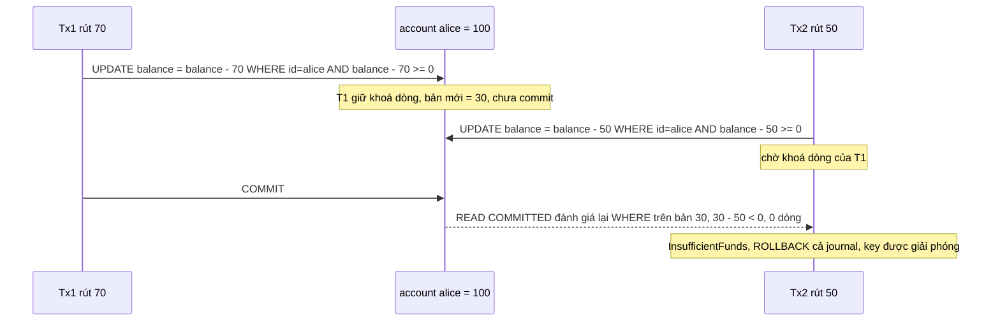
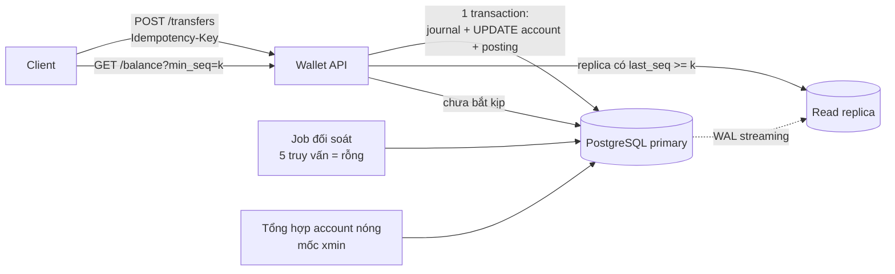

# Bài 05 — Sổ cái kép và số dư real-time: dựng ví điện tử từ đầu

> **Dùng cho:** Katalon (họ G, câu chuyện ledger của bạn ở
> [doc 06](../../katalon-prep/katalon-system-design/06-race-condition-balance-ledger.md)) · **NAB** (banking
> domain: vòng system design và vòng technical Spring/JPA)
>
> **Thời lượng:** đọc 45 phút · lab 30 phút · drill 20 phút
>
> **Lab:** [`lab/…/ledger/`](lab/src/main/java/com/prep/onbai/ledger/) · schema [`ledger.sql`](lab/src/main/resources/ledger.sql) ·
> test `LedgerTest`, `LedgerConcurrencyTest`, `BalanceReadTest`
>
> **Cần trước:** [bài 04](04-postgres-concurrency.md) (MVCC, `FOR UPDATE`, atomic update). **Học tiếp:**
> [bài 06](06-race-tinh-lai-vs-thanh-toan.md), bài race thật trên chính sổ cái này.

```bash
cd on-bai/gd1-nen-tang/lab
mvn -q test -Dtest='LedgerTest,LedgerConcurrencyTest,BalanceReadTest'   # 19 test, ~8 giây, Postgres 16 thật
```

---

## 0. Trọng tâm phỏng vấn — đọc trước khi vào phòng

Đề "thiết kế ví / chuyển tiền / số dư tài khoản" kiểm tra đúng năm thứ. Thiếu một là lộ:

| # | Interviewer dò | Câu trả lời của senior |
|:-:|---|---|
| 1 | Mô hình dữ liệu | Sổ cái kép: `journal` → `posting`, tổng mỗi journal = 0, **append-only**. Số dư là *projection*, không phải *state* |
| 2 | Race khi trừ tiền | Kiểm tra đủ tiền và trừ tiền là **một** câu lệnh: `UPDATE … SET balance = balance - x WHERE id = ? AND balance >= x` |
| 3 | Deadlock khi chuyển hai chiều | Khoá mọi account theo **id tăng dần**: A→B và B→A khoá cùng một thứ tự, nên không có vòng chờ |
| 4 | Bấm hai lần, retry, timeout | Idempotency key là **khoá tự nhiên** của nghiệp vụ, `UNIQUE`; lần hai trả **đúng kết quả lần đầu** |
| 5 | Đọc số dư nhanh mà đúng | Đọc O(1) từ số dư chạy; với replica thì dùng token `seq` để đọc lại chính thứ mình vừa ghi (read-your-writes); đối soát hằng ngày phải ra rỗng |

**Năm câu "ăn điểm"**, nói nguyên văn được:

1. *"Số dư là projection của sổ cái. Nếu giữ cột `balance` thì nó là cache được cập nhật **trong cùng
   transaction** với posting, và có job đối soát chứng minh nó khớp."*
2. *"Tôi không `SELECT` số dư rồi mới `UPDATE`. Kiểm tra và trừ nằm trong một câu `UPDATE` có điều kiện,
   nên không có khoảng hở nào giữa lúc đọc và lúc ghi."*
3. *"Deadlock là lỗi thiết kế chứ không phải xui. Mọi transaction chạm nhiều account đều khoá theo thứ
   tự id."*
4. *"Sửa sai bằng bút toán đảo, không `UPDATE` hay `DELETE`. Trigger ở DB chặn luôn nếu ai đó lỡ tay."*
5. *"Mốc chốt snapshot phải theo thứ tự **commit**. `IDENTITY` cấp theo thứ tự **insert**, hai thứ tự
   đó khác nhau."* Câu này cho thấy bạn hiểu MVCC thật chứ không chỉ thuộc pattern
   ([§2 bước 10](#bước-10--tài-khoản-nóng-không-khoá-chốt-theo-mốc-xmin)).

---

## 1. Lý thuyết cốt lõi — chỉ phần dùng được

### 1.1 Kế toán kép trong 90 giây, cho dev

Mỗi nghiệp vụ là **một journal** (bút toán), gồm **≥ 2 posting** (dòng ghi), và **tổng amount các
posting của một journal = 0**. Tiền không tự sinh ra, không tự biến mất: nó chuyển từ account này sang
account khác. Lab dùng quy ước "số có dấu": số dư của một account = `SUM(amount)` các posting của nó.

| Nghiệp vụ | Posting (account: amount) | Ghi chú |
|---|---|---|
| Nạp 100 vào ví Alice | `cash: −100`, `wallet:alice: +100` | `cash` là account hệ thống, **được phép âm** |
| Alice chuyển Bob 30 | `wallet:alice: −30`, `wallet:bob: +30` | ví khách **không được âm** |
| Thu phí 1 | `wallet:alice: −1`, `income:fee: +1` | doanh thu cũng là một account |
| Nạp nhầm, đảo lại | `wallet:alice: −100`, `cash: +100`, `reverses = journal gốc` | **thêm** dòng, không sửa dòng cũ |

Kế toán thật chia account thành tài sản, nợ, vốn, doanh thu, chi phí, với chiều ghi nợ/có riêng. Với
dev, quy ước số có dấu cộng một cờ `allow_negative` là đủ để code đúng và giải thích được. Trong phòng
phỏng vấn, nói một câu là *"tôi dùng signed amount, debit dương credit âm"*, rồi đi tiếp.

### 1.2 Vì sao append-only

- **Không có `UPDATE` thì không có lost update** trên dữ liệu gốc. Race chỉ còn ở **giá trị dẫn xuất**
  (cột `balance`), và giá trị đó tính lại được bất cứ lúc nào.
- **Audit miễn phí:** "ai làm gì lúc nào" nằm sẵn trong sổ.
- **Tính lại quá khứ:** số dư tại mọi thời điểm là `SUM` trên một tiền tố của sổ.
- Lỗi doc 06 phát hiện #7 (`Posting.addToAmount`, sửa tại chỗ số tiền đã ghi) là thứ append-only cấm.

### 1.3 Ba chỗ race trên một cái ví

| Race | Kịch bản | Tên đúng | Chặn bằng |
|---|---|---|---|
| Rút quá số dư | Hai lệnh rút 70 từ ví 100 cùng đọc thấy 100, cùng trừ | TOCTOU (check-then-act) | `UPDATE … WHERE balance >= x` (một câu) |
| Mất cập nhật | Hai lệnh cùng `SET balance = <số đọc được> - x` | Lost update | Cập nhật tương đối `balance = balance - x` |
| Trùng lệnh | Client timeout, retry, lệnh đầu thật ra đã xong | Double-submit | Idempotency key `UNIQUE` + replay |

### 1.4 Hai trục thời gian (dùng nhiều ở bài 06)

- `effective_date` là **thời gian nghiệp vụ**: bút toán *thuộc về* ngày nào. Dùng để **tính** (số dư ngày D,
  lãi ngày D).
- `recorded_at` là **thời gian hệ thống**: ta *biết* chuyện đó lúc nào. Dùng để **audit**.
- `seq` là **thứ tự commit trong một account**: ta dùng nó làm mốc snapshot và làm token cho
  read-your-writes.

Sổ có đủ các trục này trả lời được cả *"số dư ngày 15 là bao nhiêu"* lẫn *"hôm 15 ta **tưởng** số dư
là bao nhiêu"*. Câu thứ hai là câu kiểm toán hỏi.

---

## 2. Real case: dựng ví từ đầu, làm tới đâu giải thích tới đó

Đề: *ví điện tử, nạp, chuyển, rút; số dư không bao giờ âm; bấm hai lần không trừ hai lần; xem số dư
real-time; đối soát được*. Ta dựng đúng thứ trong lab, theo thứ tự bạn sẽ dựng trên bảng trắng.

### Bước 1 — Schema: ba bảng, mỗi cột có lý do

📄 [`ledger.sql`](lab/src/main/resources/ledger.sql)

```sql
CREATE TABLE IF NOT EXISTS account (
    id             bigint        PRIMARY KEY,
    code           text          NOT NULL UNIQUE,       -- 'wallet:alice', 'cash', 'loan:42:principal'
    allow_negative boolean       NOT NULL DEFAULT false, -- vi khach: false. Tai khoan he thong: true
    hot            boolean       NOT NULL DEFAULT false, -- tai khoan nong: KHONG khoa, KHONG giu so du chay
    balance        numeric(19,4) NOT NULL DEFAULT 0,     -- = SUM(posting), cap nhat TRONG CUNG transaction
    last_seq       bigint        NOT NULL DEFAULT 0,     -- seq cua posting cuoi; tang duoi khoa dong nay
    CHECK (NOT hot OR allow_negative)                    -- khong khoa thi khong chan am duoc
);

CREATE TABLE IF NOT EXISTS journal (
    id              bigint      GENERATED ALWAYS AS IDENTITY PRIMARY KEY,
    idempotency_key text        NOT NULL UNIQUE,  -- 'transfer:<id client>', 'accrual:42:2026-10-18'
    request_hash    text        NOT NULL,         -- cung key ma khac noi dung -> tu choi
    kind            text        NOT NULL,         -- DEPOSIT, TRANSFER, PAYMENT, ACCRUAL, ADJUSTMENT, REVERSAL
    effective_date  date        NOT NULL,         -- THOI GIAN NGHIEP VU: but toan thuoc ve ngay nao
    recorded_at     timestamptz NOT NULL DEFAULT clock_timestamp(),  -- THOI GIAN HE THONG: luc ghi
    reverses        bigint      REFERENCES journal(id)
);

CREATE TABLE IF NOT EXISTS posting (
    id             bigint        GENERATED ALWAYS AS IDENTITY PRIMARY KEY,
    journal_id     bigint        NOT NULL REFERENCES journal(id),
    account_id     bigint        NOT NULL REFERENCES account(id),
    seq            bigint,                         -- 1,2,3.. theo account, khong ho; NULL voi account nong
    amount         numeric(19,4) NOT NULL CHECK (amount <> 0),
    balance_after  numeric(19,4),                  -- so du chay ngay sau posting nay; NULL voi account nong
    effective_date date          NOT NULL,         -- chep tu journal de index (account, ngay)
    tx_id          xid8          NOT NULL DEFAULT pg_current_xact_id(),  -- transaction da ghi dong nay
    UNIQUE (account_id, seq),
    CHECK ((seq IS NULL) = (balance_after IS NULL))
);
```

Giải thích những cột interviewer sẽ hỏi:

- **`numeric(19,4)`, không phải `double`.** Số thực nhị phân không biểu diễn được 0,1, nên cộng nhiều lần
  sẽ lệch. Hai lựa chọn đúng: `numeric` với `BigDecimal`, hoặc `bigint` đơn vị nhỏ nhất (VND đồng, USD
  cent) với `long`. Bài 02 dùng `amount_minor bigint`, bài này dùng `numeric` vì lãi có lẻ.
- **`journal.idempotency_key UNIQUE`.** Unique index là **trọng tài duy nhất** cho chuyện trùng lệnh.
  Mọi kiểu "SELECT xem có chưa rồi INSERT" đều race.
- **`account.balance` + `last_seq`.** Đây là giá trị dẫn xuất, giữ để đọc O(1). Nó **chỉ đổi trong cùng
  transaction** với posting, nên không thể lệch (bước 4). Job đối soát (bước 11) chứng minh điều đó mỗi
  ngày.
- **`posting.seq`.** Số thứ tự 1, 2, 3… **riêng từng account, không hở**. Nó được cấp khi đang giữ khoá
  dòng account, nên **thứ tự seq = thứ tự commit** (bước 9 dựa hoàn toàn vào điều này).
- **`posting.balance_after`.** Số dư chạy (running balance). Sao kê, "số dư sau giao dịch X", replay
  idempotent đều O(1) nhờ cột này.
- **`hot`.** Account hệ thống mà *mọi* giao dịch đều chạm (`cash`, `income:*`). Khoá nó là tuần tự hoá
  cả hệ thống, nên ta không khoá. Cái giá phải trả nằm ở bước 10.

### Bước 2 — Bất biến ở tầng DB: cân bằng và append-only

```sql
-- Bat bien 1: journal can bang. Kiem tra LUC COMMIT (deferred) vi posting duoc chen tung dong.
CREATE OR REPLACE FUNCTION journal_must_balance() RETURNS trigger LANGUAGE plpgsql AS $$
DECLARE
    total numeric;
BEGIN
    SELECT coalesce(sum(amount), 0) INTO total FROM posting WHERE journal_id = NEW.journal_id;
    IF total <> 0 THEN
        RAISE EXCEPTION 'journal % khong can bang: tong = %', NEW.journal_id, total
            USING ERRCODE = 'check_violation';
    END IF;
    RETURN NULL;
END $$;
CREATE CONSTRAINT TRIGGER posting_balanced AFTER INSERT ON posting
    DEFERRABLE INITIALLY DEFERRED FOR EACH ROW EXECUTE FUNCTION journal_must_balance();

-- Bat bien 2: append-only. Sai thi ghi but toan dao (REVERSAL), khong UPDATE, khong DELETE.
CREATE TRIGGER posting_append_only BEFORE UPDATE OR DELETE ON posting
    FOR EACH ROW EXECUTE FUNCTION ledger_is_append_only();
```

- **Vì sao `DEFERRABLE INITIALLY DEFERRED`:** posting được chèn từng dòng. Sau dòng thứ nhất, tổng còn
  chưa bằng 0. Kiểm tra lúc **commit** mới đúng ngữ nghĩa "journal cân bằng".
- **Vì sao kiểm ở DB khi app đã kiểm:** để phòng thủ nhiều lớp. App kiểm là để báo lỗi sớm và đẹp. DB kiểm
  để chặn mọi đường ghi khác: script tay lúc 2 giờ sáng, một service mới viết sai, một migration. Test
  `databaseRejectsAnUnbalancedJournalAtCommit` ghi lệch bằng SQL tay và bị chặn đúng lúc `COMMIT`.
- Trong production nên làm thêm `REVOKE UPDATE, DELETE ON posting FROM app_role`. Trigger là lớp thứ hai.

### Bước 3 — Lệnh ghi: gộp theo account, sắp theo id, băm nội dung

📄 [`Ledger.java`](lab/src/main/java/com/prep/onbai/ledger/Ledger.java)

```java
/** Gop theo account, bo dong net = 0, sap theo account id TANG DAN: day chinh la thu tu khoa. */
public SortedMap<Long, BigDecimal> netByAccount() {
    TreeMap<Long, BigDecimal> net = new TreeMap<>();
    for (Leg leg : legs) {
        if (leg.amount().stripTrailingZeros().scale() > 4) {
            throw new InvalidJournal("toi da 4 chu so thap phan: " + leg.amount());
        }
        net.merge(leg.accountId(), leg.amount(), BigDecimal::add);
    }
    net.values().removeIf(v -> v.signum() == 0);
    BigDecimal total = net.values().stream().reduce(BigDecimal.ZERO, BigDecimal::add);
    if (net.size() < 2 || total.signum() != 0) {
        throw new InvalidJournal("can >= 2 account va tong = 0, dang co " + net);
    }
    return net;
}
```

Ba quyết định trong mười dòng:

1. **`TreeMap` nên duyệt theo id tăng dần.** Vòng ghi ở bước 4 đi theo map này, nên **mọi** journal khoá
   account theo cùng một thứ tự. Đây chính là luật chống deadlock, được ép bằng cấu trúc dữ liệu chứ
   không bằng lời dặn.
2. **Gộp leg cùng account.** Một journal chạm một account đúng một lần, nên cũng khoá đúng một lần.
3. **Kiểm tra hình thức trước khi mở transaction.** Lệnh sai (tổng ≠ 0, tự chuyển cho chính mình) bị từ
   chối mà không tốn connection.

`hash()` băm nội dung **đã chuẩn hoá** (kind, ngày, các leg đã gộp và sắp, scale 4). Cùng key mà khác
hash nghĩa là client dùng lại key cho một request **khác**, và ta từ chối.

### Bước 4 — `post()`: giành key, rồi khoá + kiểm tra + cấp seq trong một câu

📄 [`LedgerService.java`](lab/src/main/java/com/prep/onbai/ledger/LedgerService.java)

```java
public Receipt post(Request req) {
    SortedMap<Long, BigDecimal> net = req.netByAccount(); // kiem tra hinh thuc TRUOC khi mo transaction
    String hash = req.hash();
    return tx.execute(status -> {
        // 1. Gianh key. Request trung chay song song se CHO o unique index toi khi ben kia commit/rollback.
        Long journalId = jdbc.query("""
                INSERT INTO journal (idempotency_key, request_hash, kind, effective_date, reverses)
                VALUES (?, ?, ?, ?, ?)
                ON CONFLICT (idempotency_key) DO NOTHING
                RETURNING id""",
                rs -> rs.next() ? rs.getLong(1) : null,
                req.idempotencyKey(), hash, req.kind(), req.effectiveDate(), req.reverses());
        if (journalId == null) {
            return replay(req.idempotencyKey(), hash);
        }
        Map<Long, Boolean> hot = hotFlags(net);
        List<Applied> applied = new ArrayList<>();
        // 2. net la TreeMap -> duyet theo account id tang dan -> moi transaction khoa cung mot thu tu
        for (var e : net.entrySet()) {
            long account = e.getKey();
            BigDecimal amount = e.getValue();
            // ... (account nong: chen posting khong seq, khong khoa — bước 10)
            Applied a = jdbc.query("""
                    UPDATE account
                       SET balance = balance + ?, last_seq = last_seq + 1
                     WHERE id = ? AND (allow_negative OR balance + ? >= 0)
                 RETURNING id, last_seq, balance""",
                    rs -> rs.next() ? new Applied(rs.getLong(1), rs.getLong(2), rs.getBigDecimal(3)) : null,
                    amount, account, amount);
            if (a == null) {
                throw new InsufficientFunds(account, amount); // rollback ca journal: khong ghi gi, key tu do
            }
            jdbc.update("""
                    INSERT INTO posting (journal_id, account_id, seq, amount, balance_after, effective_date)
                    VALUES (?, ?, ?, ?, ?, ?)""",
                    journalId, account, a.seq(), amount, a.balanceAfter(), req.effectiveDate());
            applied.add(a);
        }
        return new Receipt(journalId, false, applied);
    });
}
```

Đi từng dòng, vì đây là đoạn interviewer muốn nghe bạn giải thích:

**(1) `INSERT … ON CONFLICT DO NOTHING RETURNING id` là cách giành key.** Hai request cùng key đến cùng
lúc: request thứ hai **chờ ở unique index** cho tới khi request thứ nhất commit hoặc rollback. Đây là hành
vi của Postgres khi gặp bản ghi chưa commit trong unique index. Nếu thứ nhất commit thì thứ hai nhận
`DO NOTHING`, không có id, và đi sang `replay`. Nếu thứ nhất rollback (ví dụ thiếu tiền) thì thứ hai
**chèn được** và chạy thật. Test `twentyConcurrentDuplicatesExecuteExactlyOnce`: 20 luồng, 1 thực thi,
19 phát lại, cả 20 nhận cùng `balance_after = 70`.

**(2) Một câu `UPDATE` làm bốn việc nguyên tử:**

- *khoá dòng* account cho tới hết transaction (row lock của `UPDATE`);
- *kiểm tra đủ tiền* trên **bản mới nhất** của dòng (xem sơ đồ dưới);
- *cấp seq kế tiếp* (`last_seq + 1`);
- *cập nhật số dư chạy* và trả về qua `RETURNING`.

Không có `SELECT` nào trước nó, nên **không có khoảng hở đọc → ghi**. Không có `@Version`, nên không có
retry.



Chi tiết ăn điểm: khi `T2` được nhả khoá, Postgres ở `READ COMMITTED` **đọc lại dòng mới nhất và đánh
giá lại `WHERE`** (cơ chế EvalPlanQual). Nhờ vậy điều kiện `balance + ? >= 0` luôn được xét trên số dư
thật. Test `fiftyConcurrentWithdrawalsNeverOverdraw`: 50 lệnh rút 10 cùng lúc từ ví 100 cho ra đúng 10
thành công, 40 bị từ chối, và `min(balance_after) >= 0`. Số dư không âm ở bất kỳ thời điểm nào, kể cả
giữa chừng.

**(3) `0 dòng` có hai nghĩa:** thiếu tiền, hoặc account không tồn tại. Lab tách hai trường hợp bằng
`hotFlags` (đọc account trước, không khoá). Exception lan ra ngoài làm `TransactionTemplate` **rollback
toàn bộ**, kể cả dòng `journal`, nên key được giải phóng. Đây là một quyết định nghiệp vụ: lần sau client
nạp thêm tiền rồi retry cùng key thì sẽ thành công. Muốn "cùng key thì luôn trả cùng lỗi" (kiểu Stripe)
thì phải **lưu cả kết quả lỗi**. [Bài 02](02-idempotency-key.md) làm đúng chuyện đó.

**(4) Posting được chèn khi đang giữ khoá account.** `seq` và `id` của nó được cấp trong lúc **không
transaction nào khác ghi được vào account này**. Bước 9 và bước 10 dựa vào chi tiết này.

**(5) Gọi `post()` từ trong một transaction có sẵn** (`@Transactional` hoặc `TransactionTemplate` cùng
`DataSource`) thì nó **tham gia** transaction đó (`PROPAGATION_REQUIRED`), và khoá được giữ tới khi
transaction ngoài commit. Bài 06 dùng đúng tính chất này để gộp "khoá khoản vay, tính lãi, ghi sổ" vào
một transaction.

### Bước 5 — Replay và chống dùng lại key

```java
private Receipt replay(String key, String hash) {
    Map<String, Object> row = jdbc.queryForMap("SELECT id, request_hash FROM journal WHERE idempotency_key = ?", key);
    if (!hash.equals(row.get("request_hash"))) {
        throw new KeyReuse(key);
    }
    long id = ((Number) row.get("id")).longValue();
    List<Applied> applied = jdbc.query(
            "SELECT account_id, seq, balance_after FROM posting WHERE journal_id = ? ORDER BY account_id",
            (rs, i) -> new Applied(rs.getLong(1), (Long) rs.getObject(2), rs.getBigDecimal(3)), id);
    return new Receipt(id, true, applied);
}
```

Replay trả `balance_after` **của lần đầu**, không phải số dư hiện tại. Test
`sameKeySameRequestReplaysTheFirstReceipt`: sau lần đầu còn 70, đã chuyển thêm 5 (còn 65), replay vẫn
trả 70. Đây là định nghĩa đúng của idempotent: *cùng request, cùng response*.

### Bước 6 — Đảo bút toán: thêm dòng, không sửa dòng

```java
/** Dao but toan: ghi posting AM, khong sua dong cu. Key tu nhien "reversal:{id}" -> dao hai lan = mot lan. */
public Receipt reverse(long journalId, LocalDate effectiveDate) {
    List<Leg> legs = jdbc.query("SELECT account_id, amount FROM posting WHERE journal_id = ?",
            (rs, i) -> new Leg(rs.getLong(1), rs.getBigDecimal(2).negate()), journalId);
    if (legs.isEmpty()) {
        throw new InvalidJournal("khong co journal " + journalId);
    }
    return post(new Request("reversal:" + journalId, "REVERSAL", effectiveDate, legs, journalId));
}
```

Có hai điều đáng nói. Thứ nhất, **key tự nhiên `reversal:{journalId}`** làm cho việc đảo hai lần trở
thành đảo một lần (test `reversalWritesNegativePostingsAndIsIdempotent`). Thứ hai, **đảo không vượt rào
nghiệp vụ**: nạp nhầm 100 mà khách đã tiêu 80 thì lệnh đảo bị `InsufficientFunds`
(`reversingMoneyAlreadySpentIsRejected`). Hệ thống không lặng lẽ để ví âm. Đó là lúc cần quy trình thu
hồi, một quyết định nghiệp vụ chứ không phải kỹ thuật.

### Bước 7 — Đường đọc: O(1) cho hiện tại, O(1) cho quá khứ theo seq, keyset cho sao kê

📄 [`BalanceQueries.java`](lab/src/main/java/com/prep/onbai/ledger/BalanceQueries.java)

```java
/** O(1): doc dong account. Dung tuyet doi tren primary vi balance cap nhat cung transaction voi posting. */
public Balance current(long accountId) {
    return current(jdbc, accountId);
}

/** So du ngay sau posting thu seq: O(1) nho balance_after, khong can SUM lai lich su. */
public BigDecimal asOfSeq(long accountId, long seq) { /* SELECT balance_after ... WHERE account_id = ? AND seq = ? */ }

/** So du theo NGAY NGHIEP VU: moi but toan co effective_date <= ngay do, ke ca but toan ghi muon (backdated). */
public BigDecimal asOfDate(long accountId, LocalDate date) { /* SUM(amount) WHERE effective_date <= ? */ }

/** Sao ke, phan trang keyset theo seq (khong OFFSET): trang nao cung O(limit). */
public List<Line> statement(long accountId, long afterSeq, int limit) { /* WHERE seq > ? ORDER BY seq LIMIT ? */ }
```

- **Sao kê dùng keyset (`seq > ?`), không dùng `OFFSET`.** `OFFSET 100000` buộc DB đọc rồi vứt 100.000
  dòng. Keyset đi thẳng vào index `(account_id, seq)`.
- **`asOfSeq` và `asOfDate` khác nhau, và phải khác nhau.** Test
  `backdatedEntryChangesBalanceAsOfDateButNotTheSeqHistory` nạp 100 (ngày 15), nạp 50 (ngày 18), rồi
  hôm nay ghi một khoản 7 **thuộc ngày 15** (ngân hàng báo muộn). Kết quả: `asOfDate(15) = 107`, là số
  dư ngày 15 theo hiểu biết hôm nay; `asOfSeq(1) = 100`, là số dư mà lúc ghi seq 1 ta tưởng. Đây chính
  là bi-temporal, và là chìa khoá của bài 06.

### Bước 8 — Đọc từ replica mà không "lùi số dư": read-your-writes

Replica dùng streaming replication, trễ vài ms tới vài giây. Khách vừa chuyển tiền xong, refresh, request
đọc rơi vào replica chưa bắt kịp, và thấy **số dư cũ**. Trông y hệt race condition, dù DB hoàn toàn nhất
quán.

📄 [`ReadYourWrites.java`](lab/src/main/java/com/prep/onbai/ledger/ReadYourWrites.java)

```java
public Read balance(long accountId, long minSeq) {
    Balance fromReplica = BalanceQueries.current(replica, accountId);
    if (fromReplica.asOfSeq() >= minSeq) {
        return new Read(fromReplica, "replica");
    }
    return new Read(BalanceQueries.current(primary, accountId), "primary");
}
```

Cơ chế: response của lệnh ghi trả `seq` (trong `Receipt`). Client giữ nó (cookie, header, state ở app)
và gửi kèm khi đọc (`?min_seq=17`). Replica có `last_seq ≥ 17` thì đã chứa lệnh ghi của khách, phục vụ
được. Chưa có thì đọc primary (hoặc chờ ngắn). Nhờ đó **số dư đơn điệu theo góc nhìn của một khách**.

Lab giả một "replica trễ" bằng một trick đáng biết: **mở một transaction `REPEATABLE READ` từ trước**.
Snapshot của nó đứng yên ở quá khứ, giống hệt một replica chưa áp WAL mới.

```text
[LAB] khong token: 100 tu replica | token seq=2: 70 tu primary
```

### Bước 9 — Phương án B: snapshot + phần đuôi, và vì sao chốt theo `seq` là an toàn

Khi nào cần? Khi bạn **không muốn** giữ cột `balance` nóng. Ví dụ hệ event-sourced, single-writer
(doc 06 §12), hoặc số dư nhiều chiều (theo loại tiền, theo ví con). Ý tưởng là đóng băng quá khứ và chỉ
cộng phần mới.

📄 [`SnapshotBalances.java`](lab/src/main/java/com/prep/onbai/ledger/SnapshotBalances.java)

```java
/** Cong don phan duoi vao snapshot. Chay song song bao nhieu ban cung duoc: moc chi tien, khong lui. */
public void refresh(long accountId) {
    jdbc.update("""
            INSERT INTO balance_snapshot AS s (account_id, balance, up_to_seq)
            SELECT a.id,
                   coalesce(old.balance, 0) + coalesce(sum(p.amount), 0),
                   coalesce(max(p.seq), old.up_to_seq, 0)
              FROM account a
              LEFT JOIN balance_snapshot old ON old.account_id = a.id
              LEFT JOIN posting p ON p.account_id = a.id AND p.seq > coalesce(old.up_to_seq, 0)
             WHERE a.id = ? AND NOT a.hot
             GROUP BY a.id, old.balance, old.up_to_seq
            ON CONFLICT (account_id) DO UPDATE
               SET balance = EXCLUDED.balance, up_to_seq = EXCLUDED.up_to_seq, refreshed_at = clock_timestamp()
             WHERE s.up_to_seq < EXCLUDED.up_to_seq""", accountId);
}
```

- **Đọc** = `snapshot.balance + SUM(posting có seq > up_to_seq)`, trong **một câu lệnh**, tức một
  snapshot MVCC. Snapshot và đuôi luôn khớp nhau.
- **`WHERE s.up_to_seq < EXCLUDED.up_to_seq`:** nhiều refresher chạy song song thì mốc chỉ tiến, không
  lùi. Không cần khoá.
- **Chi phí đọc bị chặn trên** bởi số posting mới kể từ lần refresh, không phụ thuộc lịch sử:

```text
[LAB] 507 posting, sau refresh doc chi cong 7 dong duoi, so du 507 @seq 507
```

**Câu hỏi sâu nhất của cả bài: vì sao refresh *không cần khoá* mà vẫn không bỏ sót posting?**

Vì `seq` được cấp **trong `UPDATE account`**, mà câu đó giữ khoá dòng account tới hết transaction.
Transaction sau muốn lấy seq `k+1` thì phải chờ transaction đang giữ seq `k` commit hoặc rollback.
Rollback thì `last_seq` cũng rollback, nên không để lại lỗ hổng. Do đó, ở **mọi** thời điểm, tập các seq
đã commit của một account là một **dãy liên tục `1..k`**. Đọc `max(seq)` lúc nào cũng an toàn: không
tồn tại posting nào có seq nhỏ hơn mà còn đang "bay".

Test `snapshotPlusTailIsAlwaysConsistentWhileWritersAndRefreshersRun` chạy song song 8 luồng ghi, 2 luồng
refresh, 2 luồng đọc. Mỗi lần đọc ra `(balance, asOfSeq)` đều phải bằng đúng `balance_after` tại seq đó:

```text
[LAB] snapshot+duoi khop so du chay o 4951 lan doc giua luc dang ghi
```

### Bước 10 — Tài khoản nóng: không khoá, chốt theo mốc xmin

`cash` (hoặc tài khoản thanh toán bù trừ của ngân hàng) bị **mọi** giao dịch chạm. Nếu khoá nó như ví
khách, toàn hệ thống xếp một hàng trên một dòng. Lab đánh dấu `hot = true`: không khoá, không giữ
`balance`/`seq`. Số dư của nó là **số tổng hợp bất đồng bộ**, không dùng để duyệt giao dịch.

Bẫy nằm ở chỗ: khi không có khoá, **`posting.id` (IDENTITY) không còn theo thứ tự commit**.

```text
 T1: INSERT posting id=101 (cash) ................................. COMMIT (muộn)
 T2:              INSERT posting id=102 (cash)  COMMIT
 tổng hợp:                                              thấy max(id)=102, đặt mốc 102
 → posting 101 commit sau, nằm DƯỚI mốc, bị bỏ sót VĨNH VIỄN
```

Test `hotAccountWatermarkByIdMissesALateCommitButXminWatermarkDoesNot` dựng đúng thứ tự trên bằng hai
transaction thật:

```text
[LAB] account nong: su that -130, chot theo id -30 (sot vinh vien), chot theo xmin -130
```

**Cách đúng là chốt theo mốc transaction, không theo mốc dòng.** `pg_snapshot_xmin(pg_current_snapshot())`
là xid nhỏ nhất **còn đang chạy**. Mọi transaction có xid nhỏ hơn đã **kết thúc** (commit hoặc
rollback). Dưới mốc đó không ai còn commit muộn được nữa. Mỗi posting lưu `tx_id xid8` (xid của
transaction ghi nó):

📄 [`HotAccountBalances.java`](lab/src/main/java/com/prep/onbai/ledger/HotAccountBalances.java)

```java
/** DUNG: cong cac posting cua transaction co xid trong [moc cu, xmin hien tai), roi dat moc moi = xmin. */
public void refresh(long accountId) {
    jdbc.update("""
            WITH h AS (SELECT pg_snapshot_xmin(pg_current_snapshot()) AS x),
                 old AS (SELECT balance, up_to_xid FROM hot_balance WHERE account_id = ?),
                 d AS (SELECT coalesce(sum(p.amount), 0) AS delta
                         FROM posting p, h
                        WHERE p.account_id = ? AND p.seq IS NULL
                          AND p.tx_id < h.x
                          AND p.tx_id >= coalesce((SELECT up_to_xid FROM old), '0'::xid8))
            INSERT INTO hot_balance AS hb (account_id, balance, up_to_xid)
            SELECT ?, coalesce((SELECT balance FROM old), 0) + d.delta, h.x FROM d, h
            ON CONFLICT (account_id) DO UPDATE
               SET balance = EXCLUDED.balance, up_to_xid = EXCLUDED.up_to_xid, refreshed_at = clock_timestamp()
             WHERE hb.up_to_xid < EXCLUDED.up_to_xid""", accountId, accountId, accountId);
}
```

Đọc = snapshot + các posting có `tx_id >= up_to_xid` **đã commit**. Kết quả đúng ở mọi thời điểm.

**Cái giá phải nói ra:** một transaction mở lâu (idle in transaction, batch dài) sẽ **ghìm mốc xmin**,
làm phần đuôi phình. Đọc vẫn đúng, chỉ chậm dần. Test
`aLongTransactionHoldsTheXminHorizonBackButReadsStayCorrect`:

```text
[LAB] mot transaction mo giu moc xmin: phan duoi phai cong = 20 dong
```

Vì vậy production luôn đặt `idle_in_transaction_session_timeout` và cảnh báo khi có transaction dài. Cùng
cơ chế xmin đó cũng chặn VACUUM, nên bạn được thêm một câu Postgres ops ăn điểm.

> **Đính chính cho doc 06 §7.2:** tài liệu nói chốt theo `posting_id` thì "không thể sót". Điều đó chỉ
> đúng khi **mọi** đường ghi giữ khoá account từ lúc cấp id tới lúc commit, như ví khách ở bước 4. Với
> account không khoá, hoặc với con trỏ toàn cục (outbox, ETL đọc `id > cursor`), mốc theo id **sót được**.
> Con trỏ outbox bị đúng lỗi này ở [bài 09](09-outbox-notification.md#bước-5--vì-sao-không-dùng-con-trỏ-id--lastid).

**Phương án khác cho account nóng** (nói thêm nếu có thời gian):

- **Tách N ví con** (`cash:0..15`), chọn theo `hash(txId) % 16`. Khoá vẫn có, nhưng tranh chấp giảm 16 lần.
  Số dư thật = tổng các ví con.
- **Không cần chặn âm?** Thì đừng khoá. Hầu hết account hệ thống đều thuộc loại này.

### Bước 11 — Đối soát: năm truy vấn phải trả về rỗng

📄 [`LedgerReconciler.java`](lab/src/main/java/com/prep/onbai/ledger/LedgerReconciler.java)

| # | Kiểm tra | Bắt được lỗi gì |
|:-:|---|---|
| 1 | `GROUP BY journal_id HAVING sum(amount) <> 0` | Journal lệch (nếu ai đó vượt được trigger) |
| 2 | `account.balance <> SUM(posting)` | **Bug B của doc 06**: cột số dư bị ghi đè |
| 3 | `last_seq <> count(*)` hoặc `<> max(seq)` | Mất posting, nhảy cóc seq |
| 4 | `balance_after <> SUM(amount) OVER (PARTITION BY account ORDER BY seq)` | Chuỗi số dư chạy bị gãy |
| 5 | `SUM(amount)` toàn hệ thống `<> 0` | Tiền tự sinh hoặc tự mất |

Câu cần nói: *"Đối soát không chỉ để phát hiện. Chạy nó trên production **trước** khi sửa lỗi chính là
cách đo lỗi đang lớn tới đâu. Tôi mang con số đó vào postmortem, không nói 'đã sửa' suông."*

---

## 3. Lab — chạy và đọc kết quả

| Test | Chứng minh | Output thật |
|---|---|---|
| `LedgerTest.transferUpdatesRunningBalanceAndSeqInOneTransaction` | seq, balance_after, đối soát sạch | — |
| `LedgerTest.overdraftIsRejectedAndNothingIsWritten` | thiếu tiền ⇒ rollback cả journal, key tự do | — |
| `LedgerTest.twentyConcurrentDuplicatesExecuteExactlyOnce` | unique index là trọng tài | `thuc thi 1, phat lai 19` |
| `LedgerTest.databaseRejectsAnUnbalancedJournalAtCommit` | trigger deferred chặn lúc COMMIT | — |
| `LedgerTest.postingsAreAppendOnly` | `UPDATE`/`DELETE` bị trigger chặn | — |
| `LedgerConcurrencyTest.fiftyConcurrentWithdrawalsNeverOverdraw` | atomic UPDATE chặn TOCTOU | `10 thanh cong, 40 bi tu choi` |
| `LedgerConcurrencyTest.randomTransfersInBothDirectionsNeverDeadlockAndConserveMoney` | khoá theo id ⇒ không deadlock | `~1.900 chuyen khoan … tong 5 vi = 5000, doi soat sach = true` |
| `LedgerConcurrencyTest.lockingInRequestOrderDeadlocks` | khoá theo thứ tự request ⇒ `40P01` | `[commit, 40P01]` |
| `BalanceReadTest.readCostIsBoundedByRefreshNotByHistory` | snapshot chặn chi phí đọc | `chi cong 7 dong duoi` |
| `BalanceReadTest.snapshotPlusTailIsAlwaysConsistent…` | seq = thứ tự commit | `khop … o 4951 lan doc` |
| `BalanceReadTest.hotAccountWatermarkById…` | mốc theo id sót, mốc xmin đúng | `-130 / -30 / -130` |
| `BalanceReadTest.readYourWritesFallsBackToPrimary…` | token seq chống "lùi số dư" | `100 tu replica / 70 tu primary` |

Toàn bộ output nằm ở [`lab/results/test-output.txt`](lab/results/test-output.txt).

**Bài tập tự làm (20 phút):** sửa `LedgerService` để duyệt `net` theo **thứ tự request** thay vì
`TreeMap` (đổi thành `LinkedHashMap`), rồi chạy `randomTransfersInBothDirections…`. Đếm số `40P01`.
Đây là cách nhanh nhất để "thấy" luật khoá theo id.

---

## 4. Vẽ design trên bảng trắng



**Nói gì khi vẽ (60 giây):**

> "Ghi đi một đường duy nhất là `LedgerService.post`. Trong một transaction, tôi giành idempotency key
> bằng unique index, rồi với từng account theo id tăng dần chạy một câu `UPDATE` có điều kiện: khoá,
> kiểm tra đủ tiền, cấp seq, cập nhật số dư chạy. Sau đó chèn posting. Trigger deferred ở DB kiểm journal
> cân bằng lúc commit, trigger khác chặn `UPDATE`/`DELETE` trên sổ. Đọc số dư là O(1) từ dòng account;
> đọc từ replica thì client gửi seq vừa nhận, replica chưa bắt kịp thì về primary. Account hệ thống nóng
> thì không khoá, số dư tổng hợp bất đồng bộ theo mốc xmin. Mỗi đêm năm truy vấn đối soát phải ra rỗng.
> Scale tiếp thì partition `posting` theo tháng và shard theo account. Chuyển tiền giữa hai shard thì
> thành saga, và đó là phần giai đoạn 2."

---

## 5. Live coding drill (20 phút): *"Viết `transfer(from, to, amount)` an toàn"*

Đề hay gặp ở cả NAB và Katalon. Bản viết tay tối thiểu nhưng đủ năm điểm. Schema rút gọn cho bảng trắng:
`account(id, balance)`, `journal(idempotency_key UNIQUE, kind)`, `posting(journal_key, account_id, amount)`.

```java
@Transactional
public void transfer(String idempotencyKey, long from, long to, BigDecimal amount) {
    if (amount.signum() <= 0 || from == to) throw new IllegalArgumentException();
    // (1) idempotency: unique index la trong tai
    int fresh = jdbc.update("""
        INSERT INTO journal (idempotency_key, kind) VALUES (?, 'TRANSFER')
        ON CONFLICT (idempotency_key) DO NOTHING""", idempotencyKey);
    if (fresh == 0) return;                                   // da lam roi: tra ket qua cu (that: doc va tra)
    // (2) khoa theo id tang dan -> khong deadlock
    long first = Math.min(from, to), second = Math.max(from, to);
    BigDecimal d1 = first == from ? amount.negate() : amount, d2 = d1.negate();
    // (3) kiem tra + tru trong MOT cau lenh -> khong co khoang ho doc -> ghi
    if (jdbc.update("UPDATE account SET balance = balance + ? WHERE id = ? AND balance + ? >= 0", d1, first, d1) == 0
        || jdbc.update("UPDATE account SET balance = balance + ? WHERE id = ? AND balance + ? >= 0", d2, second, d2) == 0) {
        throw new InsufficientFundsException();               // (4) rollback ca journal lan update da lam
    }
    // (5) append-only: ghi 2 posting, tong = 0
    jdbc.update("INSERT INTO posting (journal_key, account_id, amount) VALUES (?, ?, ?), (?, ?, ?)",
                idempotencyKey, from, amount.negate(), idempotencyKey, to, amount);
}
```

**Interviewer chấm gì:**

- [ ] Có idempotency key, **trước** mọi ghi khác
- [ ] Khoá theo thứ tự cố định (min/max id), nói được vì sao
- [ ] Không `SELECT balance` rồi `if` rồi `UPDATE`; điều kiện nằm trong `WHERE`
- [ ] Exception làm rollback cả transaction; nói được "vì sao không bắt exception rồi tiếp tục"
- [ ] Tiền là `BigDecimal`/`long minor`, không `double`
- [ ] Nói thêm: test bằng hai luồng thật + `CyclicBarrier` trên Postgres thật (không H2, vì ngữ nghĩa khoá
  khác)

**Biến thể JPA** (nếu họ muốn Spring Data). Đây chính là
[`WalletRepository.debitIfEnough`](lab/src/main/java/com/prep/onbai/pgconcurrency/jpa/WalletRepository.java) ở bài 04:

```java
@Modifying(flushAutomatically = true, clearAutomatically = true)
@Query("update Wallet w set w.balance = w.balance - :amount, w.version = w.version + 1 "
        + "where w.id = :id and w.balance >= :amount")
int debitIfEnough(@Param("id") Long id, @Param("amount") long amount);
```

Nhớ nói câu này: *"bulk update đi thẳng xuống DB, không qua `@Version`, nên tôi tự tăng version để người
đang giữ bản cũ vẫn bị optimistic lock bắt."*

---

## 6. Follow-up hay gặp

<details>
<summary><b>Q1. Vì sao không SERIALIZABLE cho mọi thứ cho chắc?</b></summary>

Vì nó **đổi lỗi im lặng lấy lỗi `40001`**, và mọi transaction phải được retry. Retry giao dịch tiền thì
bắt buộc idempotent. Thêm nữa, SSI có **false positive** do predicate lock theo trang index: bảng nhỏ,
nóng sẽ abort nhiều. Ở đây atomic `UPDATE` đã đủ đúng, chi phí thấp nhất, không retry. Tôi để
`SERIALIZABLE` cho vài đường có **bất biến trên nhiều dòng** mà không materialize được thành một dòng để
khoá. [Bài 04](04-postgres-concurrency.md) có test: SSI bắt được write skew chỉ khi **cả hai** bên đều
`SERIALIZABLE`.
</details>

<details>
<summary><b>Q2. Merchant lớn nhận hàng nghìn giao dịch/giây vào một ví thì sao?</b></summary>

Đó là bài hot account. Có ba lựa chọn, tuỳ ví đó có cần chặn âm không:

1. **Không cần chặn âm** (ví nhận tiền): đừng khoá. Ghi posting không cập nhật `balance`, số dư tổng hợp
   theo mốc xmin (bước 10).
2. **Cần chặn âm:** tách N ví con, phân tán ghi theo hash, rút tiền thì gom từ các ví con.
3. **Bất đồng bộ hoá:** đưa ghi của ví đó vào một hàng đợi single-writer (Kafka key = account). Đây là
   doc 06 §12, kèm cái giá là API trả `202`.
</details>

<details>
<summary><b>Q3. "Số dư khả dụng" khác "số dư" thế nào (thẻ, đặt cọc)?</b></summary>

`available = balance - SUM(holds đang hiệu lực)`. Authorization tạo một **hold** (một dòng có hạn, có
idempotency key riêng), và kiểm tra đủ tiền trên `available`. Capture thì chuyển hold thành journal thật
rồi xoá (hoặc đóng) hold. Hold hết hạn thì tự nhả. Điều kiện kiểm tra vẫn phải nguyên tử. Có thể giữ cột
`held` trên account và `UPDATE … SET held = held + x WHERE balance - held >= x`.
</details>

<details>
<summary><b>Q4. Nhiều loại tiền tệ?</b></summary>

Mỗi account một currency; journal **cân bằng theo từng currency**. Đổi tiền là hai cặp posting đi qua
account FX trung gian (`fx:USD`, `fx:VND`), kèm tỉ giá trong journal. Không bao giờ cộng amount khác
currency trong cùng một `SUM`.
</details>

<details>
<summary><b>Q5. Bảng posting vài tỉ dòng thì sao?</b></summary>

`PARTITION BY RANGE (effective_date)` theo tháng. Query một khoảng chỉ chạm vài partition, index nhỏ, nằm
gọn trong RAM. Partition cũ đem `DETACH` rồi xuất Parquet ra S3, query bằng Athena. Đọc số dư không phụ
thuộc lịch sử nhờ số dư chạy hoặc snapshot. Ghi vượt một node thì shard theo dải `account_id`. Cái giá
là chuyển tiền xuyên shard không còn là một transaction, nên phải dùng saga cộng bút toán bù.
</details>

<details>
<summary><b>Q6. Sao trigger chứ không để app kiểm tra?</b></summary>

App vẫn kiểm (báo lỗi sớm, rõ). Trigger là lớp cuối cho mọi đường ghi **không** đi qua app: script tay,
service khác, migration. Chi phí: một `SUM` trên 2–4 dòng mỗi posting lúc commit, không đáng kể. Bất
biến tiền bạc đáng hai lớp bảo vệ.
</details>

<details>
<summary><b>Q7. `SELECT … FOR UPDATE` rồi tính rồi `UPDATE` có sai không?</b></summary>

Không sai. Đó là pessimistic locking chuẩn ([bài 04](04-postgres-concurrency.md), fix 2). Atomic
`UPDATE` gọn hơn khi điều kiện viết được trong `WHERE`. `FOR UPDATE` cần khi logic phức tạp, phải đọc
nhiều thứ rồi mới quyết (bài 06: đọc số dư → tính lãi → ghi). Quy tắc chung vẫn vậy: khoá **trước** khi
đọc thứ mình dựa vào, và khoá theo id tăng dần.
</details>

<details>
<summary><b>Q8. Seq theo account để làm gì khi đã có posting.id?</b></summary>

`id` là thứ tự **insert** toàn cục; `seq` là thứ tự **commit** trong một account, liên tục, không hở. Nhờ
đó có bốn thứ: snapshot không cần khoá (bước 9), token read-your-writes (bước 8), phát hiện mất posting
(seq nhảy cóc, kiểm tra 3 ở bước 11), và optimistic concurrency nếu muốn (client gửi `expected_seq`).
</details>

<details>
<summary><b>Q9. Chuyển tiền sang ngân hàng khác (không cùng DB)?</b></summary>

Không có transaction chung, nên phải làm thành **máy trạng thái + saga**. Ghi `PENDING` (giữ tiền bằng hold
hoặc chuyển vào account trung gian `clearing`), gửi lệnh có idempotency key sang đối tác, nhận kết quả
(webhook hoặc poll) rồi chốt (`SETTLED`) hoặc hoàn (bút toán đảo). Mọi bước đều idempotent, sự kiện đi
qua outbox ([bài 09](09-outbox-notification.md)). Đây là nội dung giai đoạn 2.
</details>

---

## 7. Checklist tự kiểm tra

- [ ] Vẽ được ba bảng `account` / `journal` / `posting`, nói được lý do của `balance`, `last_seq`, `seq`,
      `balance_after`, `effective_date`, `idempotency_key`
- [ ] Viết tay được câu `UPDATE … WHERE balance + ? >= 0 RETURNING …` và giải thích EvalPlanQual
- [ ] Giải thích được vì sao hai request trùng key: một chờ ở unique index, một replay
- [ ] Phân biệt `asOfSeq` và `asOfDate` bằng ví dụ ghi muộn
- [ ] Giải thích được vì sao snapshot chốt theo `seq` không cần khoá, còn chốt theo `id` trên account
      không khoá thì sót
- [ ] Kể đủ năm truy vấn đối soát và bug mà mỗi truy vấn bắt
- [ ] Code xong drill §5 trong 20 phút, không nhìn tài liệu
