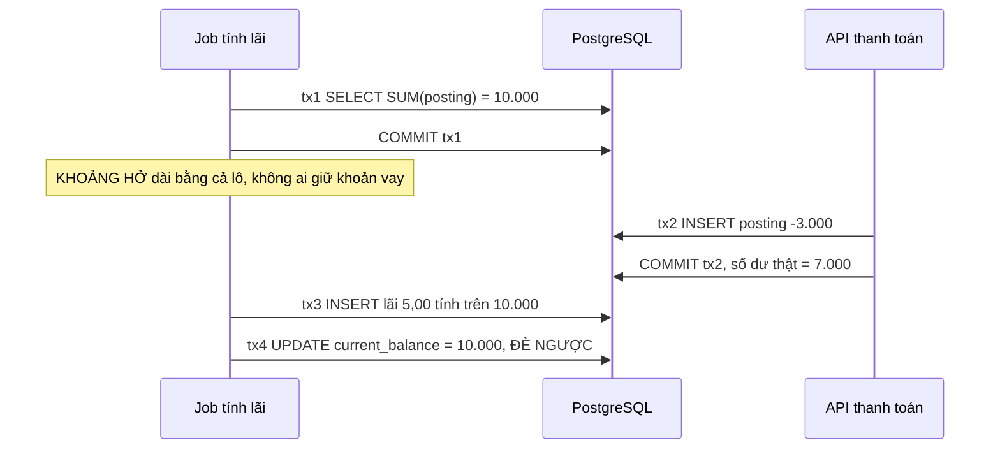
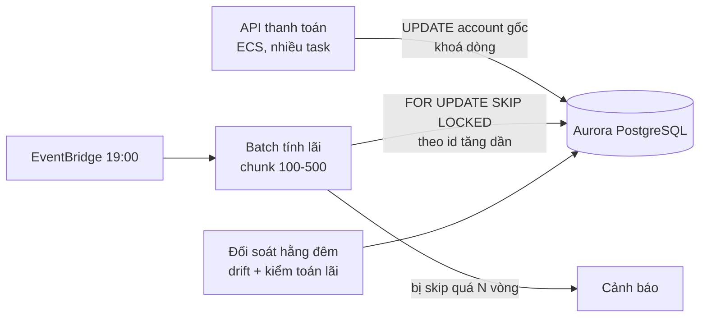
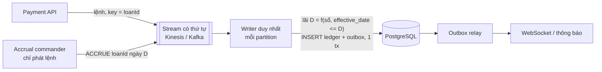

# Bài 06 — Race tính lãi với thanh toán: tái hiện lỗi thật, vì sao 4 cách trực giác sai, 3 cách sửa đúng

> **Dùng cho:** đây là **câu chuyện STAR mạnh nhất** của bạn. Ở **NAB** nó là vũ khí số một (banking
> domain, concurrency, debugging, thiết kế lại); ở **Katalon** nó là ví dụ chuẩn của họ G.
>
> **Nguồn:** [doc 06](../../katalon-prep/katalon-system-design/06-race-condition-balance-ledger.md). Bài này
> **dựng lại doc 06 bằng code chạy được** trên sổ cái của [bài 05](05-ledger-va-balance.md), và thêm ba điều
> doc 06 chưa có: bằng chứng số, sắc thái của `SERIALIZABLE`, và cách làm lỗi "im lặng" thành lỗi bắt được.
>
> **Thời lượng:** đọc 45 phút · lab 20 phút · luyện kể 15 phút
>
> **Lab:** [`lab/…/accrual/`](lab/src/main/java/com/prep/onbai/accrual/) · schema
> [`accrual.sql`](lab/src/main/resources/accrual.sql) · test `AccrualRaceTest` (10 test)

```bash
cd on-bai/gd1-nen-tang/lab
mvn -q test -Dtest=AccrualRaceTest     # ~2 giây, Postgres 16 thật, không Docker
```

---

## 0. Trọng tâm phỏng vấn

Interviewer nghe câu chuyện này sẽ đào theo năm hướng. Bạn phải trả lời được cả năm, **kèm số**:

| Hướng đào | Câu trả lời cần có |
|---|---|
| Gọi tên lỗi | TOCTOU / write skew, **không** phải lost update. Hai bên ghi hai dòng khác nhau nên DB không thấy xung đột nào. *"Ghi thành công và sai trong im lặng."* |
| Vì sao cách dễ không được | `synchronized` sai phạm vi; `@Transactional` ở `READ COMMITTED` không khoá khi đọc; nâng isolation thì đổi lỗi im lặng lấy `40001`; retry mù thì tính lãi hai lần |
| Sửa theo thứ tự nào | **Idempotency trước**, rồi thu hẹp từ lô xuống từng khoản vay, rồi khoá bi quan theo id tăng dần, cuối cùng bỏ hoặc hạ cấp cột số dư |
| Chứng minh đã sửa | Test hai luồng thật trên Postgres thật, có bằng chứng "đang chờ khoá"; job đối soát ra rỗng |
| Thiết kế lại thì sao | Đổi **định nghĩa**: lãi ngày D là hàm của sổ cái theo ngày nghiệp vụ D. Thứ tự hết quan trọng, ghi muộn thành bút toán điều chỉnh |

**Ba câu chỉ bài này có** (doc 06 chưa nói, interviewer giỏi sẽ thích):

1. *"Test kiểu `assert lãi ∈ {5,00; 3,50}` **cũng pass với bản lỗi**. Cả hai con số đều là kết quả của một
   thứ tự tuần tự hợp lệ. Lỗi không nằm ở con số mà ở chỗ con số đó được tính trên trạng thái nào. Vì vậy
   tôi lưu `basis_seq` và kiểm theo định nghĩa."*
2. *"`SERIALIZABLE` đảm bảo **tồn tại** một thứ tự tuần tự tương đương. Nó không đảm bảo thứ tự **nghiệp
   vụ muốn**. Bản lỗi tương đương 'accrual chạy trước payment', và SSI không có lý do gì để chặn."*
3. *"SSI chỉ bảo vệ transaction **cũng** `SERIALIZABLE`. Chỉ cần đường payment còn `READ COMMITTED` là mất
   bảo vệ. Tôi đã chạy thử ở bài 04."*

---

## 1. Đề, số liệu, và hai lỗi chồng lên nhau

Dư nợ gốc 10.000, lãi 0,05%/ngày. Job tính lãi đọc số dư, khách trả 3.000, job ghi lãi:



| | Lỗi | Bản chất | Chữa bằng |
|---|---|---|---|
| **A** | Lãi 5,00 tính trên số dư cũ, ghi sau khi đã trả | TOCTOU: đọc ở T1, dùng ở T2 | Ranh giới transaction + khoá, hoặc đổi định nghĩa |
| **B** | `current_balance` bị ghi đè về 10.000 | Lost update trên cột dẫn xuất | Bỏ cột, hoặc chỉ cập nhật tương đối trong cùng transaction ([bài 05](05-ledger-va-balance.md)) |

Lỗi B tệ hơn lỗi A. A làm sai **một con số** của một ngày; B làm **hỏng trạng thái**, và mọi thứ đọc từ
cột đó sau này đều sai.

---

## 2. Real case: dựng lại hệ thống khoản vay, tái hiện lỗi, sửa từng bước

### Bước 1 — Khoản vay nằm trên sổ cái bài 05, thêm bảng dấu vết

📄 [`accrual.sql`](lab/src/main/resources/accrual.sql)

```sql
CREATE TABLE IF NOT EXISTS loan (
    id                bigint        PRIMARY KEY,
    principal_account bigint        NOT NULL UNIQUE REFERENCES account(id),  -- du no goc khach dang no
    interest_account  bigint        NOT NULL UNIQUE REFERENCES account(id),  -- lai phai thu
    daily_rate        numeric(12,8) NOT NULL                                  -- 0.0005 = 0,05%/ngay
);

-- Moi lan tinh lai de lai DAU VET: tinh tren du no nao, chot toi seq nao. Kiem toan se hoi dung cau nay.
CREATE TABLE IF NOT EXISTS accrual (
    journal_id    bigint        PRIMARY KEY REFERENCES journal(id),
    loan_id       bigint        NOT NULL REFERENCES loan(id),
    business_date date          NOT NULL,
    kind          text          NOT NULL CHECK (kind IN ('ACCRUAL', 'ADJUSTMENT')),
    basis_balance numeric(19,4) NOT NULL,   -- du no goc dung de tinh
    basis_seq     bigint        NOT NULL,   -- trang thai account goc toi posting seq nay
    interest      numeric(19,4) NOT NULL
);
```

Mỗi khoản vay có hai account: **gốc** (khách nợ) và **lãi phải thu**. Hai account hệ thống `cash` và
`income:interest` là account **nóng**: mọi khoản vay đều chạm vào nên không khoá ([bài 05 bước
10](05-ledger-va-balance.md#bước-10--tài-khoản-nóng-không-khoá-chốt-theo-mốc-xmin)).

| Nghiệp vụ | Posting | Khoá dòng nào |
|---|---|---|
| Giải ngân 10.000 | `loan:42:principal +10.000`, `cash −10.000` | gốc |
| Khách trả 3.000 | `cash +3.000`, `loan:42:principal −3.000` | gốc |
| Lãi ngày D | `loan:42:interest +x`, `income:interest −x` | lãi (và gốc, nếu khoá đúng) |

Bảng `accrual` là **dấu vết kiểm toán**: lãi này tính trên dư nợ bao nhiêu, tại `seq` nào của account gốc.
Không có nó thì không trả lời được câu *"lãi hôm đó tính trên số dư nào?"*, và không kiểm được tính đúng
sau sự kiện (§2 bước 9).

📄 [`LoanBook.java`](lab/src/main/java/com/prep/onbai/accrual/LoanBook.java)

```java
/** Khach tra goc. requestId do client sinh: bam hai lan = mot lan. */
public Receipt pay(Loan loan, String requestId, BigDecimal amount, LocalDate effectiveDate) {
    return ledger.post(Request.of("payment:" + requestId, "PAYMENT", effectiveDate,
            new Leg(CASH, amount), new Leg(loan.principal(), amount.negate())));
}

/** Lai = du no x lai suat ngay, lam tron 2 chu so kieu ngan hang (HALF_EVEN: khong lech ve mot phia). */
public static BigDecimal interestOn(BigDecimal basis, BigDecimal dailyRate) {
    return basis.multiply(dailyRate).setScale(2, RoundingMode.HALF_EVEN);
}
```

`HALF_EVEN` (làm tròn kiểu ngân hàng): `0,125 → 0,12`, `0,135 → 0,14`. Trên triệu bút toán, sai số làm
tròn không dồn về một phía. Đây là câu hỏi phụ hay gặp ở NAB.

### Bước 2 — Tái hiện đúng lỗi thật: ba bước, ba transaction

📄 [`LegacyAccrualJob.java`](lab/src/main/java/com/prep/onbai/accrual/LegacyAccrualJob.java), dựng lại đúng
hình dạng `RunLoanAccountDailyAccrualConsumerService` (doc 06 §2):

```java
/** gapAfterRead: thoi gian xu ly ca lo. Test chen mot giao dich cua khach vao dung cho nay. */
public void run(List<Loan> loans, LocalDate date, Runnable gapAfterRead) {
    Map<Long, BigDecimal> balances = readBalances(loans);  // (1)
    gapAfterRead.run();
    for (Loan loan : loans) {
        BigDecimal basis = balances.get(loan.principal());
        BigDecimal interest = LoanBook.interestOn(basis, loan.dailyRate());
        postInterest(loan, date, interest);                                                  // (2)
        jdbc.update("UPDATE account SET balance = ? WHERE id = ?", basis, loan.principal()); // (3)
    }
}
```

**Kỹ thuật test đáng học:** `gapAfterRead` là một *seam*, một điểm chèn chỉ dùng trong test. Race trong
production phụ thuộc thời gian; trong test, ta **ép đúng interleaving** bằng cách chạy thanh toán ngay
trong khe đó. Không `sleep`, không "chạy 1.000 lần mong trúng", nên kết quả tất định.

```java
new LegacyAccrualJob(ds).run(List.of(loan), D, () -> book.pay(loan, "p1", THREE_K, D)); // khach tra giua luc job chay
// ...
assertThat(posted(loan, D)).isEqualByComparingTo("5.00");               // loi A: tinh tren so du cu
assertThat(column).isEqualByComparingTo("10000");                       // loi B: de nguoc so du
assertThat(sumOf(loan.principal())).isEqualByComparingTo("7000");
// khong exception nao, khong log loi nao. Chi doi soat moi thay:
assertThat(new LedgerReconciler(ds).run().balanceDrift()).containsExactly(loan.principal());
```

```text
[LAB] job cu: lai ghi 5 (dung: 3.50), cot balance 10000, SUM(posting) 7000
```

### Bước 3 — Bốn "giải pháp trực giác", có bằng chứng

#### 3.1 `synchronized`: sai phạm vi (không cần code để bác)

Khoá nằm **trong một JVM**. Hệ thống chạy ≥ 2 task ECS, và batch với API là **hai service, hai process**.
Bẫy phụ của hệ thống thật: khối `synchronized` có sẵn đang bọc một `SimpleDateFormat` vốn đã là
`ThreadLocal`. Nghĩa là code khoá thứ đã an toàn, còn thứ cần khoá thì không ai khoá. Nhìn vào thì tưởng
"đã xử lý concurrency rồi".

#### 3.2 Một `@Transactional` bao cả đọc và ghi: vẫn sai

📄 [`RcTransactionAccrual.java`](lab/src/main/java/com/prep/onbai/accrual/RcTransactionAccrual.java)

```java
public Result accrueOne(Loan loan, LocalDate date, Runnable gapAfterRead) {
    return tx.execute(s -> {
        var basis = jdbc.queryForMap("SELECT balance, last_seq FROM account WHERE id = ?", loan.principal());
        BigDecimal balance = (BigDecimal) basis.get("balance");
        long basisSeq = ((Number) basis.get("last_seq")).longValue();
        gapAfterRead.run();
        BigDecimal interest = LoanBook.interestOn(balance, loan.dailyRate());
        Receipt r = ledger.post(Request.of("accrual:" + loan.id() + ":" + date, "ACCRUAL", date,
                new Leg(loan.interest(), interest), new Leg(LoanBook.INTEREST_INCOME, interest.negate())));
        Long seqNow = jdbc.queryForObject("SELECT last_seq FROM account WHERE id = ?", Long.class, loan.principal());
        return new Result(r.journalId(), balance, basisSeq, seqNow, interest);
    });
}
```

`READ COMMITTED` không khoá gì khi `SELECT`. Mỗi câu lệnh thấy dữ liệu đã commit **mới nhất lúc nó
chạy**. Thanh toán (ở luồng khác) đi xuyên qua, không phải chờ ai. Đoạn đo `seqNow` là một **dụng cụ**: đọc
lại `last_seq` ngay trước commit. Khác `basisSeq` nghĩa là lúc ghi, dư nợ đã đổi so với lúc tính.

```text
[LAB] 1 transaction READ COMMITTED: lai 5 tinh tren 10000 @seq 1, luc commit seq da la 2
```

#### 3.3 Nâng isolation: đổi lỗi im lặng lấy `40001`, và một sắc thái hay bị nói sai

**Với lỗi B (ghi đè cột):** ở `REPEATABLE READ` hoặc `SERIALIZABLE`, ghi đè một dòng mà người khác đã
commit sau snapshot của mình sẽ nhận `40001` ngay:

```text
[LAB] REPEATABLE READ ghi de: 40001 ERROR: could not serialize access due to concurrent update
```

Tốt hơn sai im lặng, nhưng bây giờ **phải retry**. Mà retry giao dịch tiền thì phải idempotent (3.4).

**Với lỗi A (tính trên số dư cũ), đây là chỗ phần lớn ứng viên nói sai.** Cho cả accrual lẫn payment chạy
`SERIALIZABLE`. Accrual đọc 10.000; payment ghi gốc rồi commit; accrual ghi lãi vào **account lãi**, account
mà payment không đọc. Đồ thị phụ thuộc chỉ có một cạnh `accrual →rw payment`, **không có vòng**. Thứ tự
tuần tự "accrual trước, payment sau" là hợp lệ, và cho đúng 5,00. Vậy SSI **không có lý do để abort**.

> `SERIALIZABLE` đảm bảo kết quả **bằng một thứ tự tuần tự nào đó**, không đảm bảo **thứ tự nghiệp vụ
> muốn** ("lãi tính trên số dư lúc ghi sổ"). Muốn thứ tự nghiệp vụ thì phải **nói nó ra**: khoá cùng một
> thứ (bước 4), hoặc định nghĩa lại theo ngày nghiệp vụ (bước 6).

Trên bảng nhỏ, SSI *có thể* abort vì predicate lock ở mức trang index (false positive). Kết quả khi đó
phụ thuộc bố cục index, không phải logic. Đó là lý do lab không dựa vào nó.

Và [bài 04](04-postgres-concurrency.md#bước-6--write-skew-quy-tắc-nằm-trên-nhiều-dòng) có test cho thấy
thêm: **chỉ cần một bên `READ COMMITTED` là SSI mất tác dụng**.

```text
[LAB] SERIALIZABLE ca hai: 40001 ... | mot ben READ COMMITTED: tong = -80
```

#### 3.4 Retry mù: biến lỗi khó thấy thành lỗi tệ hơn

```java
job.postInterest(legacy, D, new BigDecimal("5.00"));
job.postInterest(legacy, D, new BigDecimal("5.00")); // lan 1 da commit nhung client timeout -> retry
assertThat(posted(legacy, D)).isEqualByComparingTo("10.00");
```

```text
[LAB] retry: key ngau nhien -> lai 10; key accrual:43:2026-10-18 -> lai 5, lan 2 alreadyDone=true
```

Key ngẫu nhiên (UUID mỗi lần thử) không chống được gì. **Key tự nhiên `accrual:{khoản vay}:{ngày}`**
diễn đạt đúng luật nghiệp vụ: *một khoản vay, một ngày, một bút toán lãi*. Nó được dùng từ bước 4.

### Bước 4 — Bản vá cho hệ thống đang chạy: idempotency → từng khoản vay → khoá theo id

📄 [`LockedAccrualService.java`](lab/src/main/java/com/prep/onbai/accrual/LockedAccrualService.java)

```java
public Result accrueOne(Loan loan, LocalDate date) {
    return tx.execute(s -> {
        Map<Long, Row> locked = lockInIdOrder(loan.principal(), loan.interest());
        String key = "accrual:" + loan.id() + ":" + date;
        Long done = jdbc.query("SELECT id FROM journal WHERE idempotency_key = ?",
                rs -> rs.next() ? rs.getLong(1) : null, key);
        if (done != null) {
            return new Result(done, null, -1, null, true); // check-then-act AN TOAN vi dang giu khoa
        }
        Row principal = locked.get(loan.principal());
        BigDecimal interest = LoanBook.interestOn(principal.balance(), loan.dailyRate());
        // ... (lai = 0 thi khong ghi)
        Receipt r = ledger.post(Request.of(key, "ACCRUAL", date,
                new Leg(loan.interest(), interest), new Leg(LoanBook.INTEREST_INCOME, interest.negate())));
        jdbc.update("""
                INSERT INTO accrual (journal_id, loan_id, business_date, kind, basis_balance, basis_seq, interest)
                VALUES (?, ?, ?, 'ACCRUAL', ?, ?, ?)""",
                r.journalId(), loan.id(), date, principal.balance(), principal.lastSeq(), interest);
        return new Result(r.journalId(), principal.balance(), principal.lastSeq(), interest, false);
    });
}

/** Khoa theo id TANG DAN, ke ca account chi doc: cung quy uoc voi LedgerService -> khong vong cho. */
private Map<Long, Row> lockInIdOrder(Long... ids) {
    Map<Long, Row> rows = new HashMap<>();
    jdbc.query("SELECT id, balance, last_seq FROM account WHERE id = ANY(?) ORDER BY id FOR UPDATE",
            rs -> {
                rows.put(rs.getLong(1), new Row(rs.getBigDecimal(2), rs.getLong(3)));
            },
            (Object) ids);
    // ...
    return rows;
}
```

Năm chi tiết, mỗi chi tiết là một câu trả lời follow-up:

1. **Khoá account gốc dù chỉ đọc nó.** Payment khoá đúng dòng đó (câu `UPDATE` trong `LedgerService`), nên
   hai bên **tuần tự hoá trên từng khoản vay**. Các khoản vay khác nhau vẫn chạy song song.
2. **Khoá mọi account sẽ chạm (gốc + lãi) trong một câu `ORDER BY id FOR UPDATE`.** Postgres sắp xếp
   *trước* rồi mới khoá theo thứ tự đó, nên khớp quy ước id tăng dần của `LedgerService`. Nếu khoá gốc
   trước rồi để `LedgerService` khoá lãi sau, một journal khác chạm (lãi, gốc) theo id tăng dần có thể tạo
   vòng chờ.
3. **Check-then-act an toàn vì đang giữ khoá.** Hai lần chạy cùng `(khoản vay, ngày)` không thể cùng thấy
   "chưa có". Unique index trên `idempotency_key` vẫn là lưới an toàn cuối.
4. **Một transaction ngắn cho một khoản vay** (doc 06 §6 bước 2). Cửa sổ race co từ "cả lô" xuống "không".
5. **Ghi `basis_seq`.** Lãi này tính trên trạng thái gốc tới posting số mấy. Đây là thứ biến lỗi im lặng
   thành lỗi kiểm được (bước 9).

**Bằng chứng nó thật sự tuần tự hoá:** test cho accrual giữ khoá (chạy trong transaction ngoài chưa
commit) rồi bắn payment từ luồng khác, và **thấy payment đang chờ khoá trong `pg_stat_activity`**, không
đoán bằng `sleep`:

```java
LockedAccrualService.Result acc = outer.execute(s -> {
    LockedAccrualService.Result r = locked.accrueOne(a, D); // tham gia transaction ngoai: khoa con giu
    payment.add(other.submit(() -> book.pay(a, "pa", THREE_K, D)));
    awaitLockWaiters(1);                                     // thay no dang cho khoa trong pg_stat_activity
    return r;
});
```

```text
[LAB] khoa bi quan: accrual truoc -> 5 @seq 1; thanh toan truoc -> 3.5 @seq 2
```

> Mẹo Postgres đáng nhớ: `pg_stat_activity` bị **chụp một lần cho cả transaction**. Hỏi lại trong cùng
> transaction bao nhiêu lần cũng ra số cũ. Muốn poll thì dùng connection riêng ở chế độ autocommit. Lab đã
> vấp đúng chỗ này; xem `Locks.awaitWaiters`.

**20 vòng tranh chấp thật (`CyclicBarrier`), bản khoá đặt cạnh bản `READ COMMITTED`:**

```text
[LAB] 20 vong tranh chap that: ban khoa -> {3.5@seq2=17, 5@seq1=3}, 0 lan tinh tren so du cu; ban READ COMMITTED -> 19/20 lan tinh tren so du cu
```

Đọc kỹ dòng này. Bản khoá cho **cả hai** kết quả 5,00 và 3,50, mỗi kết quả là một thứ tự tuần tự hợp lệ.
Bản `READ COMMITTED` **cũng** chỉ cho 5,00 hoặc 3,50. **Nhìn con số lãi thì không phân biệt được bản lỗi
với bản đúng.** Test kiểu doc 06 §9.1 (`isIn(5.00, 3.50)`) sẽ xanh với cả hai. Thứ phân biệt được là
`basis_seq` so với trạng thái lúc commit, hoặc tốt hơn là một định nghĩa kiểm được (bước 6 và 9).

### Bước 5 — Batch không bao giờ bắt khách chờ: `SKIP LOCKED` theo chunk

📄 [`SkipLockedAccrualBatch.java`](lab/src/main/java/com/prep/onbai/accrual/SkipLockedAccrualBatch.java)

```java
tx.executeWithoutResult(s -> {
    // MOT cau lenh khoa moi account cua chunk, id tang dan, khong cho ai
    Long[] ids = chunk.stream().flatMap(l -> java.util.stream.Stream.of(l.principal(), l.interest()))
            .sorted().toArray(Long[]::new);
    Set<Long> got = new HashSet<>(jdbc.queryForList(
            "SELECT id FROM account WHERE id = ANY(?) ORDER BY id FOR UPDATE SKIP LOCKED", Long.class, (Object) ids));
    for (Loan loan : chunk) {
        if (!got.contains(loan.principal()) || !got.contains(loan.interest())) {
            skipped.add(loan.id()); // dem lai: bi bo qua nhieu vong lien tiep -> alert
            continue;
        }
        var r = accrual.accrueOne(loan, date); // tham gia transaction cua chunk, khoa da co san
        (r.alreadyDone() ? alreadyDone : accrued).add(loan.id());
    }
});
```

Test giữ một payment **chưa commit** trên khoản vay 3, rồi chạy ba vòng batch:

```text
[LAB] SKIP LOCKED: vong 1 (33 ms) Pass[accrued=[1, 2, 4, 5, 6], alreadyDone=[], skipped=[3]] | vong 2 Pass[accrued=[3], alreadyDone=[1, 2, 4, 5, 6], skipped=[]] | vong 3 Pass[accrued=[], alreadyDone=[1, 2, 3, 4, 5, 6], skipped=[]]
```

- Vòng 1 xong trong 33 ms, **không chờ** khách đang thanh toán.
- Vòng 2 bắt kịp khoản vay 3, và tính trên dư nợ **sau** khi khách trả (3,50).
- Vòng 3 không ghi gì thêm, nhờ key tự nhiên.

**Đánh đổi phải nói:** chunk càng lớn thì transaction càng ít, nhưng khoá giữ càng lâu. Một khách
thanh toán đúng lúc chunk của họ đang chạy sẽ chờ tối đa bằng thời gian một chunk. Chọn 100–500 khoản
vay mỗi chunk. Khoản vay bị skip nhiều vòng liên tiếp thì cảnh báo, rồi cuối cửa sổ chạy một vòng có chờ
khoá (không `SKIP LOCKED`).

### Bước 6 — Thiết kế lại: đổi **định nghĩa**, không thêm khoá

Đây là ý quan trọng nhất cả bài (doc 06 §12.1):

```text
CŨ : lãi = f(số dư ĐỌC ĐƯỢC lúc job chạy)               → phụ thuộc đồng hồ → phải khoá để ghim
MỚI: lãi ngày D = f(mọi posting gốc có effective_date <= D) → hàm thuần của dữ liệu
```

Kèm **giờ chốt sổ (EOB)**: giao dịch sau 19:00 thuộc về ngày làm việc sau. Một quy tắc nghiệp vụ, không
phải đồng hồ của job:

```java
/** Ngay nghiep vu cua mot giao dich: sau gio chot so -> ngay hom sau. Mot quy tac, khong phai dong ho cua job. */
public static LocalDate effectiveDate(Instant recordedAt) {
    ZonedDateTime local = recordedAt.atZone(ZONE);
    return local.toLocalTime().isBefore(EOB) ? local.toLocalDate() : local.toLocalDate().plusDays(1);
}
```

📄 [`EffectiveDateAccrual.java`](lab/src/main/java/com/prep/onbai/accrual/EffectiveDateAccrual.java)

```java
/** Tinh lai ngay D mot lan. Chay lai -> tra but toan da co. */
public Optional<Result> accrue(Loan loan, LocalDate day) {
    return tx.execute(s -> {
        lock(loan);
        String key = "accrual:" + loan.id() + ":" + day;
        if (exists(key)) {
            return Optional.empty();
        }
        Basis b = basis(loan, day);
        return post(loan, day, "ACCRUAL", key, b, LoanBook.interestOn(b.balance(), loan.dailyRate()));
    });
}

private Basis basis(Loan loan, LocalDate day) {
    return jdbc.queryForObject("""
            SELECT coalesce(sum(amount), 0), coalesce(max(seq), 0)
              FROM posting WHERE account_id = ? AND effective_date <= ?""",
            (rs, i) -> new Basis(rs.getBigDecimal(1), rs.getLong(2)), loan.principal(), day);
}
```

Khoá vẫn còn, nhưng **vai trò đã khác**: nó chỉ để hai bản `accrue` không cùng ghi. Nó **không** còn cần
để chặn payment: payment lúc 19:00:03 có `effective_date = D+1`, nên không nằm trong `basis(D)`, dù nó
commit trước hay sau.

Test chạy 22 khoản vay theo đủ kiểu thứ tự: accrual trước, payment trước, và 20 cặp tranh chấp thật:

```text
[LAB] dinh nghia theo ngay nghiep vu: 22/22 khoan vay lai ngay D = 5.00 bat ke thu tu, ngay D+1 = 3.50
```

So với bước 4, nơi kết quả là 5,00 **hoặc** 3,50 tuỳ ai thắng, ở đây kết quả là **một con số duy nhất**
và **giải thích được**: lãi ngày 18 tính trên dư nợ cuối ngày 18. Khoản trả sau giờ chốt sổ thuộc về ngày
19.

### Bước 7 — Ghi muộn không phải race, mà là **tính lại**: bút toán điều chỉnh

Sáng hôm sau file ngân hàng về: khách thật ra đã trả 3.000 **trong ngày 18**. Theo định nghĩa mới, lãi
ngày 18 phải là 3,50, nhưng sổ đang ghi 5,00. Ta **không sửa** bút toán cũ; ta ghi phần chênh:

```java
/** Doi soat ngay D theo dinh nghia; lech -> ghi ADJUSTMENT. Key chua seq cua basis: cung du lieu thi khong ghi hai lan. */
public Optional<Result> reconcile(Loan loan, LocalDate day) {
    return tx.execute(s -> {
        lock(loan);
        Basis b = basis(loan, day);
        BigDecimal expected = LoanBook.interestOn(b.balance(), loan.dailyRate());
        BigDecimal diff = expected.subtract(postedInterest(jdbc, loan, day));
        if (diff.signum() == 0) {
            return Optional.empty();
        }
        return post(loan, day, "ADJUSTMENT", "accrual-adj:" + loan.id() + ":" + day + ":" + b.seq(), b, diff);
    });
}
```

- **Key `accrual-adj:{khoản vay}:{ngày}:{basis_seq}`.** Cùng trạng thái dữ liệu thì cùng key, nên không
  bao giờ ghi điều chỉnh hai lần. Một khoản ghi muộn **mới** làm `basis_seq` đổi, nên được phép điều
  chỉnh tiếp.
- **Vì sao vẫn khoá:** hai bản reconcile chạy song song, cả hai thấy lệch −1,50, cả hai ghi thì thành
  −3,00. Test bắn 8 bản cùng lúc:

```text
[LAB] ghi muon -> dieu chinh: [{idempotency_key=accrual-adj:42:2026-10-18:2, interest=-1.5000}], tong lai ngay D = 3.5
```

> **Câu hỏi nghiệp vụ phải hỏi kế toán, đừng tự quyết:** kỳ của ngày 18 đã đóng sổ thì điều chỉnh ghi
> vào ngày 18 hay ngày hiện tại (kèm tham chiếu ngày 18)? Lab ghi `effective_date = 18` cho dễ kiểm. Hệ
> thật thường ghi vào kỳ đang mở.

### Bước 8 — (đối chiếu) Bản single-writer của doc 06 §12

Bước 4–7 vẫn **quản lý** tranh chấp. Doc 06 §12.4 **loại bỏ** nó: mọi lệnh của một khoản vay (payment,
accrual, phí) đi qua một stream có thứ tự, `key = loanId`, và một writer duy nhất mỗi partition xử lý tuần
tự. Không khoá, không retry, không deadlock. Đổi lại, API trả `202` thay vì kết quả cuối. Phần này cần
Kafka nên thuộc giai đoạn 2. Ở đây chỉ cần nói được **khi nào** chuyển: khi tranh chấp tính bằng nghìn
ghi/giây trên mỗi account, hoặc khi cần replay xác định toàn bộ lịch sử.

### Bước 9 — Kiểm toán theo định nghĩa: lỗi im lặng thành lỗi bắt được

📄 [`AccrualAudit.java`](lab/src/main/java/com/prep/onbai/accrual/AccrualAudit.java)

```java
public List<Mismatch> check(LocalDate day) {
    // voi moi khoan vay:
    BigDecimal basis = /* SUM(posting goc) WHERE effective_date <= day */;
    BigDecimal expected = LoanBook.interestOn(basis, loan.dailyRate());
    BigDecimal posted = EffectiveDateAccrual.postedInterest(jdbc, loan, day);  // ACCRUAL + ADJUSTMENT
    if (expected.compareTo(posted) != 0) out.add(new Mismatch(loan.id(), day, expected, posted));
}
```

Chạy trên dữ liệu của **job cũ** ở bước 2, nó bắt được lỗi A:

```java
assertThat(new AccrualAudit(ds).check(D)).containsExactly(
        new AccrualAudit.Mismatch(42, D, new BigDecimal("3.50"), new BigDecimal("5.0000")));
```

Đây là ý đóng lại câu chuyện: *"Tôi không chỉ sửa lỗi. Tôi đổi định nghĩa để tính đúng **kiểm được sau sự
kiện**. Lần sau có lỗi tương tự, job kiểm toán hằng đêm sẽ báo, không cần chờ ai đối soát tay."*

---

## 3. Lab — bảng test

| Test | Chứng minh |
|---|---|
| `legacyJobComputesOnTheStaleBalanceAndOverwritesTheColumn` | Lỗi A + B tái hiện tất định; đối soát bắt B, kiểm toán theo định nghĩa bắt A |
| `oneReadCommittedTransactionIsNotEnough` | `@Transactional` mặc định vẫn TOCTOU (`seq 1` lúc tính, `seq 2` lúc commit) |
| `repeatableReadTurnsTheSilentOverwriteInto40001` | Nâng isolation: lỗi im lặng thành `40001`; `READ COMMITTED` thì drift |
| `retryWithoutAnIdempotencyKeyChargesInterestTwice` | Key ngẫu nhiên cho lãi 10; key tự nhiên cho lãi 5 |
| `whileTheAccrualHoldsTheLockThePaymentWaitsAndViceVersa` | Khoá bi quan tuần tự hoá, thấy được trong `pg_stat_activity` |
| `underRealConcurrencyEveryOutcomeIsOneOfTheTwoSerialOrders` | 20 vòng thật: bản khoá 0 lần tính trên số dư cũ, bản RC ~20/20 |
| `skipLockedBatchNeverWaitsForACustomerAndCatchesUpNextPass` | Batch không chờ khách, vòng sau bắt kịp, chạy lại không trùng |
| `cutoffDecidesTheBusinessDateNotTheJobsClock` | 18:59:59 thuộc D; 19:00:03 thuộc D+1 |
| `withTheEffectiveDateDefinitionTheOrderNoLongerMatters` | 22/22 khoản vay cùng một kết quả bất kể thứ tự |
| `aBackdatedPaymentIsFixedByAnAdjustmentNotByALock` | 8 bản reconcile song song cho đúng 1 điều chỉnh −1,50 |

**Bài tập (15 phút):** trong `LockedAccrualService`, bỏ `FOR UPDATE` (chỉ `SELECT`). Chạy lại
`whileTheAccrualHoldsTheLock…`. Test sẽ treo ở `awaitLockWaiters` vì không còn ai phải chờ, và hết giờ sau
10 giây. Đó là cách "thấy" khoá bằng mắt.

---

## 4. Vẽ design

**Bản vá (lock-based), cái bạn đã làm thật:**



**Bản thiết kế lại (doc 06 §12–13):**



**Nói khi vẽ bản thứ hai (40 giây):** *"Batch không đọc số dư, không tính tiền. Nó chỉ phát lệnh vào
đúng partition của khoản vay, nên lệnh xếp sau mọi giao dịch đã tới trước nó. Writer tính lãi bằng một hàm
thuần của sổ cái theo ngày nghiệp vụ. Thứ tự nào cũng cho kết quả giải thích được, ghi muộn thành điều
chỉnh. Cái giá là ghi bất đồng bộ, API trả 202, và một khoản vay không ghi song song được."*

---

## 5. Kể chuyện (STAR, 90 giây), bản có số

Bản đầy đủ ở [doc 06 §10.1](../../katalon-prep/katalon-system-design/06-race-condition-balance-ledger.md#101-kể-theo-star-90-giây),
bản tiếng Anh ở [nab-prep/05](../../nab-prep/05-english-interview.md). Thêm **ba câu có số** từ lab vào
phần R:

> *"…Tôi dựng lại lỗi bằng test tất định: chèn một thanh toán vào đúng khe giữa đọc và ghi, kết quả lãi 5,00
> thay vì 3,50 và cột số dư bị đè về 10.000. Sau khi sửa, 20 vòng tranh chấp thật trên Postgres cho 0 lần
> tính trên số dư cũ, trong khi bản cũ sai 19/20. Và tôi thêm một kiểm toán theo ngày nghiệp vụ, chạy trên
> dữ liệu cũ nó bắt lại đúng khoản lệch 1,50. Lỗi kiểu này giờ tự lộ ra mỗi đêm."*

---

## 6. Live coding drill (15 phút): *"Viết `accrueOne(loanId, date)` an toàn với thanh toán đồng thời"*

```java
@Transactional
public void accrueOne(long loanId, LocalDate date) {
    Loan loan = loans.get(loanId);
    // 1) khoa moi account se cham, id tang dan (ca account chi doc)
    jdbc.query("SELECT id FROM account WHERE id IN (?, ?) ORDER BY id FOR UPDATE",
               rs -> {}, loan.principal(), loan.interest());
    // 2) idempotent: mot khoan vay, mot ngay, mot but toan (unique index la luoi cuoi)
    String key = "accrual:" + loanId + ":" + date;
    if (exists(key)) return;
    // 3) doc so du DANG DUOC KHOA, tinh, ghi — khong ai chen vao duoc
    BigDecimal basis = jdbc.queryForObject("SELECT balance FROM account WHERE id = ?", BigDecimal.class, loan.principal());
    BigDecimal interest = basis.multiply(loan.rate()).setScale(2, RoundingMode.HALF_EVEN);
    ledger.post(key, date, List.of(leg(loan.interest(), interest), leg(INCOME, interest.negate())));
}
```

**Nói kèm, không cần viết:** *"Payment cũng phải khoá dòng gốc. Trong code của tôi nó khoá ngầm qua câu
`UPDATE` có điều kiện. Thêm một test kiến trúc để chặn ai đó sau này viết đường ghi posting mà quên khoá,
như doc 06 §9.3. Và câu hỏi nghiệp vụ là lãi ngày D tính trên số dư trước hay sau khoản trả trong ngày.
Tôi sẽ hỏi kế toán, rồi mã hoá câu trả lời thành `effective_date` + giờ chốt sổ."*

---

## 7. Follow-up mới (ngoài 12 câu ở doc 06 §10.2)

<details>
<summary><b>Q1. "Test của anh assert lãi ∈ {5,00; 3,50}. Bản lỗi có pass không?"</b></summary>

Có, và đó chính là điểm. Cả hai số đều là kết quả của một thứ tự tuần tự hợp lệ; bản lỗi cho 5,00 trông
y như "accrual chạy trước". Test đúng phải kiểm **trạng thái mà con số được tính trên**. Có hai cách: so
`basis_seq` với seq lúc commit (dụng cụ `seqAtCommit` ở bản `READ COMMITTED`), hoặc kiểm theo **định
nghĩa** bằng `AccrualAudit`, chạy được trên dữ liệu production, sau sự kiện.
</details>

<details>
<summary><b>Q2. "Một triệu khoản vay, batch chạy bao lâu?"</b></summary>

Ước lượng: mỗi khoản vay khoảng 4 câu SQL, mỗi câu ~0,3 ms trong cùng AZ, tức ~1,5 ms. Chunk 500 thì một
transaction ~0,75 s. 1.000.000 / 500 = 2.000 chunk. Một luồng mất ~25 phút; 8 luồng song song (mỗi luồng
một dải id) ~3–4 phút. Giới hạn thật là IOPS ghi WAL và pool connection (bài 01: 8 luồng thì giữ 8
connection). Đo bằng `pg_stat_statements` trước khi tin số này.
</details>

<details>
<summary><b>Q3. "Khoản vay bị SKIP mãi vì khách giao dịch liên tục?"</b></summary>

Mỗi vòng ghi số lần bị skip cho từng khoản vay, vượt N lần liên tiếp thì cảnh báo. Cuối cửa sổ batch,
chạy một vòng **có chờ** (`FOR UPDATE` thường, kèm `lock_timeout`) cho phần còn lại. Với định nghĩa theo
ngày nghiệp vụ, chạy trễ vài phút không làm sai số, chỉ trễ.
</details>

<details>
<summary><b>Q4. "Sao không tính lãi lazy, lúc cần mới tính?"</b></summary>

Đúng hướng (doc 06 §12.5): batch eager sinh 73 triệu posting/năm cho 100k khoản vay, phần lớn tăng trưởng
sổ đến từ chính batch. Lazy chỉ chốt khi sao kê hoặc tất toán, còn chi tiết tính on-demand. **Nhưng** ghi
nhận doanh thu hằng ngày là quy định kế toán. Phương án dung hoà: GL ghi gộp hằng ngày cho cả danh mục,
chi tiết theo khách thì tính khi cần. Phải được kế toán duyệt.
</details>

<details>
<summary><b>Q5. "Sao không dùng optimistic lock cho rẻ?"</b></summary>

`@Version` trên khoản vay chỉ bắt được xung đột khi **cả hai bên cùng `UPDATE` một dòng**. Accrual chỉ
INSERT posting vào account lãi, không chạm dòng gốc, nên version không bao giờ đổi và không bắt được gì,
trừ khi cố ý "chạm" dòng gốc trong mọi đường ghi (materialize conflict). Làm được, và bài 04 có biến thể
CAS theo version, nhưng tranh chấp **trên một khoản vay** vốn thấp và transaction ngắn. Đó là đất của khoá
bi quan: đúng chắc chắn, không retry.
</details>

<details>
<summary><b>Q6. "Làm sao biết bản vá đã có tác dụng trên production?"</b></summary>

Hai chuỗi số theo ngày. Một là số dòng `drift` của đối soát `account.balance` với `SUM(posting)`, phải về
0 và ở yên đó. Hai là số `Mismatch` của kiểm toán lãi theo định nghĩa. Chạy cả hai **trước** khi deploy để
có baseline. Không có baseline thì "đã sửa" chỉ là cảm giác.
</details>

---

## 8. Checklist

- [ ] Vẽ được interleaving bốn bước và chỉ ra hai lỗi A, B, cách chữa của từng lỗi
- [ ] Giải thích được vì sao `@Transactional` ở `READ COMMITTED` không đủ, kèm con số `seq 1 → seq 2`
- [ ] Nói đúng sắc thái `SERIALIZABLE`: thứ tự tương đương không phải thứ tự nghiệp vụ; mọi bên phải cùng
      `SERIALIZABLE`
- [ ] Viết tay `accrueOne` có khoá theo id + idempotency + đọc dưới khoá, trong 15 phút
- [ ] Giải thích được vì sao test `isIn(5,00; 3,50)` không phân biệt được bản lỗi
- [ ] Trình bày được định nghĩa theo `effective_date` + giờ chốt sổ, và vì sao ghi muộn thành điều chỉnh
- [ ] Kể STAR 90 giây có ba con số: 5,00 so với 3,50; 0/20 so với 19/20; lệch 1,50 bị kiểm toán bắt lại
