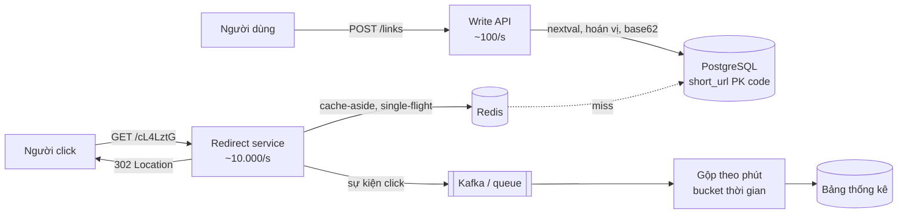

# Bài 07 — ID generator và URL shortener: Snowflake, base62, hoán vị thay vì hash

> **Dùng cho:** đề kinh điển vòng system design (cả **Katalon** lẫn **NAB**); phần ID còn xuất hiện trong
> mọi đề khác (`event_id` của bài đếm sự kiện, `payment_id`, khoá partition)
>
> **Thời lượng:** đọc 30 phút · lab 10 phút · drill 15 phút
>
> **Lab:** [`lab/…/shortener/`](lab/src/main/java/com/prep/onbai/shortener/) · schema
> [`shortener.sql`](lab/src/main/resources/shortener.sql) · test `IdAndShortenerTest` (7 test)
>
> **Nối với:** [Lab 3B Snowflake và V4 URL shortener ở tuần 3](../../java-system-design/10-implement-gd1-nen-tang.md#lab-3b--snowflake-id-generator-thứ-bảy-1-giờ).
> Bài này thêm phần lộ trình chỉ nhắc qua: **hoán vị** để mã 7 ký tự không đoán được mà không cần kiểm tra
> trùng, và chỗ dễ sai khi cho người dùng tự đặt alias.

```bash
cd on-bai/gd1-nen-tang/lab
mvn -q test -Dtest=IdAndShortenerTest   # ~3 giây
```

---

## 0. Trọng tâm phỏng vấn

| Câu hỏi | Trả lời senior |
|---|---|
| "ID phân tán sinh thế nào?" | Bốn lựa chọn: sequence DB (đơn giản, một điểm), UUIDv4 (không phối hợp, 16 byte, ngẫu nhiên nên phá locality của B-tree), **UUIDv7/Snowflake** (có thời gian, tăng dần, thân thiện index), cấp dải số (hi-lo). Chọn theo: cần sắp xếp theo thời gian? cần ngắn? chịu được một điểm phối hợp? |
| "Snowflake sai ở đâu?" | **Worker id trùng** thì trùng ID. **Đồng hồ lùi** thì trùng hoặc lùi thứ tự. Hết 4.096 ID/ms thì phải chờ |
| "Mã ngắn 7 ký tự sinh thế nào?" | Sequence rồi qua **hoán vị** của `[0, 62^7)` rồi base62. Song ánh nên không bao giờ trùng, không cần đọc kiểm tra, và mã liền nhau trông ngẫu nhiên |
| "Sao không hash URL?" | Cắt hash về 7 ký tự thì **va chạm**. Mỗi lần ghi phải đọc kiểm tra và xử lý trùng; cùng URL thì cùng mã, mất khả năng thống kê theo từng người tạo |
| "301 hay 302?" | 302 (hoặc 307) nếu cần đếm click, vì trình duyệt không cache. 301 nếu chỉ cần chuyển hướng rẻ nhất |

---

## 1. Lý thuyết cốt lõi

### 1.1 Bản đồ các loại ID

| Loại | Độ dài | Phối hợp | Tăng dần theo thời gian | Ghi chú |
|---|---|---|:-:|---|
| `bigserial` / `IDENTITY` | 8 byte | DB (một điểm) | ✓ (thứ tự insert, **không** phải thứ tự commit) | Đơn giản nhất; [bài 09](09-outbox-notification.md) có bẫy con trỏ id |
| UUIDv4 | 16 byte | không | ✗ | Insert ngẫu nhiên vào B-tree: page split, cache kém, index phình |
| UUIDv7 (RFC 9562) | 16 byte | không | ✓ (ms) | Thay thế UUIDv4 cho khoá chính; có trong Postgres 18 (`uuidv7()`) |
| **Snowflake** | 8 byte | worker id | ✓ | Vừa `bigint`; ~4 triệu/s mỗi worker |
| Cấp dải (hi-lo) | tuỳ | DB, mỗi khối một lần | ✓ theo khối | Mỗi instance lấy 10.000 số một lần; chết thì mất khối (vô hại) |

### 1.2 Bố cục Snowflake 64 bit

```text
 0 | 41 bit: ms kể từ EPOCH riêng (~69 năm) | 10 bit: worker (1.024) | 12 bit: seq (4.096/ms)
```

Đặt EPOCH riêng (ví dụ 2025-01-01) để 41 bit dùng được từ ngày hệ thống chạy, không phí 55 năm từ 1970.

### 1.3 Ước lượng cho đề URL shortener (lộ trình V4)

```text
Ghi   100 triệu URL/tháng ÷ 2,5×10^6 s ≈ 40/s, đỉnh ~100/s
Đọc   đọc/ghi 100:1 → 4.000/s, đỉnh ~10.000/s
Lưu   100 M × 60 tháng × ~500 B ≈ 3 TB trong 5 năm
Mã    62^7 ≈ 3,52 × 10^12, cần 6 × 10^9 mã trong 5 năm → 7 ký tự dư ~600 lần
```

Ghi 100/s là **nhỏ**: một Postgres thừa sức. Cái khó nằm ở **đọc** (cache) và **thống kê click** (ghi
bất đồng bộ, họ A). Nói câu này ra cho interviewer thấy bạn không over-engineer phần sinh mã.

---

## 2. Real case: dịch vụ rút gọn link, dựng từ đầu

### Bước 1 — Snowflake: một generator mỗi tiến trình, an toàn đa luồng

📄 [`Snowflake.java`](lab/src/main/java/com/prep/onbai/shortener/Snowflake.java)

```java
public synchronized long next() {
    long now = clockMillis.getAsLong();
    if (now < lastMs) {
        long behind = lastMs - now;
        if (behind > MAX_BACKWARD_MS) {
            throw new IllegalStateException("dong ho lui " + behind + " ms: tu choi cap id thay vi cap trung");
        }
        now = waitUntil(lastMs); // NTP chinh lui vai ms: cho dong ho bat kip
    }
    if (now == lastMs) {
        seq = (seq + 1) & SEQ_MASK;
        if (seq == 0) {
            now = waitUntil(lastMs + 1); // het 4.096 id trong ms nay
        }
    } else {
        seq = 0;
    }
    lastMs = now;
    return ((now - EPOCH) << (WORKER_BITS + SEQ_BITS)) | (worker << SEQ_BITS) | seq;
}
```

- **`synchronized` ở đây là đúng**: thân hàm vài chục ns, không IO, nên không phải anti-pattern khoá toàn
  cục (perf-lab P11) hay pinning (P12). Lab đo 8 luồng cho ~1.200–1.400 ID/ms, thừa xa nhu cầu.
- **Đồng hồ lùi:** lùi ít (NTP chỉnh vài ms) thì **chờ**; lùi nhiều thì **từ chối**. Cấp ID trùng còn tệ hơn
  lỗi tạm thời. Đồng hồ tiêm vào nên test dựng được cả hai tình huống:

```java
long[] readings = {t, t - 3, t - 2, t - 1, t, t - 500};
// next() #1 -> t; #2 doc t-3 -> cho toi khi ve lai t; #3 doc t-500 -> "dong ho lui 500 ms"
```

- **Tràn seq:** test dùng đồng hồ nhích 1 ms mỗi 5.000 lần hỏi. ID thứ 4.097 nhảy sang ms sau với seq 0.

### Bước 2 — Worker id: điều kiện sống còn

```java
Snowflake podA = new Snowflake(3, () -> fixed), podB = new Snowflake(3, () -> fixed);
assertThat(podA.next()).isEqualTo(podB.next()); // cung ms, cung worker, cung seq -> TRUNG
```

Hai pod cùng worker id thì **trùng ID**, và Snowflake không tự phát hiện được. Ba cách cấp worker id:

| Cách | Ưu | Nhược |
|---|---|---|
| Ordinal của StatefulSet (`pod-0..N`) | Đơn giản, ổn định | Phải dùng StatefulSet |
| **Thuê có hạn** từ DB/Redis lúc khởi động (`SET worker:7 podX NX PX 30000`, gia hạn định kỳ) | Chạy với Deployment thường | Phải gia hạn; mất lease thì **ngừng cấp ID** |
| Lấy từ IP | Không cần phối hợp | Va chạm khi IP được cấp lại |

### Bước 3 — Base62: 7 ký tự, an toàn trong URL

📄 [`Base62.java`](lab/src/main/java/com/prep/onbai/shortener/Base62.java)

```java
public static String encode(long value) {
    // ...
    StringBuilder sb = new StringBuilder();
    while (value > 0) {
        sb.append(ALPHABET.charAt((int) (value % 62)));
        value /= 62;
    }
    return sb.reverse().toString();
}
```

Base64 có `+` và `/`, phải escape trong URL. Base62 (`0-9A-Za-z`) thì không. Snowflake ra base62 dài 10–11
ký tự (lab in ra 10), **quá dài** cho link ngắn, nên đề này không dùng Snowflake trực tiếp cho mã.

### Bước 4 — Mã 7 ký tự: sequence qua một **hoán vị**

📄 [`UrlShortener.java`](lab/src/main/java/com/prep/onbai/shortener/UrlShortener.java)

```java
public static final int LENGTH = 7;
static final BigInteger SPACE = BigInteger.valueOf(62).pow(LENGTH);
static final BigInteger A = BigInteger.valueOf(2176477521915L); // ~ 62^7 x 0,618 (ti le vang): ma lien tiep nhay khap khong gian
static final BigInteger B = BigInteger.valueOf(1_234_567_891L);

public String shorten(String longUrl) {
    long n = jdbc.queryForObject("SELECT nextval('short_url_seq')", Long.class);
    String code = codeFor(n);
    jdbc.update("INSERT INTO short_url (code, long_url) VALUES (?, ?)", code, longUrl);
    return code;
}

static String codeFor(long n) {
    long permuted = A.multiply(BigInteger.valueOf(n)).add(B).mod(SPACE).longValueExact();
    return Base62.encode(permuted, LENGTH);
}
```

Toán vừa đủ để nói trên bảng:

- `f(n) = (A·n + B) mod N` là **song ánh** trên `[0, N)` khi và chỉ khi `gcd(A, N) = 1`. `N = 62^7 = 2^7 ·
  31^7`, nên A phải lẻ và không chia hết cho 31. Code kiểm điều này trong khối `static`.
- Song ánh nghĩa là `n` khác nhau cho mã khác nhau. **Không cần đọc kiểm tra trùng**, không retry, mỗi lần ghi
  đúng một `INSERT`.
- A ≈ N × 0,618 (Fibonacci hashing): mã liên tiếp nhảy khắp không gian. Lab in 5 mã của sequence 1..5:

```text
[LAB] 5 ma lien tiep tu sequence 1..5: [cL4LztG, Een9sHB, qyVxkf6, TIEld31, 5bxZVQw]
```

Bản đầu của lab dùng A nhỏ (~1,6 × 10^9) và ra `034TlWy, 04nPPYb, 06WL3aE, …`, **tăng dần**, nhìn là đoán
được. Chọn hằng số cũng là thiết kế.

- **Nói thẳng giới hạn:** đây là xáo trộn, **không phải mã hoá**. Ai có vài cặp (n, mã) giải ra được A, B.
  Cần chống dò thật (link chia sẻ tài liệu nội bộ) thì dùng Feistel có khoá bí mật (format-preserving
  encryption), hoặc mã ngẫu nhiên 8–10 ký tự kèm unique index và retry khi trùng.

**Scale phần sinh số:** `nextval` mỗi lần ghi là một round trip. Ở 100 ghi/s không sao. Ở 100.000 ghi/s thì
mỗi instance **lấy một khối** (`CREATE SEQUENCE … INCREMENT BY 1000`, instance tự phát 1.000 số trong bộ nhớ),
hoặc dùng `CACHE` của sequence. Mất khối khi instance chết là vô hại: không gian còn dư ~600 lần.

### Bước 5 — Alias tự đặt: không gian tên riêng

```java
/** Alias tu chon nam o KHONG GIAN TEN RIENG (khong phai dung 7 ky tu base62) -> khong bao gio chiem ma sinh tu dong. */
public String shortenWithAlias(String longUrl, String alias) {
    if (alias.length() < 3 || alias.length() > 40 || (alias.length() == LENGTH && Base62.isBase62(alias))
            || !alias.matches("[0-9A-Za-z-]+")) {
        throw new IllegalArgumentException("alias phai 3-40 ky tu [0-9A-Za-z-], va khong dung dang ma tu dong");
    }
    try {
        jdbc.update("INSERT INTO short_url (code, long_url, custom) VALUES (?, ?, true)", alias, longUrl);
        return alias;
    } catch (DuplicateKeyException e) {
        throw new AliasTaken(alias); // unique index quyet dinh, khong "SELECT roi INSERT"
    }
}
```

Bẫy ít người nghĩ tới: nếu cho phép alias đúng dạng mã tự động (7 ký tự base62), người dùng có thể **chiếm
trước** một mã mà sequence sẽ sinh trong tương lai. Đến lượt nó, `INSERT` nổ `DuplicateKeyException` ở
đường ghi tự động. Cấm hình dạng đó cho alias là xong, không cần retry phức tạp.

Và như mọi bài: **unique index là trọng tài**. `SELECT` xem có chưa rồi `INSERT` là TOCTOU ([bài 04](04-postgres-concurrency.md)).

### Bước 6 — Đọc: redirect, cache, thống kê

Phần này không nằm trong lab nhưng là nửa còn lại của đề:

- **Redirect:** `302 Found` + `Location`, `Cache-Control: private, max-age=0` nếu đếm click. `301` để trình
  duyệt và CDN cache vĩnh viễn: rẻ nhất, nhưng mất số liệu click và không đổi đích được.
- **Cache:** tập link nóng nhỏ (luật 80/20). Cache-aside với Redis, TTL có jitter, single-flight chống stampede
  khi một link viral hết hạn. Sửa hoặc xoá link thì dùng version + tombstone ([bài 08](08-cache-consistency.md)).
- **Click:** **không** `UPDATE clicks = clicks + 1` đồng bộ (hot row, lost update nếu sai cách). Ghi sự kiện
  vào hàng đợi rồi gộp theo phút (họ A). Đây chính là bài đếm sự kiện của Katalon.

---

## 3. Lab — bảng test

| Test | Chứng minh |
|---|---|
| `snowflakeIsUniqueAndIncreasingAcrossEightThreads` | 400.000 ID, 0 trùng, tăng dần trong từng luồng |
| `twoPodsWithTheSameWorkerIdProduceDuplicates` | Trùng worker id thì trùng ID |
| `sequenceOverflowMovesToTheNextMillisecond` | ID thứ 4.097 sang ms sau, seq 0 |
| `aSmallClockStepBackWaitsALargeOneRefuses` | Lùi 3 ms thì chờ; lùi 500 ms thì từ chối |
| `base62RoundTripsAndSevenCharsCoverTheSpace` | `decode(encode(x)) = x`; `62^7 − 1 = "zzzzzzz"` |
| `shortCodesAreUniqueFixedLengthAndNotGuessable` | 5.000 mã, unique, đủ 7 ký tự, thứ tự mã khác thứ tự tạo |
| `customAliasesLiveInTheirOwnNamespace` | Alias trùng thì `AliasTaken`; alias dạng mã tự động bị cấm |

---

## 4. Vẽ design



**Nói khi vẽ:** *"Ghi nhỏ, đọc lớn, nên hai service tách nhau để scale riêng. Mã sinh từ sequence qua một
hoán vị của 62^7: không trùng, không đọc kiểm tra, không đoán được bằng cách cộng một. Đọc đi qua Redis,
link viral có single-flight. Redirect 302 vì cần đếm click. Click đi qua hàng đợi và gộp theo phút, không
update đồng bộ."*

---

## 5. Live coding drill (15 phút)

Hai đề hay gặp, mỗi đề ≤ 10 phút:

1. **Snowflake** (bước 1) với đồng hồ tiêm vào; nói ba điều kiện: worker id duy nhất, đồng hồ lùi, tràn
   seq.
2. **Base62 encode/decode** với kiểm tra tràn (`Math.multiplyExact`):

```java
public static long decode(String s) {
    long v = 0;
    for (int i = 0; i < s.length(); i++) {
        int d = ALPHABET.indexOf(s.charAt(i));
        if (d < 0) throw new IllegalArgumentException("ky tu khong hop le: " + s.charAt(i));
        v = Math.addExact(Math.multiplyExact(v, 62), d);
    }
    return v;
}
```

**Interviewer chấm:** đúng thứ tự chữ số (đảo chuỗi khi encode), xử lý `0`, kiểm tra ký tự lạ, chống tràn
`long`, và nói được vì sao không dùng base64 trong URL.

---

## 6. Follow-up

<details>
<summary><b>Q1. Cùng một URL dài, rút gọn hai lần có ra cùng mã không?</b></summary>

Tuỳ yêu cầu. Muốn dedupe thì thêm cột `url_hash` + unique index, rồi `INSERT … ON CONFLICT DO NOTHING
RETURNING code`, ra mã cũ nếu đã có. Nhưng thường **không** nên: mỗi người tạo muốn thống kê riêng, hạn dùng
riêng. Mặc định là mã mới mỗi lần tạo.
</details>

<details>
<summary><b>Q2. Link hết hạn, xoá link?</b></summary>

Cột `expires_at`; redirect kiểm tra và trả `410 Gone`. Xoá thì soft delete (giữ mã, **không cấp lại** mã đã
dùng, kẻo link cũ trỏ sang nội dung khác). Cache phải nhận tombstone khi xoá ([bài 08](08-cache-consistency.md)).
</details>

<details>
<summary><b>Q3. Chống lạm dụng (link phishing, spam tạo link)?</b></summary>

Rate limit theo user/IP ở endpoint tạo ([bài 03](03-rate-limiter.md)); quét URL đích bất đồng bộ (Safe Browsing),
đánh dấu nguy hiểm thì trả trang cảnh báo thay vì redirect; mã không đoán được (bước 4) để không ai dò hàng
loạt link riêng tư.
</details>

<details>
<summary><b>Q4. UUIDv7 hay Snowflake cho khoá chính?</b></summary>

UUIDv7: không cần cấp worker id, chuẩn RFC, 16 byte. Snowflake: 8 byte (index nhỏ bằng một nửa), cần quản lý
worker id. Bảng vài tỉ dòng, nhiều index phụ chứa khoá chính thì 8 byte đáng giá. Còn lại UUIDv7 đơn giản hơn.
Cả hai đều **hơn hẳn UUIDv4** cho B-tree.
</details>

---

## 7. Checklist

- [ ] Bảng năm loại ID, chọn được theo yêu cầu (ngắn? sắp xếp? phối hợp?)
- [ ] Vẽ bố cục 41/10/12 bit, tính 69 năm và 4.096/ms
- [ ] Ba cách cấp worker id và vì sao trùng worker id nguy hiểm
- [ ] Giải thích hoán vị `(A·n + B) mod 62^7`: điều kiện song ánh, vì sao không cần kiểm tra trùng, giới hạn bảo mật
- [ ] Nói được bẫy alias chiếm mã tương lai
- [ ] 301 so với 302; click đi qua hàng đợi, không update đồng bộ
- [ ] Code Snowflake + base62 trong 15 phút
