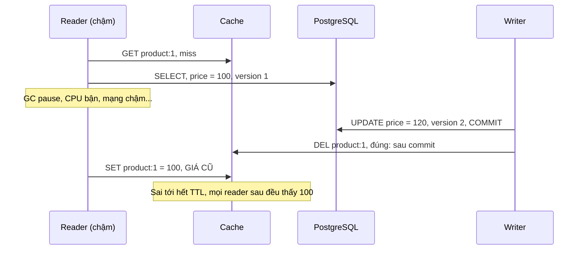
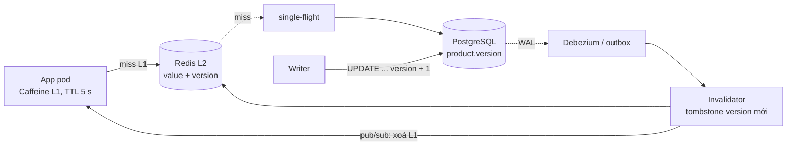

# Bài 08 — Cache nhất quán: stampede, race xoá cache, version và tombstone

> **Dùng cho:** **Katalon** (họ A: dashboard đọc nặng; trang kết quả test) · **NAB** (cache tỉ giá, hồ sơ khách,
> và câu hỏi bẫy "có cache số dư không?")
>
> **Thời lượng:** đọc 30 phút · lab 10 phút · drill 10 phút
>
> **Lab:** [`lab/…/cache/`](lab/src/main/java/com/prep/onbai/cache/) · script
> [`put_if_newer.lua`](lab/src/main/resources/cache/put_if_newer.lua) · test `CacheTest` (3 test, Postgres thật + `redis-server` thật)
>
> **Nối với:** [ghi chú tuần 4 (4.1 bốn chiến lược, 4.2 ba bệnh, 4.3 Caffeine hay Redis)](../../java-system-design/10-implement-gd1-nen-tang.md#41-bốn-chiến-lược-cache)
> và Lab 4 của lộ trình (stampede, xoá sau commit). Bài này đi tiếp một bước: **xoá đúng chỗ rồi vẫn còn
> race**, và cách đóng nó lại.

```bash
cd on-bai/gd1-nen-tang/lab
mvn -q test -Dtest=CacheTest   # ~2 giây
```

---

## 0. Trọng tâm phỏng vấn

| Câu hỏi | Trả lời senior |
|---|---|
| "Ghi thì cập nhật cache hay xoá?" | **Xoá**, và xoá **sau commit**. Cập nhật cache khi ghi thì hai writer đồng thời có thể để lại giá trị của writer thua |
| "Xoá sau commit là hết lỗi?" | Chưa. Còn **race reader chậm**: reader đọc giá cũ từ DB, writer cập nhật và xoá, reader **ghi giá cũ** vào cache. Sai tới hết TTL. Chữa bằng **version + tombstone** (hoặc lease kiểu memcache của Facebook) |
| "Key nóng hết hạn?" | **Stampede**: 100 miss cùng lúc thì 100 query. Chữa bằng **single-flight** (một người nạp, người khác chờ) + **TTL có jitter** |
| "Cache số dư tài khoản được không?" | Để **hiển thị** thì được, nếu key chứa version/seq. Để **quyết định** (đủ tiền không) thì **không bao giờ**: đọc từ nguồn sự thật, dưới khoá ([bài 05](05-ledger-va-balance.md)) |

---

## 1. Lý thuyết: cache là bản sao, mọi bài toán là bài nhất quán

- Cache-aside là mặc định: app đọc cache, miss thì đọc DB rồi nạp; ghi DB xong thì xoá cache.
- Bảng **bốn chiến lược**, **ba bệnh** (stampede, hot key, penetration), **Caffeine hay Redis** đã có ở lộ trình
  tuần 4. Đừng học lại, hãy học **cái chúng không nói**: race giữa đọc chậm và ghi.
- **Bậc nhất quán chấp nhận được** quyết định thiết kế:

| Dữ liệu | Cũ bao lâu chấp nhận được | Cách làm |
|---|---|---|
| Danh mục, cấu hình, tỉ giá hiển thị | vài giây tới vài phút | TTL, Caffeine L1 |
| Giá sản phẩm, hồ sơ | "đọc thấy ngay sau khi sửa" | Xoá sau commit + version |
| Số dư để **quyết định** | 0 | **Không cache**, đọc primary dưới khoá |
| Bộ đếm dashboard (họ A) | vài giây | Cache TTL ngắn, rollup |

---

## 2. Real case: giá sản phẩm đọc 10.000/s, sửa vài lần/ngày, bán sai giá là lỗ

### Bước 1 — Nguồn sự thật có `version`

📄 [`cache.sql`](lab/src/main/resources/cache.sql) · [`ProductStore.java`](lab/src/main/java/com/prep/onbai/cache/ProductStore.java)

```sql
CREATE TABLE IF NOT EXISTS product (
    id      bigint  PRIMARY KEY,
    name    text    NOT NULL,
    price   bigint  NOT NULL,
    version bigint  NOT NULL DEFAULT 1
);
```

```java
/** Ghi gia moi, tra ve version moi (DB cap, tang don dieu). */
public long updatePrice(long id, long price) {
    return jdbc.queryForObject("UPDATE product SET price = ?, version = version + 1 WHERE id = ? RETURNING version",
            Long.class, price, id);
}
```

`version` do **DB** cấp trong cùng câu `UPDATE`, nên nó tăng đúng theo thứ tự commit của dòng đó (khoá
dòng tuần tự hoá các writer). Đây là cùng ý tưởng với `seq` ở bài 05: cache dùng nó để biết bản nào mới hơn
mà không cần đồng hồ.

### Bước 2 — Stampede: tái hiện rồi chữa bằng single-flight

📄 [`SingleFlight.java`](lab/src/main/java/com/prep/onbai/cache/SingleFlight.java)

```java
public V load(K key, Function<K, V> loader) {
    CompletableFuture<V> mine = new CompletableFuture<>();
    CompletableFuture<V> running = inFlight.putIfAbsent(key, mine);
    if (running != null) {
        try {
            return running.join(); // nguoi khac dang nap: doi ket qua cua ho
        } catch (CompletionException e) {
            throw e.getCause() instanceof RuntimeException r ? r : e;
        }
    }
    try {
        V v = loader.apply(key);
        mine.complete(v);
        return v;
    } catch (RuntimeException e) {
        mine.completeExceptionally(e);
        throw e;
    } finally {
        inFlight.remove(key, mine); // xong thi go: lan miss sau lai nap moi
    }
}
```

- **`putIfAbsent` là trọng tài**: đúng một luồng đặt được future của mình, luồng đó nạp. Mọi luồng khác nhận
  future đang chạy và `join()`.
- **Lỗi được chia sẻ, không bị cache:** loader ném lỗi thì mọi người đang chờ cùng nhận lỗi, và
  `remove(key, mine)` gỡ future nên lần sau nạp lại. Cache lỗi là cách nhanh nhất biến một sự cố 1 giây thành
  sự cố 60 giây.
- **`remove(key, mine)`, không phải `remove(key)`:** chỉ gỡ đúng future của mình, không gỡ nhầm future của một
  lượt nạp mới hơn.

```text
[LAB] 100 luong cung miss key nong: khong gop -> 100 lan doc DB, single-flight -> 1 lan
```

Trong một JVM, `Caffeine.get(key, loader)` làm sẵn điều này. Giữa nhiều pod thì cần khoá ngắn trên Redis
(`SET lock:{key} NX PX 3000`), như bước 4 Lab 4 của lộ trình, hoặc chấp nhận "mỗi pod nạp một lần" (20 pod
thì 20 query, vẫn hơn 10.000).

**TTL có jitter** để hàng nghìn key nạp cùng lúc không hết hạn cùng một giây:

```java
/** TTL +-10%: hang nghin key nap cung luc khong het han cung luc. */
static long jitter(long ttlMs) {
    return (long) (ttlMs * (0.9 + 0.2 * ThreadLocalRandom.current().nextDouble()));
}
```

### Bước 3 — Race xoá cache: xoá đúng chỗ rồi vẫn sai



📄 [`CacheAside.java`](lab/src/main/java/com/prep/onbai/cache/CacheAside.java), bản `NAIVE`:

```java
private Product loadAndFill(long id) {
    Product p = db.find(id);
    afterDbRead.run(); // test chen mot lan ghi vao dung khe nay
    long expires = clockMs.getAsLong() + jitter(ttlMs);
    if (!versioned) {
        cache.put(id, new Entry(p, p.version(), false, expires));
    }
    // ...
}

public void updatePrice(long id, long price) {
    long v = db.updatePrice(id, price);
    if (!versioned) {
        cache.remove(id);
    }
    // ...
}
```

Test dùng seam `afterDbRead` để chen writer vào đúng khe giữa "đọc DB" và "ghi cache", không cần may mắn:

```text
[LAB] doc cham + ghi chen vao giua: xoa-khi-ghi -> cache tra 100 (CU, toi het TTL); version+tombstone -> 120
```

Khe này hẹp (vài ms) nhưng ở 10.000 đọc/s và vài trăm lần ghi/ngày thì **chắc chắn** sẽ trúng. Và khi trúng
thì sai **tới hết TTL**, không tự lành.

### Bước 4 — Version + tombstone: ghi cache có điều kiện

Ý tưởng: writer **không xoá**, mà ghi một **tombstone mang version mới**. Reader chỉ được ghi giá trị nếu
version của nó **không cũ hơn** cái đang có:

```java
public void updatePrice(long id, long price) {
    long v = db.updatePrice(id, price);
    // ...
    long expires = clockMs.getAsLong() + ttlMs;
    cache.compute(id, (k, cur) -> cur == null || v >= cur.version() ? new Entry(null, v, true, expires) : cur);
}

static boolean acceptsValue(Entry cur, long version) {
    return cur == null || version > cur.version() || (version == cur.version() && cur.tombstone());
}
```

Đi lại kịch bản: writer để tombstone `v2`; reader chậm mang giá `v1`, và `1 < 2` nên **bị từ chối**. Reader kế
tiếp miss, đọc DB được `v2`; `v2 == tombstone v2` nên được ghi. Tombstone nghĩa là *"DB đang ở version này,
chưa có giá trị"*: chỉ giá trị cùng hoặc mới hơn mới thay được nó.

| Quy tắc | Vì sao |
|---|---|
| Giá trị thắng nếu version **>** hiện tại | Bản mới hơn luôn thắng |
| Giá trị thắng nếu version **=** tombstone | Đây chính là bản writer vừa tạo |
| Tombstone thắng nếu version **≥** hiện tại | Writer luôn vô hiệu hoá được bản cũ; nếu reader nhanh đã nạp đúng bản mới thì chỉ mất một lần miss |

`compute` của `ConcurrentHashMap` làm so sánh và ghi nguyên tử trong một JVM. Trên Redis thì cần Lua.

### Bước 5 — Cùng quy tắc trên Redis: Lua

📄 [`put_if_newer.lua`](lab/src/main/resources/cache/put_if_newer.lua)

```lua
local cur = redis.call('HMGET', KEYS[1], 'v', 'k')
local curV = tonumber(cur[1])
local newV = tonumber(ARGV[1])
local kind = ARGV[3]
if curV then
  if kind == 'T' and newV < curV then return 0 end
  if kind == 'V' and (newV < curV or (newV == curV and cur[2] == 'V')) then return 0 end
end
redis.call('HSET', KEYS[1], 'v', newV, 'd', ARGV[2], 'k', kind)
redis.call('PEXPIRE', KEYS[1], ARGV[4])
return 1
```

Test chạy trên `redis-server` thật, đi đúng kịch bản: tombstone v2 được ghi; giá trị v1 bị từ chối; giá trị
v2 được ghi; v2 lần nữa bị từ chối; tombstone v3 được ghi.

### Bước 6 — Xoá ở đâu trong luồng ghi: sau commit, và thứ mạnh hơn

- **Sau commit, không trước:** xoá trước commit thì reader chen vào sẽ nạp lại giá **cũ** (chưa commit) và
  giữ tới hết TTL. Spring: `@TransactionalEventListener(phase = AFTER_COMMIT)` hoặc
  `TransactionSynchronization.afterCommit` (Lab 4 bước 6 của lộ trình). Bản lab gọi `cache` sau
  `updatePrice` tự commit, nên đã đúng vị trí, và **vẫn** dính race bước 3. Đó là lý do phải có version.
- **App chết giữa commit và xoá cache:** cache sai tới hết TTL. Đóng lỗ này bằng **invalidation từ CDC**:
  Debezium đọc WAL, phát sự kiện `product changed (id, version)`, consumer ghi tombstone. Không bao giờ sót,
  vì WAL là nguồn sự thật, và đi đúng thứ tự commit.
- **"Delayed double delete"** (xoá, chờ 500 ms, xoá lần nữa) chỉ thu nhỏ khe hở, không đóng nó. Nói được vì
  sao đây là mẹo chứ không phải lời giải.

---

## 3. Lab — bảng test

| Test | Chứng minh |
|---|---|
| `hundredConcurrentMissesHitTheDatabaseOnceWithSingleFlight` | 100 so với 1 lần đọc DB |
| `deleteOnWriteLeavesAStaleValueVersionedTombstoneDoesNot` | Xoá-khi-ghi trả 100 (cũ); version + tombstone trả 120 |
| `theSameVersionRulesHoldAtomicallyInRedisLua` | Năm quy tắc của bước 4 trên Redis thật |

---

## 4. Vẽ design: cache hai tầng, invalidation theo version



**Nói khi vẽ:** *"L1 Caffeine trong pod cho key cực nóng, TTL vài giây vì không xoá được đồng loạt dễ dàng.
L2 Redis lưu giá trị kèm version. Đọc miss thì single-flight nạp từ DB. Ghi không đụng cache trực tiếp: CDC
từ WAL phát sự kiện kèm version, invalidator ghi tombstone vào Redis bằng Lua có điều kiện và bắn pub/sub
xoá L1. Reader chậm mang version cũ bị từ chối. Đổi lại: thêm Debezium và độ trễ invalidation cỡ vài trăm
ms."*

---

## 5. Live coding drill (10 phút): `getOrLoad` chống stampede

```java
public final class LoadingCache<K, V> {
    private final ConcurrentHashMap<K, CompletableFuture<V>> map = new ConcurrentHashMap<>();
    private final Function<K, V> loader;

    public LoadingCache(Function<K, V> loader) { this.loader = loader; }

    public V get(K key) {
        CompletableFuture<V> f = map.computeIfAbsent(key, k -> CompletableFuture.supplyAsync(() -> loader.apply(k)));
        try {
            return f.join();
        } catch (CompletionException e) {
            map.remove(key, f);                  // khong cache loi
            throw e;
        }
    }
}
```

**Interviewer chấm:** một lần nạp cho N người chờ; lỗi không bị cache; `remove(key, f)` đúng future; nói được
`supplyAsync` dùng `ForkJoinPool.commonPool()` (nên truyền executor riêng cho IO); thiếu TTL và giới hạn kích
thước (đề nghị Caffeine cho production).

---

## 6. Follow-up

<details>
<summary><b>Q1. Cache "không tồn tại" (penetration)?</b></summary>

Kẻ xấu hỏi id không có thì mọi request xuyên xuống DB. Cache kết quả rỗng với TTL ngắn (30 s). Không gian id
lớn thì đặt bloom filter trước (false positive cho xuống DB, không bao giờ false negative).
</details>

<details>
<summary><b>Q2. Read-your-writes với cache?</b></summary>

Writer nhận `version` mới trong response. Client gửi kèm khi đọc. Cache có version nhỏ hơn thì bỏ qua cache,
đọc DB. Cùng cơ chế token `seq` của [bài 05 bước 8](05-ledger-va-balance.md#bước-8--đọc-từ-replica-mà-không-lùi-số-dư-read-your-writes).
</details>

<details>
<summary><b>Q3. Redis đầy thì sao?</b></summary>

`maxmemory` + chính sách: `allkeys-lru`/`allkeys-lfu` cho cache thuần; `volatile-*` nếu Redis còn chứa dữ liệu
không được mất (rate limit, lock). **Đừng** dùng chung một Redis cho cache và cho trạng thái quan trọng: eviction
không phân biệt.
</details>

<details>
<summary><b>Q4. Hot key một node Redis không chịu nổi?</b></summary>

L1 Caffeine TTL ngắn trước Redis (hấp thụ 90%+). Hoặc nhân bản key (`price:1:{0..7}`), đọc ngẫu nhiên một
bản, ghi thì vô hiệu hoá cả 8. Redis 6+ có client-side caching (`CLIENT TRACKING`): server báo client khi key đổi, client tự xoá bản L1.
</details>

<details>
<summary><b>Q5. Cache warming khi deploy?</b></summary>

Cache lạnh sau deploy là một stampede có kế hoạch. Có ba cách: rolling deploy (pod mới vào dần), nạp trước top-N
key từ log truy cập, single-flight + giới hạn đồng thời xuống DB để cache lạnh không giết DB.
</details>

---

## 7. Checklist

- [ ] Vẽ sequence diagram race "reader chậm" và giải thích vì sao xoá sau commit chưa đủ
- [ ] Nói ba quy tắc version + tombstone, đi lại kịch bản bằng số (v1 bị từ chối, v2 được ghi)
- [ ] Viết `SingleFlight`/`LoadingCache`: lỗi không cache, `remove(key, mine)`
- [ ] TTL jitter, negative caching, hot key: mỗi cái một câu
- [ ] Phân biệt cache để hiển thị với nguồn để quyết định (số dư)
- [ ] Nói được CDC invalidation và vì sao "delayed double delete" chỉ là mẹo
