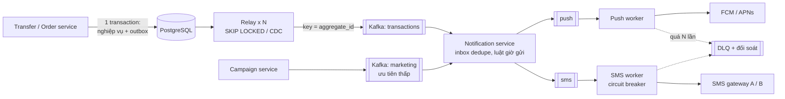

# Bài 09 — Outbox và notification: không mất, không trùng, không có "sự kiện ma"

> **Dùng cho:** **NAB** (event-driven/Kafka/Saga là gap lớn nhất trong
> [gap analysis](../../nab-prep/02-gap-analysis.md); outbox là cây cầu giữa DB và Kafka) · **Katalon** (họ C:
> at-least-once + sink idempotent; thông báo kết quả test run)
>
> **Thời lượng:** đọc 35 phút · lab 10 phút · drill 15 phút
>
> **Lab:** [`lab/…/outbox/`](lab/src/main/java/com/prep/onbai/outbox/) · schema [`outbox.sql`](lab/src/main/resources/outbox.sql) ·
> test `OutboxTest` (7 test, Postgres thật, broker giả tiêm lỗi được)
>
> **Nối với:** đề V5 notification system ở [tuần 4](../../java-system-design/10-implement-gd1-nen-tang.md#track-s-tuần-4--v5-notification-system-chủ-nhật-30-phút);
> bản chạy với **Kafka thật** ở [dist-lab `OutboxLab`](../../java-system-design/dist-lab/README.md) (giai đoạn 2).

```bash
cd on-bai/gd1-nen-tang/lab
mvn -q test -Dtest=OutboxTest   # ~2 giây
```

---

## 0. Trọng tâm phỏng vấn

| Câu hỏi | Trả lời senior |
|---|---|
| "Lưu đơn rồi publish Kafka, sai ở đâu?" | **Dual write**: hai hệ thống, không có transaction chung. Publish rồi rollback thì có **sự kiện ma**. Commit rồi publish lỗi thì **mất sự kiện** |
| "Outbox là gì?" | Ghi sự kiện vào bảng `outbox` **trong cùng transaction** với nghiệp vụ. Một relay đọc bảng đó và publish. Hoặc có cả hai, hoặc không có gì |
| "Relay chết giữa publish và đánh dấu?" | Publish lại, nên **at-least-once**. Consumer phải **idempotent** (bảng `inbox` theo `message_id`) |
| "Nhiều relay song song?" | `FOR UPDATE SKIP LOCKED` chia việc, không lấy trùng dòng. Đổi lại: **thứ tự giữa các aggregate** không còn đảm bảo |
| "Đọc outbox theo `id > lastId` cho nhanh?" | **Sai**: id cấp theo thứ tự insert, dòng hiện ra theo thứ tự commit. Transaction commit muộn bị bỏ sót vĩnh viễn. Đọc theo **trạng thái** (`published_at IS NULL`) hoặc CDC |

Câu chốt: *"Không có exactly-once qua mạng. Tôi ghép ba thứ: outbox để không mất, at-least-once để không dừng,
consumer idempotent để không trùng **hiệu ứng**."*

---

## 1. Lý thuyết cốt lõi

### 1.1 Dual write: hai kiểu hỏng

| Thứ tự trong code | Hỏng khi | Hậu quả |
|---|---|---|
| Publish **rồi** commit | Commit lỗi (constraint, timeout, rollback logic) | Consumer gửi email "đặt hàng thành công" cho đơn **không tồn tại** |
| Commit **rồi** publish | Publish lỗi, hoặc pod chết ngay sau commit | Đơn có, **không ai được báo**, không ai biết là thiếu |

Không có thứ tự nào đúng. Đó là lý do cần outbox (hoặc CDC đọc WAL).

### 1.2 Outbox: bốn mảnh

1. **Ghi:** `INSERT orders` + `INSERT outbox` trong **một** transaction.
2. **Relay:** đọc dòng chưa phát, publish, đánh dấu đã phát. Có thể chạy N bản.
3. **Broker:** giao at-least-once (Kafka, SQS…).
4. **Consumer idempotent:** nhớ `message_id` đã xử lý, cùng transaction với side effect.

### 1.3 Polling hay CDC

| | Polling (`SELECT … SKIP LOCKED`) | CDC (Debezium đọc WAL) |
|---|---|---|
| Hạ tầng | Không thêm gì | Kafka Connect + Debezium + replication slot |
| Độ trễ | Chu kỳ poll (100 ms – 1 s) | Vài chục ms |
| Thứ tự | Theo cách bạn chia việc | **Đúng thứ tự commit** (WAL) |
| Tải DB | Query định kỳ + `UPDATE` đánh dấu | Đọc WAL; slot bị bỏ quên thì **WAL phình đầy đĩa** |
| Hợp khi | Bắt đầu, tải vừa | Tải cao, nhiều bảng, cần thứ tự chặt |

---

## 2. Real case: đặt hàng xong gửi email/push xác nhận

### Bước 1 — Dual write: tái hiện sự kiện ma

📄 [`DualWriteOrderService.java`](lab/src/main/java/com/prep/onbai/outbox/DualWriteOrderService.java)

```java
public long placeOrder(String customer, long totalMinor, Runnable beforeCommit) {
    return tx.execute(s -> {
        long id = jdbc.queryForObject("INSERT INTO orders (customer, total_minor) VALUES (?, ?) RETURNING id",
                Long.class, customer, totalMinor);
        broker.publish("orders", String.valueOf(id), UUID.randomUUID().toString(), "{\"orderId\":" + id + "}");
        beforeCommit.run(); // vd: buoc sau loi validate, het timeout, constraint luc commit...
        return id;
    });
}
```

```text
[LAB] dual write: orders = 0, broker da nhan 1 su kien
```

Đơn hàng không tồn tại, nhưng sự kiện đã bay. `@TransactionalEventListener(AFTER_COMMIT)` chuyển lỗi sang kiểu
thứ hai: pod chết sau commit thì mất sự kiện, im lặng.

### Bước 2 — Outbox: một transaction, hai dòng

📄 [`outbox.sql`](lab/src/main/resources/outbox.sql)

```sql
CREATE TABLE IF NOT EXISTS outbox (
    id              bigint      GENERATED ALWAYS AS IDENTITY PRIMARY KEY,
    message_id      uuid        NOT NULL UNIQUE DEFAULT gen_random_uuid(),  -- consumer dedupe theo id nay
    aggregate_id    text        NOT NULL,      -- key khi publish -> cung partition -> giu thu tu theo don hang
    event_type      text        NOT NULL,
    payload         jsonb       NOT NULL,
    created_at      timestamptz NOT NULL DEFAULT clock_timestamp(),
    published_at    timestamptz,               -- NULL = chua phat. Trang thai, KHONG phai con tro id
    attempts        int         NOT NULL DEFAULT 0,
    next_attempt_at timestamptz NOT NULL DEFAULT clock_timestamp(),
    last_error      text
);
-- index chi chua dong chua phat: nho, nam gon trong RAM du bang outbox lon
CREATE INDEX IF NOT EXISTS outbox_pending ON outbox (next_attempt_at, id) WHERE published_at IS NULL;
```

📄 [`OrderService.java`](lab/src/main/java/com/prep/onbai/outbox/OrderService.java)

```java
public long placeOrder(String customer, long totalMinor) {
    return tx.execute(s -> {
        long id = jdbc.queryForObject("INSERT INTO orders (customer, total_minor) VALUES (?, ?) RETURNING id",
                Long.class, customer, totalMinor);
        jdbc.update("INSERT INTO outbox (aggregate_id, event_type, payload) VALUES (?, 'ORDER_PLACED', ?::jsonb)",
                String.valueOf(id), "{\"orderId\":" + id + ",\"customer\":\"" + customer + "\",\"totalMinor\":" + totalMinor + "}");
        return id;
    });
}
```

- **`message_id` riêng** (không dùng `id`): ổn định qua mọi lần phát lại, consumer dedupe theo nó.
- **Partial index `WHERE published_at IS NULL`:** bảng outbox có thể vài chục triệu dòng đã phát, nhưng index
  chỉ chứa phần chưa phát (thường vài trăm dòng). Poll luôn rẻ.
- Test `theOrderAndItsEventCommitOrRollBackTogether`: rollback thì 0 đơn, 0 sự kiện; commit thì 1 và 1.

### Bước 3 — Relay: `FOR UPDATE SKIP LOCKED`, N bản song song

📄 [`OutboxRelay.java`](lab/src/main/java/com/prep/onbai/outbox/OutboxRelay.java)

```java
public int pollOnce(int batchSize) {
    return tx.execute(s -> {
        List<Row> rows = jdbc.query("""
                SELECT id, message_id, aggregate_id, event_type, payload::text, attempts
                  FROM outbox
                 WHERE published_at IS NULL AND next_attempt_at <= clock_timestamp()
                 ORDER BY id
                 LIMIT ?
                   FOR UPDATE SKIP LOCKED""",
                (rs, i) -> new Row(rs.getLong(1), rs.getString(2), rs.getString(3), rs.getString(4), rs.getString(5), rs.getInt(6)),
                batchSize);
        int published = 0;
        for (Row r : rows) {
            try {
                broker.publish("orders", r.aggregateId(), r.messageId(), r.payload());
                afterPublish.run(); // test: relay chet ngay sau khi broker da nhan
                jdbc.update("UPDATE outbox SET published_at = clock_timestamp(), attempts = attempts + 1 WHERE id = ?", r.id());
                published++;
            } catch (FakeBroker.Unavailable e) {
                // ... backoff, buoc 6
            }
        }
        return published;
    });
}
```

```text
[LAB] 4 relay SKIP LOCKED: 1.000 su kien -> broker nhan 1000, khac nhau 1000
```

- Relay A khoá 25 dòng; relay B chạy cùng câu thì **bỏ qua** các dòng đang bị khoá và lấy 25 dòng kế. Không
  điều phối, không leader election, không trùng.
- **Đánh đổi trong code này:** publish nằm **trong** transaction, nên khoá và connection bị giữ suốt lúc gọi
  broker ([bài 01](01-littles-law-pool-timeout.md)). Broker chậm thì chuyển sang ba bước: claim (đặt
  `locked_until`, commit), publish ngoài transaction, đánh dấu.

### Bước 4 — Relay chết giữa chừng: trùng, và consumer nuốt được

```java
relay.afterPublish(() -> {
    throw new IllegalStateException("pod bi kill sau khi broker da nhan, truoc khi danh dau");
});
assertThatThrownBy(() -> relay.pollOnce(10)).isInstanceOf(IllegalStateException.class);
relay.afterPublish(() -> {});
relay.pollOnce(10); // dong van chua danh dau -> phat LAI
```

📄 [`NotificationConsumer.java`](lab/src/main/java/com/prep/onbai/outbox/NotificationConsumer.java)

```java
/** true = xu ly that; false = trung, bo qua. */
public boolean handle(FakeBroker.Message m) {
    return Boolean.TRUE.equals(tx.execute(s -> {
        int fresh = jdbc.update("INSERT INTO inbox (consumer, message_id) VALUES ('email', ?::uuid) ON CONFLICT DO NOTHING",
                m.messageId());
        if (fresh == 0) {
            return false;
        }
        long orderId = jdbc.queryForObject("SELECT (?::jsonb ->> 'orderId')::bigint", Long.class, m.payload());
        jdbc.update("INSERT INTO notification (order_id, channel, body) VALUES (?, 'email', ?)",
                orderId, "Cam on ban da dat hang #" + orderId);
        return true;
    }));
}
```

```text
[LAB] relay chet giua chung: broker nhan 2 ban, consumer xu ly [true, false] -> 1 email
```

Đây là pattern A của [bài 02](02-idempotency-key.md), đặt ở phía consumer: dòng `inbox` và side effect
(`notification`) cùng một transaction. **Lưu ý:** "side effect" ở đây là **ghi lệnh gửi** vào DB. Việc gửi email
thật qua nhà cung cấp lại là một hệ thống ngoài: worker gửi phải truyền `message_id` làm idempotency key
cho nhà cung cấp, hoặc chấp nhận hiếm hoi gửi trùng. Nói rõ giới hạn này ra.

### Bước 5 — Vì sao không dùng con trỏ `id > lastId`

📄 [`IdCursorRelay.java`](lab/src/main/java/com/prep/onbai/outbox/IdCursorRelay.java)

```java
/**
 * ANTI-PATTERN: relay theo con tro "id > lan truoc". id IDENTITY cap luc INSERT, nhung dong chi HIEN RA luc COMMIT.
 * Transaction lay id 1 commit SAU transaction lay id 2 -> relay da dua con tro qua 2 -> id 1 bi bo sot vinh vien.
 */
public int pollOnce(int batchSize) {
    List<long[]> rows = jdbc.query("SELECT id FROM outbox WHERE id > ? ORDER BY id LIMIT ?",
            (rs, i) -> new long[] {rs.getLong(1)}, cursor, batchSize);
    // ...
}
```

Test dựng đúng thứ tự: T1 insert (id 1), **chưa commit**; T2 insert (id 2), commit; relay con trỏ thấy id 2,
dời con trỏ lên 2; T1 commit.

```text
[LAB] con tro id: vong 2 thay 0 dong (sot id 1) | theo published_at IS NULL: phat 2 dong
```

Cùng một gốc với bẫy account nóng ở [bài 05 bước 10](05-ledger-va-balance.md#bước-10--tài-khoản-nóng-không-khoá-chốt-theo-mốc-xmin):
**thứ tự cấp id không phải thứ tự commit**. Ba cách đúng:

1. Đọc theo **trạng thái** (`published_at IS NULL`), như relay ở bước 3.
2. Con trỏ theo **mốc xmin**: chỉ đọc dòng của transaction có xid < `pg_snapshot_xmin`, như bài 05.
3. **CDC từ WAL**: WAL ghi theo thứ tự commit.

### Bước 6 — Broker lỗi: retry có backoff + full jitter

```java
} catch (FakeBroker.Unavailable e) {
    long delay = Backoff.fullJitterMs(r.attempts(), baseBackoffMs, capBackoffMs, ThreadLocalRandom.current());
    jdbc.update("""
            UPDATE outbox SET attempts = attempts + 1, last_error = ?,
                   next_attempt_at = clock_timestamp() + ?::interval
             WHERE id = ?""", e.getMessage(), delay + " milliseconds", r.id());
}
```

📄 [`Backoff.java`](lab/src/main/java/com/prep/onbai/outbox/Backoff.java)

```java
public static long fullJitterMs(int attempt, long baseMs, long capMs, RandomGenerator rnd) {
    long ceiling = Math.min(capMs, baseMs << Math.min(attempt, 30));
    return rnd.nextLong(ceiling + 1);
}
```

```text
[LAB] broker loi 3 lan: 11 vong poll, outbox = {attempts=4, last_error=broker khong san sang, done=true}
```

- **Full jitter** (ngẫu nhiên trong `[0, min(cap, base·2^n)]`, theo AWS Architecture Blog): 1.000 dòng cùng lỗi
  không retry cùng một mili giây. Không có jitter thì retry dồn cục thành sóng (thundering herd).
- **`next_attempt_at` nằm trong DB**, không nằm trong bộ nhớ relay. Relay chết, relay khác vẫn tôn trọng lịch
  retry.
- Vượt N lần thì **dừng retry** và chuyển sang trạng thái `FAILED`/bảng DLQ để người xem. Retry mãi một
  message độc (poison message) là đốt tài nguyên vô ích.

### Bước 7 — Thứ tự theo aggregate: thứ `SKIP LOCKED` không cho

Hai sự kiện của **cùng một đơn** (`ORDER_PLACED`, rồi `ORDER_CANCELLED`) có thể bị hai relay khác nhau lấy, và
publish **ngược thứ tự**. Consumer nhận "huỷ" trước "đặt". Có ba cách, tuỳ mức cần:

| Cách | Làm gì | Giá |
|---|---|---|
| Relay theo phân vùng | Relay k chỉ lấy `hash(aggregate_id) % N = k` | Một aggregate một relay; relay chết thì phân vùng đó dừng tới khi có người thay |
| Publish với `key = aggregate_id` | Kafka giữ thứ tự **trong** một partition | Chỉ giữ thứ tự **sau** broker; vẫn cần relay giữ thứ tự **trước** broker |
| Consumer kiểm `version` | Sự kiện mang version của aggregate; consumer bỏ sự kiện cũ hơn cái đã áp | Consumer phức tạp hơn, nhưng chịu được mọi thứ tự |

Câu trả lời chín chắn: *"Tôi publish với key = orderId, và consumer kiểm version. Thứ tự toàn cục giữa các đơn
thì không ai cần."*

### Bước 8 — Dọn bảng outbox

Bảng chỉ tăng. Hai cách: job xoá dòng đã phát quá 7 ngày, theo lô nhỏ để không giữ khoá lâu và không tạo đợt
VACUUM lớn. Hoặc **partition theo ngày** rồi `DROP PARTITION` (O(1), không dead tuple), giống retention ở bài đếm
sự kiện của Katalon.

---

## 3. Lab — bảng test

| Test | Chứng minh |
|---|---|
| `theOrderAndItsEventCommitOrRollBackTogether` | Outbox cùng transaction: rollback thì 0/0 |
| `dualWritePublishesAnEventForAnOrderThatNeverExisted` | Dual write sinh sự kiện ma |
| `fourRelaysWithSkipLockedShareTheWorkWithoutDuplicates` | 4 relay, 1.000 sự kiện, 1.000 message khác nhau |
| `aRelayThatDiesAfterPublishingCausesADuplicateTheConsumerAbsorbs` | Phát 2 lần, 1 email |
| `aFailingBrokerIsRetriedWithBackoffUntilItWorks` | 3 lỗi, backoff, lần 4 thành công |
| `anIdCursorSkipsALateCommitStatusPollingDoesNot` | Con trỏ id sót; theo trạng thái không sót |
| `fullJitterStaysWithinTheExponentialCeiling` | Backoff nằm trong trần, và trải ra |

---

## 4. Vẽ: notification system (đề V5) với outbox



**Nói khi vẽ (45 giây):** *"Service nghiệp vụ không gọi Kafka. Nó ghi outbox cùng transaction. Relay
`SKIP LOCKED` (sau này là Debezium) publish với key là id aggregate để giữ thứ tự theo đơn. Notification
service dedupe bằng `inbox` theo `message_id`, áp luật giờ gửi và tuỳ chọn của user, rồi tách hàng đợi theo
kênh và độ ưu tiên, để một triệu push marketing không chặn OTP. Worker SMS có circuit breaker và nhà cung
cấp dự phòng. Lỗi quá N lần vào DLQ và có đối soát."*

---

## 5. Live coding drill (15 phút): relay + consumer

Viết lại `pollOnce` (bước 3) và `handle` (bước 4) không nhìn. **Interviewer chấm:**

- [ ] `WHERE published_at IS NULL … ORDER BY id LIMIT ? FOR UPDATE SKIP LOCKED`, không con trỏ id
- [ ] Đánh dấu **sau** khi publish thành công, trong cùng transaction đã khoá dòng
- [ ] Nói được hệ quả: chết giữa publish và đánh dấu thì phát lại, nên consumer phải idempotent
- [ ] Consumer: `INSERT inbox … ON CONFLICT DO NOTHING` + side effect **cùng transaction**
- [ ] Retry có `next_attempt_at` + jitter + giới hạn số lần, rồi DLQ
- [ ] Biết giới hạn thứ tự của `SKIP LOCKED` và một cách chữa

---

## 6. Follow-up

<details>
<summary><b>Q1. Kafka có exactly-once rồi, cần gì outbox?</b></summary>

EOS của Kafka (idempotent producer + transaction) đảm bảo exactly-once **trong Kafka**: đọc từ topic, xử lý,
ghi sang topic khác, commit offset nguyên tử. Nó **không** bao được transaction của Postgres. Ghi DB và ghi
Kafka vẫn là hai hệ thống, vẫn là dual write. Outbox (hoặc CDC) là cầu nối giữa DB và Kafka. EOS dùng
**sau** cây cầu đó.
</details>

<details>
<summary><b>Q2. Debezium có bẫy gì?</b></summary>

Replication slot giữ WAL cho tới khi connector đọc. Connector dừng vài giờ thì WAL phình, **đầy đĩa primary**.
Phải giám sát `pg_replication_slots` (lag tính bằng byte) và đặt `max_slot_wal_keep_size`. Đổi schema bảng
cũng ảnh hưởng định dạng sự kiện, nên cần schema registry. Với outbox + Debezium thì dùng Outbox Event
Router để chỉ phát bảng outbox, không phát mọi bảng.
</details>

<details>
<summary><b>Q3. Một triệu push marketing trong 10 phút?</b></summary>

1M / 600 s ≈ 1.700 push/s. FCM chịu được mức này (Admin SDK nhận tối đa 500 token mỗi lần gọi, ghép nhiều
request trên một kết nối HTTP/2), nên worker gom lô thay vì gọi từng thông báo một. Giới hạn thật là quota của
FCM/APNs và luật nghiệp vụ (không gửi sau 22h, tối đa N tin/ngày/user). Hàng đợi marketing
tách riêng, ưu tiên thấp, có rate limit ([bài 03](03-rate-limiter.md), leaky bucket) để không chiếm chỗ của
thông báo giao dịch.
</details>

<details>
<summary><b>Q4. Consumer nhận sự kiện cho đơn chưa có trong DB của nó (thứ tự giữa các service)?</b></summary>

Đơn có thể đến trước sự kiện "khách hàng đã tạo". Hai cách: trì hoãn (đưa vào hàng chờ retry ngắn), hoặc thiết
kế sự kiện **tự đủ** (mang đủ dữ liệu cần, gọi là event-carried state transfer) để consumer không phải tra
service khác. Cách sau giảm phụ thuộc lúc chạy, đổi lại sự kiện to hơn và phải version hoá schema.
</details>

---

## 7. Checklist

- [ ] Hai kiểu hỏng của dual write, và vì sao `AFTER_COMMIT` chỉ đổi kiểu hỏng
- [ ] Viết schema outbox có `message_id`, `next_attempt_at`, partial index
- [ ] Giải thích `SKIP LOCKED` chia việc thế nào, và vì sao nó phá thứ tự giữa các aggregate
- [ ] Giải thích bẫy con trỏ id bằng thứ tự T1/T2, và ba cách đúng
- [ ] Consumer idempotent bằng inbox; nói được giới hạn khi side effect là hệ thống ngoài
- [ ] Polling hay CDC: ba khác biệt và bẫy replication slot
- [ ] Code drill §5 trong 15 phút
