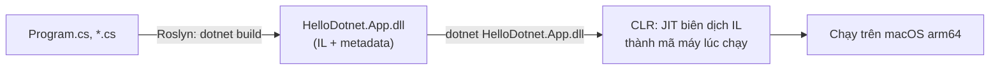

# Bài 02 — Rider: solution, project và chương trình đầu tiên (kèm lệnh CLI tương đương)

> **Bạn sẽ làm được:** tạo một solution hai project bằng Rider **và** bằng `dotnet` CLI, đọc hiểu từng file sinh ra,
> chạy với tham số, thêm thư viện NuGet, tham chiếu project, build Release và đóng gói (`publish`).
>
> **Thời lượng:** đọc 25 phút · làm 45 phút
>
> **Trước đó:** [Bài 01 — Cài đặt](01-cai-dat-macos.md) · **Tiếp theo:** [Bài 03 — C# cho người đến từ Java](03-csharp-cho-dev-java.md)

---

## 1. Lý thuyết: solution, project, assembly

### 1.1 Bốn khái niệm, đối chiếu Maven

| .NET | Là gì | Maven/Gradle |
|---|---|---|
| **Solution** (`.sln`) | Danh sách các project mở chung trong IDE, build chung | POM cha của multi-module / `settings.gradle` |
| **Project** (`.csproj`) | Một đơn vị build, ra **một** assembly | Một module (`pom.xml`) |
| **Assembly** (`.dll`) | File kết quả: mã IL + metadata | File `.jar` |
| **Namespace** | Nhóm tên trong code, không phụ thuộc thư mục | `package` (nhưng Java bắt khớp thư mục, C# thì không) |
| **NuGet package** (`.nupkg`) | Thư viện tải từ nuget.org | Artifact trên Maven Central |

### 1.2 Code C# chạy như thế nào



Giống Java: `javac` ra bytecode, JVM JIT lúc chạy. Khác ở chỗ `dotnet build` còn sinh sẵn một file chạy được
(`HelloDotnet.App`, gọi là *apphost*) để bạn chạy thẳng `./HelloDotnet.App` không cần gõ `dotnet` phía trước.

### 1.3 `bin/` và `obj/`

| Thư mục | Chứa gì | Maven |
|---|---|---|
| `obj/` | File trung gian; `project.assets.json` = cây thư viện đã giải xong | `target/` (phần trung gian) |
| `bin/Debug/net8.0/` | Kết quả build Debug | `target/classes` + jar |
| `bin/Release/net8.0/` | Kết quả build Release (tối ưu, dùng để đo hiệu năng và deploy) | |

Cả hai **không** commit vào git và xoá đi lúc nào cũng được (build lại sinh ra). Khi Rider báo lỗi "ma" (code đúng
mà vẫn đỏ), xoá `bin/` `obj/` rồi build lại là cách sửa đầu tiên.

---

## 2. Thực hành A — Tạo solution bằng Rider

1. Mở Rider. Ở màn hình chào bấm **New Solution**.
2. Cột trái chọn **Console** (mục .NET / .NET Core).
3. Điền:

   | Ô | Giá trị | Nghĩa |
   |---|---|---|
   | Solution name | `HelloDotnet` | Tên file `.sln` |
   | Project name | `HelloDotnet.App` | Tên project và namespace gốc |
   | Solution directory | `~/dev/dotnet-learning` | Thư mục chứa solution |
   | Put solution and project in the same directory | **bỏ tick** | Để có cấu trúc `src/…` khi solution lớn dần |
   | Create Git repository | tick | Rider chạy `git init` giúp bạn |
   | Framework / Target framework | **net8.0** | Bộ bài dùng .NET 8 |
   | Language | C# | |

4. Bấm **Create**. Rider tạo file, chạy `restore` (tải thư viện), rồi mở `Program.cs`.
5. Chạy: bấm nút ▶ xanh trên thanh công cụ (cạnh ô chọn **run configuration** `HelloDotnet.App`), hoặc **⌃R**.
   Cửa sổ **Run** (⌘4) hiện `Hello, World!`.

**Explorer (⌘1)** có hai chế độ xem, đổi ở ô chọn trên đầu cửa sổ:

- **Solution**: nhìn theo solution và project (thấy mục **Dependencies** gồm package NuGet và project tham chiếu).
- **File System**: nhìn đúng thư mục trên đĩa (thấy cả `bin/`, `obj/`, `.gitignore`).

> Tên các ô trong hộp thoại có thể lệch chút giữa các bản Rider, nhưng mỗi ô tương ứng đúng một tham số của
> `dotnet new` ở phần B. Rider gọi chính `dotnet new` bên dưới, nên hai cách cho ra **cùng một thứ**.

---

## 3. Thực hành B — Tạo y hệt bằng CLI (và mở bằng Rider)

```bash
mkdir -p ~/dev/dotnet-learning && cd ~/dev/dotnet-learning
dotnet new sln -n HelloDotnet
dotnet new console -n HelloDotnet.App -o src/HelloDotnet.App
dotnet sln add src/HelloDotnet.App
dotnet run --project src/HelloDotnet.App
```

Output thật:

```text
The template "Solution File" was created successfully.
The template "Console App" was created successfully.

Processing post-creation actions...
Restoring .../dotnet-learning/src/HelloDotnet.App/HelloDotnet.App.csproj:
  Determining projects to restore...
  Restored .../dotnet-learning/src/HelloDotnet.App/HelloDotnet.App.csproj (in 168 ms).
Restore succeeded.

Project `src/HelloDotnet.App/HelloDotnet.App.csproj` added to the solution.
Hello, World!
```

Mở trong Rider: `open -a Rider HelloDotnet.sln` (hoặc **File → Open…** chọn file `.sln`).

Lệnh nên thuộc lòng (tương đương Maven):

| `dotnet` | Làm gì | Maven |
|---|---|---|
| `dotnet new <template>` | Tạo project từ template (`dotnet new list` để xem) | `mvn archetype:generate` |
| `dotnet restore` | Tải thư viện (build và run tự gọi) | `mvn dependency:resolve` |
| `dotnet build` | Biên dịch | `mvn compile` |
| `dotnet run` | Build rồi chạy | `mvn exec:java` / `spring-boot:run` |
| `dotnet test` | Chạy test | `mvn test` |
| `dotnet publish` | Đóng gói để deploy | `mvn package` |
| `dotnet add package X --version Y` | Thêm thư viện | thêm `<dependency>` |
| `dotnet add reference ../B` | Tham chiếu project khác | dependency tới module khác |
| `dotnet clean` | Xoá kết quả build | `mvn clean` |

---

## 4. Đọc từng file vừa sinh ra

### 4.1 `HelloDotnet.App.csproj`

```xml
<Project Sdk="Microsoft.NET.Sdk">

  <PropertyGroup>
    <OutputType>Exe</OutputType>
    <TargetFramework>net8.0</TargetFramework>
    <ImplicitUsings>enable</ImplicitUsings>
    <Nullable>enable</Nullable>
  </PropertyGroup>

</Project>
```

| Dòng | Nghĩa |
|---|---|
| `Sdk="Microsoft.NET.Sdk"` | Kiểu project. Web dùng `Microsoft.NET.Sdk.Web`, worker dùng `Microsoft.NET.Sdk.Worker` |
| `OutputType` `Exe` | Ra chương trình chạy được. Class library không có dòng này (mặc định `Library`) |
| `TargetFramework` `net8.0` | Build cho .NET 8 (TFM, *target framework moniker*) |
| `ImplicitUsings` | Tự `using System;`, `System.Linq`, `System.Collections.Generic`… cho mọi file |
| `Nullable` | Bật kiểm tra null lúc biên dịch (bài 03 §3) |

Khác hẳn `pom.xml`: **không liệt kê file nguồn**. Mọi file `.cs` trong thư mục project tự động được biên dịch.
Sửa `.csproj` ngay trong Rider: chuột phải project → **Edit → Edit 'HelloDotnet.App.csproj'**, hoặc mở file từ chế độ File System.

### 4.2 `Program.cs`: top-level statements

```csharp
// See https://aka.ms/new-console-template for more information
Console.WriteLine("Hello, World!");
```

Không có `class Program`, không có `static void Main`. Từ C# 9, **một** file trong project được viết lệnh trực tiếp;
compiler tự bọc vào `Main`. Biến `args` (tham số dòng lệnh) và `return <số>` (exit code) dùng được ngay. Project
web và worker ở các bài sau cũng bắt đầu như vậy.

### 4.3 Kết quả build

```bash
ls src/HelloDotnet.App/bin/Debug/net8.0/
```

```text
HelloDotnet.App                     ← apphost: ./HelloDotnet.App chạy thẳng
HelloDotnet.App.deps.json           ← danh sách thư viện app cần (như classpath)
HelloDotnet.App.dll                 ← code của bạn (IL)
HelloDotnet.App.pdb                 ← symbol để debug: ánh xạ IL về dòng code
HelloDotnet.App.runtimeconfig.json  ← cần runtime nào (Microsoft.NETCore.App 8.0)
```

---

## 5. Thực hành: chương trình có tham số, class library và NuGet

Mục tiêu: `dotnet run -- 150000 99000` in giá đã cộng VAT 8%, định dạng tiền Việt.

### 5.1 Lý thuyết nhanh: vì sao tách class library

Logic tính giá đặt ở project riêng `HelloDotnet.Core` thì app console, Web API và test đều dùng chung được. Đây là
cấu trúc ta dùng lại ở dự án OrderFlow (bài 06): `OrderFlow.Core` chứa logic, `OrderFlow.Api` và `OrderFlow.Worker` dùng nó.

### 5.2 Tạo class library và tham chiếu

**Rider:** chuột phải solution → **Add → New Project…** → **Class Library**, tên `HelloDotnet.Core`, thư mục `src`.
Rồi chuột phải project `HelloDotnet.App` → **Add → Reference…** → tick `HelloDotnet.Core`.

**CLI:**

```bash
dotnet new classlib -n HelloDotnet.Core -o src/HelloDotnet.Core
dotnet sln add src/HelloDotnet.Core
dotnet add src/HelloDotnet.App reference src/HelloDotnet.Core
rm src/HelloDotnet.Core/Class1.cs
```

Tạo file `src/HelloDotnet.Core/PriceCalculator.cs` (Rider: chuột phải project → **Add → Class/Interface**, hoặc ⌘N trong Explorer):

```csharp
namespace HelloDotnet.Core;

public static class PriceCalculator
{
    public const decimal VatRate = 0.08m; // thue GTGT 8%

    public static decimal WithVat(decimal price) => Math.Round(price * (1 + VatRate), 0, MidpointRounding.AwayFromZero);
}
```

`namespace HelloDotnet.Core;` có dấu `;` là *file-scoped namespace* (C# 10): cả file thuộc namespace đó, đỡ một
cấp thụt lề. `decimal` + hậu tố `m` cho tiền (bài 03 §2).

### 5.3 Thêm thư viện NuGet: luôn ghi phiên bản

**Rider:** chuột phải `HelloDotnet.App` → **Manage NuGet Packages**, tìm `Humanizer.Core`, chọn phiên bản, bấm cài
cho project. **CLI:**

```bash
dotnet add src/HelloDotnet.App package Humanizer.Core --version 3.0.10
```

> **Bẫy lớn nhất năm 2026 với .NET 8:** gói mới nhất của nhiều thư viện Microsoft (EF Core, ASP.NET Core…) đã là
> 10.x và **chỉ chạy trên .NET 10**. Gõ `dotnet add package Microsoft.EntityFrameworkCore` không kèm phiên bản trên
> project `net8.0` ra lỗi thật như sau, và `.csproj` không đổi gì:
>
> ```text
> error: NU1202: Package Microsoft.EntityFrameworkCore 10.0.13 is not compatible with net8.0 (.NETCoreApp,Version=v8.0).
>        Package Microsoft.EntityFrameworkCore 10.0.13 supports: net10.0 (.NETCoreApp,Version=v10.0)
> ```
>
> Quy tắc của bộ bài: **gói Microsoft.\* dùng 8.0.x** (`--version 8.0.32`), gói khác kiểm tra trang nuget.org mục
> *Frameworks* có `net8.0` (hoặc `netstandard2.0`) trước khi cài. Trong cửa sổ NuGet của Rider cũng vậy: đừng
> bấm cài bản mặc định mà không nhìn số phiên bản.

### 5.4 Viết `Program.cs`

```csharp
using System.Globalization;
using HelloDotnet.Core;
using Humanizer;

// top-level statements: khong can class Program / static void Main, compiler tu sinh
var vi = CultureInfo.GetCultureInfo("vi-VN");

if (args.Length == 0)
{
    Console.WriteLine("Usage: dotnet run -- <price> [<price> ...]");
    return 1; // exit code khac 0 = loi, giong System.exit(1)
}

foreach (var arg in args)
{
    if (!decimal.TryParse(arg, NumberStyles.Number, CultureInfo.InvariantCulture, out var price))
    {
        Console.WriteLine($"'{arg}' is not a number");
        continue;
    }
    var total = PriceCalculator.WithVat(price);
    Console.WriteLine($"{price.ToString("N0", vi),12} ₫ + VAT 8% = {total.ToString("N0", vi),12} ₫");
}

Console.WriteLine($"Done in {TimeSpan.FromMilliseconds(1530).Humanize(2)}, {"OrderCreatedEvent".Humanize()}");
return 0;
```

### 5.5 Chạy với tham số

**CLI** (mọi thứ sau `--` là tham số cho chương trình, không phải cho `dotnet`):

```bash
dotnet run --project src/HelloDotnet.App -- 150000 99000 abc 1234567
```

```text
     150.000 ₫ + VAT 8% =      162.000 ₫
      99.000 ₫ + VAT 8% =      106.920 ₫
'abc' is not a number
   1.234.567 ₫ + VAT 8% =    1.333.332 ₫
Done in 1 second, 530 milliseconds, Order created event
```

Không truyền tham số thì in hướng dẫn và trả exit code `1` (kiểm bằng `echo $?`).

**Rider:** **Run → Edit Configurations…** → chọn `HelloDotnet.App` → ô **Program arguments**: `150000 99000 abc 1234567`
→ **OK** → ⌃R. Cùng hộp thoại có **Environment variables** và **Working directory**, sẽ dùng ở bài 04 và 06.

Hai chi tiết đáng để ý trong code:

- `decimal.TryParse(..., CultureInfo.InvariantCulture, ...)`: Mac đặt vùng Việt Nam thì dấu thập phân là `,`;
  không ghi culture thì cùng một chuỗi `1.5` được hiểu khác nhau trên máy bạn và trên server.
- `{price.ToString("N0", vi),12}`: `,12` là căn phải trong 12 ký tự.

---

## 6. Build Debug/Release và `publish`

```bash
dotnet build -c Release            # ra bin/Release/net8.0/
dotnet publish src/HelloDotnet.App -c Release -o out
ls out && du -sh out
dotnet out/HelloDotnet.App.dll 150000
```

```text
HelloDotnet.App  HelloDotnet.App.deps.json  HelloDotnet.App.dll  HelloDotnet.App.pdb
HelloDotnet.App.runtimeconfig.json  HelloDotnet.Core.dll  HelloDotnet.Core.pdb  Humanizer.dll
780K	out
     150.000 ₫ + VAT 8% =      162.000 ₫
Done in 1 second, 530 milliseconds, Order created event
```

| | Debug | Release |
|---|---|---|
| Tối ưu của compiler/JIT | tắt: debug từng dòng chính xác | bật: nhanh hơn, có biến bị "tối ưu mất" khi debug |
| Dùng khi | phát triển, debug | đo hiệu năng, deploy |
| Rider | ô chọn cấu hình build (mặc định Debug) | |

**Hai kiểu đóng gói:**

| | Framework-dependent (mặc định) | Self-contained |
|---|---|---|
| Lệnh | `dotnet publish -c Release -o out` | `dotnet publish -c Release -r osx-arm64 --self-contained -o out-osx-arm64` |
| Kích thước (đo thật) | **780 KB**, 8 file | **77 MB**, 190 file |
| Máy chạy cần cài .NET | có (runtime 8) | **không**: file `HelloDotnet.App` là `Mach-O 64-bit arm64 executable` |
| Dùng khi | Docker (image đã có runtime), server có sẵn .NET | gửi tool cho người không cài .NET |

Bài 10 dùng kiểu đầu trong Dockerfile.

---

## 7. Đi một vòng giao diện Rider

| Vùng | Mở bằng | Dùng để |
|---|---|---|
| Explorer | ⌘1 | Cây solution/thư mục |
| Run | ⌘4 | Output khi chạy (⌃R) |
| Debug | ⌘5 | Khi debug (⌃D), bài 04 |
| Problems | ⌘6 | Lỗi và cảnh báo của file/solution |
| Services | ⌘8 | Docker, database, các app đang chạy (bài 07, 10) |
| Git | ⌘9 | Lịch sử, nhánh |
| Commit | ⌘0 | Thay đổi chưa commit |
| Terminal | ⌥F12 | Terminal ngay trong Rider, đứng sẵn ở thư mục solution |
| Search Everywhere | ⇧⇧ (bấm Shift hai lần) | Tìm mọi thứ: file, class, lệnh, setting |
| Find Action | ⇧⌘A | Tìm **lệnh** theo tên, hiện luôn phím tắt của lệnh đó |

**Màu trong editor:** gạch đỏ = lỗi biên dịch, gạch vàng/xám = cảnh báo hoặc gợi ý. Đặt con trỏ lên đó và bấm **⌥⏎**:
Rider đề xuất cách sửa (thêm `using`, tạo method, đổi kiểu…). Đây là phím quan trọng nhất trong Rider.

Thử ngay: trong `Program.cs` gõ `var x = new StringBuilder();`. Rider gạch đỏ `StringBuilder` → ⌥⏎ →
**Import 'System.Text'**.

---

## 8. Commit đầu tiên

```bash
cd ~/dev/dotnet-learning
dotnet new gitignore        # bỏ qua bin/, obj/, .idea, *.user, .DS_Store...
git init                    # bỏ qua nếu Rider đã tạo repo
git add . && git commit -m "First .NET 8 solution"
```

`dotnet new gitignore` sinh file 484 dòng, có sẵn `[Bb]in/`, `[Oo]bj/` và mục `# JetBrains Rider` với `.idea`.
Trong Rider: **⌘K** mở Commit, gõ message, **Commit**; **⇧⌘K** để push.

---

## 9. Lỗi hay gặp

| Triệu chứng | Nguyên nhân | Sửa |
|---|---|---|
| `NU1202: Package X 10.0.y is not compatible with net8.0` | Cài bản mới nhất của gói chỉ hỗ trợ .NET 10 | Ghi `--version 8.0.x` ([§5.3](#53-thêm-thư-viện-nuget-luôn-ghi-phiên-bản)) |
| `CS0246: The type or namespace name 'PriceCalculator' could not be found` | Chưa tham chiếu project hoặc thiếu `using HelloDotnet.Core;` | ⌥⏎ trên chữ đỏ, hoặc `dotnet add reference` |
| `Couldn't find a project to run` | Chạy `dotnet run` ở thư mục solution | Thêm `--project src/HelloDotnet.App` |
| Tham số không tới chương trình | Quên `--` | `dotnet run -- 150000` |
| Rider đỏ lòm nhưng `dotnet build` chạy được | Cache của Rider lệch | **File → Invalidate Caches…**, hoặc xoá `bin/` `obj/` rồi build |
| `error MSB1011: Specify which project or solution file to use` | Thư mục có nhiều `.sln`/`.csproj` | Ghi rõ tên file: `dotnet build HelloDotnet.sln` |

---

## 10. Tự kiểm tra

- [ ] Giải thích được solution, project, assembly bằng từ của Maven.
- [ ] Tạo được solution 2 project bằng cả Rider lẫn CLI.
- [ ] Biết mỗi file trong `bin/Debug/net8.0/` dùng làm gì, `.pdb` để làm gì.
- [ ] Thêm được package NuGet đúng phiên bản cho `net8.0`, đọc được lỗi `NU1202`.
- [ ] Chạy chương trình với tham số từ CLI và từ run configuration của Rider.
- [ ] Phân biệt Debug/Release, framework-dependent/self-contained.

## 11. Ranh giới trung thực

- **Đã chạy thật** (SDK 8.0.426, Linux x64): mọi lệnh `dotnet` và output trong bài, kể cả publish self-contained
  `osx-arm64` (kiểm bằng `file`: Mach-O arm64). Chưa chạy file đó trên Mac thật.
- **Giao diện Rider** (tên ô trong hộp thoại New Solution, menu Add → Reference…, cửa sổ NuGet) mô tả theo Rider bản
  gần đây, chưa chụp màn hình được trong môi trường kiểm chứng. Lệch tên thì dùng ⇧⌘A gõ tên lệnh.
