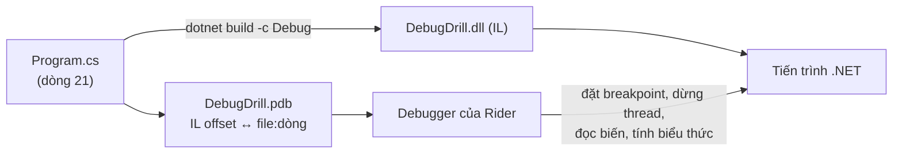

# Bài 04 — Debug trong Rider: tìm 5 lỗi cài sẵn bằng breakpoint, exception breakpoint, điều kiện, evaluate

> **Bạn sẽ làm được:** dừng chương trình ở đúng chỗ, đi từng dòng, xem và sửa biến, dừng khi có exception, dừng chỉ
> khi điều kiện đúng, tính biểu thức lúc đang dừng, debug Web API và Worker, attach vào tiến trình đang chạy.
>
> **Thời lượng:** đọc 30 phút · thực hành 60 phút
>
> **Code:** [`lab/playground/DebugDrill/`](lab/playground/DebugDrill/Program.cs): chương trình **có 5 lỗi cài sẵn**.
> Luật chơi: **không đọc code để tìm lỗi**, chỉ dùng debugger. Output đúng ở từng mốc đều đã chạy thật.
>
> **Trước đó:** [Bài 03](03-csharp-cho-dev-java.md) · **Tiếp theo:** [Bài 05 — Phím tắt Rider trên MacBook](05-phim-tat-rider-macos.md)

---

## 0. Phím debug dùng trong bài (keymap IntelliJ macOS)

| Việc | Phím | Việc | Phím |
|---|---|---|---|
| Chạy (không debug) | **⌃R** | Chạy có debug | **⌃D** |
| Dừng chương trình | **⌘F2** | Bật/tắt breakpoint ở dòng | **⌘F8** (hoặc bấm lề trái) |
| Xem mọi breakpoint | **⇧⌘F8** | Step Over (qua dòng) | **F8** |
| Step Into (vào hàm) | **F7** | Smart Step Into (chọn hàm để vào) | **⇧F7** |
| Step Out (ra khỏi hàm) | **⇧F8** | Run to Cursor | **⌥F9** |
| Resume (chạy tiếp) | **⌥⌘R** hoặc **F9** | Evaluate Expression | **⌥F8** |
| Quick Evaluate (phần đang chọn) | **⌥⌘F8** | Về dòng đang dừng | **⌥F10** |
| Attach to Process | **⌥⇧F5** | Cửa sổ Debug | **⌘5** |

> **MacBook:** hàng F1–F12 mặc định là phím âm lượng/độ sáng. Hoặc giữ **fn** khi bấm (fn+F8), hoặc bật
> **System Settings → Keyboard → Keyboard Shortcuts… → Function Keys → Use F1, F2, etc. keys as standard function keys**.
> Cách thứ hai đỡ mỏi tay hơn nhiều khi debug. Chi tiết ở [bài 05](05-phim-tat-rider-macos.md).

---

## 1. Lý thuyết: debugger làm gì



- **File `.pdb`** (symbol) cho debugger biết lệnh IL nào ứng với dòng nào. Không có `.pdb` khớp với `.dll` thì
  breakpoint không dừng (Rider vẽ breakpoint rỗng hoặc có dấu cảnh báo).
- **Debug vs Release:** build Debug tắt tối ưu, nên mọi biến cục bộ xem được và đi từng dòng đúng thứ tự. Build
  Release, JIT có thể gộp dòng, bỏ biến ("optimized away"). Debug luôn bằng cấu hình **Debug**.
- **Hai cách gắn debugger:** chạy app *trong* debugger (⌃D) hoặc **attach** vào tiến trình đang chạy (⌥⇧F5, [§9](#9-attach-vào-tiến-trình-đang-chạy)).
- **Dừng ở breakpoint** mặc định dừng **mọi thread** của tiến trình. Nhớ điều này khi debug Worker có Service Bus ([§8.3](#83-debug-consumer-service-bus-coi-chừng-lock-hết-hạn)).

Cửa sổ **Debug (⌘5)** khi đang dừng:

| Vùng | Cho biết |
|---|---|
| **Frames** | Call stack: hàm nào gọi hàm nào để tới dòng đang dừng. Bấm một frame để xem biến của frame đó |
| **Variables** | Biến cục bộ, tham số, `this`. Mở rộng object để xem field/property |
| **Watches** | Biểu thức bạn muốn theo dõi liên tục (thêm bằng chuột phải biến → **Add to Watches**) |
| **Console** | Output của chương trình |
| **Threads** | Các thread; với code async có thêm góc nhìn **Parallel Stacks** |

Trong editor, Rider còn in **giá trị biến ngay cạnh dòng code** (inline values) khi đang dừng.

---

## 2. Chuẩn bị: chạy thử và nhìn nó hỏng

1. Mở `tutorial/dotnet8-rider/lab/playground/Playground.sln` bằng Rider.
2. Ô run configuration trên thanh công cụ chọn **DebugDrill**, bấm **⌃R**.

Hoặc trong Terminal:

```bash
cd tutorial/dotnet8-rider/lab/playground/DebugDrill
dotnet run
```

Output thật:

```text
warning CS4014: Because this call is not awaited, execution of the current method continues before the call is completed. Consider applying the 'await' operator to the result of the call.
Loaded 1000 orders
Unhandled exception. System.Collections.Generic.KeyNotFoundException: The given key 'book-001' was not present in the dictionary.
   at System.Collections.Generic.Dictionary`2.get_Item(TKey key)
   at DebugDrill.InvoiceCalculator.Total(Order order, IReadOnlyDictionary`2 catalog) in .../DebugDrill/Orders.cs:line 36
   at Program.<Main>$(String[] args) in .../DebugDrill/Program.cs:line 21
```

Kết quả **đúng** sau khi sửa hết 5 lỗi (đối chiếu dần ở mỗi mốc):

```text
Loaded 1000 orders
Skipped order 737: quantity -5 for MUG-003
Revenue: 497,395,800
Orders with a coupon: 250 (25.0%)
Report written to report.txt
```

và file `report.txt` có nội dung `revenue=497395800.0`.

Code đang hỏng (để bạn đặt breakpoint, **chưa** đọc để tìm lỗi):

📄 **`lab/playground/DebugDrill/Program.cs`**

```csharp
// Bai 04: chuong trinh nay CO 5 LOI cai san. Khong doc code de tim: dung debugger cua Rider.
// Ket qua dung (sau khi sua het) ghi trong bai 04, muc "Dap an".
using System.Globalization;
using DebugDrill;

CultureInfo.DefaultThreadCurrentCulture = CultureInfo.InvariantCulture; // in so giong nhau tren moi may

var catalog = new Dictionary<string, decimal>
{
    ["BOOK-001"] = 150_000m,
    ["PEN-002"] = 12_000m,
    ["MUG-003"] = 99_000m
};

List<Order> orders = OrderGenerator.Create(count: 1000);
Console.WriteLine($"Loaded {orders.Count} orders");

decimal revenue = 0;
for (var i = 1; i < orders.Count; i++)
{
    revenue += InvoiceCalculator.Total(orders[i], catalog);
}
Console.WriteLine($"Revenue: {revenue:N0}");

var withCoupon = orders.Count(o => o.CouponCode is not null);
var percent = withCoupon / orders.Count * 100;
Console.WriteLine($"Orders with a coupon: {withCoupon} ({percent}%)");

ReportWriter.WriteAsync("report.txt", $"revenue={revenue}");
Console.WriteLine("Report written to report.txt");
```

📄 **`lab/playground/DebugDrill/Orders.cs`**

```csharp
namespace DebugDrill;

public record OrderLine(string Sku, int Quantity);

public record Order(int Id, string? CouponCode, List<OrderLine> Lines);

public static class OrderGenerator
{
    private static readonly string[] Skus = ["BOOK-001", "PEN-002", "MUG-003"];

    /// <summary>Du lieu co dinh (seed 2026): moi lan chay ra cung mot bo don.</summary>
    public static List<Order> Create(int count)
    {
        var random = new Random(2026);
        var orders = new List<Order>(count);
        for (var id = 1; id <= count; id++)
        {
            var lines = Enumerable.Range(0, random.Next(1, 4))
                .Select(_ => new OrderLine(Skus[random.Next(Skus.Length)], random.Next(1, 6)))
                .ToList();
            if (id == 42) lines[0] = lines[0] with { Sku = "book-001" }; // du lieu nhap tay tu he thong cu
            if (id == 737) lines[0] = lines[0] with { Quantity = -5 };   // loi nhap lieu
            orders.Add(new Order(id, id % 4 == 0 ? "SALE10" : null, lines));
        }
        return orders;
    }
}

public static class InvoiceCalculator
{
    public static decimal Total(Order order, IReadOnlyDictionary<string, decimal> catalog)
    {
        decimal total = 0;
        foreach (var line in order.Lines)
        {
            var unitPrice = catalog[line.Sku];
            total += unitPrice * line.Quantity;
        }
        return order.CouponCode == "SALE10" ? total * 0.9m : total;
    }
}

public static class ReportWriter
{
    public static async Task WriteAsync(string path, string content)
    {
        await Task.Delay(200); // gia lap ghi len o dia / storage cham
        await File.WriteAllTextAsync(path, content);
    }
}
```

---

## 3. Lỗi 1 — `KeyNotFoundException`: để debugger dừng đúng lúc exception xảy ra

### 3.1 Lý thuyết: đọc stack trace từ trên xuống

Dòng `at` **đầu tiên thuộc code của bạn** là chỗ cần nhìn: `InvoiceCalculator.Total(...) in Orders.cs:line 36`.
Dòng dưới nó (`Program.cs:line 21`) là nơi gọi. Stack trace cho biết **ở đâu**; debugger cho biết **vì sao**
(giá trị của từng biến tại khoảnh khắc đó).

### 3.2 Thực hành

1. Bấm **⌃D** (Debug thay vì Run).
2. Exception không ai bắt → Rider **tự dừng** tại dòng ném, tô vàng dòng `var unitPrice = catalog[line.Sku];` và hiện thông tin exception.
3. Nhìn **Variables**: mở `line` → `Sku = "book-001"`; mở `order` → `Id = 42`.
4. Bấm **⌥F8** (Evaluate Expression), gõ `catalog.Keys` → ⏎. Kết quả: `BOOK-001`, `PEN-002`, `MUG-003`. Khoá
   viết hoa, dữ liệu viết thường: `Dictionary` mặc định phân biệt hoa thường.
5. Tiếp tục ở Evaluate: `catalog.ContainsKey(line.Sku.ToUpperInvariant())` → `true`. Đã chắc nguyên nhân.
6. Dừng (**⌘F2**).

### 3.3 Exception breakpoint: dừng cả khi exception bị bắt ở đâu đó

Lỗi thật hay bị `try/catch` nuốt mất, chương trình không crash mà chỉ ra kết quả sai. Khi đó dùng **exception breakpoint**:

1. **⇧⌘F8** (View Breakpoints) → nút **+** → **.NET Exception Breakpoint**.
2. Gõ `System.Collections.Generic.KeyNotFoundException` → OK.
3. Từ giờ, mỗi khi exception này được **ném** (dù có `catch` hay không), debugger dừng ở dòng ném.

### 3.4 Sửa

Khoá của catalog không nên phân biệt hoa thường (bài 03 §4 đã gặp đúng cách này):

```csharp
var catalog = new Dictionary<string, decimal>(StringComparer.OrdinalIgnoreCase)
```

Chạy lại (⌃R). Mốc sau lỗi 1 (đã chạy thật):

```text
Loaded 1000 orders
Revenue: 496,900,800
Orders with a coupon: 250 (0%)
Report written to report.txt
```

Hết crash, nhưng doanh thu chưa khớp `497,395,800`, phần trăm `0%`, và **không có file `report.txt`** dù màn hình nói đã ghi.

---

## 4. Lỗi 2 — doanh thu thiếu: đi từng dòng, xem biến, watch

### 4.1 Lý thuyết: năm cách di chuyển khi đang dừng

| Lệnh | Phím | Làm gì |
|---|---|---|
| **Step Over** | F8 | Chạy hết dòng hiện tại (kể cả các hàm nó gọi), dừng ở dòng kế |
| **Step Into** | F7 | Đi **vào** hàm được gọi ở dòng hiện tại |
| **Smart Step Into** | ⇧F7 | Một dòng gọi nhiều hàm (`Total(orders[i], catalog)`): chọn hàm muốn vào |
| **Step Out** | ⇧F8 | Chạy hết hàm hiện tại, dừng ở chỗ gọi nó |
| **Run to Cursor** | ⌥F9 | Chạy tới dòng con trỏ đang đứng, không cần đặt breakpoint |

### 4.2 Thực hành

1. Đặt breakpoint ở dòng `revenue += InvoiceCalculator.Total(orders[i], catalog);`: bấm vào **lề trái** cạnh số dòng
   (hiện chấm đỏ) hoặc đặt con trỏ ở dòng đó và **⌘F8**.
2. **⌃D**. Debugger dừng **lần đầu tiên** đi qua dòng này.
3. Nhìn inline value và Variables: `i = 1`. Gõ vào Evaluate (**⌥F8**): `orders[i].Id` → `2`.
   **Đơn đầu tiên (Id 1) đã bị bỏ qua**: vòng lặp bắt đầu từ `1`, mà chỉ số `List` bắt đầu từ `0`.
4. Thêm watch để thấy lỗi rõ hơn: Variables → chuột phải → **New Watch** (hoặc nút **+** ở Watches) → `orders[0].Id`.
5. Thử **F7** (Step Into) để đi vào `InvoiceCalculator.Total`, **F8** vài lần để xem `total` tăng dần, **⇧F8** để ra.

> **Mẹo:** kéo mũi tên vàng (execution point) ở lề trái lên dòng trước để **chạy lại** một đoạn mà không khởi động lại
> chương trình (Rider gọi là *Set Next Statement*). Cẩn thận: nhảy lùi không hoàn tác những gì đã chạy (biến đã cộng
> thì vẫn đã cộng).

### 4.3 Sửa

```csharp
for (var i = 0; i < orders.Count; i++)
```

Mốc sau lỗi 2:

```text
Loaded 1000 orders
Revenue: 497,650,800
Orders with a coupon: 250 (0%)
Report written to report.txt
```

Doanh thu tăng 750.000 ₫ (đúng bằng đơn số 1), nhưng vẫn lệch `497,395,800`.

---

## 5. Lỗi 3 — một đơn trong 1000 có dữ liệu sai: conditional breakpoint

### 5.1 Lý thuyết: breakpoint có điều kiện, breakpoint chỉ ghi log

Đặt breakpoint thường trong vòng lặp 1000 lần thì phải bấm Resume 1000 lần. Chuột phải vào chấm đỏ để chỉnh breakpoint:

| Tuỳ chọn | Dùng khi |
|---|---|
| **Condition** | Chỉ dừng khi biểu thức C# đúng, ví dụ `line.Quantity <= 0` |
| **Suspend** (bỏ tick) + **Log / Evaluate and log** | Không dừng, chỉ in ra Debug Console: kiểu "printf debugging" mà khỏi sửa code |
| **Remove once hit** | Dừng một lần rồi tự xoá |
| **Disable until hitting the following breakpoint** | Chỉ bật sau khi một breakpoint khác đã dừng (debug luồng nhiều bước) |

Mở bảng đầy đủ của tất cả breakpoint: **⇧⌘F8**.

### 5.2 Thực hành

1. Trong `Orders.cs`, đặt breakpoint ở dòng `total += unitPrice * line.Quantity;`.
2. Chuột phải chấm đỏ → **Condition**: `line.Quantity <= 0` → **Done**.
3. **⌃D**. Debugger đi qua cả 2.003 dòng hàng của 1000 đơn nhưng chỉ dừng **một lần**. Variables: `order.Id = 737`,
   `line = OrderLine { Sku = MUG-003, Quantity = -5 }`.
4. Thử thêm kiểu không dừng: tạo breakpoint thứ hai ở cùng dòng với **Suspend** bỏ tick, **Evaluate and log**:
   `$"order {order.Id}: {line.Sku} x {line.Quantity}"`. Chạy lại, Debug Console in một dòng cho mỗi lần đi qua.
   Xoá breakpoint này sau khi xem (in 2.000 dòng làm debug chậm hẳn).

### 5.3 Sửa

Dữ liệu sai thì không tính vào doanh thu, và phải **nói ra** chứ không lặng lẽ bỏ qua:

```csharp
for (var i = 0; i < orders.Count; i++)
{
    var bad = orders[i].Lines.FirstOrDefault(l => l.Quantity <= 0);
    if (bad is not null)
    {
        Console.WriteLine($"Skipped order {orders[i].Id}: quantity {bad.Quantity} for {bad.Sku}");
        continue;
    }
    revenue += InvoiceCalculator.Total(orders[i], catalog);
}
```

Mốc sau lỗi 3:

```text
Loaded 1000 orders
Skipped order 737: quantity -5 for MUG-003
Revenue: 497,395,800
Orders with a coupon: 250 (0%)
Report written to report.txt
```

Doanh thu đã đúng. Ghi chú: đơn 737 còn một dòng `BOOK-001 x 5`, nên tổng của nó vẫn dương
(−5 × 99.000 + 5 × 150.000 = 255.000 ₫); chính vì thế lỗi này không lộ ra bằng mắt.

---

## 6. Lỗi 4 — `0%`: tính biểu thức ngay lúc đang dừng

### 6.1 Lý thuyết

**Evaluate Expression (⌥F8)** chạy một biểu thức C# bất kỳ trong ngữ cảnh frame đang dừng: đọc biến, gọi method,
thử công thức khác. **Quick Evaluate (⌥⌘F8)**: bôi đen một phần biểu thức trong editor rồi bấm, khỏi gõ lại.

> Evaluate **chạy code thật**: gọi `orders.Clear()` trong Evaluate là xoá danh sách thật. Chỉ gọi method không có
> tác dụng phụ.

### 6.2 Thực hành

1. Breakpoint ở dòng `var percent = withCoupon / orders.Count * 100;` → ⌃D.
2. Bôi đen `withCoupon / orders.Count` → **⌥⌘F8** → `0`. Hai số `int` chia nhau ra `int`: 250 / 1000 = 0, nhân 100 vẫn 0.
3. **⌥F8**, thử `withCoupon * 100.0 / orders.Count` → `25`. Có một toán hạng `double` thì phép chia là chia số thực.

### 6.3 Sửa

```csharp
var percent = withCoupon * 100.0 / orders.Count;
Console.WriteLine($"Orders with a coupon: {withCoupon} ({percent:F1}%)");
```

Mốc sau lỗi 4: dòng coupon thành `Orders with a coupon: 250 (25.0%)`.

---

## 7. Lỗi 5 — "Report written" nhưng không có file: cảnh báo của compiler và code async

### 7.1 Lý thuyết

`ReportWriter.WriteAsync(...)` trả về một `Task`. Không `await` thì `Main` chạy tiếp, in "Report written", rồi
**kết thúc tiến trình** trong khi Task vẫn đang `Task.Delay(200)`. File không bao giờ được ghi. Compiler đã báo ngay
từ đầu: `warning CS4014: Because this call is not awaited...`. Trong Rider, dòng đó có gạch chân; **⌘6** (Problems)
liệt kê mọi cảnh báo. Đã kiểm chứng: bản chưa sửa in `Report written to report.txt` mà `ls report.txt` báo
`No such file or directory`.

> Quy tắc nhóm: coi cảnh báo CS4014 như lỗi. Dự án thật có thể bật `<TreatWarningsAsErrors>true</TreatWarningsAsErrors>`
> trong `.csproj` để build fail luôn.

### 7.2 Debug code async

- Đặt breakpoint **bên trong** `WriteAsync` (dòng `await File.WriteAllTextAsync`) và chạy bản chưa sửa: breakpoint
  **không bao giờ dừng**, vì tiến trình đã thoát. Breakpoint không dừng cũng là một thông tin.
- Code có `await`: F8 qua dòng `await` vẫn dừng đúng dòng kế tiếp dù phần sau có thể chạy trên thread khác.
- Nhiều Task đang chờ nhau (deadlock, treo): tab **Threads** của cửa sổ Debug có góc nhìn **Parallel Stacks** gom các
  call stack giống nhau; nhìn vào đó thấy Task nào đang chờ Task nào.

### 7.3 Sửa

```csharp
await ReportWriter.WriteAsync("report.txt", $"revenue={revenue}");
```

File `report.txt` nằm ở **Working directory** của run configuration (xem trong **Run → Edit Configurations…**); chạy
bằng `dotnet run` thì là thư mục bạn đứng.

<details>
<summary>Đáp án: <code>Program.cs</code> sau khi sửa cả 5 lỗi (đã chạy, ra đúng output ở §2)</summary>

```csharp
// Bai 04: chuong trinh nay CO 5 LOI cai san. Khong doc code de tim: dung debugger cua Rider.
// Ket qua dung (sau khi sua het) ghi trong bai 04, muc "Dap an".
using System.Globalization;
using DebugDrill;

CultureInfo.DefaultThreadCurrentCulture = CultureInfo.InvariantCulture; // in so giong nhau tren moi may

var catalog = new Dictionary<string, decimal>(StringComparer.OrdinalIgnoreCase)
{
    ["BOOK-001"] = 150_000m,
    ["PEN-002"] = 12_000m,
    ["MUG-003"] = 99_000m
};

List<Order> orders = OrderGenerator.Create(count: 1000);
Console.WriteLine($"Loaded {orders.Count} orders");

decimal revenue = 0;
for (var i = 0; i < orders.Count; i++)
{
    var bad = orders[i].Lines.FirstOrDefault(l => l.Quantity <= 0);
    if (bad is not null)
    {
        Console.WriteLine($"Skipped order {orders[i].Id}: quantity {bad.Quantity} for {bad.Sku}");
        continue;
    }
    revenue += InvoiceCalculator.Total(orders[i], catalog);
}
Console.WriteLine($"Revenue: {revenue:N0}");

var withCoupon = orders.Count(o => o.CouponCode is not null);
var percent = withCoupon * 100.0 / orders.Count;
Console.WriteLine($"Orders with a coupon: {withCoupon} ({percent:F1}%)");

await ReportWriter.WriteAsync("report.txt", $"revenue={revenue}");
Console.WriteLine("Report written to report.txt");
```

</details>

---

## 8. Debug app thật: Web API, Worker, consumer Service Bus

Phần này dùng lab OrderFlow của bài 06–09; đọc trước để biết, làm lại khi tới các bài đó.

### 8.1 Debug Web API

1. Chạy hạ tầng: `cd lab/OrderFlow && docker compose up -d postgres`.
2. Run configuration chọn **OrderFlow.Api: http** (Rider đọc từ `Properties/launchSettings.json`) → **⌃D**.
3. Đặt breakpoint trong `OrdersController.Create` và trong `OrderService.CreateAsync`.
4. Mở `OrderFlow.Api.http`, bấm ▶ cạnh request 1. Rider dừng ở controller; Variables có `request` đã được bind từ JSON.
5. **F7** vào `CreateAsync`, **F8** qua `SaveChangesAsync`: cửa sổ Debug Console in câu SQL `INSERT INTO orders ...`
   (log của EF Core trong môi trường Development, bài 07).
6. Dừng lâu quá thì client nhận timeout. Đó là do bạn, không phải lỗi app.

### 8.2 Debug Worker (BackgroundService)

Worker là app console chạy mãi: chọn run configuration **OrderFlow.Worker** → ⌃D. Breakpoint trong
`OutboxProcessor.DispatchBatchAsync` dừng mỗi giây (theo `PeriodicTimer`); dùng **Condition** `batch.Count > 0` để
chỉ dừng khi có việc.

**Chạy Api và Worker cùng lúc:** **Run → Edit Configurations… → + → Compound**, thêm `OrderFlow.Api: http` và
`OrderFlow.Worker`. Chọn compound đó rồi ⌃D: hai tiến trình cùng chạy trong debugger, breakpoint ở project nào cũng dừng.

### 8.3 Debug consumer Service Bus: coi chừng lock hết hạn

Queue `orders` có `LockDuration` 30 giây ([bài 09](09-azure-service-bus.md)). Consumer nhận message thì message bị
khoá cho riêng nó trong 30 giây; SDK tự gia hạn khoá trong lúc xử lý. Breakpoint mặc định **dừng mọi thread**, kể cả
thread gia hạn khoá. Nghĩa là dừng ở breakpoint lâu hơn khoá thì Service Bus coi như consumer đã chết: giao message cho
consumer khác (hoặc giao lại sau), `DeliveryCount` tăng, và khi bạn bấm Resume thì `CompleteMessageAsync` báo mất khoá.

Đã đo bằng cách "đóng băng" tiến trình Worker 45 giây (`kill -STOP`, giống breakpoint dừng mọi thread) rồi cho chạy
tiếp: bản giao cũ và bản giao lại của **cùng** message chạy song song, `Complete` của bản cũ báo `MessageLockLost`, và
chỉ khoá chính của bảng `processed_messages` giữ cho đơn không bị xử lý hai lần. Log đầy đủ ở [bài 09 §7](09-azure-service-bus.md).

Cách debug an toàn: breakpoint có **Condition** để dừng đúng message cần xem, xem nhanh rồi Resume; hoặc tạm tăng
`LockDuration` trong `servicebus/config.json` khi cần đứng lâu.

---

## 9. Attach vào tiến trình đang chạy

Dùng khi app đã chạy sẵn bên ngoài Rider (ví dụ `dotnet run` trong Terminal) và bạn không muốn khởi động lại.

1. Chạy app: `dotnet run --project src/OrderFlow.Worker`.
2. Trong Rider: **⌥⇧F5** (Run → Attach to Process…), gõ tên `OrderFlow.Worker` để lọc, chọn tiến trình.
3. Đặt breakpoint như bình thường. Detach (ngắt debugger, app vẫn chạy): nút Stop trong cửa sổ Debug, chọn **Detach**.

Điều kiện: tiến trình phải build **Debug** và có `.pdb` khớp với source đang mở.

**Debug trong container Docker** có ở [bài 10 §6](10-docker-hoa.md). **Debug unit test**: bấm biểu tượng ở lề trái
cạnh tên test → **Debug** ([bài 11](11-test-xunit-testcontainers.md)).

---

## 10. Lỗi hay gặp khi debug

| Triệu chứng | Nguyên nhân thường gặp | Sửa |
|---|---|---|
| Breakpoint rỗng/có dấu chấm than, không dừng | Đang chạy bản Release, hoặc `.pdb` không khớp (code đã sửa mà chưa build), hoặc chạy nhầm project | Cấu hình Debug; build lại; kiểm run configuration |
| Biến hiện "optimized away" | Build Release | Debug bằng cấu hình Debug |
| F7 nhảy vào code của .NET | Đang đi vào code không phải của bạn | ⇧F8 để ra; dùng ⇧F7 để chọn đúng hàm của mình |
| Breakpoint trong lambda/LINQ không dừng | LINQ thực thi trì hoãn ([bài 03 §8](03-csharp-cho-dev-java.md)): lambda chỉ chạy khi duyệt | Đặt breakpoint ở chỗ `ToList()`/`First()`, hoặc trong thân lambda nhiều dòng |
| Debug rất chậm | Breakpoint có điều kiện hoặc ghi log trong vòng lặp nóng | Tắt khi xong; thu hẹp điều kiện |
| HTTP client timeout khi đang dừng | Dừng ở breakpoint quá thời gian timeout | Bình thường; gửi lại request |
| Message Service Bus bị giao lại khi đang debug | Dừng lâu hơn `LockDuration` | [§8.3](#83-debug-consumer-service-bus-coi-chừng-lock-hết-hạn) |

---

## 11. Tự kiểm tra

- [ ] Giải thích được vai trò của `.pdb` và vì sao debug bằng cấu hình Debug.
- [ ] Phân biệt F8, F7, ⇧F7, ⇧F8, ⌥F9 bằng một câu mỗi phím.
- [ ] Tạo được exception breakpoint cho một loại exception cụ thể.
- [ ] Tạo được breakpoint có điều kiện và breakpoint chỉ ghi log không dừng.
- [ ] Dùng ⌥F8 và ⌥⌘F8 để thử công thức khác ngay lúc đang dừng.
- [ ] Biết vì sao quên `await` làm mất việc, và cảnh báo nào báo trước điều đó.
- [ ] Chạy được compound configuration Api + Worker và attach vào một tiến trình đang chạy.

## 12. Ranh giới trung thực

- **Đã chạy thật:** chương trình DebugDrill bản lỗi và từng mốc sau mỗi lần sửa (5 mốc), output dán nguyên văn; bản
  chưa sửa lỗi 5 không tạo `report.txt` (đã `ls` kiểm tra).
- **Chưa chạy được ở đây:** giao diện debugger của Rider (không có màn hình). Các thao tác Rider mô tả theo nền tảng
  IntelliJ mà Rider dùng; phím tắt lấy từ keymap gốc của nền tảng ([bài 05](05-phim-tat-rider-macos.md) ghi nguồn).
  Tên menu có thể lệch chút theo phiên bản; tìm bằng ⇧⌘A.
- Phần lock hết hạn khi debug consumer ([§8.3](#83-debug-consumer-service-bus-coi-chừng-lock-hết-hạn)) đo bằng
  `SIGSTOP`/`SIGCONT` lên tiến trình, không phải bằng breakpoint thật của Rider; hai cách cùng làm mọi thread đứng yên.
