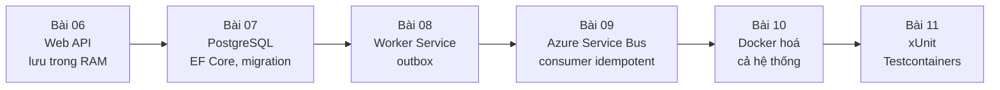
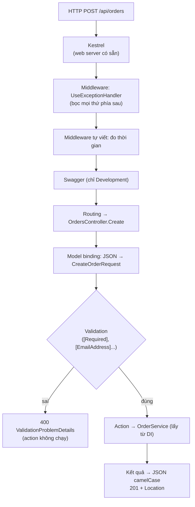

# Bài 06 — ASP.NET Core Web API từ đầu: DI, cấu hình, middleware, controller, validation, ProblemDetails

> **Bạn sẽ làm được:** dựng `OrderFlow.Api` (tạo đơn, xem đơn, lọc danh sách) chạy được ngay, tạm lưu trong RAM;
> hiểu một request đi qua ASP.NET Core thế nào, DI lifetime, cấu hình theo môi trường, middleware, validation tự
> động, lỗi chuẩn RFC (ProblemDetails) và `IExceptionHandler` mới của .NET 8.
>
> **Thời lượng:** đọc 40 phút · làm 60 phút
>
> **Code:** file bản cuối ở [`lab/OrderFlow/`](lab/README.md), ba file chỉ dùng trong bài này ở `lab/steps/06/`.
> Toàn bộ các bước của bài 06–11 đã được dựng lại từ thư mục trống bằng
> [`lab/steps/verify-steps.sh`](lab/steps/verify-steps-output.txt) và ra **đúng** code của lab.
>
> **Trước đó:** [Bài 05](05-phim-tat-rider-macos.md) · **Tiếp theo:** [Bài 07 — PostgreSQL + EF Core](07-postgresql-ef-core.md)

---

## 0. Dự án OrderFlow: bạn sẽ dựng gì trong 6 bài tới



Nghiệp vụ cố tình đơn giản để tập trung vào kỹ thuật: khách gửi đơn hàng → API lưu, trả `201` → Worker xử lý: đơn
≤ 50.000.000 ₫ thì `Confirmed`, lớn hơn thì `Rejected`. Cuối bài 06 bạn có API chạy được; mỗi bài sau thay hoặc thêm
một mảnh, controller **không phải sửa** lần nào nữa.

---

## 1. Lý thuyết: một request đi qua ASP.NET Core



**Middleware** là chuỗi hàm xử lý request theo thứ tự đăng ký; mỗi hàm gọi hàm sau (`next`) rồi được quay lại khi
response đi ngược ra. Giống chuỗi `Filter` của Servlet. Thứ tự đăng ký **là** thứ tự chạy, nên `UseExceptionHandler`
phải đứng đầu để bắt lỗi của mọi thứ phía sau.

Đối chiếu Spring Boot:

| Spring Boot | ASP.NET Core 8 |
|---|---|
| `@SpringBootApplication` + `main` | `Program.cs` (top-level statements) |
| `@RestController` | `[ApiController]` + kế thừa `ControllerBase` |
| `@RequestMapping("/api/orders")` | `[Route("api/orders")]` |
| `@GetMapping("/{id}")` + `@PathVariable` | `[HttpGet("{id:guid}")]` + tham số `Guid id` |
| `@RequestBody` | tự động cho tham số kiểu phức tạp khi có `[ApiController]` |
| `@RequestParam` | `[FromQuery]` |
| `@Valid` + Bean Validation | DataAnnotations (`[Required]`…) + `[ApiController]` tự trả 400 |
| `@ControllerAdvice` | `IExceptionHandler` (.NET 8) hoặc middleware |
| `@Service` + `@Autowired` qua constructor | `builder.Services.AddScoped<OrderService>()` + constructor |
| `application.yml`, profile | `appsettings.json`, `appsettings.Development.json`, `ASPNETCORE_ENVIRONMENT` |
| Actuator `/health` | `AddHealthChecks()` + `MapHealthChecks("/health")` |
| springdoc-openapi | Swashbuckle (có sẵn trong template .NET 8) |

---

## 2. Thực hành: tạo solution và hai project

```bash
mkdir -p ~/dev/OrderFlow && cd ~/dev/OrderFlow
dotnet new globaljson --sdk-version 8.0.100 --roll-forward latestFeature
dotnet new sln -n OrderFlow
dotnet new classlib -n OrderFlow.Core -o src/OrderFlow.Core
dotnet new webapi --use-controllers -n OrderFlow.Api -o src/OrderFlow.Api
dotnet sln add src/OrderFlow.Core src/OrderFlow.Api
dotnet add src/OrderFlow.Api reference src/OrderFlow.Core
rm src/OrderFlow.Core/Class1.cs src/OrderFlow.Api/WeatherForecast.cs src/OrderFlow.Api/Controllers/WeatherForecastController.cs
open -a Rider OrderFlow.sln
```

- `--use-controllers`: template .NET 8 mặc định sinh **minimal API**; cờ này sinh kiểu controller (giải thích ở [§6.2](#62-controller-hay-minimal-api)).
- Trong Rider: **New Solution → Web → ASP.NET Core Web API**, bỏ tick *Use minimal APIs* (hoặc chọn *Use controllers*),
  framework `net8.0`; rồi **Add → New Project → Class Library** cho `OrderFlow.Core`, và **Add → Reference…**.
- Template sinh sẵn `Program.cs` có Swagger và `app.UseHttpsRedirection()`; ta thay cả file ở [§7](#7-programcs-ghép-mọi-thứ-lại).

Vì sao hai project: `OrderFlow.Core` chứa nghiệp vụ không biết gì về HTTP. Bài 08 có thêm `OrderFlow.Worker` dùng
lại đúng `Core` này. Đánh đổi là thêm một project phải quản lý; với solution có hơn một app chạy (Api, Worker) thì đáng.

---

## 3. Domain: class `Order` trong Core

**Lý thuyết.** Entity giữ **quy tắc nghiệp vụ** của chính nó: setter `private`, muốn đổi trạng thái phải gọi method có
tên nghiệp vụ (`Create`, `Process`). Code ngoài không thể gán bừa `order.Status = Confirmed`. Lỗi nghiệp vụ ném
`DomainException` để API trả 400 thay vì 500.

Tạo thư mục `src/OrderFlow.Core/Domain/` và file:

📄 **`lab/OrderFlow/src/OrderFlow.Core/Domain/Order.cs`**

```csharp
namespace OrderFlow.Core.Domain;

public enum OrderStatus
{
    Pending,
    Confirmed,
    Rejected
}

/// <summary>
/// Don hang. Setter de private: muon doi trang thai phai goi method co ten nghiep vu (Create, Process),
/// khong ai gan thang order.Status = ... tu ngoai duoc.
/// </summary>
public class Order
{
    /// <summary>Quy tac demo cho buoc "xu ly": tong tien vuot han muc thi tu choi.</summary>
    public const decimal AutoConfirmLimit = 50_000_000m;

    private readonly List<OrderLine> _lines = new();

    private Order() { } // EF Core can constructor rong khi doc tu DB

    public Guid Id { get; private set; }
    public string CustomerEmail { get; private set; } = null!;
    public OrderStatus Status { get; private set; }
    public decimal Total { get; private set; }
    public string? RejectReason { get; private set; }
    public DateTime CreatedAtUtc { get; private set; }
    public DateTime? ProcessedAtUtc { get; private set; }
    public IReadOnlyList<OrderLine> Lines => _lines;

    public static Order Create(string customerEmail, IEnumerable<OrderLine> lines, DateTime nowUtc)
    {
        if (string.IsNullOrWhiteSpace(customerEmail))
            throw new DomainException("customerEmail is required");
        if (nowUtc.Kind != DateTimeKind.Utc)
            throw new ArgumentException("nowUtc must be UTC", nameof(nowUtc)); // Npgsql chi nhan UTC cho timestamptz

        var order = new Order
        {
            Id = Guid.NewGuid(),
            CustomerEmail = customerEmail.Trim().ToLowerInvariant(),
            Status = OrderStatus.Pending,
            CreatedAtUtc = nowUtc
        };
        order._lines.AddRange(lines);
        if (order._lines.Count == 0)
            throw new DomainException("an order needs at least one line");

        // quy tac attribute [Required]/[Range] khong dien ta duoc: phai nhin ca danh sach
        var duplicate = order._lines.GroupBy(l => l.Sku).FirstOrDefault(g => g.Count() > 1);
        if (duplicate is not null)
            throw new DomainException($"sku {duplicate.Key} appears more than once, merge the quantities into one line");

        order.Total = order._lines.Sum(l => l.LineTotal);
        return order;
    }

    /// <summary>
    /// Buoc xu ly chay o Worker sau khi nhan message OrderCreated. Tra ve false neu don da xu ly roi
    /// (goi lan hai khong doi gi ca: idempotent).
    /// </summary>
    public bool Process(DateTime nowUtc)
    {
        if (Status != OrderStatus.Pending)
            return false;

        if (Total > AutoConfirmLimit)
        {
            Status = OrderStatus.Rejected;
            // Invariant: may Mac dat vung Viet Nam in N0 thanh 60.000.000, server Linux in 60,000,000
            RejectReason = FormattableString.Invariant($"total {Total:N0} is over the auto-confirm limit {AutoConfirmLimit:N0}");
        }
        else
        {
            Status = OrderStatus.Confirmed;
        }
        ProcessedAtUtc = nowUtc;
        return true;
    }
}

public class OrderLine
{
    private OrderLine() { }

    public OrderLine(string sku, int quantity, decimal unitPrice)
    {
        if (string.IsNullOrWhiteSpace(sku)) throw new DomainException("sku is required");
        if (quantity <= 0) throw new DomainException($"quantity must be > 0 (sku {sku})");
        if (unitPrice <= 0) throw new DomainException($"unitPrice must be > 0 (sku {sku})");
        Sku = sku.Trim().ToUpperInvariant();
        Quantity = quantity;
        UnitPrice = unitPrice;
    }

    public long Id { get; private set; }
    public Guid OrderId { get; private set; }
    public string Sku { get; private set; } = null!;
    public int Quantity { get; private set; }
    public decimal UnitPrice { get; private set; }
    public decimal LineTotal => Quantity * UnitPrice;
}

/// <summary>Loi nghiep vu: API tra 400 thay vi 500.</summary>
public class DomainException(string message) : Exception(message);
```

Những dòng đáng để ý:

- `= null!`: báo compiler "property này sẽ được gán" (bởi `Create` hoặc EF Core), tắt cảnh báo null.
- `private Order() { }` và `private OrderLine() { }`: EF Core (bài 07) cần constructor rỗng để dựng object từ DB.
- `IReadOnlyList<OrderLine> Lines => _lines`: bên ngoài chỉ **đọc** được danh sách, không `Add` được.
- `nowUtc.Kind != DateTimeKind.Utc`: thời gian truyền **vào** chứ không gọi `DateTime.UtcNow` bên trong, để test cố
  định được thời gian (bài 11). Bắt buộc UTC vì PostgreSQL `timestamptz` qua Npgsql chỉ nhận UTC (bài 07).
- `Process` trả `false` nếu đã xử lý: gọi lần hai không đổi gì. Tính chất này (idempotent) cứu ta ở bài 09.

---

## 4. Hợp đồng HTTP: request/response là record riêng

**Lý thuyết.** Không nhận thẳng entity từ client: client sẽ gửi được cả `Status`, `Id`. DTO (record) tách khỏi entity:
đổi bảng DB không vỡ API, và validation đặt ngay trên DTO bằng **DataAnnotations**.

Tạo `src/OrderFlow.Api/Contracts/OrderContracts.cs`:

📄 **`lab/OrderFlow/src/OrderFlow.Api/Contracts/OrderContracts.cs`**

```csharp
using System.ComponentModel.DataAnnotations;
using OrderFlow.Core.Domain;

namespace OrderFlow.Api.Contracts;

// Hop dong HTTP tach rieng khoi entity: doi bang DB khong lam vo API, va client khong gui duoc Status/Id.

public sealed record CreateOrderRequest(
    [Required, EmailAddress, StringLength(256)] string CustomerEmail,
    [Required, MinLength(1), MaxLength(50)] List<CreateOrderLineRequest> Lines);

public sealed record CreateOrderLineRequest(
    [Required, StringLength(32, MinimumLength = 1)] string Sku,
    [Range(1, 1000)] int Quantity,
    [Range(1.0, 1_000_000_000.0)] decimal UnitPrice);

public sealed record OrderLineResponse(string Sku, int Quantity, decimal UnitPrice, decimal LineTotal);

public sealed record OrderResponse(
    Guid Id,
    string CustomerEmail,
    string Status,
    decimal Total,
    string? RejectReason,
    DateTime CreatedAtUtc,
    DateTime? ProcessedAtUtc,
    IReadOnlyList<OrderLineResponse> Lines)
{
    public static OrderResponse From(Order order) => new(
        order.Id,
        order.CustomerEmail,
        order.Status.ToString(),
        order.Total,
        order.RejectReason,
        order.CreatedAtUtc,
        order.ProcessedAtUtc,
        order.Lines.Select(l => new OrderLineResponse(l.Sku, l.Quantity, l.UnitPrice, l.LineTotal)).ToList());
}
```

- Attribute đặt thẳng trên tham số của record; `[ApiController]` kiểm tra **cả** từng phần tử trong `Lines`.
- `[Range(1.0, 1_000_000_000.0)]` dùng bản `double`: bản nhận chuỗi `[Range(typeof(decimal), "0.01", ...)]` phân tích
  chuỗi theo culture của máy, mà máy vùng Việt Nam đọc `0.01` khác máy vùng Mỹ.
- Kiểm tra trùng SKU **không** viết được bằng attribute (phải nhìn cả danh sách) nên nằm trong `Order.Create`.

---

## 5. Dependency Injection: ai tạo object, sống bao lâu

### 5.1 Lý thuyết: ba lifetime

ASP.NET Core có sẵn DI container. Bạn **đăng ký** ở `Program.cs`, rồi **khai báo trong constructor** thứ mình cần;
container tự tạo và truyền vào (như `@Autowired` qua constructor).

| Lifetime | Đăng ký | Sống bao lâu | Spring | Dùng cho |
|---|---|---|---|---|
| **Singleton** | `AddSingleton<T>()` | Một instance cho cả app | `@Bean` mặc định | Thứ dùng chung, thread-safe: `TimeProvider`, cache, `ServiceBusClient` |
| **Scoped** | `AddScoped<T>()` | Một instance **mỗi request** | `@RequestScope` | `DbContext`, service dùng `DbContext` |
| **Transient** | `AddTransient<T>()` | Mỗi lần xin là một instance mới | `@Scope("prototype")` | Object nhẹ, không giữ trạng thái |

**Quy tắc vàng:** thứ sống lâu không được giữ thứ sống ngắn hơn. Singleton giữ một Scoped là giữ `DbContext` của
request đầu tiên mãi mãi. Bài 08 chạy thử lỗi này và xem .NET 8 phản ứng khác nhau thế nào giữa Development và Production.

### 5.2 Thực hành: kho tạm trong RAM (singleton) và service (scoped)

Bài này chưa có database, nên đơn được giữ trong một dictionary dùng chung. Tạo `src/OrderFlow.Api/Services/`:

📄 **`lab/steps/06/src/OrderFlow.Api/Services/InMemoryOrderStore.cs`**

```csharp
using System.Collections.Concurrent;
using OrderFlow.Core.Domain;

namespace OrderFlow.Api.Services;

/// <summary>Kho tam cua bai 06: don nam trong RAM, tat app la mat. Bai 07 thay bang PostgreSQL.</summary>
public sealed class InMemoryOrderStore
{
    // nhieu request chay cung luc tren nhieu thread: dung ConcurrentDictionary, khong dung Dictionary thuong
    private readonly ConcurrentDictionary<Guid, Order> _orders = new();

    public void Add(Order order) => _orders[order.Id] = order;

    public Order? Find(Guid id) => _orders.GetValueOrDefault(id);

    public IEnumerable<Order> All => _orders.Values;
}
```

📄 **`lab/steps/06/src/OrderFlow.Api/Services/OrderService.cs`**

```csharp
using OrderFlow.Api.Contracts;
using OrderFlow.Core.Domain;

namespace OrderFlow.Api.Services;

// Ban cua bai 06: luu trong InMemoryOrderStore. Bai 07 doi sang EF Core nhung giu nguyen 3 method,
// nen OrdersController khong phai sua dong nao.
public sealed class OrderService(InMemoryOrderStore store, TimeProvider time, ILogger<OrderService> logger)
{
    public Task<OrderResponse> CreateAsync(CreateOrderRequest request, CancellationToken ct)
    {
        var order = Order.Create(
            request.CustomerEmail,
            request.Lines.Select(l => new OrderLine(l.Sku, l.Quantity, l.UnitPrice)),
            time.GetUtcNow().UtcDateTime);
        store.Add(order);

        logger.LogInformation("Order {OrderId} created for {Email}, total {Total}", order.Id, order.CustomerEmail, order.Total);
        return Task.FromResult(OrderResponse.From(order));
    }

    public Task<OrderResponse?> GetAsync(Guid id, CancellationToken ct)
    {
        var order = store.Find(id);
        return Task.FromResult<OrderResponse?>(order is null ? null : OrderResponse.From(order));
    }

    public Task<IReadOnlyList<OrderResponse>> ListAsync(OrderStatus? status, int take, CancellationToken ct)
    {
        IReadOnlyList<OrderResponse> result = store.All
            .Where(o => status is null || o.Status == status)
            .OrderByDescending(o => o.CreatedAtUtc)
            .Take(take)
            .Select(OrderResponse.From)
            .ToList();
        return Task.FromResult(result);
    }
}
```

- **`TimeProvider`** (mới trong .NET 8): thay vì gọi `DateTime.UtcNow`, xin "đồng hồ" qua DI. Test thay bằng đồng hồ
  giả để thời gian cố định (bài 11).
- **Logging có cấu trúc:** `"Order {OrderId} created"` là *template*, không phải chuỗi nội suy `$"..."`. Giá trị
  `OrderId` được lưu thành trường riêng, công cụ log (Seq, Elastic, Application Insights) lọc được theo trường đó.
- Chữ ký `Task<...>` dù chưa có gì bất đồng bộ: bài 07 đổi thân hàm sang EF Core (`await SaveChangesAsync`) mà
  controller không phải sửa.

### 5.3 Thí nghiệm: đăng ký sai lifetime

Ở [§7](#7-programcs-ghép-mọi-thứ-lại), kho được đăng ký `AddSingleton<InMemoryOrderStore>()`. Thử đổi thành
`AddScoped<InMemoryOrderStore>()`, chạy lại, rồi tạo đơn và xem lại ngay. Kết quả thật:

```text
created ef0d9083-3afe-4b7a-be56-579d66e18944
HTTP/1.1 404 Not Found
{"type":"https://tools.ietf.org/html/rfc9110#section-15.5.5","title":"Not Found","status":404,"traceId":"00-d9118983e4c6629a505bc1c95691ed6a-ad447fb0994ae92c-00"}
[]
```

Mỗi request nhận một kho **mới tinh**: request POST ghi vào kho của nó, request GET đọc kho khác, rỗng. Không có lỗi
biên dịch, không exception: lifetime sai là lỗi logic. Đổi lại `AddSingleton` trước khi đi tiếp.

---

## 6. Controller

### 6.1 Code

Tạo `src/OrderFlow.Api/Controllers/OrdersController.cs`:

📄 **`lab/OrderFlow/src/OrderFlow.Api/Controllers/OrdersController.cs`**

```csharp
using System.ComponentModel.DataAnnotations;
using Microsoft.AspNetCore.Mvc;
using OrderFlow.Api.Contracts;
using OrderFlow.Api.Services;
using OrderFlow.Core.Domain;

namespace OrderFlow.Api.Controllers;

[ApiController] // tu validate model -> 400 ValidationProblemDetails, tu bind body JSON
[Route("api/orders")]
// Khong dat [Produces("application/json")] o day: no ep ca loi 400/404 thanh application/json,
// mat content type chuan application/problem+json (test Unknown_id_returns_404_problem bat duoc)
public class OrdersController(OrderService orders) : ControllerBase
{
    [HttpPost]
    [ProducesResponseType(typeof(OrderResponse), StatusCodes.Status201Created)]
    [ProducesResponseType(typeof(ValidationProblemDetails), StatusCodes.Status400BadRequest)]
    public async Task<ActionResult<OrderResponse>> Create(CreateOrderRequest request, CancellationToken ct)
    {
        var order = await orders.CreateAsync(request, ct);
        return CreatedAtAction(nameof(GetById), new { id = order.Id }, order); // 201 + header Location
    }

    [HttpGet("{id:guid}")]
    [ProducesResponseType(typeof(OrderResponse), StatusCodes.Status200OK)]
    [ProducesResponseType(typeof(ProblemDetails), StatusCodes.Status404NotFound)]
    public async Task<ActionResult<OrderResponse>> GetById(Guid id, CancellationToken ct)
    {
        var order = await orders.GetAsync(id, ct);
        return order is null ? NotFound() : order;
    }

    [HttpGet]
    [ProducesResponseType(typeof(IReadOnlyList<OrderResponse>), StatusCodes.Status200OK)]
    public Task<IReadOnlyList<OrderResponse>> List(
        [FromQuery] OrderStatus? status,
        [FromQuery, Range(1, 100)] int take = 20,
        CancellationToken ct = default)
        => orders.ListAsync(status, take, ct);
}
```

| Chi tiết | Nghĩa |
|---|---|
| `OrdersController(OrderService orders)` | primary constructor (C# 12): DI truyền `OrderService` vào |
| `[HttpGet("{id:guid}")]` | ràng buộc route: `id` không phải GUID thì là 404 của routing, không vào action |
| `ActionResult<OrderResponse>` | trả được **hoặc** dữ liệu (200) **hoặc** kết quả khác (`NotFound()`) |
| `CreatedAtAction(nameof(GetById), ...)` | `201 Created` + header `Location: /api/orders/{id}` trỏ đúng action GET |
| `CancellationToken ct` | ASP.NET Core tự truyền; client ngắt kết nối thì token bị huỷ, EF Core dừng query (bài 07) |
| `[ProducesResponseType]` | chỉ để Swagger mô tả đúng các kiểu trả về |

**Chuyện có thật khi viết lab:** bản đầu có `[Produces("application/json")]` trên controller. Integration test
(bài 11) bắt được: lỗi 404 trả `application/json` thay vì `application/problem+json`, vì attribute đó ép **mọi**
kết quả, kể cả lỗi, về một content type. Đã bỏ, và để lại comment trong code.

### 6.2 Controller hay minimal API

.NET 8 có hai cách viết endpoint. Minimal API khai báo endpoint bằng lambda ngay trong `Program.cs`:

```csharp
app.MapPost("/api/orders", (CreateOrderRequest request) =>
    Results.Created($"/api/orders/{Guid.NewGuid()}", new { request.CustomerEmail, Lines = request.Lines.Count }));
```

Đã chạy thử đoạn trên với **cùng** record có `[Required, EmailAddress]`, gửi email sai và danh sách rỗng:

```text
HTTP/1.1 201 Created
{"customerEmail":"not-an-email","lines":0}
```

Minimal API của .NET 8 **không tự validate DataAnnotations** (phải tự gọi hoặc dùng thư viện; .NET 10 mới có sẵn).
Controller với `[ApiController]` thì có. Bộ bài chọn controller vì: validation tự động, gần với Spring nhất, và đa số
dự án .NET 8 ở công ty đang dùng controller. Minimal API hợp với service rất nhỏ hoặc khi cần khởi động nhanh nhất.

---

## 7. `Program.cs`: ghép mọi thứ lại

### 7.1 Lỗi chuẩn: ProblemDetails và `IExceptionHandler`

**Lý thuyết.** API trả lỗi theo một định dạng chuẩn (RFC 9457, trước là 7807): `application/problem+json` với các
trường `type`, `title`, `status`, `detail`, `traceId`. `AddProblemDetails()` + `UseExceptionHandler()` làm việc đó
cho mọi lỗi. **`IExceptionHandler`** (mới trong .NET 8) cho phép bắt riêng một loại exception ở một chỗ, như
`@ControllerAdvice`. Tạo `src/OrderFlow.Api/Infrastructure/DomainExceptionHandler.cs`:

📄 **`lab/OrderFlow/src/OrderFlow.Api/Infrastructure/DomainExceptionHandler.cs`**

```csharp
using Microsoft.AspNetCore.Diagnostics;
using Microsoft.AspNetCore.Mvc;
using OrderFlow.Core.Domain;

namespace OrderFlow.Api.Infrastructure;

/// <summary>
/// IExceptionHandler (moi trong .NET 8): bat DomainException o mot cho, tra 400 ProblemDetails.
/// Exception khac -> tra false -> UseExceptionHandler tra 500 ProblemDetails, khong lo stack trace ra ngoai.
/// </summary>
public sealed class DomainExceptionHandler(IProblemDetailsService problemDetails) : IExceptionHandler
{
    public async ValueTask<bool> TryHandleAsync(HttpContext httpContext, Exception exception, CancellationToken ct)
    {
        if (exception is not DomainException)
            return false;

        httpContext.Response.StatusCode = StatusCodes.Status400BadRequest;
        return await problemDetails.TryWriteAsync(new ProblemDetailsContext
        {
            HttpContext = httpContext,
            Exception = exception,
            ProblemDetails = new ProblemDetails
            {
                Status = StatusCodes.Status400BadRequest,
                Title = "The order is not valid",
                Detail = exception.Message
            }
        });
    }
}
```

### 7.2 `Program.cs` của bài 06

Thay toàn bộ `src/OrderFlow.Api/Program.cs`:

📄 **`lab/steps/06/src/OrderFlow.Api/Program.cs`**

```csharp
using System.Diagnostics;
using OrderFlow.Api.Infrastructure;
using OrderFlow.Api.Services;

var builder = WebApplication.CreateBuilder(args);

// ---- 1. Dang ky dich vu (DI container) ----
builder.Services.AddSingleton(TimeProvider.System);  // dong ho: mot instance cho ca app
builder.Services.AddSingleton<InMemoryOrderStore>(); // kho tam: song suot doi app, moi request dung chung
builder.Services.AddScoped<OrderService>();          // moi request mot instance moi

builder.Services.AddControllers();
builder.Services.AddEndpointsApiExplorer();
builder.Services.AddSwaggerGen();

builder.Services.AddProblemDetails(); // moi loi tra ve dang application/problem+json (RFC 7807)
builder.Services.AddExceptionHandler<DomainExceptionHandler>();
builder.Services.AddHealthChecks();   // bai 07 them kiem tra ket noi PostgreSQL

var app = builder.Build();

// ---- 2. Pipeline middleware: request di tu tren xuong, response di nguoc len ----
app.UseExceptionHandler();

// middleware tu viet de thay pipeline: do thoi gian moi request (bai 07 bo di, log SQL cua EF da du)
app.Use(async (context, next) =>
{
    var started = Stopwatch.GetTimestamp();
    await next(context); // goi cac middleware phia sau, cuoi cung la controller
    app.Logger.LogInformation("{Method} {Path} -> {Status} in {Elapsed:F1} ms", context.Request.Method,
        context.Request.Path, context.Response.StatusCode, Stopwatch.GetElapsedTime(started).TotalMilliseconds);
});

if (app.Environment.IsDevelopment())
{
    app.UseSwagger();
    app.UseSwaggerUI(); // http://localhost:5080/swagger
}

app.MapControllers();
app.MapHealthChecks("/health");

app.Run();
```

Hai nửa của file:

1. **Trước `builder.Build()`**: đăng ký dịch vụ. Thứ tự không quan trọng.
2. **Sau `Build()`**: dựng pipeline. **Thứ tự là tất cả**: `UseExceptionHandler` đứng đầu để bọc mọi middleware sau
   nó; middleware đo thời gian đứng trước Swagger và controller nên đo được cả hai.

So với template: bỏ `app.UseHttpsRedirection()` (bộ bài chạy HTTP; profile `http` không có cổng HTTPS nên dòng đó chỉ
in cảnh báo) và `app.UseAuthorization()` (chưa có xác thực).

---

## 8. Cấu hình và môi trường

### 8.1 Lý thuyết: các nguồn cấu hình, nguồn sau đè nguồn trước

```text
appsettings.json  →  appsettings.{Environment}.json  →  user secrets (chỉ Development)  →  biến môi trường  →  tham số dòng lệnh
```

- Môi trường lấy từ `ASPNETCORE_ENVIRONMENT` (web) hoặc `DOTNET_ENVIRONMENT` (worker): `Development`, `Staging`,
  `Production` (mặc định nếu không đặt). Code hỏi bằng `app.Environment.IsDevelopment()`.
- Biến môi trường dùng **`__`** (hai gạch dưới) thay cho `:`. `ConnectionStrings__Postgres=...` đè
  `ConnectionStrings:Postgres` trong `appsettings.json`. Bài 10 dùng đúng cách này trong `docker-compose.yml`.
- Bí mật (mật khẩu thật) không để trong `appsettings.json` commit lên git: dùng `dotnet user-secrets` khi dev, biến
  môi trường hoặc Key Vault khi chạy thật ([bài 12](12-bat-dau-du-an-that.md)).

### 8.2 `launchSettings.json`: chỉ dùng khi chạy từ máy dev

Thay `src/OrderFlow.Api/Properties/launchSettings.json` (bản template có thêm profile `https` và `IIS Express`, cái sau chỉ có trên Windows):

📄 **`lab/OrderFlow/src/OrderFlow.Api/Properties/launchSettings.json`**

```json
{
  "$schema": "http://json.schemastore.org/launchsettings.json",
  "profiles": {
    "http": {
      "commandName": "Project",
      "dotnetRunMessages": true,
      "launchBrowser": true,
      "launchUrl": "swagger",
      "applicationUrl": "http://localhost:5080",
      "environmentVariables": {
        "ASPNETCORE_ENVIRONMENT": "Development"
      }
    }
  }
}
```

Rider đọc file này và tạo run configuration **OrderFlow.Api: http**. `dotnet run` cũng đọc nó.

> **Bẫy đã gặp thật khi viết bài:** `dotnet run` áp biến môi trường của launch profile **đè** lên biến bạn đặt ở
> Terminal. Gõ `DOTNET_ENVIRONMENT=Production dotnet run` mà app vẫn chạy `Development`, vì profile đặt
> `Development`. Muốn chạy đúng môi trường khác: `dotnet run --no-launch-profile` (kèm biến môi trường), hoặc chạy
> thẳng file đã build `dotnet bin/Debug/net8.0/OrderFlow.Api.dll`.

---

## 9. Chạy và thử

### 9.1 Chạy

```bash
dotnet run --project src/OrderFlow.Api --launch-profile http
```

Hoặc trong Rider: chọn **OrderFlow.Api: http** → **⌃R** (Run) hoặc **⌃D** (Debug). Trình duyệt tự mở
`http://localhost:5080/swagger`: trang Swagger liệt kê 3 endpoint, bấm **Try it out** để gọi thử.

### 9.2 Gọi bằng file `.http` ngay trong Rider

Thay `src/OrderFlow.Api/OrderFlow.Api.http` bằng file dưới, mở nó trong Rider, bấm ▶ xanh cạnh mỗi request. Request
1 lưu `id` vào biến `orderId` cho request 2. File này dùng đến hết bộ bài; request 2 và 3 sẽ đổi trạng thái khi có
Worker (bài 09).

📄 **`lab/OrderFlow/src/OrderFlow.Api/OrderFlow.Api.http`**

```http
### Rider: bam nut ▶ xanh o le trai canh moi request. Chay request 1 truoc de co bien orderId.
@host = http://localhost:5080

### 1. Tao don hang (luu id vao bien orderId cho request sau)
POST {{host}}/api/orders
Content-Type: application/json

{
  "customerEmail": "an.nguyen@example.com",
  "lines": [
    { "sku": "BOOK-001", "quantity": 2, "unitPrice": 150000 },
    { "sku": "PEN-002", "quantity": 5, "unitPrice": 12000 }
  ]
}

> 

### 2. Xem don vua tao: luc dau Pending, Worker xu ly xong thi Confirmed
GET {{host}}/api/orders/{{orderId}}

### 3. Don vuot han muc 50.000.000 -> Worker se Rejected
POST {{host}}/api/orders
Content-Type: application/json

{
  "customerEmail": "big.buyer@example.com",
  "lines": [ { "sku": "LAPTOP-PRO", "quantity": 2, "unitPrice": 30000000 } ]
}

### 4. Du lieu sai -> 400 ValidationProblemDetails
POST {{host}}/api/orders
Content-Type: application/json

{ "customerEmail": "not-an-email", "lines": [] }

### 5. Danh sach don theo trang thai
GET {{host}}/api/orders?status=Confirmed&take=10

### 6. Health check (kiem tra ket noi PostgreSQL)
GET {{host}}/health
```

Đã chạy file này bằng JetBrains HTTP Client CLI (cùng bộ máy với Rider): `6 requests completed, 0 have failed tests`,
request 2 nhận đúng `orderId` từ request 1.

### 9.3 Kết quả thật (bản bài 06)

```bash
curl -i -X POST http://localhost:5080/api/orders -H 'Content-Type: application/json' \
  -d '{"customerEmail":"An.Nguyen@Example.com","lines":[{"sku":"book-001","quantity":2,"unitPrice":150000},{"sku":"pen-002","quantity":5,"unitPrice":12000}]}'
```

```text
HTTP/1.1 201 Created
Location: http://localhost:5080/api/orders/bb30083a-9df4-4678-a2f8-6952becbb817
{"id":"bb30083a-9df4-4678-a2f8-6952becbb817","customerEmail":"an.nguyen@example.com","status":"Pending","total":360000,"rejectReason":null,"createdAtUtc":"2026-10-21T09:56:21.4011709Z","processedAtUtc":null,"lines":[{"sku":"BOOK-001","quantity":2,"unitPrice":150000,"lineTotal":300000},{"sku":"PEN-002","quantity":5,"unitPrice":12000,"lineTotal":60000}]}
```

Email đã về chữ thường, SKU về chữ hoa (do `Order.Create`), JSON là **camelCase** dù property C# là PascalCase.

Các lỗi, mỗi loại một hình dạng:

| Gửi | Nhận (thật) |
|---|---|
| `{"customerEmail":"not-an-email","lines":[]}` | `400`, `errors: {"Lines": ["The field Lines must be a string or array type with a minimum length of '1'."], "CustomerEmail": ["The CustomerEmail field is not a valid e-mail address."]}` |
| Hai dòng `a-1` và `A-1` | `400`, `title: "The order is not valid"`, `detail: "sku A-1 appears more than once, merge the quantities into one line"` (từ `DomainExceptionHandler`) |
| `"quantity":"two"` | `400`, `errors: {"$.lines[0].quantity": ["The JSON value could not be converted to OrderFlow.Api.Contracts.CreateOrderLineRequest. ..."]}` |
| Thiếu header `Content-Type` | `415 Unsupported Media Type` |
| `GET /api/orders/<guid không có>` | `404`, `application/problem+json` |
| `GET /api/orders?status=done` | `400`, `errors: {"status": ["The value 'done' is not valid."]}`; `status=confirmed` (chữ thường) thì hợp lệ |

Log của app (middleware tự viết in mỗi request một dòng):

```text
info: OrderFlow.Api.Services.OrderService[0]
      Order d7b4fe30-6eaa-4558-9c43-70687a6955be created for an@example.com, total 300000
info: OrderFlow.Api[0]
      POST /api/orders -> 201 in 139.9 ms
info: OrderFlow.Api[0]
      GET /api/orders/d7b4fe30-6eaa-4558-9c43-70687a6955be -> 200 in 15.8 ms
info: OrderFlow.Api[0]
      POST /api/orders -> 400 in 29.6 ms
fail: Microsoft.AspNetCore.Diagnostics.ExceptionHandlerMiddleware[1]
      An unhandled exception has occurred while executing the request.
      OrderFlow.Core.Domain.DomainException: sku A-1 appears more than once, merge the quantities into one line
```

Dòng `fail` cuối là điều nên biết: trong .NET 8, `ExceptionHandlerMiddleware` **luôn** ghi log mức Error kèm stack
trace trước khi gọi `IExceptionHandler`, kể cả khi handler của bạn xử lý êm thành 400. Lỗi nghiệp vụ xảy ra thường
xuyên thì log sẽ ồn. Đánh đổi: dùng exception cho lỗi nghiệp vụ thì code gọn, đổi lại log ồn; muốn log sạch thì trả
lỗi bằng giá trị (kiểu `Result<T>`) thay vì ném exception.

---

## 10. Lỗi hay gặp

| Triệu chứng | Nguyên nhân | Sửa |
|---|---|---|
| `Failed to bind to address http://127.0.0.1:5080: address already in use` | App cũ còn chạy | Dừng app cũ (⌘F2 trong Rider), hoặc `lsof -i :5080` rồi `kill <pid>` |
| `415 Unsupported Media Type` | Thiếu `Content-Type: application/json` | Thêm header |
| Thêm service mà báo `Unable to resolve service for type 'X'` | Quên `builder.Services.AddScoped<X>()` | Đăng ký trong `Program.cs` |
| `Failed to determine the https port for redirect` | Còn `UseHttpsRedirection` mà chạy profile `http` | Bỏ dòng đó hoặc chạy profile `https` |
| Sửa code mà API vẫn chạy bản cũ | Chưa dừng/chạy lại | ⌘F2 rồi ⌃R; hoặc `dotnet watch --project src/OrderFlow.Api` để tự nạp lại khi lưu file |
| Gọi từ trang web khác (React…) bị chặn CORS | Trình duyệt chặn khác origin | `builder.Services.AddCors(...)` + `app.UseCors(...)`; không cần cho bộ bài |

---

## 11. Tự kiểm tra

- [ ] Vẽ lại được đường đi của một request qua middleware → routing → binding → validation → action.
- [ ] Giải thích Singleton/Scoped/Transient, và vì sao kho đổi sang Scoped thì GET trả 404.
- [ ] Viết được action trả `201 + Location`, `404`, và nhận tham số `[FromQuery]`.
- [ ] Biết lỗi validation (attribute) và lỗi nghiệp vụ (`DomainException`) đi hai đường khác nhau mà cùng ra ProblemDetails.
- [ ] Đè được một giá trị cấu hình bằng biến môi trường `__`, và biết vì sao `dotnet run` có thể lờ biến đó.
- [ ] Chạy được API từ Rider, gọi bằng file `.http` và Swagger.

## 12. Ranh giới trung thực

- **Đã chạy thật:** trạng thái cuối bài 06 dựng lại từ thư mục trống (`verify-steps.sh 06`: build 0 warning, POST
  201, GET, 400, lỗi trùng SKU, log của middleware); thí nghiệm Scoped; thí nghiệm minimal API không validate; mọi
  response trong bảng §9.3; file `.http` qua JetBrains HTTP Client CLI.
- Giao diện Rider (hộp thoại New Solution kiểu Web API, nút ▶ trong file `.http`) mô tả theo bản gần đây, chưa chụp được ở đây.
- Câu ".NET 10 có validation sẵn cho minimal API" là thông tin về bản sau, bộ bài không chạy thử trên .NET 10 phần này.
