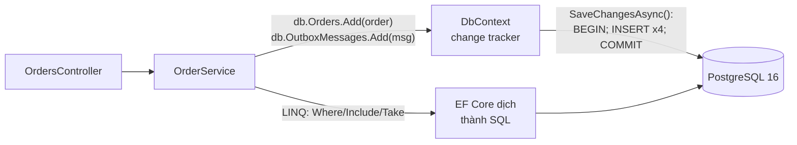
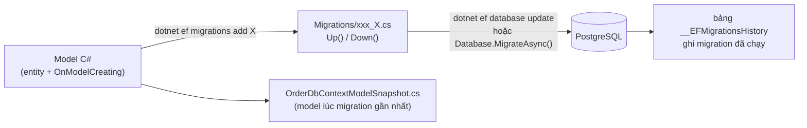

# Bài 07 — PostgreSQL với EF Core 8: entity, DbContext, migration, LINQ ra SQL, transaction

> **Bạn sẽ làm được:** chạy PostgreSQL 16 bằng Docker Compose, nối EF Core 8 qua Npgsql, cấu hình mapping, tạo và
> chạy migration, đọc SQL mà EF sinh ra, ghi nhiều bảng trong **một** transaction, và thay kho RAM của bài 06 mà
> controller không đổi dòng nào.
>
> **Thời lượng:** đọc 40 phút · làm 60 phút
>
> **Trước đó:** [Bài 06](06-web-api-asp-net-core.md) · **Tiếp theo:** [Bài 08 — Background Worker](08-background-worker.md)

---

## 1. Lý thuyết: EF Core qua con mắt người dùng JPA/Hibernate

| JPA / Hibernate | EF Core 8 | Ghi chú |
|---|---|---|
| `EntityManager` / `Session` | **`DbContext`** | Unit of work. Đăng ký **Scoped**: mỗi request một cái |
| Repository / bảng | `DbSet<Order>` | `db.Orders.Where(...)` |
| Persistence context, dirty checking | **Change tracking** | Sửa property của entity đã load rồi `SaveChanges` là có `UPDATE` |
| `flush()` + `commit` | **`SaveChangesAsync()`** | Mỗi lần gọi là **một transaction** |
| JPQL / Criteria API | **LINQ** → SQL | Cùng cú pháp với LINQ trên `List` ([bài 03 §8](03-csharp-cho-dev-java.md)) |
| `JOIN FETCH` | `.Include(o => o.Lines)` | |
| `@Transactional(readOnly = true)` | `.AsNoTracking()` | |
| Lazy loading | **Tắt mặc định** | Quên `Include` thì collection **rỗng**, không tự query thêm ([§8.3](#83-không-có-lazy-loading)) |
| Native query | `FromSql($"...")` | Tham số hoá tự động (bài 08 dùng `FOR UPDATE SKIP LOCKED`) |
| Flyway / Liquibase | **Migration của EF** | Sinh **từ model C#**, không viết SQL tay |
| JDBC driver + dialect | Provider `Npgsql.EntityFrameworkCore.PostgreSQL` | |



---

## 2. Thực hành: PostgreSQL bằng Docker Compose

Tạo `docker-compose.yml` ở thư mục gốc solution (cạnh `OrderFlow.sln`):

📄 **`lab/steps/07/docker-compose.yml`**

```yaml
# Bai 07: chi PostgreSQL. Bai 09 them Service Bus emulator, bai 10 them migrate + api + worker.
name: orderflow

services:
  postgres:
    image: postgres:16-alpine
    environment:
      POSTGRES_USER: orderflow
      POSTGRES_PASSWORD: orderflow
      POSTGRES_DB: orderflow
    ports:
      - "5432:5432"
    volumes:
      - pgdata:/var/lib/postgresql/data # du lieu song qua "docker compose down" (mat khi "down -v")
    healthcheck:
      test: ["CMD-SHELL", "pg_isready -U orderflow -d orderflow"]
      interval: 2s
      timeout: 3s
      retries: 30

volumes:
  pgdata:
```

```bash
docker compose up -d --wait postgres     # --wait: đợi tới khi healthcheck báo healthy
docker compose ps
docker compose exec postgres psql -U orderflow -d orderflow -c 'select version()'
```

| Khối | Nghĩa |
|---|---|
| `image: postgres:16-alpine` | Image chính thức, bản Alpine nhỏ; có bản arm64 cho chip Apple |
| `environment` | Image tự tạo user, mật khẩu, database ở lần chạy đầu |
| `ports: "5432:5432"` | Cổng máy Mac : cổng trong container. App chạy trong Rider nối `localhost:5432` |
| `volumes: pgdata:` | Dữ liệu nằm trong *named volume*: xoá container không mất; `docker compose down -v` mới xoá |
| `healthcheck` | Compose biết lúc nào Postgres **sẵn sàng**, không chỉ "đã khởi động" (bài 10 dùng để xếp thứ tự) |

Đã có PostgreSQL cài sẵn trên Mac chiếm cổng 5432 thì đổi thành `"55432:5432"` và sửa `Port=55432` trong connection string.

---

## 3. Thêm package (ghi đúng phiên bản cho .NET 8)

```bash
dotnet add src/OrderFlow.Core package Npgsql.EntityFrameworkCore.PostgreSQL --version 8.0.11
dotnet add src/OrderFlow.Core package EFCore.NamingConventions --version 8.0.3
dotnet add src/OrderFlow.Api package Microsoft.EntityFrameworkCore.Design --version 8.0.32
dotnet add src/OrderFlow.Api package Microsoft.Extensions.Diagnostics.HealthChecks.EntityFrameworkCore --version 8.0.32
```

| Package | Project | Để làm gì |
|---|---|---|
| `Npgsql.EntityFrameworkCore.PostgreSQL` 8.0.11 | Core | Provider PostgreSQL cho EF Core 8 (kéo theo EF Core và driver Npgsql) |
| `EFCore.NamingConventions` 8.0.3 | Core | Đặt tên bảng/cột `snake_case`: `customer_email` thay vì `"CustomerEmail"` phải bọc ngoặc kép trong SQL |
| `Microsoft.EntityFrameworkCore.Design` 8.0.32 | Api | Cho `dotnet ef` chạy được; phải nằm ở **startup project** |
| `...HealthChecks.EntityFrameworkCore` 8.0.32 | Api | `/health` kiểm tra kết nối DB thật |

Bản 10.x của các package này chỉ chạy trên .NET 10 (lỗi `NU1202`, [bài 02 §5.3](02-rider-du-an-dau-tien.md)).

---

## 4. Model: message, outbox và `DbContext`

### 4.1 Message `OrderCreated` và bảng outbox (chuẩn bị cho bài 08)

**Lý thuyết.** Bài 08 cần báo cho Worker biết "có đơn mới". Nếu API lưu đơn xong mới gửi message, hai việc đó không
cùng transaction: lưu xong mà gửi lỗi thì mất message, gửi xong mà lưu lỗi thì có message cho đơn không tồn tại.
**Outbox pattern:** ghi message vào **bảng** `outbox_messages` trong **cùng transaction** với đơn; việc gửi đi để
Worker làm sau. Bài này tạo sẵn bảng và ghi vào đó; bài 08 dựng phần gửi.

Tạo `src/OrderFlow.Core/Messaging/Messages.cs`:

📄 **`lab/OrderFlow/src/OrderFlow.Core/Messaging/Messages.cs`**

```csharp
using System.Text.Json;

namespace OrderFlow.Core.Messaging;

/// <summary>Su kien API phat ra khi tao don. Record: bat bien, so sanh theo gia tri, serialize gon.</summary>
public sealed record OrderCreated(Guid OrderId, string CustomerEmail, decimal Total, DateTime CreatedAtUtc);

public static class MessageTypes
{
    public const string OrderCreated = "order-created";
}

public static class Json
{
    /// <summary>camelCase giong ASP.NET Core, de payload trong outbox, Service Bus va API cung mot kieu.</summary>
    public static readonly JsonSerializerOptions Options = new(JsonSerializerDefaults.Web);
}
```

Tạo `src/OrderFlow.Core/Data/OutboxMessage.cs` (có luôn bảng `ProcessedMessage` mà bài 09 dùng, để cả bộ bài chỉ cần **một** migration):

📄 **`lab/OrderFlow/src/OrderFlow.Core/Data/OutboxMessage.cs`**

```csharp
using System.Text.Json;
using OrderFlow.Core.Messaging;

namespace OrderFlow.Core.Data;

/// <summary>
/// Mot dong outbox = mot message CHUA gui. Ghi cung transaction voi don hang, Worker doc ra gui len Service Bus sau.
/// Id cua dong nay dung lam MessageId tren Service Bus: gui lai bao nhieu lan cung mot Id.
/// </summary>
public class OutboxMessage
{
    public Guid Id { get; set; }
    public string Type { get; set; } = null!;
    public string Payload { get; set; } = null!;
    public DateTime OccurredAtUtc { get; set; }
    public DateTime? ProcessedAtUtc { get; set; }
    public int Attempts { get; set; }
    public string? LastError { get; set; }

    public static OutboxMessage For<T>(string type, T message, DateTime nowUtc) => new()
    {
        Id = Guid.NewGuid(),
        Type = type,
        Payload = JsonSerializer.Serialize(message, Json.Options),
        OccurredAtUtc = nowUtc
    };
}

/// <summary>Inbox: message nao da xu ly thi co mot dong o day. Khoa chinh MessageId chan xu ly hai lan.</summary>
public class ProcessedMessage
{
    public string MessageId { get; set; } = null!;
    public DateTime ProcessedAtUtc { get; set; }
}
```

### 4.2 `OrderDbContext`: mapping bằng Fluent API

📄 **`lab/OrderFlow/src/OrderFlow.Core/Data/OrderDbContext.cs`**

```csharp
using Microsoft.EntityFrameworkCore;
using OrderFlow.Core.Domain;

namespace OrderFlow.Core.Data;

public class OrderDbContext(DbContextOptions<OrderDbContext> options) : DbContext(options)
{
    public DbSet<Order> Orders => Set<Order>();
    public DbSet<OutboxMessage> OutboxMessages => Set<OutboxMessage>();
    public DbSet<ProcessedMessage> ProcessedMessages => Set<ProcessedMessage>();

    protected override void OnModelCreating(ModelBuilder modelBuilder)
    {
        modelBuilder.Entity<Order>(e =>
        {
            e.HasKey(o => o.Id);
            e.Property(o => o.CustomerEmail).HasMaxLength(256);
            e.Property(o => o.Status).HasConversion<string>().HasMaxLength(16); // luu "Pending", doc DB de hieu
            e.Property(o => o.Total).HasPrecision(18, 2);
            e.Property(o => o.RejectReason).HasMaxLength(512);
            e.HasIndex(o => o.CreatedAtUtc);

            e.HasMany(o => o.Lines).WithOne().HasForeignKey(l => l.OrderId).OnDelete(DeleteBehavior.Cascade);
            e.Navigation(o => o.Lines).HasField("_lines").UsePropertyAccessMode(PropertyAccessMode.Field);
        });

        modelBuilder.Entity<OrderLine>(e =>
        {
            e.ToTable("order_lines"); // khong co DbSet<OrderLine> nen EF dat ten theo class: order_line
            e.Property(l => l.Sku).HasMaxLength(32);
            e.Property(l => l.UnitPrice).HasPrecision(18, 2);
            e.Ignore(l => l.LineTotal);
        });

        modelBuilder.Entity<OutboxMessage>(e =>
        {
            e.Property(m => m.Type).HasMaxLength(128);
            e.Property(m => m.Payload).HasColumnType("jsonb");
            // index mot phan: chi chua dong CHUA gui, nen nho mai du bang outbox lon dan
            e.HasIndex(m => m.OccurredAtUtc).HasFilter("processed_at_utc IS NULL");
        });

        modelBuilder.Entity<ProcessedMessage>(e =>
        {
            e.HasKey(m => m.MessageId);
            e.Property(m => m.MessageId).HasMaxLength(128);
        });
    }
}
```

| Cấu hình | Sinh ra trong PostgreSQL | JPA tương đương |
|---|---|---|
| `HasKey(o => o.Id)` (có thể bỏ vì tên `Id` là quy ước) | `PRIMARY KEY (id)` | `@Id` |
| `HasMaxLength(256)` | `character varying(256)` | `@Column(length = 256)` |
| `HasConversion<string>()` | cột `status` chứa chữ `Pending` | `@Enumerated(EnumType.STRING)` |
| `HasPrecision(18, 2)` | `numeric(18,2)` | `@Column(precision = 18, scale = 2)` |
| `HasMany(...).WithOne().HasForeignKey(...)` | khoá ngoại `order_lines.order_id`, `ON DELETE CASCADE` | `@OneToMany` / `@ManyToOne` |
| `HasField("_lines")` | EF đọc/ghi qua field private `_lines`, vì property `Lines` chỉ đọc | `@Access(FIELD)` |
| `Ignore(l => l.LineTotal)` | không có cột (giá trị tính toán) | `@Transient` |
| `HasColumnType("jsonb")` | cột JSON nhị phân của Postgres | |
| `HasFilter("processed_at_utc IS NULL")` | **partial index** chỉ chứa dòng chưa gửi | |

Mặc định EF Core suy được rất nhiều (khoá chính `Id`, kiểu cột, khoá ngoại theo tên); cấu hình tường minh như trên
để đọc file này là biết bảng trông thế nào.

### 4.3 Đăng ký `DbContext` vào DI

Tạo `src/OrderFlow.Core/DataServiceCollectionExtensions.cs`. Api (và Worker ở bài 08) gọi chung một method:

📄 **`lab/OrderFlow/src/OrderFlow.Core/DataServiceCollectionExtensions.cs`**

```csharp
using Microsoft.EntityFrameworkCore;
using Microsoft.Extensions.Configuration;
using Microsoft.Extensions.DependencyInjection;
using Microsoft.Extensions.DependencyInjection.Extensions;
using OrderFlow.Core.Data;

namespace OrderFlow.Core;

/// <summary>Dang ky phan du lieu, dung chung cho Api va Worker.</summary>
public static class DataServiceCollectionExtensions
{
    public static IServiceCollection AddOrderFlowData(this IServiceCollection services, IConfiguration configuration)
    {
        var connectionString = configuration.GetConnectionString("Postgres")
            ?? throw new InvalidOperationException("Missing connection string 'ConnectionStrings:Postgres'");

        services.AddDbContext<OrderDbContext>(options => options
            .UseNpgsql(connectionString)
            .UseSnakeCaseNamingConvention()); // bang orders, cot customer_email thay vi "Orders"."CustomerEmail"

        services.TryAddSingleton(TimeProvider.System);
        return services;
    }
}
```

- `AddDbContext` đăng ký `OrderDbContext` là **Scoped**. Connection không mở suốt đời DbContext: Npgsql có **pool**
  connection, EF mượn khi chạy lệnh rồi trả lại.
- `GetConnectionString("Postgres")` đọc `ConnectionStrings:Postgres`. Thiếu thì chết ngay lúc khởi động với thông báo
  rõ ràng, thay vì chết ở request đầu tiên.
- `TryAddSingleton`: chỉ đăng ký nếu chưa ai đăng ký (test có thể đăng ký đồng hồ giả trước).

### 4.4 Connection string và log SQL

📄 **`lab/OrderFlow/src/OrderFlow.Api/appsettings.json`**

```json
{
  "Logging": {
    "LogLevel": {
      "Default": "Information",
      "Microsoft.AspNetCore": "Warning",
      "Microsoft.EntityFrameworkCore": "Warning"
    }
  },
  "AllowedHosts": "*",
  "ConnectionStrings": {
    "Postgres": "Host=localhost;Port=5432;Database=orderflow;Username=orderflow;Password=orderflow"
  }
}
```

📄 **`lab/OrderFlow/src/OrderFlow.Api/appsettings.Development.json`**

```json
{
  "Logging": {
    "LogLevel": {
      "Default": "Information",
      "Microsoft.AspNetCore": "Warning",
      "Microsoft.EntityFrameworkCore.Database.Command": "Information"
    }
  }
}
```

Ở Development, category `Microsoft.EntityFrameworkCore.Database.Command` bật mức Information: **mọi câu SQL** in ra
console. Production giữ `Warning`. Mật khẩu `orderflow` ở đây chỉ cho container dev trên máy bạn; mật khẩu thật không
bao giờ nằm trong file commit ([bài 12](12-bat-dau-du-an-that.md)).

---

## 5. `OrderService` bản EF Core và `Program.cs` bản cuối

Xoá `src/OrderFlow.Api/Services/InMemoryOrderStore.cs`, thay `OrderService.cs`:

📄 **`lab/OrderFlow/src/OrderFlow.Api/Services/OrderService.cs`**

```csharp
using Microsoft.EntityFrameworkCore;
using OrderFlow.Api.Contracts;
using OrderFlow.Core.Data;
using OrderFlow.Core.Domain;
using OrderFlow.Core.Messaging;

namespace OrderFlow.Api.Services;

public sealed class OrderService(OrderDbContext db, TimeProvider time, ILogger<OrderService> logger)
{
    public async Task<OrderResponse> CreateAsync(CreateOrderRequest request, CancellationToken ct)
    {
        var now = time.GetUtcNow().UtcDateTime;
        var order = Order.Create(
            request.CustomerEmail,
            request.Lines.Select(l => new OrderLine(l.Sku, l.Quantity, l.UnitPrice)),
            now);

        db.Orders.Add(order);
        db.OutboxMessages.Add(OutboxMessage.For(
            MessageTypes.OrderCreated,
            new OrderCreated(order.Id, order.CustomerEmail, order.Total, now),
            now));

        // INSERT orders + order_lines + outbox_messages trong MOT transaction: co don thi chac chan co message
        await db.SaveChangesAsync(ct);

        logger.LogInformation("Order {OrderId} created for {Email}, total {Total}", order.Id, order.CustomerEmail, order.Total);
        return OrderResponse.From(order);
    }

    public async Task<OrderResponse?> GetAsync(Guid id, CancellationToken ct)
    {
        var order = await db.Orders
            .AsNoTracking() // chi doc: khong can change tracking, nhanh hon va it bo nho hon
            .Include(o => o.Lines)
            .SingleOrDefaultAsync(o => o.Id == id, ct);
        return order is null ? null : OrderResponse.From(order);
    }

    public async Task<IReadOnlyList<OrderResponse>> ListAsync(OrderStatus? status, int take, CancellationToken ct)
    {
        IQueryable<Order> query = db.Orders.AsNoTracking().Include(o => o.Lines);
        if (status is not null)
            query = query.Where(o => o.Status == status);

        var orders = await query
            .OrderByDescending(o => o.CreatedAtUtc)
            .Take(take)
            .ToListAsync(ct);
        return orders.Select(OrderResponse.From).ToList();
    }
}
```

Ba method giữ nguyên chữ ký của bài 06, nên `OrdersController` không đổi. `IQueryable<Order>`: query xây dần từng
bước (`if` thêm `Where`), chỉ chạy một lần ở `ToListAsync`.

Thay `Program.cs` (đây là bản cuối, các bài sau không sửa nữa):

📄 **`lab/OrderFlow/src/OrderFlow.Api/Program.cs`**

```csharp
using OrderFlow.Api.Infrastructure;
using OrderFlow.Api.Services;
using OrderFlow.Core;
using OrderFlow.Core.Data;
using Microsoft.EntityFrameworkCore;

var builder = WebApplication.CreateBuilder(args);

// ---- 1. Dang ky dich vu (DI container) ----
builder.Services.AddOrderFlowData(builder.Configuration); // DbContext (scoped) + TimeProvider (singleton)
builder.Services.AddScoped<OrderService>();

builder.Services.AddControllers();
builder.Services.AddEndpointsApiExplorer();
builder.Services.AddSwaggerGen();

builder.Services.AddProblemDetails(); // moi loi tra ve dang application/problem+json (RFC 7807)
builder.Services.AddExceptionHandler<DomainExceptionHandler>();
builder.Services.AddHealthChecks().AddDbContextCheck<OrderDbContext>("postgres");

var app = builder.Build();

// docker compose chay "dotnet OrderFlow.Api.dll --migrate" MOT lan truoc khi api va worker len
if (args.Contains("--migrate"))
{
    await using var scope = app.Services.CreateAsyncScope();
    await scope.ServiceProvider.GetRequiredService<OrderDbContext>().Database.MigrateAsync();
    app.Logger.LogInformation("Database migrated");
    return;
}

// ---- 2. Pipeline middleware: request di tu tren xuong ----
app.UseExceptionHandler();

if (app.Environment.IsDevelopment())
{
    app.UseSwagger();
    app.UseSwaggerUI(); // http://localhost:5080/swagger
}

app.MapControllers();
app.MapHealthChecks("/health");

app.Run();

public partial class Program { } // de project test dung duoc WebApplicationFactory<Program>
```

Khác bài 06: đăng ký DB thay kho RAM; health check kiểm DB thật; bỏ middleware đo thời gian (log SQL của EF đã cho
biết mỗi câu mất bao lâu); thêm cờ `--migrate` (bài 10 dùng); dòng cuối cho phép test gọi `Program` (bài 11).

---

## 6. Migration: từ model C# ra bảng thật

### 6.1 Lý thuyết



- `migrations add` **so model hiện tại với snapshot**, sinh code C# cho phần khác biệt. Không kết nối DB.
- `database update` chạy các migration chưa có trong `__EFMigrationsHistory`.
- Migration là code: đọc lại trước khi commit, commit cùng code đổi model.

### 6.2 Thực hành

```bash
dotnet ef migrations add InitialCreate --project src/OrderFlow.Core --startup-project src/OrderFlow.Api --output-dir Data/Migrations
dotnet ef database update --project src/OrderFlow.Core --startup-project src/OrderFlow.Api
```

- `--project`: nơi **chứa** `DbContext` và nơi đặt migration (Core).
- `--startup-project`: project **chạy được** để EF đọc cấu hình, connection string và DI (Api). Thiếu tham số này, lỗi thật:

```text
Your startup project 'OrderFlow.Core' doesn't reference Microsoft.EntityFrameworkCore.Design. This package is required for the Entity Framework Core Tools to work. Ensure your startup project is correct, install the package, and try again.
```

Ba file sinh ra trong `src/OrderFlow.Core/Data/Migrations/`: `<timestamp>_InitialCreate.cs`, `.Designer.cs` và
`OrderDbContextModelSnapshot.cs`. Đoạn đầu của file migration:

✂️ **`lab/OrderFlow/src/OrderFlow.Core/Data/Migrations/20261021084834_InitialCreate.cs`** (trích)

```csharp
            migrationBuilder.CreateTable(
                name: "orders",
                columns: table => new
                {
                    id = table.Column<Guid>(type: "uuid", nullable: false),
                    customer_email = table.Column<string>(type: "character varying(256)", maxLength: 256, nullable: false),
                    status = table.Column<string>(type: "character varying(16)", maxLength: 16, nullable: false),
                    total = table.Column<decimal>(type: "numeric(18,2)", precision: 18, scale: 2, nullable: false),
                    reject_reason = table.Column<string>(type: "character varying(512)", maxLength: 512, nullable: true),
                    created_at_utc = table.Column<DateTime>(type: "timestamp with time zone", nullable: false),
                    processed_at_utc = table.Column<DateTime>(type: "timestamp with time zone", nullable: true)
                },
                constraints: table =>
                {
                    table.PrimaryKey("pk_orders", x => x.id);
                });
```

Kiểm tra trong database:

```bash
docker compose exec postgres psql -U orderflow -d orderflow -c '\dt' -c '\d outbox_messages'
```

```text
                 List of relations
 Schema |         Name          | Type  |   Owner
--------+-----------------------+-------+-----------
 public | __EFMigrationsHistory | table | orderflow
 public | order_lines           | table | orderflow
 public | orders                | table | orderflow
 public | outbox_messages       | table | orderflow
 public | processed_messages    | table | orderflow

                        Table "public.outbox_messages"
      Column      |           Type           | Collation | Nullable | Default
------------------+--------------------------+-----------+----------+---------
 id               | uuid                     |           | not null |
 type             | character varying(128)   |           | not null |
 payload          | jsonb                    |           | not null |
 occurred_at_utc  | timestamp with time zone |           | not null |
 processed_at_utc | timestamp with time zone |           |          |
 attempts         | integer                  |           | not null |
 last_error       | text                     |           |          |
Indexes:
    "pk_outbox_messages" PRIMARY KEY, btree (id)
    "ix_outbox_messages_occurred_at_utc" btree (occurred_at_utc) WHERE processed_at_utc IS NULL
```

### 6.3 Các lệnh migration còn lại

| Lệnh | Làm gì | Lưu ý (đã chạy thật) |
|---|---|---|
| `dotnet ef migrations list ...` | Liệt kê migration, đánh dấu cái chưa chạy | |
| `dotnet ef migrations remove ...` | Xoá migration **cuối** (khi chưa chạy lên DB nào) | **Cần kết nối DB** để kiểm tra đã chạy chưa: Postgres tắt thì báo `Failed to connect to 127.0.0.1:5432` |
| `dotnet ef migrations script --idempotent ...` | Sinh **SQL** chạy được nhiều lần (mỗi migration bọc `IF NOT EXISTS`) | Cách an toàn cho production: DBA đọc rồi chạy |
| `dotnet ef database update <tên>` | Lùi/tiến tới đúng migration đó | Lùi là chạy `Down()`, có thể mất dữ liệu |

Production **không** chạy `dotnet ef` trên server. Ba cách thường gặp: script SQL idempotent; *migration bundle*
(`dotnet ef migrations bundle` ra một file chạy được); hoặc app tự `MigrateAsync()` ở một bước riêng trước khi chạy,
đúng cách bài 10 dùng cờ `--migrate`. Đánh đổi của cách cuối: đơn giản, nhưng tài khoản DB của app phải có quyền đổi schema.

---

## 7. Chạy và đọc SQL mà EF Core sinh ra

```bash
dotnet run --project src/OrderFlow.Api --launch-profile http
```

Gửi request 1 của file `.http` (bài 06 §9.2). Log thật trong console:

```text
info: Microsoft.EntityFrameworkCore.Database.Command[20101]
      Executed DbCommand (94ms) [Parameters=[@p0='?' (DbType = Guid), @p1='?' (DbType = DateTime), ...], CommandType='Text', CommandTimeout='30']
      INSERT INTO orders (id, created_at_utc, customer_email, processed_at_utc, reject_reason, status, total)
      VALUES (@p0, @p1, @p2, @p3, @p4, @p5, @p6);
      INSERT INTO outbox_messages (id, attempts, last_error, occurred_at_utc, payload, processed_at_utc, type)
      VALUES (@p7, @p8, @p9, @p10, @p11, @p12, @p13);
      INSERT INTO order_lines (order_id, quantity, sku, unit_price)
      VALUES (@p14, @p15, @p16, @p17)
      RETURNING id;
      INSERT INTO order_lines (order_id, quantity, sku, unit_price)
      VALUES (@p18, @p19, @p20, @p21)
      RETURNING id;
```

- **Một** lần `SaveChangesAsync` = **một** lần gửi tới DB (batch 4 câu), trong **một** transaction. Đơn và dòng outbox
  hoặc cùng có, hoặc cùng không: đây là toàn bộ lời hứa của outbox.
- `RETURNING id`: `order_lines.id` là cột identity, EF lấy giá trị vừa sinh gán ngược vào entity.
- Giá trị tham số hiện `?`: EF giấu dữ liệu nhạy cảm trong log. Muốn thấy khi debug: `options.EnableSensitiveDataLogging()`
  (chỉ ở Development).

GET đơn vừa tạo:

```text
      SELECT t.id, t.created_at_utc, t.customer_email, t.processed_at_utc, t.reject_reason, t.status, t.total, o0.id, o0.order_id, o0.quantity, o0.sku, o0.unit_price
      FROM (
          SELECT o.id, o.created_at_utc, o.customer_email, o.processed_at_utc, o.reject_reason, o.status, o.total
          FROM orders AS o
          WHERE o.id = @__id_0
          LIMIT 2
      ) AS t
      LEFT JOIN order_lines AS o0 ON t.id = o0.order_id
      ORDER BY t.id
```

`LIMIT 2` là của `SingleOrDefault`: lấy 2 dòng để phát hiện "nhiều hơn một" và ném exception. `Include` thành
`LEFT JOIN`. Dừng API rồi chạy lại: đơn vẫn còn (đã kiểm trong `verify-steps.sh`: *order survives an API restart*).

Hai chi tiết nhỏ trong response, đã thấy khi so POST với GET:

| | POST trả về (object trong bộ nhớ) | GET (đọc lại từ DB) |
|---|---|---|
| `total` | `360000` | `360000.00`: `numeric(18,2)` trả về `decimal` có 2 chữ số thập phân; cùng giá trị |
| `createdAtUtc` | `...22.1824191Z` (7 chữ số) | `...22.182419Z` (6 chữ số): Postgres lưu tới **micro** giây, .NET tới 100 nano giây |

Chi tiết thứ hai làm test so sánh thời gian đọc từ DB với thời gian trong bộ nhớ bị lệch; bài 11 tránh bằng đồng hồ giả có số tròn.

---

## 8. LINQ ra SQL: xem trước bằng `ToQueryString()`

### 8.1 Bảng dịch (chạy thật trên DB của bài)

`query.ToQueryString()` in câu SQL **mà không chạy**. Rất nên dùng khi không chắc EF sẽ làm gì.

| LINQ | SQL EF Core 8 sinh ra |
|---|---|
| `db.Orders.Where(o => o.Status == OrderStatus.Pending)` | `WHERE o.status = 'Pending'` |
| `.Where(o => o.Total > 100_000m && o.CreatedAtUtc >= since).OrderByDescending(o => o.CreatedAtUtc).Take(10)` | `WHERE o.total > 100000.0 AND o.created_at_utc >= @__since_0 ORDER BY o.created_at_utc DESC LIMIT @__p_1` |
| `.Select(o => new { o.Id, o.Status, LineCount = o.Lines.Count })` | `SELECT o.id AS "Id", o.status AS "Status", (SELECT count(*)::int FROM order_lines AS o0 WHERE o.id = o0.order_id) AS "LineCount" FROM orders AS o` |
| `.GroupBy(o => o.Status).Select(g => new { Status = g.Key, Count = g.Count(), Total = g.Sum(o => o.Total) })` | `SELECT o.status AS "Status", count(*)::int AS "Count", COALESCE(sum(o.total), 0.0) AS "Total" FROM orders AS o GROUP BY o.status` |
| `.Where(o => new[] { "an@example.com", "big.buyer@example.com" }.Contains(o.CustomerEmail))` | `WHERE o.customer_email IN ('an@example.com', 'big.buyer@example.com')` |

Quan sát: **hằng số** viết thẳng vào SQL (`'Pending'`, `100000.0`), **biến** (`since`) thành tham số `@__since_0`.
Không bao giờ có chuyện nối chuỗi dữ liệu người dùng vào SQL, nên không có SQL injection.

### 8.2 Chỉ đọc thì `AsNoTracking()`

Entity load bình thường được change tracker theo dõi (tốn bộ nhớ, tốn thời gian so sánh lúc `SaveChanges`).
Query chỉ để trả về API thì thêm `AsNoTracking()`, như `GetAsync` và `ListAsync` ở trên.

### 8.3 Không có lazy loading

Đã chạy thật trên đơn có 1 dòng hàng:

```text
== no lazy loading: without Include Lines.Count=0, with Include Lines.Count=1
```

Không `Include` thì `Lines` **rỗng**, không lỗi, không query thêm. Với người quen Hibernate: không có
`LazyInitializationException`, nhưng cũng không có cảnh báo; dữ liệu thiếu im lặng. Thấy collection rỗng bất
thường, việc đầu tiên là kiểm `Include`.

---

## 9. Transaction và đồng thời

- **Mỗi `SaveChangesAsync` là một transaction.** Đủ cho 90% trường hợp: gom mọi thay đổi rồi gọi một lần.
- **Transaction tường minh** khi cần *đọc có khoá* rồi *ghi* trong cùng transaction, hoặc trộn SQL tay với EF:

```csharp
await using var tx = await db.Database.BeginTransactionAsync(ct);
// ... FromSql("SELECT ... FOR UPDATE SKIP LOCKED"), sửa entity ...
await db.SaveChangesAsync(ct);
await tx.CommitAsync(ct);   // quên dòng này thì DisposeAsync rollback
```

  Bài 08 dùng đúng mẫu này trong `OutboxProcessor`.
- **Isolation mặc định của PostgreSQL là Read Committed.** Hai request cùng đọc rồi cùng ghi một dòng có thể ghi đè
  nhau (lost update). EF Core hỗ trợ khoá lạc quan: với Npgsql, cột hệ thống `xmin` làm *concurrency token*
  (`builder.Property<uint>("Version").IsRowVersion()` trên một property `uint Version`), ghi trùng thì
  `DbUpdateConcurrencyException`. Phân tích sâu các kiểu tranh chấp, kèm lab chạy thật, ở
  [Ôn bài 04 — Postgres concurrency](../../on-bai/gd1-nen-tang/04-postgres-concurrency.md) của repo này.

---

## 10. Xem dữ liệu bằng Rider (không cần psql)

1. **⌘8** (Services) hoặc **View → Tool Windows → Database** → **+** → **Data Source → PostgreSQL**.
2. Host `localhost`, Port `5432`, User `orderflow`, Password `orderflow`, Database `orderflow`. Lần đầu Rider đề nghị
   tải driver: bấm **Download**. **Test Connection** → OK.
3. Mở rộng `orderflow → public → tables`; bấm đúp bảng để xem dữ liệu; **⇧⌘L** hoặc chuột phải → **New → Query
   Console** để viết SQL. Ví dụ:

```sql
select o.id, o.status, o.total, count(l.id) as lines, m.processed_at_utc as outbox_sent_at
from orders o
join order_lines l on l.order_id = o.id
left join outbox_messages m on m.payload->>'orderId' = o.id::text
group by o.id, m.processed_at_utc
order by o.created_at_utc desc;
```

Ghi chú `jsonb`: payload ghi vào là `{"orderId":...,"customerEmail":...,"total":...}`, đọc ra thì Postgres đã **đổi
thứ tự key** (`{"total": 300000, "orderId": ...}`, thấy thật trong log bài 08) và bỏ khoảng trắng thừa. Đọc bằng tên
key thì không ảnh hưởng; cần giữ nguyên văn từng byte thì dùng kiểu `json` hoặc `text`.

---

## 11. Lỗi hay gặp (nguyên văn, đã gặp thật)

| Lỗi | Nguyên nhân | Sửa |
|---|---|---|
| `Npgsql.NpgsqlException: Failed to connect to 127.0.0.1:5432` | Postgres chưa chạy | `docker compose up -d --wait postgres` |
| `PostgresException: 42P01: relation "orders" does not exist` | DB trống, chưa chạy migration | `dotnet ef database update ...` |
| `ArgumentException: Cannot write DateTime with Kind=Local to PostgreSQL type 'timestamp with time zone', only UTC is supported.` | Dùng `DateTime.Now` | Luôn dùng UTC: `TimeProvider.GetUtcNow().UtcDateTime` |
| `Your startup project 'OrderFlow.Core' doesn't reference Microsoft.EntityFrameworkCore.Design` | Thiếu `--startup-project` | Thêm `--startup-project src/OrderFlow.Api` |
| `NU1202: Package ... 10.0.x is not compatible with net8.0` | Cài package không ghi phiên bản | Ghi `--version 8.0.x` |
| `Lines` rỗng dù DB có dữ liệu | Quên `.Include(o => o.Lines)` | [§8.3](#83-không-có-lazy-loading) |
| `The instance of entity type 'Order' cannot be tracked because another instance with the same key value...` | Gắn hai object cùng khoá vào một DbContext | Dùng object đã load, hoặc `AsNoTracking()` khi chỉ đọc |

---

## 12. Tự kiểm tra

- [ ] Chạy/dừng/xoá sạch Postgres bằng Docker Compose, vào được `psql` trong container.
- [ ] Giải thích được `--project` và `--startup-project` của `dotnet ef`.
- [ ] Đọc được file migration, biết snapshot dùng để làm gì.
- [ ] Biết một `SaveChangesAsync` ghi nhiều bảng trong một transaction, và vì sao outbox dựa vào điều đó.
- [ ] Dùng `ToQueryString()` xem SQL; giải thích hằng số với tham số; biết khi nào cần `Include`, `AsNoTracking`.
- [ ] Biết vì sao `DateTime` phải là UTC với Npgsql.

## 13. Ranh giới trung thực

- **Đã chạy thật:** trạng thái cuối bài 07 dựng lại từ thư mục trống (`verify-steps.sh 07`: postgres healthy,
  migration, 5 bảng, build 0 warning, outbox cùng transaction, dữ liệu còn sau khi khởi động lại API); toàn bộ SQL,
  bảng `ToQueryString`, thí nghiệm lazy loading và ba thông báo lỗi trong bảng §11 (kết nối, `42P01`, DateTime Local,
  thiếu startup project).
- Ghi chú `xmin`/`IsRowVersion` là theo tài liệu Npgsql, bộ bài **không** có code hay test cho nó.
- Hộp thoại Database của Rider mô tả theo bản gần đây, chưa chụp màn hình được ở đây.
