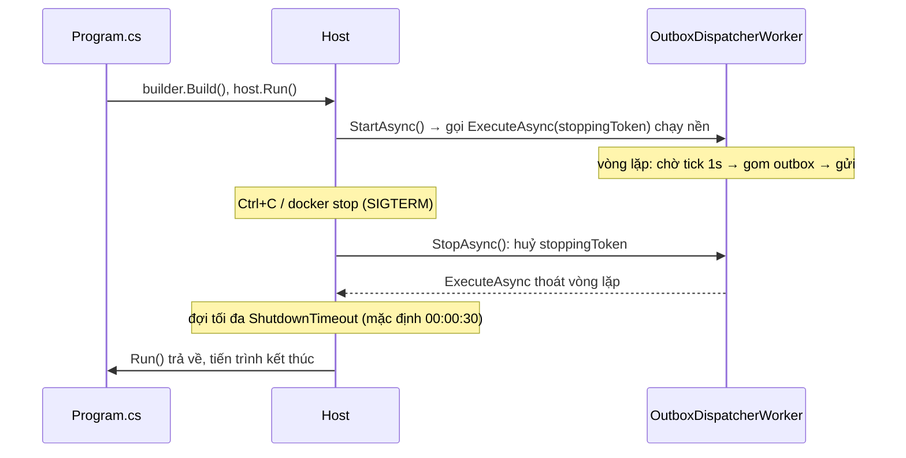
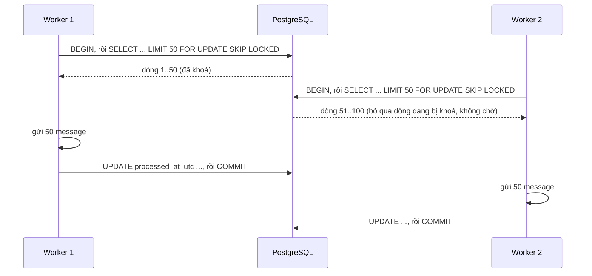

# Bài 08 — Background Worker: Worker Service, `BackgroundService`, `PeriodicTimer`, scope DI và outbox

> **Bạn sẽ làm được:** tạo một tiến trình chạy nền (`OrderFlow.Worker`) cứ mỗi giây gom các message còn nằm trong bảng
> outbox để gửi đi; hiểu vòng đời của host, vì sao phải tạo scope DI cho mỗi vòng, cấu hình có kiểm tra lúc khởi động,
> tắt êm khi nhận Ctrl+C, và chuyện gì xảy ra khi một worker ném exception.
>
> **Thời lượng:** đọc 35 phút · làm 45 phút
>
> **Trước đó:** [Bài 07](07-postgresql-ef-core.md) · **Tiếp theo:** [Bài 09 — Azure Service Bus](09-azure-service-bus.md)

---

## 1. Lý thuyết: "chạy nền" trong .NET

### 1.1 Ba chỗ đặt việc chạy nền

| Cách | Là gì | Khi nào dùng |
|---|---|---|
| Hosted service **trong** app web | `builder.Services.AddHostedService<X>()` ngay trong `OrderFlow.Api` | Việc nhỏ, đi cùng API (làm nóng cache…) |
| **Worker Service** (project riêng) | Tiến trình riêng, `Microsoft.NET.Sdk.Worker`, không có HTTP | Việc nền thật sự: xử lý queue, outbox, job định kỳ. **Bộ bài dùng cách này** |
| Lập lịch bên ngoài | Hangfire, Quartz.NET, CronJob của Kubernetes | Lịch kiểu cron, cần giao diện quản lý job, chạy lại job lỗi |

Tách Worker khỏi API: API chậm vì Worker đang bận thì không còn; scale riêng (API 4 bản, Worker 2 bản); deploy riêng.
Đánh đổi: thêm một thứ phải chạy, theo dõi và deploy.

### 1.2 Đối chiếu Spring

| Spring | .NET 8 |
|---|---|
| `@Scheduled(fixedDelay = 1000)` | `BackgroundService` + `PeriodicTimer` |
| `CommandLineRunner` | `IHostedService.StartAsync` |
| `@KafkaListener` / `@JmsListener` | `BackgroundService` bọc `ServiceBusProcessor` (bài 09) |
| `ApplicationContext` không web | **Generic Host**: `Host.CreateApplicationBuilder(args)`, cùng DI/config/logging như web |
| `@PreDestroy`, graceful shutdown | `StopAsync` + `CancellationToken` `stoppingToken` |

### 1.3 Vòng đời của host



Giá trị mặc định đọc thật trên .NET 8: `HostOptions.ShutdownTimeout = 00:00:30`,
`BackgroundServiceExceptionBehavior = StopHost` (hệ quả ở [§7.1](#71-exception-thoát-khỏi-executeasync-cả-host-dừng-mà-exit-code-vẫn-0)).

---

## 2. Thực hành: tạo project Worker

```bash
dotnet new worker -n OrderFlow.Worker -o src/OrderFlow.Worker
dotnet sln add src/OrderFlow.Worker
dotnet add src/OrderFlow.Worker reference src/OrderFlow.Core
dotnet add src/OrderFlow.Core package Microsoft.Extensions.Options.ConfigurationExtensions --version 8.0.0
dotnet add src/OrderFlow.Core package Microsoft.Extensions.Options.DataAnnotations --version 8.0.0
rm src/OrderFlow.Worker/Worker.cs
```

Rider: chuột phải solution → **Add → New Project… → Worker Service**. Hai package Options cần cho `ValidateDataAnnotations()`
ở §5: khi dựng lại bộ bài từ đầu, thiếu chúng thì build lỗi thật
`CS1061: 'OptionsBuilder<OutboxOptions>' does not contain a definition for 'ValidateDataAnnotations'`.

Template sinh `Worker.cs` như sau (đọc để hiểu rồi xoá):

```csharp
public class Worker : BackgroundService
{
    private readonly ILogger<Worker> _logger;

    public Worker(ILogger<Worker> logger)
    {
        _logger = logger;
    }

    protected override async Task ExecuteAsync(CancellationToken stoppingToken)
    {
        while (!stoppingToken.IsCancellationRequested)
        {
            if (_logger.IsEnabled(LogLevel.Information))
            {
                _logger.LogInformation("Worker running at: {time}", DateTimeOffset.Now);
            }
            await Task.Delay(1000, stoppingToken);
        }
    }
}
```

`BackgroundService` là lớp trừu tượng: bạn chỉ viết `ExecuteAsync`, phần `StartAsync`/`StopAsync` nó lo. Project
file là `Sdk="Microsoft.NET.Sdk.Worker"` và có sẵn package `Microsoft.Extensions.Hosting`.

---

## 3. Outbox processor: logic nằm trong Core

### 3.1 Lý thuyết: gom việc an toàn khi chạy nhiều Worker



- `FOR UPDATE`: khoá các dòng vừa đọc tới khi transaction kết thúc.
- `SKIP LOCKED`: dòng nào đang bị transaction khác khoá thì **bỏ qua**, không đứng chờ. Hai Worker tự chia việc mà
  không cần điều phối. Bài 11 có test chạy hai dispatcher song song trên 40 message: tổng 40 lần gửi, không message nào hai lần.
- **Gửi xong mà chết trước `COMMIT`** thì dòng chưa được đánh dấu, lần sau gửi lại: outbox cho **at-least-once**
  (ít nhất một lần). Phía nhận phải chịu được trùng; bài 09 lo phần đó.

### 3.2 Code

Interface để processor không biết gì về Service Bus (bài 09 mới cài đặt thật):

📄 **`lab/OrderFlow/src/OrderFlow.Core/Messaging/IMessagePublisher.cs`**

```csharp
using OrderFlow.Core.Data;

namespace OrderFlow.Core.Messaging;

/// <summary>Cho OutboxProcessor khong biet gi ve Service Bus: test thay bang ban gia, doi broker chi doi class cai dat.</summary>
public interface IMessagePublisher
{
    Task PublishAsync(OutboxMessage message, CancellationToken ct);
}
```

📄 **`lab/OrderFlow/src/OrderFlow.Core/Outbox/OutboxProcessor.cs`**

```csharp
using System.ComponentModel.DataAnnotations;
using Microsoft.EntityFrameworkCore;
using Microsoft.Extensions.Logging;
using Microsoft.Extensions.Options;
using OrderFlow.Core.Data;
using OrderFlow.Core.Messaging;

namespace OrderFlow.Core.Outbox;

public sealed class OutboxOptions
{
    public const string Section = "Outbox";

    [Range(1, 1000)] public int BatchSize { get; set; } = 50;

    [Range(100, 60_000)] public int PollIntervalMs { get; set; } = 1000;
}

/// <summary>
/// Mot vong outbox: khoa mot lo dong chua gui (FOR UPDATE SKIP LOCKED), gui tung dong, danh dau da gui, commit.
/// Chay nhieu Worker song song cung duoc: SKIP LOCKED chia viec, khong ban nao lay trung dong cua ban khac.
/// Chet giua "gui" va "commit" thi lan sau gui lai: consumer phai idempotent (xem OrderCreatedHandler).
/// </summary>
public sealed class OutboxProcessor(
    OrderDbContext db,
    IMessagePublisher publisher,
    TimeProvider time,
    IOptions<OutboxOptions> options,
    ILogger<OutboxProcessor> logger)
{
    /// <returns>So message da gui thanh cong trong vong nay.</returns>
    public async Task<int> DispatchBatchAsync(CancellationToken ct)
    {
        var batchSize = options.Value.BatchSize;
        await using var tx = await db.Database.BeginTransactionAsync(ct);

        // FromSql + chuoi noi suy: {batchSize} thanh tham so @p0, khong phai noi chuoi -> khong SQL injection
        var batch = await db.OutboxMessages
            .FromSql($"""
                SELECT * FROM outbox_messages
                WHERE processed_at_utc IS NULL
                ORDER BY occurred_at_utc
                LIMIT {batchSize}
                FOR UPDATE SKIP LOCKED
                """)
            .ToListAsync(ct);

        var sent = 0;
        foreach (var message in batch)
        {
            try
            {
                await publisher.PublishAsync(message, ct);
                message.ProcessedAtUtc = time.GetUtcNow().UtcDateTime;
                sent++;
            }
            catch (Exception ex) when (ex is not OperationCanceledException)
            {
                message.Attempts++;
                message.LastError = ex.Message.Length > 2000 ? ex.Message[..2000] : ex.Message;
                logger.LogWarning(ex, "Publish failed for outbox message {MessageId} (attempt {Attempts})",
                    message.Id, message.Attempts);
                break; // broker dang loi: dung lo nay, vong sau thu lai, khong dap tiep vao broker
            }
        }

        await db.SaveChangesAsync(ct);
        await tx.CommitAsync(ct);

        if (sent > 0)
            logger.LogInformation("Outbox: sent {Sent}/{Batch} message(s)", sent, batch.Count);
        return sent;
    }
}
```

| Dòng | Vì sao |
|---|---|
| `BeginTransactionAsync` | Khoá `FOR UPDATE` chỉ sống trong transaction; phải mở tường minh vì có cả SQL tay lẫn `SaveChanges` |
| `FromSql($"""...{batchSize}...""")` | SQL tay nhưng **tham số hoá**: `{batchSize}` thành `@p0`. Entity load bằng `FromSql` vẫn được track, sửa rồi `SaveChanges` là có `UPDATE` |
| `catch ... when (ex is not OperationCanceledException)` | Huỷ do tắt app không phải lỗi publish |
| `break` khi lỗi | Broker đang chết thì dừng lô, đợi vòng sau; ghi `Attempts`, `LastError` để nhìn thấy trong DB |
| `ex.Message[..2000]` | *range operator*: lấy 2000 ký tự đầu, như `substring(0, 2000)` |

Đánh đổi của thiết kế này: publish nằm **trong** transaction, giữ khoá dòng và một connection trong lúc gọi broker.
Broker chậm thì nên chuyển sang kiểu "nhận việc" (đánh dấu *đang gửi* với thời hạn), gửi ngoài transaction, rồi
đánh dấu xong. Với lô 50 message và broker cục bộ, cách đơn giản này đủ dùng.

---

## 4. `BackgroundService`: vòng lặp, scope, lỗi

📄 **`lab/OrderFlow/src/OrderFlow.Worker/OutboxDispatcherWorker.cs`**

```csharp
using Microsoft.Extensions.Options;
using OrderFlow.Core.Outbox;

namespace OrderFlow.Worker;

/// <summary>
/// Background worker kieu "hen gio": moi PollIntervalMs chay mot vong outbox. Phan logic nam o OutboxProcessor
/// (Core) de test duoc ma khong can dung host; lop nay chi lo vong lap, scope DI va xu ly loi.
/// </summary>
public sealed class OutboxDispatcherWorker(
    IServiceScopeFactory scopeFactory,
    IOptions<OutboxOptions> options,
    ILogger<OutboxDispatcherWorker> logger) : BackgroundService
{
    protected override async Task ExecuteAsync(CancellationToken stoppingToken)
    {
        var interval = TimeSpan.FromMilliseconds(options.Value.PollIntervalMs);
        logger.LogInformation("Outbox dispatcher started, polling every {Interval}", interval);

        using var timer = new PeriodicTimer(interval);
        try
        {
            do
            {
                await DrainAsync(stoppingToken);
            }
            while (await timer.WaitForNextTickAsync(stoppingToken));
        }
        catch (OperationCanceledException) when (stoppingToken.IsCancellationRequested)
        {
            // host dang tat (Ctrl+C, docker stop): thoat vong lap binh thuong
        }
    }

    private async Task DrainAsync(CancellationToken ct)
    {
        try
        {
            int sent;
            do
            {
                // Worker nay la singleton, DbContext la scoped: moi vong tao mot scope moi, xong thi Dispose
                await using var scope = scopeFactory.CreateAsyncScope();
                var processor = scope.ServiceProvider.GetRequiredService<OutboxProcessor>();
                sent = await processor.DispatchBatchAsync(ct);
            }
            while (sent == options.Value.BatchSize); // con hang thi lam tiep ngay, khong doi tick sau
        }
        catch (Exception ex) when (ex is not OperationCanceledException)
        {
            // KHONG de exception bay ra khoi ExecuteAsync: tu .NET 6 mac dinh la dung ca host
            logger.LogError(ex, "Outbox dispatch failed, will retry on the next tick");
        }
    }
}
```

Bốn quyết định trong file này:

1. **`PeriodicTimer` thay vì `Task.Delay` trong `while`.** `Task.Delay(1000)` sau mỗi vòng làm chu kỳ trôi dần (1 s +
   thời gian xử lý). `PeriodicTimer` (từ .NET 6) bắn đều đặn; vòng xử lý dài hơn chu kỳ thì không chồng vòng, tick lỡ được bỏ qua.
2. **Mỗi vòng một scope.** `AddHostedService` đăng ký worker là **singleton**, còn `OutboxProcessor` cần `DbContext`
   **scoped**. Inject thẳng `OutboxProcessor` vào constructor là giữ một `DbContext` suốt đời app ([§7.2](#72-inject-scoped-vào-singleton-development-chặn-production-im-lặng-chạy-sai)).
   `IServiceScopeFactory.CreateAsyncScope()` tạo scope mới, `await using` giải phóng nó (đóng `DbContext`) cuối mỗi vòng.
3. **Còn hàng thì làm tiếp ngay:** gửi đủ `BatchSize` nghĩa là có thể còn, lặp luôn không đợi tick.
4. **Bắt mọi exception trong vòng lặp.** Exception thoát khỏi `ExecuteAsync` làm **dừng cả host** ([§7.1](#71-exception-thoát-khỏi-executeasync-cả-host-dừng-mà-exit-code-vẫn-0)).

---

## 5. `Program.cs`, publisher tạm, cấu hình

Bài này chưa có Service Bus, nên dùng một publisher **tạm** chỉ ghi log. Bài 09 xoá file này.

📄 **`lab/steps/08/src/OrderFlow.Worker/LoggingMessagePublisher.cs`**

```csharp
using OrderFlow.Core.Data;
using OrderFlow.Core.Messaging;

namespace OrderFlow.Worker;

/// <summary>Publisher tam cua bai 08: chi ghi log, chua gui di dau. Bai 09 xoa file nay, dung ServiceBusMessagePublisher.</summary>
public sealed class LoggingMessagePublisher(ILogger<LoggingMessagePublisher> logger) : IMessagePublisher
{
    public Task PublishAsync(OutboxMessage message, CancellationToken ct)
    {
        logger.LogInformation("PUBLISH {Type} {MessageId}: {Payload}", message.Type, message.Id, message.Payload);
        return Task.CompletedTask;
    }
}
```

📄 **`lab/steps/08/src/OrderFlow.Worker/Program.cs`**

```csharp
using OrderFlow.Core;
using OrderFlow.Core.Messaging;
using OrderFlow.Core.Outbox;
using OrderFlow.Worker;

var builder = Host.CreateApplicationBuilder(args);

builder.Services.AddOrderFlowData(builder.Configuration); // DbContext + TimeProvider
builder.Services.AddOptions<OutboxOptions>()
    .Bind(builder.Configuration.GetSection(OutboxOptions.Section))
    .ValidateDataAnnotations()
    .ValidateOnStart(); // cau hinh sai thi chet ngay luc khoi dong
builder.Services.AddSingleton<IMessagePublisher, LoggingMessagePublisher>(); // bai 09 doi sang Service Bus
builder.Services.AddScoped<OutboxProcessor>();

builder.Services.AddHostedService<OutboxDispatcherWorker>(); // outbox -> (tam thoi) log

var host = builder.Build();
host.Run();
```

📄 **`lab/steps/08/src/OrderFlow.Worker/appsettings.json`**

```json
{
  "Logging": {
    "LogLevel": {
      "Default": "Information",
      "Microsoft.Hosting.Lifetime": "Information",
      "Microsoft.EntityFrameworkCore": "Warning"
    }
  },
  "ConnectionStrings": {
    "Postgres": "Host=localhost;Port=5432;Database=orderflow;Username=orderflow;Password=orderflow"
  },
  "Outbox": {
    "BatchSize": 50,
    "PollIntervalMs": 1000
  }
}
```

### 5.1 Lý thuyết: Options pattern

Thay vì đọc `configuration["Outbox:BatchSize"]` rải rác, gom thành class `OutboxOptions` và **bind** một lần:

- `.Bind(section)`: map khoá `Outbox:BatchSize` vào property `BatchSize` (biến môi trường `Outbox__BatchSize` cũng vậy).
- `.ValidateDataAnnotations()`: kiểm `[Range(1, 1000)]` trên class.
- `.ValidateOnStart()`: kiểm **ngay lúc host khởi động**. Không có dòng này, cấu hình sai chỉ lộ ra khi có người đầu
  tiên đọc `options.Value`, có khi là lúc 3 giờ sáng.
- Nơi dùng nhận `IOptions<OutboxOptions>` qua constructor (như `OutboxProcessor`), giống `@ConfigurationProperties`.

Thử thật: đặt `Outbox__BatchSize=0` rồi chạy Worker:

```text
fail: Microsoft.Extensions.Hosting.Internal.Host[11]
      Hosting failed to start
      Microsoft.Extensions.Options.OptionsValidationException: DataAnnotation validation failed for 'OutboxOptions' members: 'BatchSize' with the error: 'The field BatchSize must be between 1 and 1000.'.
```

Tiến trình thoát với exit code **134** (khác 0), nên Docker/Kubernetes biết là lỗi.

---

## 6. Chạy Api + Worker cùng lúc

Hai Terminal (Postgres của bài 07 vẫn chạy):

```bash
dotnet run --project src/OrderFlow.Api --launch-profile http     # Terminal 1
dotnet run --project src/OrderFlow.Worker                        # Terminal 2
```

Trong Rider: **Run → Edit Configurations… → + → Compound**, đặt tên `Api + Worker`, thêm `OrderFlow.Api: http` và
`OrderFlow.Worker` → chọn compound đó → ⌃R (hoặc ⌃D để debug cả hai).

Gửi request 1 của file `.http`. Log thật của Worker (bản dựng lại bài 08):

```text
info: OrderFlow.Worker.OutboxDispatcherWorker[0]
      Outbox dispatcher started, polling every 00:00:01
info: Microsoft.Hosting.Lifetime[0]
      Application started. Press Ctrl+C to shut down.
info: Microsoft.Hosting.Lifetime[0]
      Hosting environment: Development
info: OrderFlow.Worker.LoggingMessagePublisher[0]
      PUBLISH order-created 89937493-e9f9-4ba5-9a3e-91cbf19d0b72: {"total": 60000, "orderId": "2813058d-f528-4628-9b77-abb6ce9c0cf9", "createdAtUtc": "2026-10-21T09:51:40.2803821Z", "customerEmail": "binh@example.com"}
info: OrderFlow.Core.Outbox.OutboxProcessor[0]
      Outbox: sent 1/1 message(s)
```

(Thứ tự key trong payload đã bị `jsonb` sắp xếp lại, [bài 07 §10](07-postgresql-ef-core.md).) Kiểm tra trong DB:

```bash
docker compose exec postgres psql -U orderflow -d orderflow \
  -c 'select id, type, processed_at_utc, attempts from outbox_messages order by occurred_at_utc desc limit 3'
```

`processed_at_utc` có giá trị = đã gửi. Ctrl+C ở Terminal 2: log in `Application is shutting down...` và tiến trình
thoát ngay (vòng lặp bắt `OperationCanceledException` và kết thúc), không phải đợi hết 30 giây `ShutdownTimeout`.

---

## 7. Ba thí nghiệm về những gì có thể sai (đã chạy thật)

### 7.1 Exception thoát khỏi `ExecuteAsync`: cả host dừng, mà exit code vẫn 0

Hai worker trong một host; một cái ném exception sau 0,5 giây, cái kia đang chạy bình thường. Output thật:

```text
info: CrashDemo.OtherWorker[0]
      other worker still alive
fail: Microsoft.Extensions.Hosting.Internal.Host[9]
      BackgroundService failed
      System.InvalidOperationException: boom: unhandled exception inside ExecuteAsync
crit: Microsoft.Extensions.Hosting.Internal.Host[10]
      The HostOptions.BackgroundServiceExceptionBehavior is configured to StopHost. A BackgroundService has thrown an unhandled exception, and the IHost instance is stopping. To avoid this behavior, configure this to Ignore; however the BackgroundService will not be restarted.
      System.InvalidOperationException: boom: unhandled exception inside ExecuteAsync
info: Microsoft.Hosting.Lifetime[0]
      Application is shutting down...
```

- Một worker chết kéo theo **cả host**, kể cả worker kia đang khoẻ.
- Đo bằng `echo $?`: tiến trình kết thúc với **exit code 0**. Docker với `restart: on-failure` **không** khởi động
  lại container exit 0. Vì thế `docker-compose.yml` của bài 10 dùng `restart: unless-stopped` cho worker.
- Phòng từ gốc: bắt exception **bên trong** vòng lặp như `DrainAsync` làm.

### 7.2 Inject Scoped vào Singleton: Development chặn, Production im lặng chạy sai

Một `BackgroundService` nhận thẳng service Scoped qua constructor:

```csharp
builder.Services.AddScoped<OrderRepository>();
builder.Services.AddHostedService<Worker>();   // Worker(OrderRepository repository, ...)
```

Chạy ở **Development**:

```text
Unhandled exception. System.AggregateException: Some services are not able to be constructed (Error while validating the service descriptor 'ServiceType: Microsoft.Extensions.Hosting.IHostedService Lifetime: Singleton ImplementationType: CrashDemo.Worker': Cannot consume scoped service 'CrashDemo.OrderRepository' from singleton 'Microsoft.Extensions.Hosting.IHostedService'.)
```

Chạy **cùng code** ở **Production** (`DOTNET_ENVIRONMENT=Production`, không qua launch profile):

```text
info: CrashDemo.Worker[0]
      pending: 3
info: Microsoft.Hosting.Lifetime[0]
      Application started. Press Ctrl+C to shut down.
info: Microsoft.Hosting.Lifetime[0]
      Hosting environment: Production
```

Production **không kiểm tra scope** (để khởi động nhanh) và chạy tiếp với một object "scoped" bị giữ suốt đời app.
Nếu đó là `DbContext`: dữ liệu cũ dính trong change tracker, bộ nhớ phình dần, lỗi khi hai thread dùng chung.
Bài học: chạy thử ở Development trước, và trong worker luôn đi qua `IServiceScopeFactory`.

Bẫy kèm theo khi làm thí nghiệm này: `DOTNET_ENVIRONMENT=Production dotnet run` vẫn ra **Development**, vì
`launchSettings.json` của Worker đặt `DOTNET_ENVIRONMENT=Development` và `dotnet run` áp nó đè lên ([bài 06 §8.2](06-web-api-asp-net-core.md)).

### 7.3 Chạy file `.dll` từ thư mục khác: không thấy `appsettings.json`

```bash
cd lab/OrderFlow
dotnet src/OrderFlow.Worker/bin/Debug/net8.0/OrderFlow.Worker.dll
```

```text
Unhandled exception. System.InvalidOperationException: Missing connection string 'ConnectionStrings:Postgres'
```

Host lấy **thư mục hiện tại** làm content root để tìm `appsettings.json`. `dotnet run --project ...` đặt sẵn thư
mục làm việc là thư mục project nên không gặp. Chạy file `.dll` thì `cd` vào đúng thư mục trước (Dockerfile ở bài 10
có `WORKDIR /app` vì lý do này).

---

## 8. Lỗi hay gặp

| Triệu chứng | Nguyên nhân | Sửa |
|---|---|---|
| `Cannot consume scoped service ... from singleton ...IHostedService` | Inject Scoped vào worker | `IServiceScopeFactory` + scope mỗi vòng ([§7.2](#72-inject-scoped-vào-singleton-development-chặn-production-im-lặng-chạy-sai)) |
| Worker im lặng dừng, container `Exited (0)` | Exception thoát khỏi `ExecuteAsync` | Bắt trong vòng lặp; `restart: unless-stopped` ([§7.1](#71-exception-thoát-khỏi-executeasync-cả-host-dừng-mà-exit-code-vẫn-0)) |
| `OptionsValidationException ... BatchSize` lúc khởi động | Cấu hình sai, `ValidateOnStart` bắt được | Sửa `appsettings.json` hoặc biến môi trường |
| `Missing connection string 'ConnectionStrings:Postgres'` | Content root sai ([§7.3](#73-chạy-file-dll-từ-thư-mục-khác-không-thấy-appsettingsjson)) hoặc quên khai | Chạy từ thư mục project; kiểm `appsettings.json` của **Worker** (mỗi project một file riêng) |
| Ctrl+C mà Worker 30 giây sau mới tắt | Vòng lặp không nhận `stoppingToken` | Truyền `stoppingToken` xuống mọi `await` |
| Outbox không vơi, `attempts` tăng mãi | Publisher lỗi liên tục | Đọc cột `last_error`; bài 09 §8 có kịch bản Service Bus tắt |

---

## 9. Tự kiểm tra

- [ ] Phân biệt hosted service trong API, Worker Service riêng, và lập lịch bên ngoài.
- [ ] Vẽ được vòng đời Start → Execute → Stop và nói `stoppingToken` bị huỷ lúc nào.
- [ ] Giải thích `FOR UPDATE SKIP LOCKED` cho phép nhiều Worker chạy song song thế nào, và vì sao outbox là at-least-once.
- [ ] Viết được `BackgroundService` có `PeriodicTimer`, scope mỗi vòng, bắt exception đúng chỗ.
- [ ] Dùng Options pattern có `ValidateOnStart`.
- [ ] Kể được ba thí nghiệm ở §7 và cách phòng từng cái.

## 10. Ranh giới trung thực

- **Đã chạy thật:** trạng thái cuối bài 08 dựng lại từ thư mục trống (`verify-steps.sh 08`: build 0 warning, outbox
  được Worker gom hết, log `PUBLISH order-created`); lỗi CS1061 khi thiếu package Options (lần dựng lại đầu tiên);
  giá trị mặc định `HostOptions`; ba thí nghiệm §7 và lỗi `OptionsValidationException`, kèm exit code 0 và 134.
- Câu "`PeriodicTimer` bỏ tick lỡ" là theo tài liệu .NET, bộ bài không đo riêng.
- Compound run configuration của Rider mô tả theo bản gần đây, chưa chụp màn hình được ở đây.
