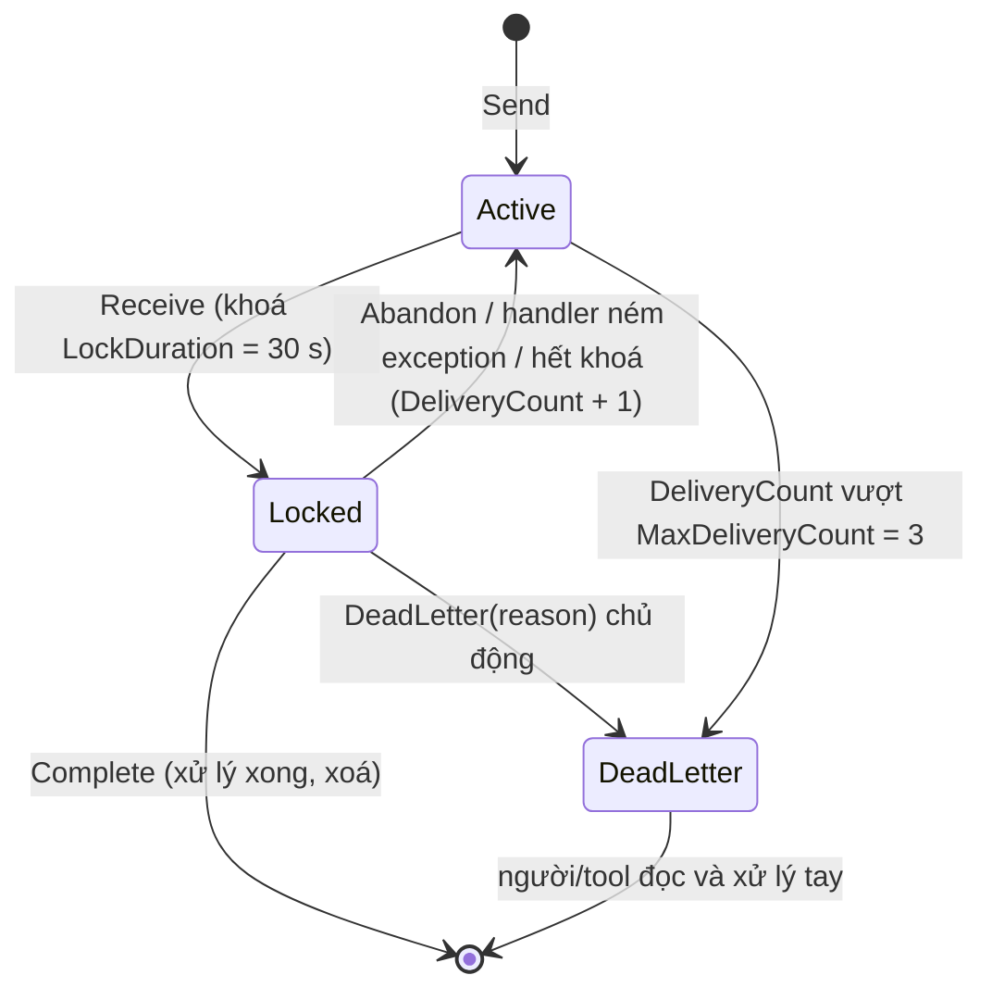

# Bài 09 — Azure Service Bus: queue, topic, peek-lock, retry, dead-letter, emulator và consumer idempotent

> **Bạn sẽ làm được:** chạy Service Bus **emulator** chính thức của Microsoft bằng Docker, làm 7 thí nghiệm để thấy tận
> mắt peek-lock, retry, dead-letter, duplicate detection, topic; rồi nối OrderFlow: Worker gửi outbox lên queue và một
> consumer xử lý đơn **đúng một lần về hiệu ứng** dù message có thể tới nhiều lần.
>
> **Thời lượng:** đọc 45 phút · làm 75 phút
>
> **Code:** [`lab/playground/ServiceBusDemo/`](lab/playground/ServiceBusDemo/Program.cs) (thí nghiệm) và lab OrderFlow (tích hợp)
>
> **Trước đó:** [Bài 08](08-background-worker.md) · **Tiếp theo:** [Bài 10 — Docker hoá](10-docker-hoa.md)

---

## 1. Lý thuyết: Service Bus trong 10 khái niệm

| Khái niệm | Nghĩa | Kafka (để đối chiếu) |
|---|---|---|
| **Namespace** | Một "máy chủ" Service Bus: `xxx.servicebus.windows.net`. Emulator luôn là `sbemulatorns` | Cluster |
| **Queue** | Hàng đợi điểm-điểm: mỗi message chỉ **một** consumer nhận; nhiều consumer thì chia nhau (*competing consumers*) | Topic + một consumer group |
| **Topic + Subscription** | Pub/sub: mỗi subscription nhận **một bản sao** của mỗi message; có thể lọc theo thuộc tính | Topic + nhiều consumer group |
| **Message** | Body (bytes) + `MessageId`, `Subject`, `ContentType`, `CorrelationId`, `ApplicationProperties` | Record (key, value, headers) |
| **Peek-lock** (mặc định) | Nhận = **khoá** message trong `LockDuration`; xử lý xong gọi `Complete` mới bị xoá | Commit offset sau xử lý |
| **Abandon** | Trả message về hàng đợi ngay, `DeliveryCount` tăng 1 | Không commit, đọc lại |
| **MaxDeliveryCount** | Giao quá số lần này (bộ bài: 3) → tự chuyển vào **dead-letter queue** | Không có sẵn (tự làm DLQ topic) |
| **Dead-letter queue (DLQ)** | Hàng đợi con `orders/$deadletterqueue` chứa message hỏng/hết lượt, có `DeadLetterReason` | |
| **Duplicate detection** | Queue nhớ `MessageId` trong một cửa sổ thời gian, bỏ bản gửi trùng | Idempotent producer (khác cơ chế) |
| **Session** | Nhóm message theo `SessionId`, xử lý tuần tự trong nhóm (FIFO theo khoá) | Thứ tự theo partition key |

Khác biệt gốc với Kafka: Kafka là **log** giữ message theo thời gian, consumer tự giữ offset và đọc lại được; Service Bus
là **broker** quản lý trạng thái từng message (khoá, đếm số lần giao, xoá khi xong). Service Bus hợp với **lệnh/công
việc** cần xử lý từng cái một có retry và DLQ; Kafka hợp với luồng sự kiện khối lượng lớn cần đọc lại.

Vòng đời một message ở chế độ peek-lock:



**Hệ quả quan trọng nhất:** Service Bus giao **ít nhất một lần** (at-least-once). Consumer chết sau khi xử lý nhưng
trước `Complete`, hoặc khoá hết hạn, thì message tới lần nữa. Không broker nào giao "đúng một lần" qua mạng; ta làm
cho lần thứ hai **vô hại** ([§6](#6-idempotency-ba-lớp-chống-xử-lý-hai-lần)).

---

## 2. Thực hành: chạy emulator bằng Docker

### 2.1 Emulator gồm hai container

Emulator cần một SQL Server làm kho lưu trạng thái. Bộ bài dùng **Azure SQL Edge** như file mẫu chính thức của
Microsoft (có bản arm64 nên chạy thẳng trên chip Apple). Thay `docker-compose.yml`:

📄 **`lab/steps/09/docker-compose.yml`**

```yaml
# Bai 09: PostgreSQL + Service Bus emulator (emulator can them mot SQL Server lam kho luu tru).
# App van chay tu Rider/dotnet run. Bai 10 them migrate + api + worker vao profile "app".
name: orderflow

services:
  postgres:
    image: postgres:16-alpine
    environment:
      POSTGRES_USER: orderflow
      POSTGRES_PASSWORD: orderflow
      POSTGRES_DB: orderflow
    ports:
      - "5432:5432"
    volumes:
      - pgdata:/var/lib/postgresql/data
    healthcheck:
      test: ["CMD-SHELL", "pg_isready -U orderflow -d orderflow"]
      interval: 2s
      timeout: 3s
      retries: 30

  # Service Bus emulator can mot SQL Server de luu trang thai; Azure SQL Edge chay native ca tren chip Apple (arm64)
  sqledge:
    image: mcr.microsoft.com/azure-sql-edge:latest
    environment:
      ACCEPT_EULA: "Y"
      MSSQL_SA_PASSWORD: "${SQL_PASSWORD:-OrderFlow_Dev_2026!}"

  servicebus:
    image: mcr.microsoft.com/azure-messaging/servicebus-emulator:latest
    depends_on:
      - sqledge
    environment:
      SQL_SERVER: sqledge
      MSSQL_SA_PASSWORD: "${SQL_PASSWORD:-OrderFlow_Dev_2026!}"
      ACCEPT_EULA: "Y"
    volumes:
      - ./servicebus/config.json:/ServiceBus_Emulator/ConfigFiles/Config.json:ro
    ports:
      - "5672:5672" # AMQP: app gui/nhan message
      - "5300:5300" # HTTP: /health va API quan tri

volumes:
  pgdata:
```

- `ACCEPT_EULA: "Y"`: đồng ý điều khoản của emulator và SQL Edge (bắt buộc, không có thì container không chạy).
- `${SQL_PASSWORD:-...}`: lấy biến môi trường `SQL_PASSWORD`, không có thì dùng giá trị mặc định. Mật khẩu SQL phải đủ
  mạnh (chữ hoa, thường, số, ký tự đặc biệt) nếu không SQL Edge từ chối khởi động.
- Emulator chỉ để **dev và test**, không dùng cho production; không tương thích với công cụ Service Bus Explorer.

### 2.2 Khai báo queue/topic: `servicebus/config.json`

Emulator **không** tạo queue qua code; nó đọc file cấu hình lúc khởi động. Tạo `servicebus/config.json`:

📄 **`lab/OrderFlow/servicebus/config.json`**

```json
{
  "UserConfig": {
    "Namespaces": [
      {
        "Name": "sbemulatorns",
        "Queues": [
          {
            "Name": "orders",
            "Properties": {
              "DeadLetteringOnMessageExpiration": false,
              "DefaultMessageTimeToLive": "PT1H",
              "DuplicateDetectionHistoryTimeWindow": "PT5M",
              "ForwardDeadLetteredMessagesTo": "",
              "ForwardTo": "",
              "LockDuration": "PT30S",
              "MaxDeliveryCount": 3,
              "RequiresDuplicateDetection": true,
              "RequiresSession": false
            }
          },
          {
            "Name": "demo",
            "Properties": {
              "DeadLetteringOnMessageExpiration": false,
              "DefaultMessageTimeToLive": "PT1H",
              "DuplicateDetectionHistoryTimeWindow": "PT1M",
              "ForwardDeadLetteredMessagesTo": "",
              "ForwardTo": "",
              "LockDuration": "PT30S",
              "MaxDeliveryCount": 3,
              "RequiresDuplicateDetection": true,
              "RequiresSession": false
            }
          }
        ],
        "Topics": [
          {
            "Name": "order-events",
            "Properties": {
              "DefaultMessageTimeToLive": "PT1H",
              "DuplicateDetectionHistoryTimeWindow": "PT1M",
              "RequiresDuplicateDetection": false
            },
            "Subscriptions": [
              {
                "Name": "email",
                "Properties": {
                  "DeadLetteringOnMessageExpiration": false,
                  "DefaultMessageTimeToLive": "PT1H",
                  "LockDuration": "PT30S",
                  "MaxDeliveryCount": 3,
                  "ForwardDeadLetteredMessagesTo": "",
                  "ForwardTo": "",
                  "RequiresSession": false
                }
              },
              {
                "Name": "analytics",
                "Properties": {
                  "DeadLetteringOnMessageExpiration": false,
                  "DefaultMessageTimeToLive": "PT1H",
                  "LockDuration": "PT30S",
                  "MaxDeliveryCount": 3,
                  "ForwardDeadLetteredMessagesTo": "",
                  "ForwardTo": "",
                  "RequiresSession": false
                }
              }
            ]
          }
        ]
      }
    ],
    "Logging": {
      "Type": "Console"
    }
  }
}
```

Thời gian viết theo ISO 8601: `PT30S` = 30 giây, `PT5M` = 5 phút, `PT1H` = 1 giờ. `"Logging": {"Type": "Console"}`
để `docker compose logs servicebus` thấy log.

### 2.3 Chạy và đợi sẵn sàng

```bash
docker compose up -d
until curl -fs -o /dev/null http://localhost:5300/health; do sleep 2; done; echo ready
docker compose logs servicebus | tail -3
```

```text
servicebus-1  | info: a.G.aGp[0]
servicebus-1  |       Emulator Service is Successfully Up! ; Use connection string: "Endpoint=sb://localhost;SharedAccessKeyName=RootManageSharedAccessKey;SharedAccessKey=SAS_KEY_VALUE;UseDevelopmentEmulator=true;". For more networking-options refer: "https://github.com/Azure/azure-service-bus-emulator-installer?tab=readme-ov-file#interact-with-the-emulator"
```

Đo thật: lần đầu khởi động mất **38 giây** tới `/health` = 200; sau khi Docker vừa khởi động lại (nguội) mất 96 giây.
App khởi động trước emulator vẫn được: SDK tự thử lại kết nối (log đỏ một lúc rồi hết).

> **Lỗi thật đã gặp:** bản đầu của `config.json` đặt `"DuplicateDetectionHistoryTimeWindow": "PT10M"` cho queue
> `orders`. Emulator không lên, log có dòng:
>
> ```text
> FluentAssertions.Execution.AssertionFailedException: Expected time to be less than or equal to 5m because Max Duplicate detection window supported 5m, but found 10m.
> ```
>
> Emulator giới hạn cửa sổ chống trùng tối đa **5 phút** (Azure thật cho tới 7 ngày). Emulator không lên thì luôn đọc
> `docker compose logs servicebus` trước tiên.

### 2.4 Connection string

| App chạy ở đâu | Connection string |
|---|---|
| Trên máy Mac (Rider, `dotnet run`) | `Endpoint=sb://localhost;SharedAccessKeyName=RootManageSharedAccessKey;SharedAccessKey=SAS_KEY_VALUE;UseDevelopmentEmulator=true;` |
| Container trong cùng compose | `Endpoint=sb://servicebus;...` (tên service), bài 10 dùng |
| Azure thật | `Endpoint=sb://<namespace>.servicebus.windows.net/;SharedAccessKeyName=...;SharedAccessKey=...` hoặc Managed Identity ([§9](#9-lên-azure-thật-những-gì-thay-đổi)) |

`UseDevelopmentEmulator=true` bảo SDK dùng AMQP không mã hoá ở cổng 5672, chỉ có ý nghĩa với emulator.

---

## 3. Bảy thí nghiệm với SDK (`playground/ServiceBusDemo`)

Học SDK trên một app console nhỏ trước khi đưa vào OrderFlow. Toàn bộ chương trình:

📄 **`lab/playground/ServiceBusDemo/Program.cs`**

```csharp
// Thi nghiem Azure Service Bus tren emulator (bai 09). Moi lenh mot hien tuong:
//   dotnet run -- basics | retry | processor-throws | duplicate | topic | poison | dlq <queue>
using Azure.Messaging.ServiceBus;

var connectionString = Environment.GetEnvironmentVariable("SB_CONNECTION")
    ?? "Endpoint=sb://localhost;SharedAccessKeyName=RootManageSharedAccessKey;SharedAccessKey=SAS_KEY_VALUE;UseDevelopmentEmulator=true;";

await using var client = new ServiceBusClient(connectionString);
var command = args.FirstOrDefault() ?? "basics";

switch (command)
{
    case "basics": await Basics(); break;
    case "retry": await Retry(); break;
    case "processor-throws": await ProcessorThrows(); break;
    case "duplicate": await Duplicate(); break;
    case "topic": await Topic(); break;
    case "poison": await Poison(); break;
    case "dlq": await PeekDeadLetters(args.ElementAtOrDefault(1) ?? "demo"); break;
    default: Console.WriteLine($"unknown command '{command}'"); break;
}

// 1. Gui -> nhan kieu peek-lock -> Complete. Message bi "khoa" chu khong bi xoa cho toi khi Complete.
async Task Basics()
{
    await using var sender = client.CreateSender("demo");
    await sender.SendMessageAsync(new ServiceBusMessage("hello from .NET 8") { MessageId = $"basics-{Guid.NewGuid():N}" });
    Console.WriteLine("sent 1 message to queue 'demo'");

    await using var receiver = client.CreateReceiver("demo"); // mac dinh ReceiveMode.PeekLock
    var msg = await receiver.ReceiveMessageAsync(TimeSpan.FromSeconds(5));
    Console.WriteLine($"received: body='{msg.Body}' messageId={msg.MessageId} seq={msg.SequenceNumber} " +
                      $"deliveryCount={msg.DeliveryCount} lockedUntil={msg.LockedUntil:HH:mm:ss}");
    await receiver.CompleteMessageAsync(msg); // xac nhan xong -> Service Bus xoa message
    Console.WriteLine("completed");

    var again = await receiver.ReceiveMessageAsync(TimeSpan.FromSeconds(2));
    Console.WriteLine($"receive again: {(again is null ? "nothing (queue empty)" : again.MessageId)}");
}

// 2. Abandon (= xu ly loi) lap lai: DeliveryCount tang; qua MaxDeliveryCount (3) -> tu vao dead-letter queue
async Task Retry()
{
    await using var sender = client.CreateSender("demo");
    var id = $"retry-{Guid.NewGuid():N}";
    await sender.SendMessageAsync(new ServiceBusMessage("this one always fails") { MessageId = id });

    await using var receiver = client.CreateReceiver("demo");
    for (var attempt = 1; attempt <= 4; attempt++)
    {
        var msg = await receiver.ReceiveMessageAsync(TimeSpan.FromSeconds(3));
        if (msg is null)
        {
            Console.WriteLine($"attempt {attempt}: nothing left in 'demo' -> the broker moved it to the dead-letter queue");
            break;
        }
        Console.WriteLine($"attempt {attempt}: got {msg.MessageId} deliveryCount={msg.DeliveryCount} -> abandon");
        await receiver.AbandonMessageAsync(msg);
    }
    await PeekDeadLetters("demo", onlyId: id);
}

// 3. Handler cua ServiceBusProcessor nem exception: processor tu Abandon -> giao lai -> het luot -> dead-letter
async Task ProcessorThrows()
{
    await using var sender = client.CreateSender("demo");
    var id = $"throws-{Guid.NewGuid():N}";
    await sender.SendMessageAsync(new ServiceBusMessage("handler will throw") { MessageId = id });

    var deliveries = 0;
    await using var processor = client.CreateProcessor("demo", new ServiceBusProcessorOptions { AutoCompleteMessages = false });
    processor.ProcessMessageAsync += args =>
    {
        deliveries++;
        Console.WriteLine($"handler: {args.Message.MessageId} deliveryCount={args.Message.DeliveryCount} -> throw");
        throw new InvalidOperationException("database is down");
    };
    processor.ProcessErrorAsync += args =>
    {
        Console.WriteLine($"ProcessErrorAsync: {args.ErrorSource}: {args.Exception.Message}");
        return Task.CompletedTask;
    };
    await processor.StartProcessingAsync();
    await Task.Delay(TimeSpan.FromSeconds(6));
    await processor.StopProcessingAsync();
    Console.WriteLine($"handler ran {deliveries} times");
    await PeekDeadLetters("demo", onlyId: id);
}

// 4. Queue bat RequiresDuplicateDetection: hai message CUNG MessageId trong cua so -> broker giu mot
async Task Duplicate()
{
    await using var sender = client.CreateSender("demo");
    var id = $"dup-{Guid.NewGuid():N}";
    await sender.SendMessageAsync(new ServiceBusMessage("first copy") { MessageId = id });
    await sender.SendMessageAsync(new ServiceBusMessage("second copy, same MessageId") { MessageId = id });
    Console.WriteLine($"sent 2 messages with MessageId={id}");

    await using var receiver = client.CreateReceiver("demo");
    var got = 0;
    while (await receiver.ReceiveMessageAsync(TimeSpan.FromSeconds(3)) is { } msg)
    {
        got++;
        Console.WriteLine($"received '{msg.Body}'");
        await receiver.CompleteMessageAsync(msg);
    }
    Console.WriteLine($"received {got} message(s)");
}

// 5. Topic: MOT message gui vao topic, MOI subscription nhan mot ban sao rieng (fan-out)
async Task Topic()
{
    await using var sender = client.CreateSender("order-events");
    await sender.SendMessageAsync(new ServiceBusMessage("""{"orderId":"demo-1","status":"Confirmed"}""")
    {
        MessageId = $"evt-{Guid.NewGuid():N}",
        Subject = "order-confirmed",
        ContentType = "application/json"
    });
    Console.WriteLine("published 1 event to topic 'order-events'");

    foreach (var subscription in new[] { "email", "analytics" })
    {
        await using var receiver = client.CreateReceiver("order-events", subscription);
        var msg = await receiver.ReceiveMessageAsync(TimeSpan.FromSeconds(5));
        Console.WriteLine($"subscription '{subscription}' got: subject={msg?.Subject} body={msg?.Body}");
        if (msg is not null) await receiver.CompleteMessageAsync(msg);
    }
}

// 6. Gui message hong vao queue 'orders' cua OrderFlow: Worker phai dead-letter ngay, khong retry
async Task Poison()
{
    await using var sender = client.CreateSender("orders");
    var id = $"poison-{Guid.NewGuid():N}";
    await sender.SendMessageAsync(new ServiceBusMessage("this is not json") { MessageId = id, Subject = "order-created" });
    Console.WriteLine($"sent poison message {id} to 'orders'; check the Worker log, then: dotnet run -- dlq orders");
}

async Task PeekDeadLetters(string queue, string? onlyId = null)
{
    await using var dlq = client.CreateReceiver(queue, new ServiceBusReceiverOptions { SubQueue = SubQueue.DeadLetter });
    var messages = await dlq.PeekMessagesAsync(maxMessages: 50); // Peek: chi xem, khong khoa, khong xoa
    var shown = messages.Where(m => onlyId is null || m.MessageId == onlyId).ToList();
    Console.WriteLine($"dead-letter queue of '{queue}': {shown.Count} message(s)");
    foreach (var m in shown)
        Console.WriteLine($"  {m.MessageId} reason={m.DeadLetterReason} description={m.DeadLetterErrorDescription} deliveryCount={m.DeliveryCount}");
}
```

Tự làm từ đầu thì: `dotnet new console -n ServiceBusDemo` và `dotnet add package Azure.Messaging.ServiceBus --version 7.21.0`.

### 3.1 Peek-lock cơ bản: `dotnet run -- basics`

```text
sent 1 message to queue 'demo'
received: body='hello from .NET 8' messageId=basics-b1662f80605646ae9b1359a85db3fa94 seq=1 deliveryCount=1 lockedUntil=08:57:33
completed
receive again: nothing (queue empty)
```

Nhận message **không** xoá nó; nó bị khoá tới `lockedUntil`. Chỉ `CompleteMessageAsync` mới xoá.

### 3.2 Abandon ba lần → dead-letter: `dotnet run -- retry`

```text
attempt 1: got retry-8c07bd1765eb47e1af9cd50ff8946333 deliveryCount=1 -> abandon
attempt 2: got retry-8c07bd1765eb47e1af9cd50ff8946333 deliveryCount=2 -> abandon
attempt 3: got retry-8c07bd1765eb47e1af9cd50ff8946333 deliveryCount=3 -> abandon
attempt 4: nothing left in 'demo' -> the broker moved it to the dead-letter queue
dead-letter queue of 'demo': 1 message(s)
  retry-8c07bd1765eb47e1af9cd50ff8946333 reason=MaxDeliveryCountExceeded description=Message could not be consumed after 3 delivery attempts. deliveryCount=3
```

### 3.3 Handler ném exception: `dotnet run -- processor-throws`

```text
handler: throws-6ab9c0461309455b9bf3d6dd1369b658 deliveryCount=1 -> throw
ProcessErrorAsync: ProcessMessageCallback: database is down
handler: throws-6ab9c0461309455b9bf3d6dd1369b658 deliveryCount=2 -> throw
ProcessErrorAsync: ProcessMessageCallback: database is down
handler: throws-6ab9c0461309455b9bf3d6dd1369b658 deliveryCount=3 -> throw
ProcessErrorAsync: ProcessMessageCallback: database is down
handler ran 3 times
dead-letter queue of 'demo': 1 message(s)
  throws-6ab9c0461309455b9bf3d6dd1369b658 reason=MaxDeliveryCountExceeded description=Message could not be consumed after 3 delivery attempts. deliveryCount=3
```

Kết luận dùng cho Worker: với `ServiceBusProcessor`, **ném exception là retry**. Processor tự `Abandon`, gọi
`ProcessErrorAsync`, Service Bus giao lại; hết 3 lượt thì DLQ. Không cần tự viết vòng retry.

### 3.4 Duplicate detection: `dotnet run -- duplicate`

```text
sent 2 messages with MessageId=dup-a6519e4f2080455a93dc119abe502992
received 'first copy'
received 1 message(s)
```

### 3.5 Topic fan-out: `dotnet run -- topic`

```text
published 1 event to topic 'order-events'
subscription 'email' got: subject=order-confirmed body={"orderId":"demo-1","status":"Confirmed"}
subscription 'analytics' got: subject=order-confirmed body={"orderId":"demo-1","status":"Confirmed"}
```

Một lần gửi, hai subscription mỗi bên một bản. Thêm hệ thống mới quan tâm tới sự kiện chỉ cần thêm subscription, bên gửi không đổi.

Thí nghiệm 6 và 7 (`poison`, `dlq orders`) cần Worker của OrderFlow đang chạy: ở [§5.3](#53-message-hỏng-vào-thẳng-dead-letter).

---

## 4. Nối OrderFlow với Service Bus

### 4.1 Package và publisher thật

```bash
dotnet add src/OrderFlow.Core package Azure.Messaging.ServiceBus --version 7.21.0
rm src/OrderFlow.Worker/LoggingMessagePublisher.cs
```

Tạo `src/OrderFlow.Core/Messaging/ServiceBusMessaging.cs`:

📄 **`lab/OrderFlow/src/OrderFlow.Core/Messaging/ServiceBusMessaging.cs`**

```csharp
using System.ComponentModel.DataAnnotations;
using Azure.Messaging.ServiceBus;
using OrderFlow.Core.Data;

namespace OrderFlow.Core.Messaging;

public sealed class ServiceBusOptions
{
    public const string Section = "ServiceBus";

    [Required] public string OrdersQueue { get; set; } = "orders";

    [Range(1, 64)] public int MaxConcurrentCalls { get; set; } = 4;
}

public sealed class ServiceBusMessagePublisher(ServiceBusSender sender) : IMessagePublisher
{
    public Task PublishAsync(OutboxMessage message, CancellationToken ct)
    {
        var sbMessage = new ServiceBusMessage(BinaryData.FromString(message.Payload))
        {
            MessageId = message.Id.ToString(), // cung outbox id -> cung MessageId -> duplicate detection cua queue loc
            Subject = message.Type,
            ContentType = "application/json"
        };
        return sender.SendMessageAsync(sbMessage, ct);
    }
}
```

`MessageId = id dòng outbox` là chi tiết quan trọng nhất của bài: outbox gửi lại bao nhiêu lần thì vẫn **một** `MessageId`.

### 4.2 Đăng ký vào DI

Tạo `src/OrderFlow.Core/MessagingServiceCollectionExtensions.cs`:

📄 **`lab/OrderFlow/src/OrderFlow.Core/MessagingServiceCollectionExtensions.cs`**

```csharp
using Azure.Messaging.ServiceBus;
using Microsoft.Extensions.Configuration;
using Microsoft.Extensions.DependencyInjection;
using Microsoft.Extensions.Options;
using OrderFlow.Core.Messaging;
using OrderFlow.Core.Outbox;

namespace OrderFlow.Core;

/// <summary>Dang ky phan messaging cho Worker: Service Bus, outbox, handler.</summary>
public static class MessagingServiceCollectionExtensions
{
    public static IServiceCollection AddOrderFlowMessaging(this IServiceCollection services, IConfiguration configuration)
    {
        services.AddOptions<ServiceBusOptions>()
            .Bind(configuration.GetSection(ServiceBusOptions.Section))
            .ValidateDataAnnotations()
            .ValidateOnStart(); // cau hinh sai thi chet ngay luc khoi dong, khong doi toi message dau tien
        services.AddOptions<OutboxOptions>()
            .Bind(configuration.GetSection(OutboxOptions.Section))
            .ValidateDataAnnotations()
            .ValidateOnStart();

        var connectionString = configuration.GetConnectionString("ServiceBus")
            ?? throw new InvalidOperationException("Missing connection string 'ConnectionStrings:ServiceBus'");

        // ServiceBusClient giu ket noi AMQP, thread-safe: MOT instance cho ca app (giong HttpClient dung chung)
        services.AddSingleton(_ => new ServiceBusClient(connectionString, new ServiceBusClientOptions
        {
            RetryOptions = new ServiceBusRetryOptions { MaxRetries = 2, TryTimeout = TimeSpan.FromSeconds(10) }
        }));
        services.AddSingleton(sp => sp.GetRequiredService<ServiceBusClient>()
            .CreateSender(sp.GetRequiredService<IOptions<ServiceBusOptions>>().Value.OrdersQueue));
        services.AddSingleton<IMessagePublisher, ServiceBusMessagePublisher>();

        services.AddScoped<OutboxProcessor>();
        services.AddScoped<OrderCreatedHandler>();
        return services;
    }
}
```

| Đăng ký | Lifetime | Vì sao |
|---|---|---|
| `ServiceBusClient` | Singleton | Giữ kết nối AMQP, thread-safe, tạo mỗi lần là mở kết nối mới (chậm, tốn tài nguyên) |
| `ServiceBusSender` | Singleton | Cũng thread-safe, gắn với một queue |
| `RetryOptions` | | SDK tự thử lại lỗi tạm thời; mặc định `TryTimeout` 60 giây quá lâu khi giữ khoá DB trong outbox ([bài 08 §3.2](08-background-worker.md)) |
| `OutboxProcessor`, `OrderCreatedHandler` | Scoped | Dùng `DbContext` |

### 4.3 Consumer idempotent: `OrderCreatedHandler`

📄 **`lab/OrderFlow/src/OrderFlow.Core/Messaging/OrderCreatedHandler.cs`**

```csharp
using Microsoft.EntityFrameworkCore;
using Microsoft.Extensions.Logging;
using Npgsql;
using OrderFlow.Core.Data;

namespace OrderFlow.Core.Messaging;

public enum HandleResult
{
    Processed,
    Duplicate,
    OrderNotFound
}

/// <summary>
/// Xu ly OrderCreated mot cach idempotent. Service Bus giao "it nhat mot lan": cung mot message co the toi hai lan
/// (lock het han, consumer chet truoc khi Complete, outbox gui lai). Khoa chinh processed_messages.message_id
/// la thu bao dam xu ly dung mot lan; cau AnyAsync phia tren chi la duong tat.
/// </summary>
public sealed class OrderCreatedHandler(OrderDbContext db, TimeProvider time, ILogger<OrderCreatedHandler> logger)
{
    public async Task<HandleResult> HandleAsync(string messageId, OrderCreated message, CancellationToken ct)
    {
        if (await db.ProcessedMessages.AnyAsync(p => p.MessageId == messageId, ct))
            return HandleResult.Duplicate;

        var order = await db.Orders.SingleOrDefaultAsync(o => o.Id == message.OrderId, ct);
        if (order is null)
            return HandleResult.OrderNotFound;

        var now = time.GetUtcNow().UtcDateTime;
        order.Process(now);
        db.ProcessedMessages.Add(new ProcessedMessage { MessageId = messageId, ProcessedAtUtc = now });

        try
        {
            await db.SaveChangesAsync(ct); // UPDATE orders + INSERT processed_messages trong MOT transaction
        }
        catch (DbUpdateException ex) when (ex.InnerException is PostgresException { SqlState: PostgresErrorCodes.UniqueViolation })
        {
            // consumer khac vua xu ly cung message: transaction nay rollback ca phan UPDATE, coi nhu trung
            logger.LogInformation("Message {MessageId} was processed concurrently, skipping", messageId);
            return HandleResult.Duplicate;
        }

        logger.LogInformation("Order {OrderId} processed: {Status}", order.Id, order.Status);
        return HandleResult.Processed;
    }
}
```

### 4.4 `BackgroundService` bọc `ServiceBusProcessor`

Tạo `src/OrderFlow.Worker/OrderCreatedConsumerWorker.cs`:

📄 **`lab/OrderFlow/src/OrderFlow.Worker/OrderCreatedConsumerWorker.cs`**

```csharp
using System.Text.Json;
using Azure.Messaging.ServiceBus;
using Microsoft.Extensions.Options;
using OrderFlow.Core.Messaging;

namespace OrderFlow.Worker;

/// <summary>
/// Background worker kieu "nghe su kien": ServiceBusProcessor tu keo message ve va goi HandleMessageAsync,
/// toi da MaxConcurrentCalls message cung luc. Moi message: Complete (xong), DeadLetter (hong, retry vo ich),
/// hoac nem exception (loi tam thoi) -> processor Abandon -> Service Bus giao lai, DeliveryCount tang.
/// </summary>
public sealed class OrderCreatedConsumerWorker(
    ServiceBusClient client,
    IServiceScopeFactory scopeFactory,
    IOptions<ServiceBusOptions> options,
    ILogger<OrderCreatedConsumerWorker> logger) : BackgroundService
{
    private ServiceBusProcessor? _processor;

    protected override async Task ExecuteAsync(CancellationToken stoppingToken)
    {
        _processor = client.CreateProcessor(options.Value.OrdersQueue, new ServiceBusProcessorOptions
        {
            AutoCompleteMessages = false, // chi Complete sau khi DB commit: crash giua chung thi message duoc giao lai
            MaxConcurrentCalls = options.Value.MaxConcurrentCalls
        });
        _processor.ProcessMessageAsync += HandleMessageAsync;
        _processor.ProcessErrorAsync += HandleErrorAsync;

        await _processor.StartProcessingAsync(stoppingToken);
        logger.LogInformation("Consuming queue '{Queue}' with up to {Max} concurrent calls",
            options.Value.OrdersQueue, options.Value.MaxConcurrentCalls);

        try
        {
            await Task.Delay(Timeout.Infinite, stoppingToken); // processor tu chay tren thread rieng; o day chi doi tat
        }
        catch (OperationCanceledException) when (stoppingToken.IsCancellationRequested)
        {
        }
    }

    public override async Task StopAsync(CancellationToken cancellationToken)
    {
        if (_processor is not null)
        {
            await _processor.StopProcessingAsync(cancellationToken); // cho cac message dang xu ly chay xong
            await _processor.DisposeAsync();
        }
        await base.StopAsync(cancellationToken);
    }

    private async Task HandleMessageAsync(ProcessMessageEventArgs args)
    {
        var message = args.Message;

        OrderCreated? evt = null;
        try
        {
            evt = message.Body.ToObjectFromJson<OrderCreated>(Json.Options);
        }
        catch (JsonException)
        {
        }

        if (evt is null || evt.OrderId == Guid.Empty)
        {
            // message hong: retry bao nhieu lan cung hong -> dua thang vao dead-letter queue cho nguoi xem
            await args.DeadLetterMessageAsync(message, "invalid-payload", "Body is not a valid OrderCreated", args.CancellationToken);
            logger.LogWarning("Dead-lettered message {MessageId}: invalid payload", message.MessageId);
            return;
        }

        await using var scope = scopeFactory.CreateAsyncScope(); // moi message mot scope -> mot DbContext rieng
        var handler = scope.ServiceProvider.GetRequiredService<OrderCreatedHandler>();
        var result = await handler.HandleAsync(message.MessageId, evt, args.CancellationToken);

        if (result == HandleResult.OrderNotFound)
        {
            await args.DeadLetterMessageAsync(message, "order-not-found", $"Order {evt.OrderId} does not exist", args.CancellationToken);
            logger.LogWarning("Dead-lettered message {MessageId}: order {OrderId} not found", message.MessageId, evt.OrderId);
            return;
        }

        await args.CompleteMessageAsync(message, args.CancellationToken);
        logger.LogInformation("Message {MessageId} {Result} (delivery #{Delivery})", message.MessageId, result, message.DeliveryCount);
    }

    private Task HandleErrorAsync(ProcessErrorEventArgs args)
    {
        logger.LogError(args.Exception, "Service Bus error from {Source} on {Entity}", args.ErrorSource, args.EntityPath);
        return Task.CompletedTask;
    }
}
```

Ba lối ra của mỗi message, đúng như thí nghiệm §3 đã cho thấy:

| Tình huống | Làm gì | Vì sao |
|---|---|---|
| Xử lý xong (kể cả `Duplicate`) | `CompleteMessageAsync` **sau** khi DB đã commit | Crash trước dòng này thì message được giao lại, không mất |
| Message hỏng / đơn không tồn tại | `DeadLetterMessageAsync` ngay | Retry 3 lần cũng hỏng; vào DLQ cho người xem, kèm lý do |
| Lỗi tạm thời (DB chập chờn…) | Để exception bay ra | Processor tự Abandon → giao lại → quá 3 lần thì DLQ ([§3.3](#33-handler-ném-exception-dotnet-run----processor-throws)) |

`AutoCompleteMessages = false`: mặc định processor tự `Complete` khi handler trả về; tắt đi để mọi đường đều tường
minh. `StopAsync`: tắt app thì đợi các message đang xử lý chạy xong rồi mới đóng.

### 4.5 `Program.cs` và cấu hình bản cuối của Worker

📄 **`lab/OrderFlow/src/OrderFlow.Worker/Program.cs`**

```csharp
using OrderFlow.Core;
using OrderFlow.Worker;

var builder = Host.CreateApplicationBuilder(args);

builder.Services.AddOrderFlowData(builder.Configuration);      // DbContext + TimeProvider
builder.Services.AddOrderFlowMessaging(builder.Configuration); // ServiceBusClient, sender, OutboxProcessor, handler

builder.Services.AddHostedService<OutboxDispatcherWorker>();     // outbox -> Service Bus
builder.Services.AddHostedService<OrderCreatedConsumerWorker>(); // Service Bus -> xu ly don

var host = builder.Build();
host.Run();
```

📄 **`lab/OrderFlow/src/OrderFlow.Worker/appsettings.json`**

```json
{
  "Logging": {
    "LogLevel": {
      "Default": "Information",
      "Microsoft.Hosting.Lifetime": "Information",
      "Microsoft.EntityFrameworkCore": "Warning"
    }
  },
  "ConnectionStrings": {
    "Postgres": "Host=localhost;Port=5432;Database=orderflow;Username=orderflow;Password=orderflow",
    "ServiceBus": "Endpoint=sb://localhost;SharedAccessKeyName=RootManageSharedAccessKey;SharedAccessKey=SAS_KEY_VALUE;UseDevelopmentEmulator=true;"
  },
  "ServiceBus": {
    "OrdersQueue": "orders",
    "MaxConcurrentCalls": 4
  },
  "Outbox": {
    "BatchSize": 50,
    "PollIntervalMs": 1000
  }
}
```

---

## 5. Chạy cả luồng

### 5.1 Hai đơn, hai kết quả

Chạy Api và Worker (compound configuration của [bài 08 §6](08-background-worker.md), hoặc hai Terminal), gửi một
đơn nhỏ và một đơn 60.000.000 ₫, rồi xem trạng thái mỗi giây. Kết quả thật:

```text
t=0s: Pending None | Pending None
t=1s: Confirmed 2026-10-21T08:55:42.030151Z | Rejected total 60,000,000 is over the auto-confirm limit 50,000,000
```

Log Worker:

```text
info: OrderFlow.Worker.OrderCreatedConsumerWorker[0]
      Consuming queue 'orders' with up to 4 concurrent calls
info: OrderFlow.Core.Outbox.OutboxProcessor[0]
      Outbox: sent 2/2 message(s)
info: OrderFlow.Core.Messaging.OrderCreatedHandler[0]
      Order 68466c33-111e-464a-965e-b62b332ccd94 processed: Confirmed
info: OrderFlow.Core.Messaging.OrderCreatedHandler[0]
      Order 413345b5-d0c2-40d5-b6b7-550ca3706f04 processed: Rejected
info: OrderFlow.Worker.OrderCreatedConsumerWorker[0]
      Message 285e133a-7f3d-4042-a396-63234e2591f8 Processed (delivery #1)
info: OrderFlow.Worker.OrderCreatedConsumerWorker[0]
      Message b35a06d8-642d-40dc-9f05-cbb244008d42 Processed (delivery #1)
```

`MessageId` trong log chính là `id` của dòng outbox: dò ngược từ message về DB được ngay.

### 5.2 Outbox gửi lại: broker tự bỏ bản trùng

Giả lập "Worker gửi xong rồi chết trước khi đánh dấu": đặt lại `processed_at_utc = null` cho một dòng outbox đã gửi.

```bash
docker compose exec postgres psql -U orderflow -d orderflow \
  -c "update outbox_messages set processed_at_utc = null where id = '285e133a-7f3d-4042-a396-63234e2591f8'"
```

Log Worker in `Outbox: sent 1/1 message(s)` (đã gửi lại), nhưng consumer **không** nhận gì: queue có
`RequiresDuplicateDetection` và message mang cùng `MessageId` trong vòng 5 phút nên bị bỏ ở broker. Bảng
`processed_messages` vẫn 2 dòng.

### 5.3 Message hỏng vào thẳng dead-letter

```bash
cd lab/playground/ServiceBusDemo
dotnet run -- poison
dotnet run -- dlq orders
```

```text
sent poison message poison-187d9d2e71334a56982e137d5366b3f3 to 'orders'; check the Worker log, then: dotnet run -- dlq orders
dead-letter queue of 'orders': 1 message(s)
  poison-187d9d2e71334a56982e137d5366b3f3 reason=invalid-payload description=Body is not a valid OrderCreated deliveryCount=0
```

Log Worker: `Dead-lettered message poison-187d…: invalid payload`. Không retry: body không phải JSON thì thử lại
cũng vô ích. (Trên emulator, message dead-letter chủ động hiện `deliveryCount=0` khi peek từ DLQ.)

Xử lý DLQ trong thực tế: một công cụ/endpoint nội bộ đọc DLQ, cho người xem lý do, sửa dữ liệu rồi **gửi lại** bản
sao vào queue chính (và `Complete` bản trong DLQ). Bộ bài không viết công cụ đó.

---

## 6. Idempotency: ba lớp chống xử lý hai lần

| Lớp | Ở đâu | Chặn được | Không chặn được |
|---|---|---|---|
| 1. **Duplicate detection** của queue | Broker, theo `MessageId`, cửa sổ 5 phút | Outbox gửi lại cùng message (§5.2) | Bản trùng tới sau cửa sổ; trùng do **giao lại** (cùng một bản gửi, nhận hai lần) |
| 2. **Inbox** `processed_messages` (khoá chính `message_id`) | DB, trong **cùng** transaction với thay đổi nghiệp vụ | Mọi lần xử lý lại cùng `MessageId`, kể cả **song song** | Hai message *khác* `MessageId` cho cùng một việc |
| 3. `Order.Process` trả `false` nếu không còn `Pending` | Domain | Xử lý lại **tuần tự** cùng đơn | Hai luồng **cùng lúc** đọc thấy `Pending` |

Lớp 2 là lớp **bảo đảm**; câu `AnyAsync` ở đầu handler chỉ là đường tắt cho trường hợp tuần tự. Hai thí nghiệm thật:

- **Bỏ khối `catch` unique violation** rồi chạy riêng test `Concurrent_redeliveries_are_processed_exactly_once`
  (6 handler song song, cùng `MessageId`): **fail 10/10 lần** với
  `Npgsql.PostgresException : 23505: duplicate key value violates unique constraint "pk_processed_messages"`. Nghĩa là
  nhiều handler đã qua được `AnyAsync` cùng lúc; chỉ khoá chính chặn được, và `catch` biến lỗi đó thành "trùng".
- Có khối `catch`: test pass ổn định, đúng 1 `Processed`, 5 `Duplicate`, 1 dòng inbox.
- Nhưng chạy **cả bộ** test thì test song song đó chỉ fail 1/5 lần khi bỏ `catch`: kết nối đã "ấm", các handler ít
  khi chồng lên nhau. Test xanh chưa chắc đã chạm nhánh `catch`. [Bài 11 §6](11-test-xunit-testcontainers.md) đo
  chuyện này bằng coverage và thêm một test **tất định** (fail 5/5 khi bỏ `catch`).

Câu chốt: **exactly-once về hiệu ứng = giao at-least-once + xử lý idempotent.** Nếu việc xử lý gọi ra ngoài
(trừ tiền, gửi email), khoá inbox không bọc được lời gọi đó; khi ấy truyền `MessageId` làm idempotency key cho bên
ngoài. Repo có bài riêng: [Ôn bài 02 — Idempotency key](../../on-bai/gd1-nen-tang/02-idempotency-key.md),
[Ôn bài 09 — Outbox](../../on-bai/gd1-nen-tang/09-outbox-notification.md).

---

## 7. Thí nghiệm: consumer đứng yên quá `LockDuration` (như đứng ở breakpoint)

Đây là chuyện xảy ra khi debug consumer ([bài 04 §8.3](04-debug-trong-rider.md)). Cách đo: chạy Api + Worker, **đóng
băng** tiến trình Worker bằng `kill -STOP` (mọi thread đứng yên, giống breakpoint dừng mọi thread), tạo đơn, gửi tay
một `OrderCreated` cho đơn đó với `MessageId = freeze-test-1`, đợi **45 giây** (> khoá 30 giây), rồi `kill -CONT`.

```text
12:58:34 worker frozen (SIGSTOP), like a breakpoint that suspends all threads
order baddcbfc-5aae-4921-90b2-8d7fb6edb6ad created (Pending)
12:58:36 message sent; waiting 45 s (> LockDuration 30 s)
12:59:21 worker resumed (SIGCONT)
```

Chuỗi sự kiện trong log Worker ngay sau khi chạy tiếp (mỗi dòng là một log event, đã rút gọn):

```text
info: OutboxProcessor            | Outbox: sent 1/1 message(s)
info: OrderCreatedHandler        | Order baddcbfc-5aae-4921-90b2-8d7fb6edb6ad processed: Confirmed
info: OrderCreatedHandler        | Order baddcbfc-5aae-4921-90b2-8d7fb6edb6ad processed: Confirmed
fail: EF Core Database.Command   | Failed executing DbCommand ... UPDATE orders ...; INSERT INTO processed_messages ...
fail: OrderCreatedConsumerWorker | Service Bus error from RenewLock on orders
                                 |   ServiceBusException: The lock supplied is invalid. Either the lock expired, or the message has already been removed from the queue. ... (MessageLockLost)
fail: EF Core Update             | An exception occurred in the database while saving changes ... 23505 ... pk_processed_messages
info: OrderCreatedHandler        | Message freeze-test-1 was processed concurrently, skipping
info: OrderCreatedConsumerWorker | Message freeze-test-1 Duplicate (delivery #2)
fail: OrderCreatedConsumerWorker | Service Bus error from ProcessMessageCallback on orders   (MessageLockLost khi Complete)
fail: OrderCreatedConsumerWorker | Service Bus error from ProcessMessageCallback on orders   (MessageLockLost khi Complete)
info: OrderCreatedConsumerWorker | Message 8bf096b4-e6d4-4ae0-a632-b2028e77c254 Duplicate (delivery #2)
```

Kết quả trong DB (truy vấn thật sau thí nghiệm):

```text
 orders:             status = Confirmed, processed_at_utc = 2026-10-21 12:59:21.845741+00
 outbox_messages:    8bf096b4-e6d4-4ae0-a632-b2028e77c254, processed_at_utc = 12:59:21.674533
 processed_messages: 8bf096b4-e6d4-4ae0-a632-b2028e77c254 | 12:59:21.845741
                     freeze-test-1                        | 12:59:21.84578
```

Đọc lại những gì đã xảy ra:

1. Lúc bị đóng băng, Worker đã nhận `freeze-test-1` (lần giao #1) nhưng không chạy được handler; khoá hết hạn sau 30
   giây, broker đưa message về hàng đợi. Dispatcher outbox cũng đứng yên nên message của outbox chưa đi.
2. Khi chạy tiếp, gần như cùng lúc có **ba** handler: message outbox `8bf096b4…` (vừa được gửi), bản #1 cũ của
   `freeze-test-1` (khoá đã mất) và bản giao lại #2 của nó.
3. Message outbox là cái chuyển đơn sang `Confirmed`: `processed_at_utc` của đơn trùng đúng mốc `.845741` của dòng inbox
   `8bf096b4…`. Hai dòng `processed: Confirmed` trong log là của nó và của một bản `freeze-test-1`; handler in trạng
   thái hiện tại của đơn, kể cả khi `Order.Process` thấy đơn đã xử lý rồi và không đổi gì.
4. Bản `freeze-test-1` còn lại đã đọc đơn lúc còn `Pending` nên định `UPDATE orders` (câu SQL thất bại trong log), vướng
   khoá chính `processed_messages` (`23505`), transaction rollback cả phần `UPDATE`, handler trả `Duplicate`. Lớp 2 ở §6
   làm đúng việc của nó.
5. Hai lần `Complete` báo `MessageLockLost`: bản #1 cũ của `freeze-test-1` (bản #2 đã `Complete` trước) và lần giao đầu
   của `8bf096b4…`; message này được giao lại và lần #2 là `Duplicate`.

Trong hệ thống thật mỗi đơn chỉ có **một** dòng outbox, nên không có hai `MessageId` cho một đơn; thí nghiệm cố tình
gửi thêm `freeze-test-1` để thấy cả ba lớp ở §6 cùng hoạt động.

Hai điều rút ra:

- **Log ồn mà dữ liệu đúng:** EF Core vẫn ghi `fail` cho lỗi unique mà code đã `catch`; SDK ghi `MessageLockLost`.
  Đọc log ở chế độ này cần biết trước là bình thường.
- **Khi debug consumer, đừng đứng ở breakpoint quá `LockDuration`**, hoặc tạm tăng nó trong `config.json`.

---

## 8. Thí nghiệm: Service Bus tắt khi đang có đơn mới

```bash
docker compose stop servicebus
# tạo đơn qua API, đợi 45 giây
docker compose start servicebus
```

Trong lúc tắt (DB thật):

```text
 status  | attempts |                                         last_error
---------+----------+--------------------------------------------------------------------------------------------
 Pending |        9 | Connection refused ErrorCode: System.Net.Sockets.SocketException (111): Connection refused
```

Log Worker đỏ đều đặn hai loại: `Publish failed for outbox message ... (attempt n)` (outbox) và
`Service Bus error from Receive on orders ... Connection refused` (consumer). Không có gì bị mất: đơn đã nằm trong
DB, message đã nằm trong outbox.

Bật lại emulator: đơn thành `Confirmed` sau **39 giây** tính từ lúc `start` (gồm cả thời gian emulator khởi động),
`attempts` dừng ở 20, log `Outbox: sent 1/1 message(s)`, `Order ... processed: Confirmed`. Đây là lý do có outbox:
API vẫn nhận đơn khi broker chết, và mọi đơn được xử lý khi broker sống lại.

Cải tiến nên làm ở dự án thật: lùi thời gian thử lại theo `attempts` (exponential backoff + jitter) thay vì thử mỗi
giây; đặt ngưỡng `attempts` để báo động.

---

## 9. Lên Azure thật: những gì thay đổi

| | Emulator | Azure Service Bus thật |
|---|---|---|
| Tạo queue/topic | `config.json` lúc khởi động | Azure Portal, Bicep/Terraform, hoặc `ServiceBusAdministrationClient` |
| Gói dịch vụ | | **Basic** chỉ có queue; **topic cần Standard** trở lên; Premium cho tài nguyên riêng |
| Cửa sổ duplicate detection | tối đa 5 phút | tối đa 7 ngày |
| Xác thực | chuỗi cố định `SAS_KEY_VALUE` | Connection string có SAS key, hoặc **Managed Identity** (không có bí mật trong cấu hình) |
| Code | | **Không đổi**, chỉ đổi connection string |

Với Managed Identity (cần package `Azure.Identity`), client tạo bằng tên namespace thay vì connection string:

```csharp
var client = new ServiceBusClient("orderflow-prod.servicebus.windows.net", new DefaultAzureCredential());
```

Trên Mac khi dev, `DefaultAzureCredential` dùng tài khoản đã `az login`. Bộ bài **không** chạy thử phần này trên Azure
thật; xem [bài 12](12-bat-dau-du-an-that.md) cho checklist khi vào dự án công ty.

---

## 10. Bài tập: thêm sự kiện `OrderConfirmed` lên topic

Topic `order-events` (subscription `email`, `analytics`) đã khai trong `config.json`. Tự làm:

1. Thêm record `OrderConfirmed(Guid OrderId, string Status)` và loại message `order-confirmed`.
2. Trong `OrderCreatedHandler`, khi `Process` thành công thì ghi thêm **một dòng outbox** (cùng transaction).
3. Sửa publisher để gửi theo `Type`: `order-created` → queue `orders`, `order-confirmed` → topic `order-events`
   (cần thêm một `ServiceBusSender` cho topic).
4. Viết `EmailNotificationWorker` nghe subscription `email` (`client.CreateProcessor("order-events", "email")`), chỉ log "gửi email".
5. Kiểm tra bằng `dotnet run -- dlq` và log.

Bài tập này **chưa có lời giải chạy sẵn** trong lab; thí nghiệm `topic` ở §3.5 cho thấy phần gửi/nhận topic chạy được.

---

## 11. Lỗi hay gặp

| Triệu chứng | Nguyên nhân | Sửa |
|---|---|---|
| Emulator thoát ngay, log `Max Duplicate detection window supported 5m` | Cửa sổ chống trùng > 5 phút | `PT5M` hoặc nhỏ hơn |
| Emulator không lên, log về SQL / password | `MSSQL_SA_PASSWORD` yếu hoặc SQL Edge chưa sẵn sàng | Mật khẩu mạnh; đợi; xem `docker compose logs sqledge` |
| `Connection refused` ở cổng 5672 | Emulator chưa chạy/chưa xong khởi động | Đợi `/health` = 200 |
| `ServiceBusException`, `Reason = MessagingEntityNotFound` (đã thử: gửi vào `order` thay vì `orders`) | Tên trong code khác tên trong `config.json` | Sửa một trong hai; `config.json` chỉ đọc lúc emulator khởi động: đổi xong phải `docker compose up -d --force-recreate servicebus` |
| Message cứ quay lại, `DeliveryCount` tăng | Handler ném exception, hoặc quên `Complete` | Đọc `ProcessErrorAsync`; `Complete` sau khi xử lý xong |
| `MessageLockLost` | Xử lý (hoặc đứng ở breakpoint) lâu hơn `LockDuration` | [§7](#7-thí-nghiệm-consumer-đứng-yên-quá-lockduration-như-đứng-ở-breakpoint) |
| Message nằm hết trong DLQ | Payload sai định dạng, hoặc lỗi lặp 3 lần | `dotnet run -- dlq orders` xem `DeadLetterReason` |

---

## 12. Tự kiểm tra

- [ ] Giải thích queue vs topic/subscription, peek-lock, abandon, DLQ, `MaxDeliveryCount`.
- [ ] Chạy được emulator, viết được `config.json`, biết giới hạn 5 phút của duplicate detection.
- [ ] Biết ba lối ra của một message trong consumer (Complete / DeadLetter / ném exception) và khi nào dùng cái nào.
- [ ] Giải thích được ba lớp idempotency và vì sao khoá chính inbox mới là lớp bảo đảm.
- [ ] Kể lại thí nghiệm §7 và §8 bằng lời của mình.

## 13. Ranh giới trung thực

- **Đã chạy thật** trên emulator `mcr.microsoft.com/azure-messaging/servicebus-emulator:latest` + `azure-sql-edge`,
  SDK `Azure.Messaging.ServiceBus` 7.21.0: cả 7 thí nghiệm của `ServiceBusDemo`; luồng OrderFlow end-to-end; outbox gửi
  lại bị duplicate detection chặn; poison vào DLQ; Service Bus tắt rồi bật; consumer đóng băng 45 giây; thí nghiệm bỏ
  `catch` (số đo ở [`results/test-experiments.txt`](lab/OrderFlow/results/test-experiments.txt)). Trạng thái cuối
  bài 09 dựng lại từ thư mục trống (`verify-steps.sh 09`).
- **Chưa chạy trên Azure thật:** bảng §9 và đoạn Managed Identity theo tài liệu Azure. Emulator có thể khác Azure ở chi
  tiết (ví dụ `deliveryCount=0` của message dead-letter chủ động).
- Thí nghiệm §7 dùng `SIGSTOP`, không phải breakpoint thật của Rider.
