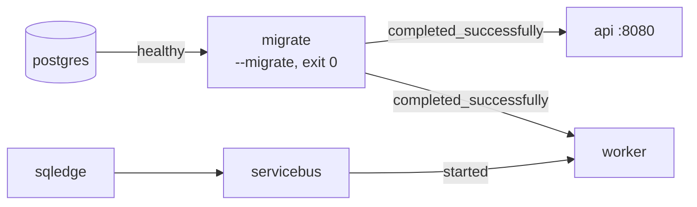

# Bài 10 — Docker hoá cả hệ thống: Dockerfile multi-stage, compose có profile, migrate một lần, Rider + Docker

> **Bạn sẽ làm được:** đóng gói Api và Worker thành image nhỏ chạy bằng user không phải root, chạy **cả** hệ thống
> (Postgres, Service Bus emulator, migrate, api, worker) bằng một lệnh, kiểm tra bằng smoke test, và biết khi nào chạy
> app trong Docker, khi nào chạy từ Rider.
>
> **Thời lượng:** đọc 30 phút · làm 45 phút
>
> **Trước đó:** [Bài 09](09-azure-service-bus.md) · **Tiếp theo:** [Bài 11 — Test](11-test-xunit-testcontainers.md)

---

## 1. Lý thuyết: image .NET 8 và build nhiều tầng

| Image | Chứa gì | Kích thước (đo thật) | Dùng ở |
|---|---|---|---|
| `mcr.microsoft.com/dotnet/sdk:8.0` | SDK đầy đủ: compiler, NuGet, `dotnet build/publish` | 1,24 GB | **Chỉ** tầng build |
| `mcr.microsoft.com/dotnet/aspnet:8.0` | Runtime .NET + ASP.NET Core | 321 MB | Tầng chạy của Api |
| `mcr.microsoft.com/dotnet/runtime:8.0` | Runtime .NET (không ASP.NET) | 285 MB | Tầng chạy của Worker |

**Multi-stage build:** tầng 1 dùng image SDK để `publish`, tầng 2 bắt đầu lại từ image runtime và chỉ chép **kết quả
publish** sang. Image cuối không có SDK, không có source code. Kết quả đo: `orderflow-api:dev` **341 MB**,
`orderflow-worker:dev` **304 MB**, tức code của mình thêm khoảng 20 MB vào image runtime. Giống Java build bằng image
Maven rồi chạy bằng image JRE.

Ba thay đổi của image .NET 8 mà tài liệu cũ (trước 2023) không có:

1. **Cổng mặc định là 8080**, không phải 80 (biến `ASPNETCORE_HTTP_PORTS=8080` có sẵn trong image). Lý do: cổng < 1024
   cần quyền root.
2. Có sẵn user **`app`** (`APP_UID=1654`). Dòng `USER $APP_UID` cho app chạy không phải root.
3. Có thêm biến thể *chiseled* (Ubuntu tối giản, không shell, nhỏ hơn nữa). Bộ bài dùng bản thường cho dễ `exec` vào xem.

Kiểm tra trên image vừa build:

```bash
docker image inspect orderflow-api:dev --format 'user={{.Config.User}} env={{json .Config.Env}}'
```

```text
user=1654 env=["PATH=/usr/local/sbin:/usr/local/bin:/usr/sbin:/usr/bin:/sbin:/bin","APP_UID=1654","ASPNETCORE_HTTP_PORTS=8080","DOTNET_RUNNING_IN_CONTAINER=true","DOTNET_VERSION=8.0.32","ASPNET_VERSION=8.0.32"]
```

---

## 2. Dockerfile của Api

Tạo `src/OrderFlow.Api/Dockerfile`:

📄 **`lab/OrderFlow/src/OrderFlow.Api/Dockerfile`**

```dockerfile
# Build context la thu muc goc solution (vi Api tham chieu Core):
#   docker build -f src/OrderFlow.Api/Dockerfile -t orderflow-api .

# ---- stage 1: build bang SDK (~1 GB, chi dung luc build) ----
FROM mcr.microsoft.com/dotnet/sdk:8.0 AS build
WORKDIR /src

# copy csproj truoc va restore rieng: sua code khong lam mat cache cua buoc restore (cham nhat)
COPY src/OrderFlow.Core/OrderFlow.Core.csproj src/OrderFlow.Core/
COPY src/OrderFlow.Api/OrderFlow.Api.csproj src/OrderFlow.Api/
RUN dotnet restore src/OrderFlow.Api/OrderFlow.Api.csproj

COPY src/ src/
RUN dotnet publish src/OrderFlow.Api/OrderFlow.Api.csproj -c Release -o /app/publish --no-restore

# ---- stage 2: chay bang runtime ASP.NET (~220 MB), khong co SDK, khong co source ----
FROM mcr.microsoft.com/dotnet/aspnet:8.0 AS final
WORKDIR /app
COPY --from=build /app/publish .

# image .NET 8 co san user "app" (APP_UID=1654): khong chay bang root
USER $APP_UID
# .NET 8 mac dinh nghe cong 8080 (ASPNETCORE_HTTP_PORTS=8080), khong phai 80 nhu .NET 7 tro ve truoc
EXPOSE 8080
ENTRYPOINT ["dotnet", "OrderFlow.Api.dll"]
```

| Dòng | Vì sao |
|---|---|
| Build context là **thư mục gốc solution** | Api tham chiếu Core; context là `src/OrderFlow.Api` thì không `COPY` được Core |
| `COPY *.csproj` rồi `restore` **trước** khi copy code | Docker cache theo tầng: sửa code mà không sửa `.csproj` thì bước restore (tải NuGet, chậm nhất) dùng lại cache. Đo thật: build đầu 52 giây, build lại sau khi sửa code **11 giây** |
| `--no-restore` | Đã restore ở trên |
| `WORKDIR /app` | Thư mục hiện tại = content root = nơi tìm `appsettings.json` ([bài 08 §7.3](08-background-worker.md)) |
| `ENTRYPOINT ["dotnet", "OrderFlow.Api.dll"]` | Dạng mảng (exec form): tiến trình .NET là PID 1, nhận đúng tín hiệu `SIGTERM` khi `docker stop` để tắt êm |

> **Bẫy cú pháp Dockerfile:** comment chỉ hợp lệ ở **đầu dòng**. Viết `USER $APP_UID # chạy non-root` thì phần
> `# chạy non-root` bị hiểu là tham số của lệnh. Vì vậy mọi comment trong file trên đều nằm trên dòng riêng.

## 3. Dockerfile của Worker và `.dockerignore`

📄 **`lab/OrderFlow/src/OrderFlow.Worker/Dockerfile`**

```dockerfile
# Build context la thu muc goc solution:
#   docker build -f src/OrderFlow.Worker/Dockerfile -t orderflow-worker .

FROM mcr.microsoft.com/dotnet/sdk:8.0 AS build
WORKDIR /src

COPY src/OrderFlow.Core/OrderFlow.Core.csproj src/OrderFlow.Core/
COPY src/OrderFlow.Worker/OrderFlow.Worker.csproj src/OrderFlow.Worker/
RUN dotnet restore src/OrderFlow.Worker/OrderFlow.Worker.csproj

COPY src/ src/
RUN dotnet publish src/OrderFlow.Worker/OrderFlow.Worker.csproj -c Release -o /app/publish --no-restore

# Worker khong phuc vu HTTP nen chi can runtime .NET thuong, nhe hon runtime ASP.NET
FROM mcr.microsoft.com/dotnet/runtime:8.0 AS final
WORKDIR /app
COPY --from=build /app/publish .
USER $APP_UID
ENTRYPOINT ["dotnet", "OrderFlow.Worker.dll"]
```

`.dockerignore` ở thư mục gốc: không gửi `bin/`, `obj/` (build trên Mac, khác hệ điều hành trong container), `.idea/`, test vào build context.

📄 **`lab/OrderFlow/.dockerignore`**

```text
**/bin/
**/obj/
**/.idea/
**/.vs/
**/*.user
**/.DS_Store
tests/
```

Build thử từng image:

```bash
docker build -f src/OrderFlow.Api/Dockerfile -t orderflow-api:dev .
docker build -f src/OrderFlow.Worker/Dockerfile -t orderflow-worker:dev .
docker images | grep orderflow
```

---

## 4. `docker-compose.yml` bản cuối: một file, hai chế độ

📄 **`lab/OrderFlow/docker-compose.yml`**

```yaml
# Hai che do trong MOT file:
#   docker compose up -d                       -> chi ha tang (Postgres + Service Bus emulator), app chay tu Rider de debug
#   docker compose --profile app up -d --build -> ca he thong: them migrate (chay mot lan), api, worker
name: orderflow

x-postgres-cs: &postgres-cs "Host=postgres;Port=5432;Database=orderflow;Username=orderflow;Password=orderflow"

services:
  postgres:
    image: postgres:16-alpine
    environment:
      POSTGRES_USER: orderflow
      POSTGRES_PASSWORD: orderflow
      POSTGRES_DB: orderflow
    ports:
      - "5432:5432"
    volumes:
      - pgdata:/var/lib/postgresql/data
    healthcheck:
      test: ["CMD-SHELL", "pg_isready -U orderflow -d orderflow"]
      interval: 2s
      timeout: 3s
      retries: 30

  # Service Bus emulator can mot SQL Server de luu trang thai; Azure SQL Edge chay native ca tren chip Apple (arm64)
  sqledge:
    image: mcr.microsoft.com/azure-sql-edge:latest
    environment:
      ACCEPT_EULA: "Y"
      MSSQL_SA_PASSWORD: "${SQL_PASSWORD:-OrderFlow_Dev_2026!}"

  servicebus:
    image: mcr.microsoft.com/azure-messaging/servicebus-emulator:latest
    depends_on:
      - sqledge
    environment:
      SQL_SERVER: sqledge
      MSSQL_SA_PASSWORD: "${SQL_PASSWORD:-OrderFlow_Dev_2026!}"
      ACCEPT_EULA: "Y"
    volumes:
      - ./servicebus/config.json:/ServiceBus_Emulator/ConfigFiles/Config.json:ro
    ports:
      - "5672:5672" # AMQP: app gui/nhan message
      - "5300:5300" # HTTP: /health va API quan tri

  migrate:
    profiles: ["app"]
    image: orderflow-api:dev
    build:
      context: .
      dockerfile: src/OrderFlow.Api/Dockerfile
    command: ["--migrate"] # chay EF migrations roi thoat
    environment:
      ConnectionStrings__Postgres: *postgres-cs
    depends_on:
      postgres:
        condition: service_healthy

  api:
    profiles: ["app"]
    image: orderflow-api:dev
    build:
      context: .
      dockerfile: src/OrderFlow.Api/Dockerfile
    restart: unless-stopped
    environment:
      ASPNETCORE_ENVIRONMENT: Development # bat Swagger trong container, KHONG lam vay o production
      ConnectionStrings__Postgres: *postgres-cs # "__" thay cho ":" -> ghi de ConnectionStrings:Postgres
    ports:
      - "8080:8080"
    depends_on:
      migrate:
        condition: service_completed_successfully

  worker:
    profiles: ["app"]
    image: orderflow-worker:dev
    build:
      context: .
      dockerfile: src/OrderFlow.Worker/Dockerfile
    # BackgroundService nem exception -> host .NET 8 dung voi exit code 0, nen on-failure KHONG restart
    restart: unless-stopped
    environment:
      ConnectionStrings__Postgres: *postgres-cs
      ConnectionStrings__ServiceBus: "Endpoint=sb://servicebus;SharedAccessKeyName=RootManageSharedAccessKey;SharedAccessKey=SAS_KEY_VALUE;UseDevelopmentEmulator=true;"
    depends_on:
      migrate:
        condition: service_completed_successfully
      servicebus:
        condition: service_started

volumes:
  pgdata:
```

Đọc từng ý:

| Ý | Nghĩa |
|---|---|
| `profiles: ["app"]` | `migrate`, `api`, `worker` chỉ chạy khi có `--profile app`. Không có thì chỉ hạ tầng: chế độ chạy app từ Rider |
| `x-postgres-cs: &postgres-cs` + `*postgres-cs` | YAML anchor: khai connection string **một** lần, dùng ba chỗ. Khoá bắt đầu bằng `x-` thì Compose bỏ qua |
| `Host=postgres` | Trong mạng của compose, **tên service là hostname**. `localhost` trong container là chính container đó |
| `ConnectionStrings__Postgres` | Biến môi trường đè `ConnectionStrings:Postgres` của `appsettings.json` ([bài 06 §8.1](06-web-api-asp-net-core.md)) |
| `migrate` + `command: ["--migrate"]` | Dùng **chính image của Api**, chạy `MigrateAsync()` rồi thoát ([bài 07 §5](07-postgresql-ef-core.md)) |
| `condition: service_healthy` | `migrate` đợi Postgres **healthy** (healthcheck `pg_isready`), không chỉ "đã chạy" |
| `condition: service_completed_successfully` | `api`, `worker` chỉ khởi động khi `migrate` đã **thoát với mã 0** |
| `restart: unless-stopped` | Tự khởi động lại kể cả khi exit 0 ([bài 08 §7.1](08-background-worker.md)) |
| `ASPNETCORE_ENVIRONMENT: Development` | Để có Swagger trong container khi học. Production không đặt (mặc định `Production`) |



---

## 5. Chạy cả hệ thống và kiểm tra

```bash
docker compose --profile app up -d --build
docker compose --profile app ps -a
```

Output thật (chạy từ volume trắng):

```text
SERVICE      IMAGE                                                          STATUS                      PORTS
api          orderflow-api:dev                                              Up 33 seconds               0.0.0.0:8080->8080/tcp
migrate      orderflow-api:dev                                              Exited (0) 34 seconds ago
postgres     postgres:16-alpine                                             Up 39 seconds (healthy)     0.0.0.0:5432->5432/tcp
servicebus   mcr.microsoft.com/azure-messaging/servicebus-emulator:latest   Up 38 seconds               0.0.0.0:5300->5300/tcp, 0.0.0.0:5672->5672/tcp, 8080/tcp
sqledge      mcr.microsoft.com/azure-sql-edge:latest                        Up 39 seconds               1401/tcp, 1433/tcp
worker       orderflow-worker:dev                                           Up 33 seconds
```

`migrate` hiện `Exited (0)`: đúng ý đồ. `docker compose logs migrate` in `Database migrated`.

### 5.1 Smoke test

Tạo `scripts/smoke-test.sh` (rồi `chmod +x scripts/smoke-test.sh`):

📄 **`lab/OrderFlow/scripts/smoke-test.sh`**

```bash
#!/usr/bin/env bash
# Kiem tra ca he thong sau "docker compose --profile app up -d --build":
# tao 2 don qua API, doi Worker xu ly qua Service Bus, in trang thai cuoi. Can curl va python3 (macOS co san).
set -euo pipefail

API="${API:-http://localhost:8080}"
SB_HEALTH="${SB_HEALTH:-http://localhost:5300/health}"

wait_for() { # wait_for <ten> <url> <so giay toi da>
  local name=$1 url=$2 max=$3 start=$SECONDS
  until curl -fs -o /dev/null "$url"; do
    if (( SECONDS - start > max )); then echo "  $name: not ready after ${max}s ($url)"; exit 1; fi
    sleep 2
  done
  echo "  $name ready after $(( SECONDS - start ))s"
}

field() { python3 -c "import json,sys; print(json.load(sys.stdin)[sys.argv[1]])" "$1"; }

echo "1) waiting for the services"
wait_for "API" "$API/health" 120
wait_for "Service Bus emulator" "$SB_HEALTH" 180

echo "2) creating two orders"
small=$(curl -fs -X POST "$API/api/orders" -H 'Content-Type: application/json' \
  -d '{"customerEmail":"an.nguyen@example.com","lines":[{"sku":"BOOK-001","quantity":2,"unitPrice":150000}]}' | field id)
big=$(curl -fs -X POST "$API/api/orders" -H 'Content-Type: application/json' \
  -d '{"customerEmail":"big.buyer@example.com","lines":[{"sku":"LAPTOP-PRO","quantity":2,"unitPrice":30000000}]}' | field id)
echo "  small order $small (300,000)"
echo "  big order   $big (60,000,000, over the 50,000,000 limit)"

echo "3) waiting for the Worker (outbox -> Service Bus -> handler)"
start=$SECONDS
for id in "$small" "$big"; do
  until [ "$(curl -fs "$API/api/orders/$id" | field status)" != "Pending" ]; do
    if (( SECONDS - start > 90 )); then echo "  still Pending after 90s: docker compose logs worker"; exit 1; fi
    sleep 1
  done
done
echo "  processed after $(( SECONDS - start ))s"

echo "4) final state"
for id in "$small" "$big"; do
  curl -fs "$API/api/orders/$id" | python3 -c "
import json, sys
o = json.load(sys.stdin)
print(f\"  {o['id']}  {o['status']:<9}  total={o['total']:>14,.0f}  reason={o['rejectReason']}\")"
done
echo "OK"
```

```bash
./scripts/smoke-test.sh
```

```text
1) waiting for the services
  API ready after 3s
  Service Bus emulator ready after 27s
2) creating two orders
  small order 7a3578d3-e4a4-41eb-b055-4ce5b0764092 (300,000)
  big order   9f3c4616-019b-4716-b62a-63e33aeacdc8 (60,000,000, over the 50,000,000 limit)
3) waiting for the Worker (outbox -> Service Bus -> handler)
  processed after 2s
4) final state
  7a3578d3-e4a4-41eb-b055-4ce5b0764092  Confirmed  total=       300,000  reason=None
  9f3c4616-019b-4716-b62a-63e33aeacdc8  Rejected   total=    60,000,000  reason=total 60,000,000 is over the auto-confirm limit 50,000,000
OK
```

Từ lúc `up` tới `OK`: **40 giây** (phần lớn là đợi emulator). Trong vài chục giây đầu, log của `worker` đỏ vì emulator
chưa sẵn sàng; SDK tự thử lại, không cần làm gì.

### 5.2 Nhìn vào bên trong

```bash
docker compose exec api id                      # uid=1654(app) gid=1654(app) groups=1654(app)
docker compose logs -f worker                   # theo dõi Worker
docker compose logs api | grep 'Now listening'  # Now listening on: http://0.0.0.0:8080
open http://localhost:8080/swagger              # Swagger trong container
docker stats --no-stream                        # RAM từng container
```

RAM đo thật: api 72,6 MiB · worker 83,4 MiB · servicebus 161,2 MiB · postgres 39,0 MiB · sqledge 468,5 MiB, tổng khoảng 825 MiB.

### 5.3 Dừng và dọn

```bash
docker compose --profile app down        # dừng, xoá container; GIỮ dữ liệu Postgres (volume)
docker compose --profile app down -v     # xoá luôn volume: lần sau migrate lại từ đầu
docker compose --profile app up -d --build api   # sửa code Api: chỉ build và chạy lại api
```

---

## 6. Rider và Docker: vòng làm việc hằng ngày

| Chế độ | Lệnh | Khi nào |
|---|---|---|
| **Hạ tầng trong Docker, app trong Rider** | `docker compose up -d` rồi ⌃D compound `Api + Worker` | Viết code và debug hằng ngày: breakpoint, hot reload, sửa nhanh |
| Cả hệ thống trong Docker | `docker compose --profile app up -d --build` | Kiểm tra trước khi push: đúng như môi trường chạy thật, đúng biến môi trường |

Rider có sẵn Docker:

- **⌘8 (Services)** → **Docker**: thấy compose project `orderflow`, từng container, log, nút start/stop; chuột phải
  container → mở terminal trong container (như `docker compose exec`).
- Mở `docker-compose.yml`: có biểu tượng ▶ ở lề cạnh từng service để chạy riêng service đó.
- Chuột phải `Dockerfile` → **Run** để build và chạy image; trong run configuration có thể đặt cổng và biến môi trường.
- **Debug app bên trong container**: Rider hỗ trợ debug project .NET chạy trong container qua run configuration kiểu
  Docker (Dockerfile hoặc Docker Compose). Cần thì xem tài liệu Rider mục *Docker*; với bộ bài, debug từ Rider ở chế
  độ "app trong Rider" đơn giản và nhanh hơn nhiều.

---

## 7. Lỗi hay gặp

| Triệu chứng | Nguyên nhân | Sửa |
|---|---|---|
| `COPY failed: file not found` / `"/src/OrderFlow.Core": not found` | Build context sai (chạy `docker build` trong `src/OrderFlow.Api`) | Đứng ở thư mục gốc solution, `-f src/OrderFlow.Api/Dockerfile .` |
| `error NU1301: Unable to load the service index for source https://api.nuget.org/v3/index.json` khi build | Container build không ra được Internet (proxy công ty, VPN) | Cấu hình proxy cho Docker Desktop; feed NuGet riêng thì cần `NuGet.config` + secret của BuildKit |
| `Missing connection string 'ConnectionStrings:Postgres'` trong container | Gõ một dấu `_` (`ConnectionStrings_Postgres`) | Phải là **hai** dấu: `ConnectionStrings__Postgres` |
| Api/worker không chạy, `migrate` `Exited (1)` | Migration lỗi hoặc Postgres sai mật khẩu | `docker compose logs migrate` |
| Container trong compose gọi `localhost:5432` không được | `localhost` là chính container | Dùng tên service: `postgres:5432` |
| Image build trên Mac chạy trên server báo `exec format error` | Mac chip Apple build ra image `linux/arm64`, server là x86 | `docker buildx build --platform linux/amd64 ...` (thường do pipeline CI build) |
| `Bind for 0.0.0.0:5432 failed: port is already allocated` | Postgres khác (hoặc compose khác) đang giữ cổng | Dừng cái kia, hoặc đổi cổng bên trái: `"55432:5432"` |

---

## 8. Tự kiểm tra

- [ ] Giải thích multi-stage build và vì sao image cuối không có SDK.
- [ ] Biết ba thay đổi của image .NET 8: cổng 8080, user `app`, biến thể chiseled.
- [ ] Viết được Dockerfile có tầng restore được cache.
- [ ] Giải thích `profiles`, `depends_on` với `service_healthy` / `service_completed_successfully`, và biến `__`.
- [ ] Chạy được cả hệ thống, smoke test ra `OK`, xem log, vào container.
- [ ] Biết khi nào chạy app trong Rider, khi nào chạy cả hệ thống trong Docker.

## 9. Ranh giới trung thực

- **Đã chạy thật:** build hai image, chạy compose từ volume trắng, smoke test (`OK` sau 40 giây), `id`, Swagger trong
  container, kích thước image, RAM; bản dựng lại từ thư mục trống (`verify-steps.sh 10`) cũng ra `OK`.
- **Khác biệt của môi trường kiểm chứng:** build Docker ở đây phải đi qua proxy có CA riêng, nên dùng bản sao
  Dockerfile thêm đúng 2 dòng tin CA (lỗi `NU1301` trong bảng §7 là lỗi thật gặp trước khi thêm). Dockerfile trong
  repo không có 2 dòng đó.
- Thời gian build "52 giây rồi 11 giây" đo trên máy Linux x64 có cache NuGet; máy bạn sẽ khác.
- Phần Rider + Docker (§6) mô tả theo bản Rider gần đây, chưa chạy được ở đây.
