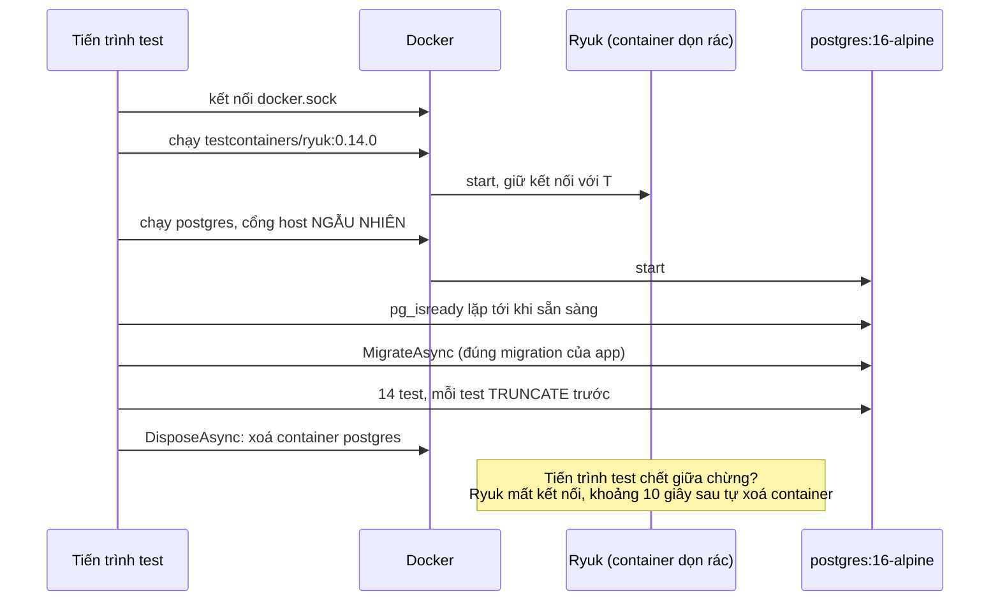

# Bài 11 — Test: xUnit, integration test trên PostgreSQL thật (Testcontainers), chạy và debug test trong Rider

> **Bạn sẽ làm được:** viết unit test cho domain; viết integration test gọi API thật trên PostgreSQL thật (container tự
> dựng, tự xoá); test logic của Worker kể cả lúc hai consumer tranh nhau một message; chạy, lọc, debug test trong Rider
> và Terminal; đọc coverage để biết bộ test còn hở chỗ nào.
>
> **Thời lượng:** đọc 35 phút · làm 60 phút
>
> **Trước đó:** [Bài 10](10-docker-hoa.md) · **Tiếp theo:** [Bài 12 — Bắt đầu dự án thật](12-bat-dau-du-an-that.md)

---

## 0. Bộ test của OrderFlow trong một bảng

| Tầng | Ở đâu | Số test | Chạm vào | Thời gian đo |
|---|---|---|---|---|
| Unit | `tests/OrderFlow.UnitTests` | 10 | Chỉ code C#: `Order`, `OutboxMessage` | 0,2 giây |
| Integration | `tests/OrderFlow.IntegrationTests` | 14 | API chạy trong bộ nhớ, `OutboxProcessor`, `OrderCreatedHandler`, **PostgreSQL 16 thật** trong container | 3 giây chạy test, cộng khoảng 10 giây dựng container và migrate |
| Smoke | `scripts/smoke-test.sh` ([bài 10](10-docker-hoa.md)) | 1 kịch bản | Cả hệ thống trong Docker, kể cả Service Bus emulator | khoảng 40 giây |

Chạy `dotnet test` ở thư mục gốc solution (đã build), tổng cộng 16 giây:

```text
Passed!  - Failed:     0, Passed:    10, Skipped:     0, Total:    10, Duration: 206 ms - OrderFlow.UnitTests.dll (net8.0)
Passed!  - Failed:     0, Passed:    14, Skipped:     0, Total:    14, Duration: 3 s - OrderFlow.IntegrationTests.dll (net8.0)
```

Danh sách 24 test và thời gian từng test: [`results/test-output.txt`](lab/OrderFlow/results/test-output.txt). Mọi thí
nghiệm trong bài này (bỏ `catch`, tắt Docker, ghi đè cấu hình sai, đột biến code) có số đo ở
[`results/test-experiments.txt`](lab/OrderFlow/results/test-experiments.txt).

Phần **không** có test tự động: code gửi/nhận Service Bus (`ServiceBusMessagePublisher`, worker consumer). Phần đó
được kiểm bằng tay ở bài 09 và bằng smoke test ở bài 10; §9 sẽ thấy coverage báo đúng chỗ hở này.

---

## 1. Lý thuyết: xUnit cho người quen JUnit

| JUnit 5 | xUnit v2 (bộ bài dùng) | Ghi chú |
|---|---|---|
| `@Test` | `[Fact]` | Một test không tham số |
| `@ParameterizedTest` + `@CsvSource` | `[Theory]` + `[InlineData(...)]` | Mỗi `InlineData` là một test riêng trong kết quả |
| `@BeforeEach` | **constructor** của class test | xUnit tạo **instance mới** cho **mỗi** test, field không dùng chung giữa các test |
| `@AfterEach` | `IDisposable.Dispose()` | |
| setup/teardown `async` | `IAsyncLifetime`: `InitializeAsync()` / `DisposeAsync()` | Dùng cho việc phải `await` (reset DB, tạo client) |
| `@BeforeAll` (static) | `IClassFixture<T>` | Một đối tượng `T` dùng chung cho mọi test trong **một** class |
| Chia sẻ giữa nhiều class | `ICollectionFixture<T>` + `[CollectionDefinition]` + `[Collection]` | Một `T` cho **nhiều** class; bộ bài dùng cho container Postgres |
| `assertEquals(expected, actual)` | `Assert.Equal(expected, actual)` | Giá trị mong đợi đứng **trước** |
| `assertThrows(...)` | `Assert.Throws<T>(...)` | Đúng kiểu `T`, không nhận lớp con (lớp con: `Assert.ThrowsAny<T>`) |
| `@DisplayName` | (không cần) | Tên method chính là câu mô tả: `Create_rejects_an_order_without_lines` |
| `@Disabled` | `[Fact(Skip = "lý do")]` | |
| `@Tag("slow")` | `[Trait("Category", "Slow")]` | Lọc được bằng `--filter "Category=Slow"` |

**Chạy song song.** Mặc định mỗi class test là một *collection*; các collection chạy **song song** với nhau, test trong
**cùng** collection chạy **tuần tự**. Ba class integration của OrderFlow cùng gắn `[Collection(nameof(PostgresCollection))]`
nên chạy lần lượt trên **một** database mà không giẫm chân nhau; hai class unit test chạy song song vì không chia sẻ gì.

**Phiên bản.** `dotnet new xunit` của SDK 8 ghim xUnit **2.5.3**; bộ bài nâng lên **2.9.3**, bản cuối của xUnit v2,
vì 2.5.3 kéo theo hai gói có lỗ hổng mức High (§2). Đã có xUnit v3 (package `xunit.v3`), đổi vài API, ví dụ
`IAsyncLifetime` trả `ValueTask`; bộ bài ở lại v2 cho khớp với template.

---

## 2. Tạo hai project test

Đứng ở thư mục gốc solution (chỗ có `OrderFlow.sln`). Đây đúng là các lệnh `verify-steps.sh` chạy ở bước bài 11:

```bash
dotnet new xunit -n OrderFlow.UnitTests -o tests/OrderFlow.UnitTests
dotnet new xunit -n OrderFlow.IntegrationTests -o tests/OrderFlow.IntegrationTests
dotnet sln add tests/OrderFlow.UnitTests tests/OrderFlow.IntegrationTests

dotnet add tests/OrderFlow.UnitTests reference src/OrderFlow.Core
dotnet add tests/OrderFlow.IntegrationTests reference src/OrderFlow.Api src/OrderFlow.Core

dotnet add tests/OrderFlow.IntegrationTests package Microsoft.AspNetCore.Mvc.Testing --version 8.0.32
dotnet add tests/OrderFlow.IntegrationTests package Testcontainers.PostgreSql --version 4.16.0
dotnet add tests/OrderFlow.IntegrationTests package Microsoft.Extensions.TimeProvider.Testing --version 8.10.0

dotnet add tests/OrderFlow.UnitTests package xunit --version 2.9.3          # template ghim 2.5.3, xem ngay dưới
dotnet add tests/OrderFlow.IntegrationTests package xunit --version 2.9.3

rm tests/OrderFlow.UnitTests/UnitTest1.cs tests/OrderFlow.IntegrationTests/UnitTest1.cs   # file mẫu của template
```

**Vì sao nâng `xunit` ngay.** Với bản 2.5.3 của template, lệnh kiểm tra lỗ hổng báo thật:

```bash
dotnet list package --vulnerable --include-transitive
```

```text
Project `OrderFlow.UnitTests` has the following vulnerable packages
   [net8.0]:
   Transitive Package                    Resolved   Severity   Advisory URL
   > System.Net.Http                     4.3.0      High       https://github.com/advisories/GHSA-7jgj-8wvc-jh57
   > System.Text.RegularExpressions      4.3.0      High       https://github.com/advisories/GHSA-cmhx-cq75-c4mj
```

Hai gói đó là gói **bắc cầu** (transitive): `xunit 2.5.3` → `NETStandard.Library 1.6.1` → `System.Net.Http 4.3.0`.
Nâng `xunit` lên 2.9.3 thì cả chuỗi biến mất, 5 project đều báo `has no vulnerable packages`, 24 test vẫn xanh.
Cách tự lần ra chuỗi phụ thuộc như vậy (`dotnet nuget why`) ở [bài 12 §1](12-bat-dau-du-an-that.md); bằng chứng
trước/sau ở [`results/package-audit.txt`](lab/OrderFlow/results/package-audit.txt).

Làm bằng Rider: chuột phải solution trong Solution Explorer → **Add → New Project…** → chọn mẫu **Unit Test Project**,
kiểu **xUnit** (tên mục có thể khác chút giữa các bản Rider), đặt tên, chọn thư mục `tests`. Thêm tham chiếu: chuột
phải project test → **Add → Reference…**. Thêm package: chuột phải project → **Manage NuGet Packages**, hoặc gõ lệnh ở
trên trong Terminal của Rider (**⌥F12**). Nhớ quy tắc [bài 02 §5.3](02-rider-du-an-dau-tien.md): gói `Microsoft.*` phải
chọn bản **8.0.x**; bản mới nhất của `Microsoft.AspNetCore.Mvc.Testing` là 10.x và không cài được vào project `net8.0`.

Hai file project sau khi chạy các lệnh trên:

📄 **`lab/OrderFlow/tests/OrderFlow.UnitTests/OrderFlow.UnitTests.csproj`**

```xml
<Project Sdk="Microsoft.NET.Sdk">

  <PropertyGroup>
    <TargetFramework>net8.0</TargetFramework>
    <ImplicitUsings>enable</ImplicitUsings>
    <Nullable>enable</Nullable>

    <IsPackable>false</IsPackable>
    <IsTestProject>true</IsTestProject>
  </PropertyGroup>

  <ItemGroup>
    <PackageReference Include="coverlet.collector" Version="6.0.0" />
    <PackageReference Include="Microsoft.NET.Test.Sdk" Version="17.8.0" />
    <PackageReference Include="xunit" Version="2.9.3" />
    <PackageReference Include="xunit.runner.visualstudio" Version="2.5.3" />
  </ItemGroup>

  <ItemGroup>
    <Using Include="Xunit" />
  </ItemGroup>

  <ItemGroup>
    <ProjectReference Include="..\..\src\OrderFlow.Core\OrderFlow.Core.csproj" />
  </ItemGroup>

</Project>
```

📄 **`lab/OrderFlow/tests/OrderFlow.IntegrationTests/OrderFlow.IntegrationTests.csproj`**

```xml
<Project Sdk="Microsoft.NET.Sdk">

  <PropertyGroup>
    <TargetFramework>net8.0</TargetFramework>
    <ImplicitUsings>enable</ImplicitUsings>
    <Nullable>enable</Nullable>

    <IsPackable>false</IsPackable>
    <IsTestProject>true</IsTestProject>
  </PropertyGroup>

  <ItemGroup>
    <PackageReference Include="coverlet.collector" Version="6.0.0" />
    <PackageReference Include="Microsoft.AspNetCore.Mvc.Testing" Version="8.0.32" />
    <PackageReference Include="Microsoft.Extensions.TimeProvider.Testing" Version="8.10.0" />
    <PackageReference Include="Microsoft.NET.Test.Sdk" Version="17.8.0" />
    <PackageReference Include="Testcontainers.PostgreSql" Version="4.16.0" />
    <PackageReference Include="xunit" Version="2.9.3" />
    <PackageReference Include="xunit.runner.visualstudio" Version="2.5.3" />
  </ItemGroup>

  <ItemGroup>
    <Using Include="Xunit" />
  </ItemGroup>

  <ItemGroup>
    <ProjectReference Include="..\..\src\OrderFlow.Api\OrderFlow.Api.csproj" />
    <ProjectReference Include="..\..\src\OrderFlow.Core\OrderFlow.Core.csproj" />
  </ItemGroup>

</Project>
```

| Dòng | Để làm gì |
|---|---|
| `Microsoft.NET.Test.Sdk` | Bộ chạy test (VSTest) mà `dotnet test` và Rider gọi tới |
| `xunit` 2.9.3 | Framework: `[Fact]`, `[Theory]`, `Assert` (đã nâng từ 2.5.3 của template) |
| `xunit.runner.visualstudio` | Adapter để `dotnet test` và Rider **tìm thấy** test xUnit. Thiếu nó: "No test is available" |
| `coverlet.collector` | Đo coverage (§9) |
| `Microsoft.AspNetCore.Mvc.Testing` | `WebApplicationFactory`: chạy API thật trong bộ nhớ (§5) |
| `Testcontainers.PostgreSql` | Dựng container PostgreSQL cho test (§4) |
| `Microsoft.Extensions.TimeProvider.Testing` | `FakeTimeProvider`: đồng hồ giả (§6) |
| `<Using Include="Xunit" />` | `global using Xunit;` cho cả project, khỏi viết `using Xunit;` ở từng file |
| Tham chiếu `OrderFlow.Api` | `WebApplicationFactory<Program>` cần thấy class `Program` của API |

Class `Program` sinh ra từ top-level statements của .NET 8 **không public**, nên cuối `Program.cs` của API có dòng
`public partial class Program { }` (đã thêm ở [bài 07](07-postgresql-ef-core.md)). Không có dòng đó, project test báo
lỗi biên dịch vì không truy cập được `Program`.

---

## 3. Unit test cho domain: nhanh, không DB, không Docker

### 3.1 `OrderTests`

📄 **`lab/OrderFlow/tests/OrderFlow.UnitTests/OrderTests.cs`**

```csharp
using OrderFlow.Core.Domain;

namespace OrderFlow.UnitTests;

public class OrderTests
{
    private static readonly DateTime Now = new(2026, 10, 21, 9, 0, 0, DateTimeKind.Utc);

    private static Order NewOrder(params OrderLine[] lines) => Order.Create("An.Nguyen@Example.com ", lines, Now);

    [Fact]
    public void Create_computes_the_total_and_normalizes_input()
    {
        var order = NewOrder(new OrderLine("book-001", 2, 150_000m), new OrderLine("pen-002", 5, 12_000m));

        Assert.Equal(360_000m, order.Total);
        Assert.Equal(OrderStatus.Pending, order.Status);
        Assert.Equal("an.nguyen@example.com", order.CustomerEmail);
        Assert.Equal(new[] { "BOOK-001", "PEN-002" }, order.Lines.Select(l => l.Sku));
        Assert.NotEqual(Guid.Empty, order.Id);
    }

    [Fact]
    public void Create_rejects_an_order_without_lines()
    {
        var ex = Assert.Throws<DomainException>(() => NewOrder());
        Assert.Contains("at least one line", ex.Message);
    }

    [Theory]
    [InlineData(0)]
    [InlineData(-3)]
    public void A_line_needs_a_positive_quantity(int quantity)
    {
        Assert.Throws<DomainException>(() => new OrderLine("BOOK-001", quantity, 10m));
    }

    [Fact]
    public void Create_rejects_the_same_sku_twice_even_with_different_case()
    {
        var ex = Assert.Throws<DomainException>(() =>
            NewOrder(new OrderLine("book-001", 1, 10m), new OrderLine("BOOK-001", 2, 10m)));
        Assert.Contains("BOOK-001 appears more than once", ex.Message);
    }

    [Fact]
    public void Create_requires_utc_time()
    {
        var local = new DateTime(2026, 10, 21, 16, 0, 0, DateTimeKind.Local);
        Assert.Throws<ArgumentException>(() => Order.Create("a@b.com", new[] { new OrderLine("X", 1, 1m) }, local));
    }

    [Fact]
    public void Process_confirms_an_order_under_the_limit()
    {
        var order = NewOrder(new OrderLine("BOOK-001", 1, 150_000m));

        Assert.True(order.Process(Now.AddSeconds(1)));
        Assert.Equal(OrderStatus.Confirmed, order.Status);
        Assert.Equal(Now.AddSeconds(1), order.ProcessedAtUtc);
        Assert.Null(order.RejectReason);
    }

    [Fact]
    public void Process_rejects_an_order_over_the_limit()
    {
        var order = NewOrder(new OrderLine("LAPTOP-PRO", 2, 30_000_000m));

        order.Process(Now);

        Assert.Equal(OrderStatus.Rejected, order.Status);
        Assert.Equal("total 60,000,000 is over the auto-confirm limit 50,000,000", order.RejectReason);
    }

    [Fact]
    public void Processing_twice_changes_nothing_the_second_time()
    {
        var order = NewOrder(new OrderLine("BOOK-001", 1, 150_000m));
        order.Process(Now);

        Assert.False(order.Process(Now.AddMinutes(5)));
        Assert.Equal(Now, order.ProcessedAtUtc);
    }
}
```

| Chỗ | Ý nghĩa |
|---|---|
| `Now = new(2026, 10, 21, 9, 0, 0, DateTimeKind.Utc)` | Thời gian **cố định**: test chạy hôm nay hay năm sau đều ra cùng kết quả. Không gọi `DateTime.UtcNow` trong test |
| `NewOrder(params OrderLine[] lines)` | Hàm dựng dữ liệu dùng chung, có sẵn email viết hoa và dấu cách thừa để test việc chuẩn hoá |
| Thân test chia 3 đoạn | **Arrange** (dựng dữ liệu) · **Act** (gọi đúng một hành vi) · **Assert** (kiểm kết quả); dòng trống ngăn cách |
| `[Theory]` + `[InlineData(0)]`, `[InlineData(-3)]` | Một method, hai test: kết quả hiện `A_line_needs_a_positive_quantity(quantity: 0)` và `(quantity: -3)` |
| `var ex = Assert.Throws<DomainException>(...)` | Kiểm đúng kiểu exception, rồi kiểm cả nội dung thông báo |
| `Assert.False(order.Process(...))` | Gọi lần hai trả `false` và **không** ghi đè `ProcessedAtUtc`: tính idempotent ở tầng domain |

### 3.2 `OutboxMessageTests`

📄 **`lab/OrderFlow/tests/OrderFlow.UnitTests/OutboxMessageTests.cs`**

```csharp
using System.Text.Json;
using OrderFlow.Core.Data;
using OrderFlow.Core.Messaging;

namespace OrderFlow.UnitTests;

public class OutboxMessageTests
{
    [Fact]
    public void For_serializes_the_message_as_camelCase_json_that_round_trips()
    {
        var now = new DateTime(2026, 10, 21, 9, 0, 0, DateTimeKind.Utc);
        var evt = new OrderCreated(Guid.Parse("11111111-2222-3333-4444-555555555555"), "a@b.com", 360_000m, now);

        var outbox = OutboxMessage.For(MessageTypes.OrderCreated, evt, now);

        Assert.Equal("order-created", outbox.Type);
        Assert.Equal(
            """{"orderId":"11111111-2222-3333-4444-555555555555","customerEmail":"a@b.com","total":360000,"createdAtUtc":"2026-10-21T09:00:00Z"}""",
            outbox.Payload);
        Assert.Equal(evt, JsonSerializer.Deserialize<OrderCreated>(outbox.Payload, Json.Options)); // record: so sanh theo gia tri
        Assert.Null(outbox.ProcessedAtUtc);
    }
}
```

- `"""..."""` là **raw string literal** (C# 11): viết JSON có dấu `"` mà không phải escape.
- Test chốt **đúng hình dạng JSON** gửi lên Service Bus (camelCase, ngày dạng ISO UTC). Ai đổi tên property hoặc
  bỏ `Json.Options` thì test này đỏ trước khi consumer ở môi trường khác đọc hỏng.
- `Assert.Equal(evt, ...)` so sánh hai `record` theo **giá trị** từng property ([bài 03](03-csharp-cho-dev-java.md)).

### 3.3 Chạy

```bash
dotnet test tests/OrderFlow.UnitTests
```

```text
Passed!  - Failed:     0, Passed:    10, Skipped:     0, Total:    10, Duration: 284 ms - OrderFlow.UnitTests.dll (net8.0)
```

Xem danh sách test mà không chạy:

```bash
dotnet test tests/OrderFlow.UnitTests --list-tests
```

```text
The following Tests are available:
    OrderFlow.UnitTests.OrderTests.Create_computes_the_total_and_normalizes_input
    OrderFlow.UnitTests.OrderTests.Create_rejects_an_order_without_lines
    OrderFlow.UnitTests.OrderTests.A_line_needs_a_positive_quantity(quantity: 0)
    OrderFlow.UnitTests.OrderTests.A_line_needs_a_positive_quantity(quantity: -3)
    OrderFlow.UnitTests.OrderTests.Create_rejects_the_same_sku_twice_even_with_different_case
    OrderFlow.UnitTests.OrderTests.Create_requires_utc_time
    OrderFlow.UnitTests.OrderTests.Process_confirms_an_order_under_the_limit
    OrderFlow.UnitTests.OrderTests.Process_rejects_an_order_over_the_limit
    OrderFlow.UnitTests.OrderTests.Processing_twice_changes_nothing_the_second_time
    OrderFlow.UnitTests.OutboxMessageTests.For_serializes_the_message_as_camelCase_json_that_round_trips
```

---

## 4. Testcontainers: PostgreSQL thật cho mỗi lần chạy test

### 4.1 Vì sao không dùng EF Core InMemory hay SQLite

Code của OrderFlow dựa vào những thứ chỉ PostgreSQL có:

| Code | Dựa vào | InMemory | SQLite |
|---|---|---|---|
| `OutboxProcessor` | `FromSql(... FOR UPDATE SKIP LOCKED)` ([bài 08](08-background-worker.md)) | Không chạy SQL | Không có `SKIP LOCKED` |
| `OrderCreatedHandler` | Lỗi khoá chính `23505` dạng `PostgresException` ([bài 09](09-azure-service-bus.md)) | Không có ràng buộc thật | Ném `SqliteException`, khối `catch` không bao giờ khớp |
| `OutboxMessage.Payload` | Cột `jsonb` | Không có kiểu cột | Không có `jsonb` |
| Toàn bộ | Migration thật, `timestamptz` chỉ nhận UTC, tên snake_case | Không có migration | SQL khác |

Test trên một database **khác** database chạy thật thì xanh cũng chưa nói lên điều gì. Tài liệu EF Core cũng khuyên không
dùng provider InMemory để test. Testcontainers cho mỗi lần chạy test một PostgreSQL 16 **thật**, cùng image với
`docker-compose.yml`, rồi tự xoá.

### 4.2 Testcontainers làm gì khi bạn bấm Run



Log thật của Testcontainers khi chạy (`--logger "console;verbosity=normal"`), rút gọn:

```text
[testcontainers.org 00:00:00.31] Connected to Docker:
  Host: unix:///var/run/docker.sock
[testcontainers.org 00:00:00.68] Docker container ce8c4feae23b created
[testcontainers.org 00:00:02.01] Docker container ce8c4feae23b ready
[testcontainers.org 00:00:02.15] Docker container ab4a97c58e07 created
[testcontainers.org 00:00:02.38] Execute "pg_isready --host localhost --dbname postgres --username postgres" at Docker container ab4a97c58e07
[testcontainers.org 00:00:05.70] Execute "pg_isready --host localhost --dbname postgres --username postgres" at Docker container ab4a97c58e07
[testcontainers.org 00:00:05.79] Docker container ab4a97c58e07 ready
```

`docker ps` chụp **trong lúc** test chạy (container `orderflow-*` của compose bài 10 không tính):

```text
friendly_morse                                            postgres:16-alpine          0.0.0.0:32769->5432/tcp
testcontainers-ryuk-89923854-4789-449f-bfae-f8f1a5333bb2  testcontainers/ryuk:0.14.0  0.0.0.0:32768->8080/tcp
```

Tên container ngẫu nhiên, cổng host ngẫu nhiên (`32769`), nên test **không** đụng Postgres 5432 của compose đang chạy.
Chạy xong, cả hai container biến mất. Thí nghiệm kill tiến trình test giữa chừng (giống bấm Stop khi đang debug):
`dotnet test` in `The active test run was aborted. Reason: Test host process crashed`, và Ryuk xoá container Postgres
**10,8 giây** sau đó.

Lần chạy đầu tiên Testcontainers phải tải image `postgres:16-alpine` (nếu đã làm bài 10 thì image có sẵn) và
`testcontainers/ryuk`. Máy Mac chip Apple dùng được ngay vì cả hai image đều có bản `arm64`.

### 4.3 Fixture dùng chung một container cho cả bộ test

📄 **`lab/OrderFlow/tests/OrderFlow.IntegrationTests/PostgresFixture.cs`**

```csharp
using Microsoft.EntityFrameworkCore;
using Microsoft.EntityFrameworkCore.Diagnostics;
using OrderFlow.Core.Data;
using Testcontainers.PostgreSql;

namespace OrderFlow.IntegrationTests;

/// <summary>
/// Mot container PostgreSQL 16 THAT cho ca bo test (Testcontainers tu chay va tu xoa, chi can Docker dang chay).
/// Ap dung dung migration cua app: test ca migration, khong dung EnsureCreated.
/// </summary>
public sealed class PostgresFixture : IAsyncLifetime
{
    private readonly PostgreSqlContainer _container = new PostgreSqlBuilder("postgres:16-alpine").Build();

    public string ConnectionString => _container.GetConnectionString();

    public async Task InitializeAsync()
    {
        await _container.StartAsync();
        await using var db = CreateDbContext();
        await db.Database.MigrateAsync();
    }

    public Task DisposeAsync() => _container.DisposeAsync().AsTask();

    public OrderDbContext CreateDbContext(params IInterceptor[] interceptors) => new(new DbContextOptionsBuilder<OrderDbContext>()
        .UseNpgsql(ConnectionString)
        .UseSnakeCaseNamingConvention()
        .AddInterceptors(interceptors) // test chen hanh vi vao giua SaveChanges (OrderCreatedHandlerTests)
        .Options);

    /// <summary>Moi test bat dau tu bang rong.</summary>
    public async Task ResetAsync()
    {
        await using var db = CreateDbContext();
        await db.Database.ExecuteSqlRawAsync("TRUNCATE orders, order_lines, outbox_messages, processed_messages");
    }
}

[CollectionDefinition(nameof(PostgresCollection))]
public class PostgresCollection : ICollectionFixture<PostgresFixture>;
```

| Chỗ | Ý nghĩa |
|---|---|
| `new PostgreSqlBuilder("postgres:16-alpine")` | Ghi rõ image. Bản 4.x đánh dấu constructor không tham số là obsolete (cảnh báo `CS0618`) |
| `InitializeAsync`: `StartAsync` rồi `MigrateAsync` | Container chỉ dựng **một lần** cho cả 14 test. Áp dụng **migration thật**: migration hỏng thì test đỏ ngay |
| `CreateDbContext(params IInterceptor[])` | Test tự tạo `DbContext` để chuẩn bị và kiểm dữ liệu; interceptor dùng ở §6.3 |
| `ResetAsync`: `TRUNCATE` 4 bảng | Mỗi test bắt đầu từ bảng rỗng, không phụ thuộc thứ tự chạy |
| `[CollectionDefinition]` + `ICollectionFixture<PostgresFixture>` | Mọi class gắn `[Collection(nameof(PostgresCollection))]` nhận **cùng một** fixture qua constructor |

`TRUNCATE` thay vì xoá database và migrate lại: nhanh hơn nhiều, và schema thì không đổi giữa các test.

---

## 5. Integration test cho API: `WebApplicationFactory`

### 5.1 Lý thuyết

`WebApplicationFactory<Program>` chạy **đúng** `Program.cs` của API trong bộ nhớ (TestServer, không mở cổng thật) và
trả về một `HttpClient` nói chuyện thẳng với nó. Một request trong test đi qua **toàn bộ** pipeline thật: routing,
model binding, validation `[ApiController]`, `DomainExceptionHandler`, `OrderService`, EF Core, PostgreSQL. Không mock
lớp nào. Cái duy nhất test thay là connection string: trỏ sang container của §4.

### 5.2 Code

📄 **`lab/OrderFlow/tests/OrderFlow.IntegrationTests/OrdersApiTests.cs`**

```csharp
using System.Net;
using System.Net.Http.Json;
using System.Text.Json;
using Microsoft.AspNetCore.Hosting;
using Microsoft.AspNetCore.Mvc;
using Microsoft.AspNetCore.Mvc.Testing;
using Microsoft.EntityFrameworkCore;
using OrderFlow.Api.Contracts;
using OrderFlow.Core.Messaging;

namespace OrderFlow.IntegrationTests;

/// <summary>Chay API that trong bo nho (WebApplicationFactory), goi HTTP that, DB la PostgreSQL that.</summary>
[Collection(nameof(PostgresCollection))]
public class OrdersApiTests(PostgresFixture pg) : IAsyncLifetime
{
    private WebApplicationFactory<Program> _factory = null!;
    private HttpClient _client = null!;

    public async Task InitializeAsync()
    {
        await pg.ResetAsync();
        _factory = new WebApplicationFactory<Program>().WithWebHostBuilder(host =>
            host.UseSetting("ConnectionStrings:Postgres", pg.ConnectionString)); // tro API vao container test
        _client = _factory.CreateClient();
    }

    public async Task DisposeAsync()
    {
        _client.Dispose();
        await _factory.DisposeAsync();
    }

    private static object ValidOrder(string email = "An.Nguyen@Example.com") => new
    {
        customerEmail = email,
        lines = new[] { new { sku = "book-001", quantity = 2, unitPrice = 150_000 } }
    };

    [Fact]
    public async Task Post_saves_the_order_and_its_outbox_message_together()
    {
        var response = await _client.PostAsJsonAsync("/api/orders", ValidOrder());

        Assert.Equal(HttpStatusCode.Created, response.StatusCode);
        var order = await response.Content.ReadFromJsonAsync<OrderResponse>();
        Assert.NotNull(order);
        Assert.Equal("Pending", order.Status);
        Assert.Equal(300_000m, order.Total);
        Assert.Equal("an.nguyen@example.com", order.CustomerEmail);
        Assert.Equal($"/api/orders/{order.Id}", response.Headers.Location?.AbsolutePath);

        await using var db = pg.CreateDbContext();
        var outbox = await db.OutboxMessages.SingleAsync();
        Assert.Equal(MessageTypes.OrderCreated, outbox.Type);
        Assert.Null(outbox.ProcessedAtUtc);
        Assert.Equal(order.Id, JsonSerializer.Deserialize<OrderCreated>(outbox.Payload, Json.Options)!.OrderId);
    }

    [Fact]
    public async Task Get_returns_what_post_created()
    {
        var created = await (await _client.PostAsJsonAsync("/api/orders", ValidOrder())).Content.ReadFromJsonAsync<OrderResponse>();

        var order = await _client.GetFromJsonAsync<OrderResponse>($"/api/orders/{created!.Id}");

        Assert.Equal(created.Id, order!.Id);
        Assert.Equal("BOOK-001", Assert.Single(order.Lines).Sku);
    }

    [Fact]
    public async Task Invalid_body_returns_400_validation_problem_and_writes_nothing()
    {
        var response = await _client.PostAsJsonAsync("/api/orders", new { customerEmail = "not-an-email", lines = Array.Empty<object>() });

        Assert.Equal(HttpStatusCode.BadRequest, response.StatusCode);
        var problem = await response.Content.ReadFromJsonAsync<ValidationProblemDetails>();
        Assert.Contains("CustomerEmail", problem!.Errors.Keys);
        Assert.Contains("Lines", problem.Errors.Keys);

        await using var db = pg.CreateDbContext();
        Assert.Equal(0, await db.Orders.CountAsync());
        Assert.Equal(0, await db.OutboxMessages.CountAsync());
    }

    [Fact]
    public async Task Domain_rule_violation_returns_400_problem_from_the_exception_handler()
    {
        var response = await _client.PostAsJsonAsync("/api/orders", new
        {
            customerEmail = "a@b.com",
            lines = new[] { new { sku = "book-001", quantity = 1, unitPrice = 10 }, new { sku = "BOOK-001", quantity = 2, unitPrice = 10 } }
        });

        Assert.Equal(HttpStatusCode.BadRequest, response.StatusCode);
        Assert.Equal("application/problem+json", response.Content.Headers.ContentType?.MediaType);
        var problem = await response.Content.ReadFromJsonAsync<ProblemDetails>();
        Assert.Equal("The order is not valid", problem!.Title);
        Assert.Contains("BOOK-001 appears more than once", problem.Detail);
    }

    [Fact]
    public async Task Unknown_id_returns_404_problem()
    {
        var response = await _client.GetAsync($"/api/orders/{Guid.NewGuid()}");

        Assert.Equal(HttpStatusCode.NotFound, response.StatusCode);
        Assert.Equal("application/problem+json", response.Content.Headers.ContentType?.MediaType);
    }

    [Fact]
    public async Task Health_check_reaches_postgres()
    {
        var response = await _client.GetAsync("/health");

        Assert.Equal(HttpStatusCode.OK, response.StatusCode);
        Assert.Equal("Healthy", await response.Content.ReadAsStringAsync());
    }
}
```

| Test | Chứng minh điều gì |
|---|---|
| `Post_saves_the_order_and_its_outbox_message_together` | `201` + header `Location`, chuẩn hoá email, **và** có đúng một dòng outbox chứa đúng `OrderId`, đọc thẳng từ DB |
| `Get_returns_what_post_created` | Đọc lại qua API ra đúng cái vừa ghi (SKU đã viết hoa) |
| `Invalid_body_returns_400_validation_problem_and_writes_nothing` | Validation trả lỗi theo **từng field**, và DB không có dòng nào |
| `Domain_rule_violation_returns_400_problem_from_the_exception_handler` | Quy tắc domain (SKU trùng) thành `400` dạng `application/problem+json` |
| `Unknown_id_returns_404_problem` | `404` cũng là `application/problem+json` |
| `Health_check_reaches_postgres` | `/health` thật sự hỏi được PostgreSQL |

Dòng `fail: Microsoft.AspNetCore.Diagnostics.ExceptionHandlerMiddleware[1]` kèm stack trace in ra khi chạy test
`Domain_rule_violation...` là bình thường ở .NET 8 (đã giải thích ở [bài 06](06-web-api-asp-net-core.md)): middleware
ghi log lỗi trước khi gọi `DomainExceptionHandler`. Response vẫn là `400` như test kiểm.

### 5.3 Chuyện có thật: test bắt được `[Produces]`

Bản đầu của controller có `[Produces("application/json")]`. Test `Unknown_id_returns_404_problem` đỏ:

```text
Failed OrderFlow.IntegrationTests.OrdersApiTests.Unknown_id_returns_404_problem [291 ms]
  Error Message:
   Assert.Equal() Failure: Strings differ
                       ↓ (pos 12)
Expected: "application/problem+json"
Actual:   "application/json"
                       ↓ (pos 12)
```

Attribute đó ép **mọi** kết quả của controller, kể cả lỗi, về `application/json`. Bỏ attribute, để lại comment giải
thích trong `OrdersController.cs`. Gọi tay bằng Swagger rất khó để ý chi tiết này; một dòng `Assert` thì bắt được ngay.

### 5.4 Thí nghiệm: ghi đè cấu hình sai cách thì test ghi nhầm vào DB dev

Test dùng `host.UseSetting("ConnectionStrings:Postgres", ...)`. Cách hay gặp trên mạng là
`ConfigureAppConfiguration(... AddInMemoryCollection(...))`. Đã thử thay bằng cách đó (trên bản sao, lab không đổi),
trong lúc Postgres của compose bài 10 vẫn chạy ở `localhost:5432`:

| Cách ghi đè | Kết quả `OrdersApiTests` | DB dev ở `localhost:5432` |
|---|---|---|
| `UseSetting(...)` (lab) | 6/6 pass | không đổi |
| `ConfigureAppConfiguration(...)` | **5/6 pass**, 1 fail: `Sequence contains no elements` | `orders` từ 4 lên **6**: hai đơn của test ghi nhầm vào DB dev |
| `ConfigureAppConfiguration(...)` + đọc connection string lúc tạo `DbContext` | 6/6 pass | không đổi |

Lý do: `Program.cs` gọi `AddOrderFlowData(builder.Configuration)`, hàm này đọc connection string **ngay lúc đăng ký**,
trước `builder.Build()`. Giá trị thêm bằng `ConfigureAppConfiguration` của factory chưa có ở thời điểm đó, nên API lấy
connection string trong `appsettings.json`, tức DB dev. Giá trị đặt bằng `UseSetting` thì đã có. Chỉ **một** test đỏ,
vì đó là test duy nhất đọc lại DB của container để so; năm test còn lại vẫn xanh trong khi dữ liệu rơi sang chỗ khác.
Bài học: integration test phải kiểm dữ liệu ở **đúng** database của test, đừng chỉ tin HTTP status.

---

## 6. Test logic của Worker: outbox và consumer idempotent

Worker ở bài 08 và 09 tách logic ra khỏi vòng lặp: `OutboxDispatcherWorker` chỉ lo hẹn giờ và tạo scope, việc thật
nằm ở `OutboxProcessor` (Core). Nhờ vậy test gọi thẳng `DispatchBatchAsync` mà không phải dựng host, không đợi timer.

### 6.1 Outbox

📄 **`lab/OrderFlow/tests/OrderFlow.IntegrationTests/OutboxProcessorTests.cs`**

```csharp
using System.Collections.Concurrent;
using Microsoft.EntityFrameworkCore;
using Microsoft.Extensions.Logging.Abstractions;
using Microsoft.Extensions.Options;
using OrderFlow.Core.Data;
using OrderFlow.Core.Messaging;
using OrderFlow.Core.Outbox;

namespace OrderFlow.IntegrationTests;

[Collection(nameof(PostgresCollection))]
public class OutboxProcessorTests(PostgresFixture pg) : IAsyncLifetime
{
    public Task InitializeAsync() => pg.ResetAsync();

    public Task DisposeAsync() => Task.CompletedTask;

    /// <summary>Publisher gia: ghi lai message da "gui"; tuy chon cham hoac loi.</summary>
    private sealed class RecordingPublisher(TimeSpan delay = default, int failFirst = 0) : IMessagePublisher
    {
        private int _calls;
        public ConcurrentQueue<Guid> Sent { get; } = new();

        public async Task PublishAsync(OutboxMessage message, CancellationToken ct)
        {
            if (Interlocked.Increment(ref _calls) <= failFirst)
                throw new InvalidOperationException("broker unavailable");
            if (delay > TimeSpan.Zero)
                await Task.Delay(delay, ct);
            Sent.Enqueue(message.Id);
        }
    }

    private OutboxProcessor NewProcessor(OrderDbContext db, IMessagePublisher publisher, int batchSize = 50) =>
        new(db, publisher, TimeProvider.System, Options.Create(new OutboxOptions { BatchSize = batchSize }),
            NullLogger<OutboxProcessor>.Instance);

    private async Task<List<Guid>> SeedAsync(int count)
    {
        await using var db = pg.CreateDbContext();
        var start = new DateTime(2026, 10, 21, 9, 0, 0, DateTimeKind.Utc);
        var rows = Enumerable.Range(0, count)
            .Select(i => OutboxMessage.For("test", new { n = i }, start.AddSeconds(i)))
            .ToList();
        db.OutboxMessages.AddRange(rows);
        await db.SaveChangesAsync();
        return rows.Select(r => r.Id).ToList();
    }

    [Fact]
    public async Task Sends_pending_messages_in_order_and_only_once()
    {
        var ids = await SeedAsync(3);
        var publisher = new RecordingPublisher();

        await using (var db = pg.CreateDbContext())
            Assert.Equal(3, await NewProcessor(db, publisher).DispatchBatchAsync(default));
        await using (var db = pg.CreateDbContext())
            Assert.Equal(0, await NewProcessor(db, publisher).DispatchBatchAsync(default)); // vong sau: khong con gi

        Assert.Equal(ids, publisher.Sent.ToList());
        await using var check = pg.CreateDbContext();
        Assert.True(await check.OutboxMessages.AllAsync(m => m.ProcessedAtUtc != null));
    }

    [Fact]
    public async Task A_failed_publish_keeps_the_message_and_records_the_error()
    {
        await SeedAsync(1);

        await using (var db = pg.CreateDbContext())
            Assert.Equal(0, await NewProcessor(db, new RecordingPublisher(failFirst: 1)).DispatchBatchAsync(default));

        await using (var db = pg.CreateDbContext())
        {
            var row = await db.OutboxMessages.SingleAsync();
            Assert.Null(row.ProcessedAtUtc);
            Assert.Equal(1, row.Attempts);
            Assert.Equal("broker unavailable", row.LastError);
        }

        await using (var db = pg.CreateDbContext())
            Assert.Equal(1, await NewProcessor(db, new RecordingPublisher()).DispatchBatchAsync(default)); // broker song lai
    }

    [Fact]
    public async Task Two_dispatchers_in_parallel_never_send_the_same_message()
    {
        var ids = await SeedAsync(40);
        var publisher = new RecordingPublisher(delay: TimeSpan.FromMilliseconds(15)); // giu khoa lau de hai ben chong lan

        async Task<int> RunOne()
        {
            var total = 0;
            int sent;
            do
            {
                await using var db = pg.CreateDbContext();
                sent = await NewProcessor(db, publisher, batchSize: 5).DispatchBatchAsync(default);
                total += sent;
            } while (sent > 0);
            return total;
        }

        var results = await Task.WhenAll(RunOne(), RunOne());

        Assert.Equal(40, results.Sum());
        Assert.Equal(40, publisher.Sent.Count);                     // tong so lan gui
        Assert.Equal(ids.Order(), publisher.Sent.Distinct().Order()); // khong message nao gui hai lan
        Assert.All(results, r => Assert.True(r > 0, "both dispatchers should get work"));
    }
}
```

- `RecordingPublisher` là một **fake viết tay**: ghi lại message đã "gửi", tuỳ chọn chậm (`delay`) hoặc lỗi
  (`failFirst`). Thư viện mock (Moq, NSubstitute) làm được việc tương tự; với interface một method thì class 15 dòng dễ
  đọc hơn.
- `A_failed_publish_keeps_the_message_and_records_the_error`: broker lỗi thì message **còn nguyên**, `Attempts` tăng,
  `LastError` ghi lý do; vòng sau broker sống lại thì gửi được.
- `Two_dispatchers_in_parallel_never_send_the_same_message`: 40 message, hai dispatcher chạy song song, mỗi lô 5,
  mỗi lần gửi chậm 15 ms để hai bên chắc chắn chồng lên nhau. Kết quả: tổng 40 lần gửi, không message nào hai lần,
  **cả hai** dispatcher đều có việc. Đây là bằng chứng `FOR UPDATE SKIP LOCKED` chạy đúng như bài 08 nói.

### 6.2 Consumer: đồng hồ giả và số tròn

📄 **`lab/OrderFlow/tests/OrderFlow.IntegrationTests/OrderCreatedHandlerTests.cs`**

```csharp
using Microsoft.EntityFrameworkCore;
using Microsoft.EntityFrameworkCore.Diagnostics;
using Microsoft.Extensions.Logging.Abstractions;
using Microsoft.Extensions.Time.Testing;
using OrderFlow.Core.Data;
using OrderFlow.Core.Domain;
using OrderFlow.Core.Messaging;

namespace OrderFlow.IntegrationTests;

[Collection(nameof(PostgresCollection))]
public class OrderCreatedHandlerTests(PostgresFixture pg) : IAsyncLifetime
{
    private static readonly DateTimeOffset T0 = new(2026, 10, 21, 9, 0, 0, TimeSpan.Zero);
    private readonly FakeTimeProvider _time = new(T0); // dong ho gia: thoi gian trong test co dinh, assert duoc

    public Task InitializeAsync() => pg.ResetAsync();

    public Task DisposeAsync() => Task.CompletedTask;

    private async Task<OrderCreated> SeedOrderAsync(decimal unitPrice)
    {
        await using var db = pg.CreateDbContext();
        var order = Order.Create("a@b.com", new[] { new OrderLine("BOOK-001", 1, unitPrice) }, T0.UtcDateTime);
        db.Orders.Add(order);
        await db.SaveChangesAsync();
        return new OrderCreated(order.Id, order.CustomerEmail, order.Total, order.CreatedAtUtc);
    }

    private async Task<HandleResult> HandleAsync(string messageId, OrderCreated message)
    {
        await using var db = pg.CreateDbContext(); // moi lan mot DbContext, nhu moi message mot scope trong Worker
        return await new OrderCreatedHandler(db, _time, NullLogger<OrderCreatedHandler>.Instance)
            .HandleAsync(messageId, message, default);
    }

    [Fact]
    public async Task Processes_the_order_once_and_ignores_a_redelivery()
    {
        var message = await SeedOrderAsync(150_000m);
        _time.Advance(TimeSpan.FromSeconds(2));

        Assert.Equal(HandleResult.Processed, await HandleAsync("msg-1", message));
        _time.Advance(TimeSpan.FromMinutes(1));
        Assert.Equal(HandleResult.Duplicate, await HandleAsync("msg-1", message)); // giao lai cung message

        await using var db = pg.CreateDbContext();
        var order = await db.Orders.SingleAsync();
        Assert.Equal(OrderStatus.Confirmed, order.Status);
        Assert.Equal(T0.UtcDateTime.AddSeconds(2), order.ProcessedAtUtc); // lan hai khong ghi de
        Assert.Equal(1, await db.ProcessedMessages.CountAsync());
    }

    [Fact]
    public async Task Rejects_an_order_over_the_limit()
    {
        var message = await SeedOrderAsync(60_000_000m);

        Assert.Equal(HandleResult.Processed, await HandleAsync("msg-big", message));

        await using var db = pg.CreateDbContext();
        Assert.Equal(OrderStatus.Rejected, (await db.Orders.SingleAsync()).Status);
    }

    [Fact]
    public async Task Unknown_order_is_reported_not_retried()
    {
        var message = new OrderCreated(Guid.NewGuid(), "a@b.com", 1m, T0.UtcDateTime);

        Assert.Equal(HandleResult.OrderNotFound, await HandleAsync("msg-x", message));
    }

    [Fact]
    public async Task Concurrent_redeliveries_are_processed_exactly_once()
    {
        var message = await SeedOrderAsync(150_000m);

        // stress test: tuy thoi diem, cac ban trung bi chan o AnyAsync hoac o khoa chinh; khong bao dam cham nhanh catch
        var results = await Task.WhenAll(Enumerable.Range(0, 6).Select(_ => Task.Run(() => HandleAsync("msg-race", message))));

        Assert.Equal(1, results.Count(r => r == HandleResult.Processed));
        Assert.Equal(5, results.Count(r => r == HandleResult.Duplicate));
        await using var db = pg.CreateDbContext();
        Assert.Equal(1, await db.ProcessedMessages.CountAsync());
    }

    /// <summary>Gia lap consumer khac commit cung MessageId ngay truoc SaveChanges cua handler (sau AnyAsync).</summary>
    private sealed class OtherConsumerCommitsFirst(PostgresFixture pg, string messageId) : SaveChangesInterceptor
    {
        public override async ValueTask<InterceptionResult<int>> SavingChangesAsync(
            DbContextEventData eventData, InterceptionResult<int> result, CancellationToken ct = default)
        {
            await using var other = pg.CreateDbContext(); // ket noi rieng, transaction rieng, commit ngay
            other.ProcessedMessages.Add(new ProcessedMessage { MessageId = messageId, ProcessedAtUtc = T0.UtcDateTime });
            await other.SaveChangesAsync(ct);
            return result;
        }
    }

    [Fact]
    public async Task Losing_the_race_to_another_consumer_is_a_duplicate_and_rolls_back_the_update()
    {
        var message = await SeedOrderAsync(150_000m);

        await using (var db = pg.CreateDbContext(new OtherConsumerCommitsFirst(pg, "msg-race")))
        {
            var result = await new OrderCreatedHandler(db, _time, NullLogger<OrderCreatedHandler>.Instance)
                .HandleAsync("msg-race", message, default);
            Assert.Equal(HandleResult.Duplicate, result); // nhanh catch unique violation, lan nao cung vao
        }

        await using var check = pg.CreateDbContext();
        Assert.Equal(OrderStatus.Pending, (await check.Orders.SingleAsync()).Status); // UPDATE cua handler da rollback
        Assert.Equal(1, await check.ProcessedMessages.CountAsync());                  // chi con dong cua consumer kia
    }
}
```

`FakeTimeProvider` thay `TimeProvider.System`: thời gian chỉ chạy khi test gọi `Advance`. `T0` là số **tròn** (9 giờ
đúng). Nhờ vậy `Assert.Equal(T0.UtcDateTime.AddSeconds(2), order.ProcessedAtUtc)` so được giá trị đọc lại từ DB: nếu
dùng giờ thật, .NET giữ tới 100 nano giây còn PostgreSQL chỉ lưu tới micro giây, hai giá trị lệch nhau ở chữ số thứ 7
([bài 07 §7](07-postgresql-ef-core.md)).

Mỗi lần gọi handler tạo một `DbContext` mới, đúng như Worker tạo một scope cho mỗi message.

### 6.3 Thí nghiệm quan trọng nhất của bài: test xanh chưa chắc đã chạm tới nhánh cần test

Khối `catch` unique violation trong `OrderCreatedHandler` là thứ bảo đảm "xử lý đúng một lần" khi hai consumer nhận
cùng một message ([bài 09 §6](09-azure-service-bus.md)). Test `Concurrent_redeliveries_are_processed_exactly_once`
chạy 6 handler song song để thử nó. Câu hỏi: nếu ai đó xoá khối `catch`, test có đỏ không? Đã đo bằng cách xoá thật
(sửa tạm rồi trả lại):

| Bỏ `catch`, rồi chạy | `Concurrent_redeliveries...` (song song) | `Losing_the_race...` (tất định) |
|---|---|---|
| Riêng test song song (`--filter`) | fail **10/10** | (lúc đó chưa có) |
| Cả bộ integration, 5 lần, **trước** khi có test tất định | fail **1/5**, pass 4/5 | (chưa có) |
| Cả bộ integration, 5 lần, **sau** khi thêm test tất định | fail 2/5 | fail **5/5** |

Chạy cả bộ thì kết nối tới DB đã "ấm", 6 handler hiếm khi cùng lọt qua `AnyAsync` một lúc, nên test song song thường
xanh **dù không có `catch`**. Coverage (§9) của một lần chạy xanh, đo **trước** khi có test tất định, cho thấy đúng
như vậy: các dòng 39–43 của `OrderCreatedHandler.cs`, tức cả khối `catch`, **không chạy lần nào**.

Cách sửa: tự tạo ra đúng khe hở cần test thay vì chờ may rủi. `OtherConsumerCommitsFirst` là một
`SaveChangesInterceptor` của EF Core, chạy **ngay trước** `SaveChanges` của handler (tức là sau khi handler đã kiểm
`AnyAsync` và thấy "chưa xử lý"). Nó dùng một kết nối khác chèn dòng `processed_messages` cùng `MessageId` rồi commit,
giống hệt một consumer khác vừa thắng cuộc đua. `SaveChanges` của handler vì thế **lần nào cũng** gặp lỗi khoá chính.

Test kiểm ba điều: handler trả `Duplicate`; đơn vẫn `Pending`, tức `UPDATE orders` của handler bị rollback **cùng**
với `INSERT` hỏng (một transaction); chỉ còn một dòng inbox. Khi bỏ `catch`, test này đỏ với đúng lỗi thật:

```text
Failed OrderFlow.IntegrationTests.OrderCreatedHandlerTests.Losing_the_race_to_another_consumer_is_a_duplicate_and_rolls_back_the_update [46 ms]
  Error Message:
   Microsoft.EntityFrameworkCore.DbUpdateException : An error occurred while saving the entity changes. See the inner exception for details.
---- Npgsql.PostgresException : 23505: duplicate key value violates unique constraint "pk_processed_messages"
```

Test song song vẫn giữ lại: nó là *stress test*, đôi khi bắt được những kiểu chồng lấn mình không nghĩ ra. Nhưng để
**bảo vệ** một nhánh code, cần một test luôn đi qua nhánh đó.

---

## 7. Chạy test trong Terminal

| Lệnh | Làm gì |
|---|---|
| `dotnet test` | Build rồi chạy mọi project test trong solution |
| `dotnet test --no-build` | Bỏ bước build (vừa build xong) |
| `dotnet test tests/OrderFlow.UnitTests` | Chỉ một project; không cần Docker |
| `dotnet test --list-tests` | Liệt kê, không chạy |
| `dotnet test --filter "FullyQualifiedName~OrdersApiTests"` | Tên đầy đủ **chứa** chuỗi (`~`): cả class |
| `dotnet test --filter "FullyQualifiedName=OrderFlow.UnitTests.OrderTests.Create_requires_utc_time"` | Đúng một test (`=`) |
| `dotnet test --logger "console;verbosity=normal"` | In tên và thời gian từng test, kèm log của app và Testcontainers |

Ghép điều kiện: `|` là *hoặc*, `&` là *và*:

```bash
dotnet test --filter "FullyQualifiedName~Outbox|FullyQualifiedName~Handler"
```

Lọc cả solution theo tên class của integration test thì project unit in thêm một dòng vô hại (đường dẫn đã rút gọn):

```text
No test matches the given testcase filter `FullyQualifiedName~OrdersApiTests` in .../OrderFlow.UnitTests.dll
Passed!  - Failed:     0, Passed:     6, Skipped:     0, Total:     6, Duration: 1 s - OrderFlow.IntegrationTests.dll (net8.0)
```

Chạy lặp một test nhiều lần (cách đã dùng để đếm 10/10 ở §6.3):

```bash
for i in $(seq 1 10); do
  dotnet test tests/OrderFlow.IntegrationTests --no-build --filter "FullyQualifiedName~Concurrent_redeliveries" | grep -E "Passed!|Failed!"
done
```

---

## 8. Chạy và debug test trong Rider

1. **Bật Docker Desktop trước** (integration test cần Docker). Unit test thì không cần.
2. Build solution (**⌘F9**). Rider tìm test sau khi build: biểu tượng chạy hiện ở **lề trái** cạnh mỗi class test,
   mỗi `[Fact]`, mỗi `[Theory]`.
3. Bấm biểu tượng ở lề → **Run** hoặc **Debug**. Hoặc đặt con trỏ trong test rồi **⌃⇧R** (chạy) / **⌃⇧D** (debug).
   Con trỏ ở tên class thì chạy cả class. (Phím theo keymap macOS, xem [bài 05 §3.8](05-phim-tat-rider-macos.md).)
4. Kết quả hiện trong cửa sổ **Unit Tests** (mở bằng **⇧⌘A** → gõ "Unit Tests"): cây test theo project, namespace,
   class; mỗi `InlineData` của `[Theory]` là một nút con. Bấm vào một test để xem output và thông báo lỗi; nhấp đúp để
   nhảy tới code. Thanh công cụ có nút chạy lại các test đỏ.
5. Chạy hết: chuột phải solution trong Solution Explorer → **Run Unit Tests**.

**Bài thực hành debug: xem tận mắt lỗi `23505` mà `catch` bắt.**

1. Mở `src/OrderFlow.Core/Messaging/OrderCreatedHandler.cs`, đặt breakpoint ở dòng
   `logger.LogInformation("Message {MessageId} was processed concurrently, skipping", messageId);` (bên trong `catch`).
2. Trong `OrderCreatedHandlerTests.cs`, bấm biểu tượng lề cạnh `Losing_the_race_to_another_consumer...` → **Debug**.
3. Rider dừng ở breakpoint. Trong cửa sổ Debug, mở `ex` → `InnerException`: kiểu `PostgresException`, `SqlState` là
   `"23505"`, `ConstraintName` là `"pk_processed_messages"`. Thử **⌥F8** (Evaluate Expression) với
   `((PostgresException)ex.InnerException).SqlState`.
4. Bấm Resume (**⌥⌘R**): test xanh. Nếu bấm Stop giữa chừng, container Postgres của lần chạy đó được Ryuk xoá khoảng
   10 giây sau (§4.2), không cần dọn tay.

Thông báo lỗi Postgres trong test có dòng `DETAIL: Detail redacted as it may contain sensitive data`. Muốn thấy giá trị
khoá bị trùng khi debug ở máy mình, thêm `Include Error Detail=true` vào connection string **dev**; đừng bật ở
production vì chi tiết đó có thể chứa dữ liệu khách hàng.

---

## 9. Coverage: bộ test còn hở ở đâu

Đo bằng `coverlet.collector` (template đã thêm sẵn), xuất báo cáo bằng ReportGenerator:

```bash
dotnet test --collect:"XPlat Code Coverage" --results-directory ./TestResults

dotnet tool install -g dotnet-reportgenerator-globaltool        # một lần; bản đã dùng: 5.5.11
reportgenerator -reports:"TestResults/*/coverage.cobertura.xml" -targetdir:TestResults/report \
  -reporttypes:"Html;TextSummary" -classfilters:"-OrderFlow.Core.Data.Migrations.*"

cat TestResults/report/Summary.txt
open TestResults/report/index.html                               # macOS: mở báo cáo HTML, tô màu từng dòng
```

`-classfilters` bỏ code migration do EF Core sinh ra, nếu không nó kéo con số xuống mà chẳng nói lên điều gì. Kết quả
thật, gộp cả hai project test ([`results/coverage-summary.txt`](lab/OrderFlow/results/coverage-summary.txt)):

```text
  Line coverage: 83.2%
  Covered lines: 279
  Uncovered lines: 56
  Branch coverage: 71.7% (33 of 46)

OrderFlow.Api                                           83.9%
  OrderFlow.Api.Services.OrderService                   69.6%
  Program                                               76.9%
OrderFlow.Core                                          82.9%
  OrderFlow.Core.Domain.Order                           95.6%
  OrderFlow.Core.Messaging.OrderCreatedHandler           100%
  OrderFlow.Core.Messaging.ServiceBusMessagePublisher      0%
  OrderFlow.Core.MessagingServiceCollectionExtensions      0%
  OrderFlow.Core.Outbox.OutboxProcessor                  100%
```

Đọc con số như thế nào:

- `ServiceBusMessagePublisher` **0%**: đúng như §0 nói, Service Bus không có test tự động. Con số nhắc ta nhớ.
- `OrderService` **69,6%**: phần chưa chạy là `ListAsync`, tức `GET /api/orders?status=&take=` chưa có test → bài tập 2.
- `Program` 76,9%: nhánh `--migrate` (compose bài 10 có chạy, test thì không).
- `OrderCreatedHandler` **100%** là nhờ test tất định ở §6.3. Trước khi có nó, coverage của một lần chạy xanh cho thấy
  khối `catch` không chạy dòng nào.
- Coverage cao **không** có nghĩa là test đủ: `Order` 95,6% nhưng vẫn sót một lỗi ở biên, xem bài tập 1.

Rider cũng có công cụ coverage tích hợp (dotCover), chạy từ biểu tượng ở lề hoặc cửa sổ Unit Tests; tuỳ loại giấy
phép Rider của bạn mà có hay không. Lệnh ở trên thì chạy ở mọi máy và trên CI.

---

## 10. Bài tập (lời giải đã chạy thật)

**Bài 1: tìm lỗi mà coverage không thấy.** Trong `Order.Process`, đổi `if (Total > AutoConfirmLimit)` thành
`if (Total >= AutoConfirmLimit)` rồi chạy `dotnet test`. Kết quả đo: **cả 24 test vẫn xanh**, vì không test nào dùng
đúng giá trị biên 50.000.000. Viết một test đỏ với bản sửa sai và xanh với bản gốc, rồi trả lại `>`.

<details>
<summary>Lời giải</summary>

Thêm vào `OrderTests`:

```csharp
    [Theory]
    [InlineData(50_000_000, OrderStatus.Confirmed)] // dung bang han muc: van xac nhan, "vuot" moi tu choi
    [InlineData(50_000_001, OrderStatus.Rejected)]
    public void Process_allows_a_total_exactly_at_the_limit(decimal total, OrderStatus expected)
    {
        var order = NewOrder(new OrderLine("BOOK-001", 1, total));

        order.Process(Now);

        Assert.Equal(expected, order.Status);
    }
```

Với `>=`:

```text
  Failed OrderFlow.UnitTests.OrderTests.Process_allows_a_total_exactly_at_the_limit(total: 50000000, expected: Confirmed) [4 ms]
  Error Message:
   Assert.Equal() Failure: Values differ
Expected: Confirmed
Actual:   Rejected
```

Với `>` (bản gốc): `Passed: 12`. `InlineData` không nhận hằng `decimal`, nên viết số nguyên; xUnit tự đổi sang `decimal`
cho tham số. Việc cố ý làm sai code để xem test có bắt được không gọi là *mutation testing*; công cụ Stryker.NET làm
việc này tự động trên cả codebase.

</details>

**Bài 2: test cho `GET /api/orders`.** Viết hai test trong `OrdersApiTests`: (a) tạo 3 đơn, `?status=Pending&take=2`
trả đúng 2 đơn **mới nhất trước**, `?status=Confirmed` trả rỗng; (b) `take=0` và `take=101` trả `400` có lỗi ở field
`take`.

<details>
<summary>Lời giải</summary>

```csharp
    [Fact]
    public async Task List_filters_by_status_and_returns_the_newest_first()
    {
        foreach (var email in new[] { "u0@example.com", "u1@example.com", "u2@example.com" })
            (await _client.PostAsJsonAsync("/api/orders", ValidOrder(email))).EnsureSuccessStatusCode();

        var pending = await _client.GetFromJsonAsync<List<OrderResponse>>("/api/orders?status=Pending&take=2");
        var confirmed = await _client.GetFromJsonAsync<List<OrderResponse>>("/api/orders?status=Confirmed");

        Assert.Equal(new[] { "u2@example.com", "u1@example.com" }, pending!.Select(o => o.CustomerEmail));
        Assert.Empty(confirmed!); // chua co Worker xu ly: khong don nao Confirmed
    }

    [Theory]
    [InlineData(0)]
    [InlineData(101)]
    public async Task List_rejects_take_out_of_range(int take)
    {
        var response = await _client.GetAsync($"/api/orders?take={take}");

        Assert.Equal(HttpStatusCode.BadRequest, response.StatusCode);
        var problem = await response.Content.ReadFromJsonAsync<ValidationProblemDetails>();
        Assert.Contains("take", problem!.Errors.Keys);
    }
```

Chạy `dotnet test tests/OrderFlow.IntegrationTests --filter "FullyQualifiedName~OrdersApiTests"`: `Passed: 9` (6 cũ, 1
`Fact` mới, 2 trường hợp của `Theory`). `[Range(1, 100)]` đặt trên **tham số** action được `[ApiController]` kiểm như
kiểm body.

</details>

**Bài 3 (tự làm, không có lời giải):** mỗi test của `OrdersApiTests` đang tạo một `WebApplicationFactory` mới. Chuyển
nó thành fixture dùng chung cho cả class (`IClassFixture`), đo lại thời gian, và nghĩ xem điều gì phải giữ để các test
vẫn độc lập.

---

## 11. Lỗi hay gặp

| Triệu chứng | Nguyên nhân | Sửa |
|---|---|---|
| `DockerUnavailableException : Docker is either not running or misconfigured` / `Failed to connect to Docker endpoint at 'unix:///var/run/docker.sock'` | Docker không chạy (đo thật: 14/14 integration fail sau khoảng 0,2 giây; 10 unit test vẫn xanh) | Mở Docker Desktop, đợi nó báo đang chạy. Docker chạy rồi mà vẫn lỗi: Docker Desktop → Settings → Advanced → cho phép dùng socket mặc định, hoặc `export DOCKER_HOST=unix://$HOME/.docker/run/docker.sock` |
| `The following constructor parameters did not have matching fixture data: PostgresFixture pg` | Fixture khởi động lỗi (Docker không chạy, image không tải được), hoặc class thiếu `[Collection(nameof(PostgresCollection))]` | Đọc lỗi **đi kèm** phía trên; kiểm attribute `[Collection]` |
| `No test matches the given testcase filter ...` | Lọc theo tên chỉ có trong một project | Vô hại; chỉ định project nếu muốn gọn |
| Rider không hiện biểu tượng chạy test | Chưa build, hoặc thiếu `xunit.runner.visualstudio` | ⌘F9; kiểm package trong `.csproj` |
| Test pass khi chạy riêng, fail khi chạy cả bộ | Dữ liệu còn lại từ test trước | `ResetAsync()` trong `InitializeAsync`; các class dùng chung DB phải cùng một `[Collection]` |
| So `DateTime` lệch ở chữ số thứ 7 | .NET giữ 100 ns, PostgreSQL giữ 1 µs | `FakeTimeProvider` với thời điểm tròn, hoặc so sau khi cắt về micro giây |
| Test xanh nhưng dữ liệu nằm trong DB dev | Ghi đè connection string bằng `ConfigureAppConfiguration` trong khi `Program.cs` đọc cấu hình sớm (§5.4) | `UseSetting(...)`; luôn kiểm dữ liệu trong DB của test |
| `Npgsql.PostgresException : 23505 ... pk_processed_messages` trong test của handler | Khối `catch` unique violation bị xoá hoặc điều kiện `when` sai | Đây chính là lỗi test §6.3 sinh ra để bắt |
| `The active test run was aborted. Reason: Test host process crashed` | Tiến trình test bị kill (Stop khi debug, hết RAM) | Chạy lại; container cũ được Ryuk dọn sau khoảng 10 giây |
| `warning CS0618` ở `new PostgreSqlBuilder()` | Testcontainers 4.x muốn ghi rõ image | `new PostgreSqlBuilder("postgres:16-alpine")` |

---

## 12. Tự kiểm tra

- [ ] Kể được 5 khác biệt giữa xUnit và JUnit: instance mỗi test, constructor là setup, `IAsyncLifetime`, fixture,
      collection và chạy song song.
- [ ] Giải thích vì sao OrderFlow không test bằng EF Core InMemory hay SQLite.
- [ ] Mô tả Testcontainers làm gì từ lúc bấm Run tới lúc test xong, và Ryuk để làm gì.
- [ ] Viết được một integration test API: `WebApplicationFactory`, `UseSetting`, kiểm cả HTTP lẫn dữ liệu trong DB.
- [ ] Kể lại thí nghiệm §6.3 và giải thích vì sao test song song không đủ để bảo vệ khối `catch`.
- [ ] Chạy một test, một class, cả solution bằng Terminal và bằng Rider; debug một test tới breakpoint trong code app.
- [ ] Đọc báo cáo coverage và chỉ ra ba chỗ hở của OrderFlow.
- [ ] Làm xong bài tập 1 và 2.

## 13. Ranh giới trung thực

- **Đã chạy thật** (.NET SDK 8.0.426, Linux x64, Docker): toàn bộ 24 test, nhiều lần liên tiếp; các lệnh lọc ở §7;
  thí nghiệm bỏ `catch` (số lần fail ghi trong bảng §6.3); Docker không chạy (ẩn `docker.sock` trong một mount namespace
  riêng); ghi đè cấu hình bằng `ConfigureAppConfiguration`; kill tiến trình test giữa chừng; coverage với
  ReportGenerator 5.5.11; lời giải hai bài tập. Bộ test cũng pass khi nâng solution lên .NET 10 ([bài 12 §6](12-bat-dau-du-an-that.md)).
- **Thời gian** đo trên máy Linux có sẵn image; lần đầu trên máy bạn phải tải image nên lâu hơn.
- **Chưa chạy ở đây:** giao diện Rider (§8: biểu tượng lề, cửa sổ Unit Tests, debug test, dotCover) mô tả theo bản
  Rider gần đây; Docker Desktop trên Mac (đường dẫn socket, mục Settings có thể khác theo phiên bản).
- Tỉ lệ fail của test song song (1/5, 2/5) phụ thuộc máy và tải lúc chạy; máy bạn có thể ra số khác. Điều không đổi là
  test tất định fail **mọi** lần khi thiếu `catch`.
