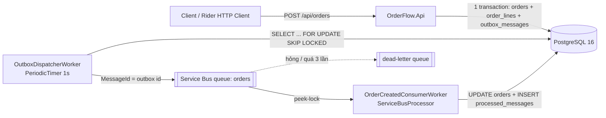

# Lab: OrderFlow trên .NET 8 — API + Worker + PostgreSQL + Azure Service Bus + Docker, 24 test chạy thật

Code hoàn chỉnh của các bài [01–12](../README.md). Bạn **tự gõ lại theo bài** trong một thư mục riêng; thư mục này để
**so sánh** khi bị kẹt, hoặc mở thẳng trong Rider để chạy thử trước khi học.

```bash
cd tutorial/dotnet8-rider/lab/OrderFlow
docker compose up -d                          # Postgres 16 + Service Bus emulator (+ SQL Edge mà emulator cần)
dotnet test                                   # 10 unit test + 14 integration test trên Postgres thật (Testcontainers)
docker compose --profile app up -d --build    # thêm migrate, api, worker: cả hệ thống trong Docker
./scripts/smoke-test.sh                       # tạo 2 đơn, đợi Worker xử lý, in kết quả
```

**Cần gì:** .NET 8 SDK (8.0.100 trở lên, xem [`global.json`](OrderFlow/global.json)), Docker Desktop đang chạy,
khoảng 1 GB RAM trống cho các container (đo thật: 825 MiB, [`results/docker-stats.txt`](OrderFlow/results/docker-stats.txt)).
Cài đặt từng bước: [bài 01](../01-cai-dat-macos.md).

---

## Có gì trong lab

```text
lab/
├── OrderFlow/                          ← solution chính (bài 06–12)
│   ├── OrderFlow.sln, global.json
│   ├── docker-compose.yml              ← hạ tầng mặc định; profile "app" thêm migrate/api/worker
│   ├── servicebus/config.json          ← queue "orders", "demo"; topic "order-events" (emulator đọc lúc khởi động)
│   ├── src/
│   │   ├── OrderFlow.Core/             ← domain, EF Core + Npgsql, migration, outbox, Service Bus, handler
│   │   ├── OrderFlow.Api/              ← ASP.NET Core Web API (controller), ProblemDetails, health check, Dockerfile
│   │   └── OrderFlow.Worker/           ← Worker Service: OutboxDispatcherWorker + OrderCreatedConsumerWorker, Dockerfile
│   ├── tests/
│   │   ├── OrderFlow.UnitTests/        ← 10 test domain, không cần gì ngoài .NET
│   │   └── OrderFlow.IntegrationTests/ ← 14 test: API thật trong bộ nhớ + PostgreSQL 16 thật qua Testcontainers
│   ├── scripts/smoke-test.sh           ← kiểm tra end-to-end khi chạy cả hệ thống
│   └── results/                        ← output thật: test, thí nghiệm test, coverage, package lỗ hổng, smoke test,
│                                         compose ps, kích thước image, RAM, nâng .NET 10
├── steps/                              ← file bản tạm của bài 06–09 + verify-steps.sh: dựng lại lab từ thư mục trống
├── bootstrap/new-dotnet8-service.sh    ← bài 12: dựng khung một service .NET 8 mới bằng một lệnh
└── playground/                         ← project nhỏ cho bài 03, 04, 09
    ├── CSharpBasics/                   ← 10 phần cú pháp C#: dotnet run -- linq
    ├── DebugDrill/                     ← chương trình cài sẵn 5 lỗi để luyện debugger
    ├── ServiceBusDemo/                 ← 7 thí nghiệm Service Bus: peek-lock, retry, DLQ, duplicate, topic
    └── results/                        ← output thật của CSharpBasics
```

## Luồng của hệ thống



1. API nhận đơn, ghi **đơn + dòng outbox trong cùng một transaction** (có đơn thì chắc chắn có message), trả `201`.
2. Worker mỗi giây khoá một lô dòng outbox chưa gửi, gửi lên queue `orders` với `MessageId` = id dòng outbox.
3. Consumer nhận message (peek-lock), xử lý đơn (≤ 50.000.000 thì `Confirmed`, lớn hơn thì `Rejected`), ghi
   `processed_messages` trong cùng transaction rồi mới `Complete`. Message hỏng thì đưa thẳng vào dead-letter.

## Kết nối

| | Từ máy Mac (chạy app trong Rider) | Từ container trong compose |
|---|---|---|
| PostgreSQL | `Host=localhost;Port=5432;Database=orderflow;Username=orderflow;Password=orderflow` | `Host=postgres;...` |
| Service Bus | `Endpoint=sb://localhost;SharedAccessKeyName=RootManageSharedAccessKey;SharedAccessKey=SAS_KEY_VALUE;UseDevelopmentEmulator=true;` | `Endpoint=sb://servicebus;...` |
| API | `http://localhost:5080` (launch profile `http`), Swagger `/swagger` | `http://localhost:8080` khi chạy bằng compose |
| Emulator health | `http://localhost:5300/health` | |

```bash
docker compose exec postgres psql -U orderflow -d orderflow -c 'select id, status, total from orders'
docker compose logs -f worker                 # xem Worker xử lý
docker compose --profile app down -v          # xoá sạch, kể cả dữ liệu Postgres
```

## Kết quả thật đã chạy (21/10/2026, .NET SDK 8.0.426, runtime 8.0.32)

| Kiểm tra | Kết quả | File |
|---|---|---|
| `dotnet test` | 24/24 pass: 10 unit, 14 integration (16 giây, gồm khởi động container Postgres) | [`test-output.txt`](OrderFlow/results/test-output.txt) |
| Cả hệ thống bằng compose, từ volume trắng | `up` → smoke test OK sau 40 giây; Worker xử lý 2 đơn sau 2 giây | [`smoke-test.txt`](OrderFlow/results/smoke-test.txt) |
| Image | api 341 MB, worker 304 MB (aspnet:8.0 là 321 MB, runtime:8.0 là 285 MB) | [`image-sizes.txt`](OrderFlow/results/image-sizes.txt) |
| Service Bus tắt khi đang tạo đơn | đơn giữ `Pending`, outbox ghi 20 lần thử lỗi; emulator lên lại thì `Confirmed` sau 39 giây, không mất message | bài 09 §8 |
| Bỏ khối `catch` unique violation trong handler | test tất định fail 5/5 với `23505 duplicate key ... pk_processed_messages`; test song song chỉ fail 1–2/5 khi chạy cả bộ | [`test-experiments.txt`](OrderFlow/results/test-experiments.txt), bài 11 §6.3 |
| Coverage (gộp unit + integration, bỏ migration) | line 83,2%, branch 71,7%; Service Bus 0% | [`coverage-summary.txt`](OrderFlow/results/coverage-summary.txt) |
| `dotnet list package --vulnerable --include-transitive` | 0 lỗ hổng (trước khi nâng `xunit` 2.5.3 → 2.9.3: 2 gói bắc cầu mức High) | [`package-audit.txt`](OrderFlow/results/package-audit.txt) |
| Nâng lên .NET 10 (bản sao) | 0 warning, 24/24 test, API chạy | [`net10-upgrade.txt`](OrderFlow/results/net10-upgrade.txt) |
| Dựng lại từ thư mục trống theo bài 06 → 11 | mọi file giống hệt lab | [`verify-steps-output.txt`](steps/verify-steps-output.txt) |
| `bootstrap/new-dotnet8-service.sh` | 64 giây: 0 warning, test xanh, 0 lỗ hổng, `dotnet format` sạch | [`bootstrap-output.txt`](bootstrap/bootstrap-output.txt) |

## Ranh giới trung thực

- **Đã chạy thật trong môi trường Linux x64** (container Ubuntu 24.04): build, 24 test, migration, API + Worker chạy
  trên máy và trong Docker, emulator Service Bus, file `.http` (bằng JetBrains HTTP Client CLI, 6/6 request).
- **Chưa chạy trên macOS/Apple Silicon.** Các image đã kiểm có bản `arm64`: `servicebus-emulator`, `azure-sql-edge`,
  `postgres:16-alpine`, `dotnet/aspnet:8.0`, `dotnet/runtime:8.0`, `dotnet/sdk:8.0` — nên chạy native trên chip Apple, không cần Rosetta.
- **Docker build trong môi trường kiểm chứng** phải đi qua proxy có CA riêng, nên build bằng bản sao Dockerfile thêm
  đúng 2 dòng tin CA đó; Dockerfile trong repo không có 2 dòng này và không cần chúng trên máy bạn.
- **Giao diện Rider** (menu, hộp thoại) không chạy được ở đây vì không có màn hình; mọi bước Rider trong bài đều kèm
  lệnh CLI tương đương đã chạy thật.
